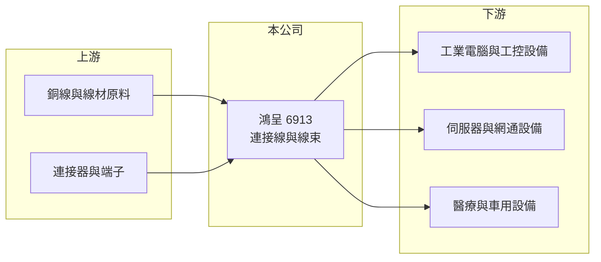

# 6913 鴻呈

> 上櫃｜[[產業索引-電子零組件業|電子零組件業]]｜上市（櫃）日期 2024/10/01

# 第一章：企業模式與商業藍圖

> [!info] 撰寫說明
> 精簡版，由 Claude 依公開資料整理，架構比照 [[2330台積電]]，資料截至 2026-10-08。來源：櫃買中心開放資料快照（基本資料、2026 年第二季資產負債與損益、本益比殖利率）、Goodinfo 經營績效頁、nStock 公司簡介、財經媒體報導標題。營收比重與客戶未查得，公開資料有限，應用描述部分依記憶整理並標註待校對。#待校對

鴻呈實業（以下簡稱鴻呈）是一家做[[連接線]]與[[線束]]的公司，理解它的關鍵在於：線材看似簡單，但工業、醫療與伺服器客戶要的是少量多樣、規格嚴格且供貨穩定的客製化產品，這才是它的生意本質。

- **核心業務：** 鴻呈成立於 1994 年，總部在新北市中和，2024 年 10 月在櫃買中心掛牌，實收資本額約 4.38 億元，董事長為簡忠正、總經理為林星宏。依 nStock 的公司介紹，主要產品是應用在智慧物聯網、雲端、工業控制、醫療與車用的連接線材。這類產品多半依客戶設計圖客製，從線材、端子到組裝都要配合客戶的系統規格。
- **營收結構：** 產品別與地區別比重未查得。依 2024 年科技新報的報導標題，鴻呈有發展伺服器用的[[高速傳輸線]]，代表產品組合正從一般工業線材往資料中心延伸（細節待校對）。高速線材對訊號完整性要求高，單價與技術門檻都比一般電源線高。
- **營運據點：** 生產基地在中國大陸與越南，2026 年公告對越南河內子公司 VSOVN ELECTRONICS (HANOI) 增資。在「中國加一」的供應鏈調整下，越南產能讓歐美客戶可以把訂單留在中國以外，是鴻呈接單的重要條件。
- **長期方向：** 長期成長動能來自兩條線：一是伺服器與網通設備的高速線材，二是醫療、工控等長生命週期產品。前者帶來量的成長，後者提供穩定的毛利，兩者搭配可以降低單一終端景氣的影響（推估）。

# 第二章：護城河深度與競爭優勢

鴻呈的護城河屬於窄護城河，來自客製化能力、客戶認證與多國產能配置，而不是規模或專利。

- **競爭優勢：** 工業與醫療客戶一旦完成線材驗證，通常會沿用同一供應商到產品停產，這類產品生命週期可長達 5 至 10 年，轉換成本高。鴻呈能同時做少量多樣的工業線材與量較大的資訊線材，加上中國與越南雙產地，讓客戶在地緣政治變化時有彈性。2022 年毛利率曾達 35.6%，顯示在供應吃緊時具備一定的議價能力。
- **主要對手：** 台灣線材與連接器同業包括 [[3665貿聯-KY]]、[[3023信邦]]、[[6290良維]]、[[6197佳必琪]] 與 [[3533嘉澤]]，這些公司規模多數大於鴻呈。貿聯與信邦在工業、醫療與車用線束布局最完整，是定位最接近的對手；伺服器高速線則面對國際大廠與中國線材廠的價格競爭。
- **觀察重點：** 長期要追蹤毛利率能否穩定在 27% 至 30% 以上，以及高速線材與越南產能在營收中的比重。若高階產品比重提升且越南廠利用率上升，代表公司正從代工線材往技術型線材供應商轉型。

# 第三章：財務體質與盈利規模

資料日期：2026-10-08，表格是撰寫當時的快照；最新月營收、毛利率、累計 EPS 由自動排程寫在本筆記的屬性欄位（月營收、毛利率、累計EPS 等）。#待校對

鴻呈的財務特色是營收穩定成長、獲利隨產品組合波動，2026 年上半年利潤率明顯改善。

| 年度 | 營收（億元） | [[毛利率]] | [[營業利益率]] | EPS（元） | [[ROE]] |
|---|---|---|---|---|---|
| 2020 | 19.9 | 22.4% | 10.1% | 3.31 | 20.8% |
| 2021 | 21.2 | 23.1% | 10.1% | 3.47 | 22.1% |
| 2022 | 22.7 | 35.6% | 19.7% | 10.89 | 41.3% |
| 2023 | 18.2 | 24.8% | 8.15% | 3.05 | 11.3% |
| 2024 | 21.6 | 27.4% | 10.4% | 4.78 | 14.9% |
| 2025 | 26.3 | 27.1% | 9.97% | 4.34 | 12.6% |
| 2026 上半年 | 16.1 | 30.0% | 13.8% | 4.11 | 未查得 |

（來源：Goodinfo 經營績效頁；2026 上半年依櫃買中心開放資料計算。）

- **營收規模：** 2020 至 2025 年營收由 19.9 億元增至 26.3 億元，年複合成長率約 5.7%（推算），2023 年曾因客戶庫存調整下滑約兩成。2026 年 1 至 9 月營收約 26.0 億元，年增約 33%，已接近 2025 年全年。
- **獲利：** 2021 至 2025 年平均 ROE 約 20.4%（推算），但 2022 年的 41.3% 屬特殊高峰，扣除後約 15%。2026 年上半年毛利率約 30.0%、營業利益率約 13.8%，高於 2023 至 2025 年水準，推估與高階線材比重提高有關。
- **財務特色：** 2026 年第二季總資產約 37.6 億元、權益總計約 18.3 億元、負債約 19.3 億元，權益比約 49%。最近一次現金股利每股 2.5 元，約為 2025 年 EPS 4.34 元的 58%（推算）；2024 年另有 0.5 元股票股利。自由現金流是否長期為正未查得。
- **[[ROIC]] 與 [[WACC]]：** 以 2025 年營業利益約 2.62 億元（26.3 億元 × 9.97%）、稅率 20% 計算，稅後營業利益約 2.10 億元。有息負債未查得，投入資本以權益 18.3 億元到「權益加全部負債」37.6 億元為區間，ROIC 約 5.6% 至 11.5%（推算）；2026 年上半年年化後約 9.5% 至 19.5%（推算）。WACC 以 CAPM 推估：無風險利率 1.75%、市場風險溢酬 6%、β 假設 1.1（電子零組件中小型股常見值），權益成本約 8.4%；稅後負債成本假設 2%、負債占三成，WACC 約 6.4%（推算）。ROIC 大致高於 WACC，代表鴻呈長期能創造經濟價值，2026 年利差擴大。

# 第四章：總體風險與地緣政治

鴻呈的風險主要來自終端景氣、客戶集中與原物料價格。

- **產業週期：** 線材需求跟著工業電腦、網通與伺服器的出貨循環走，2023 年營收下滑約兩成、營業利益率由 19.7% 降到 8.2% 就是例子。客戶在景氣反轉時會先消化庫存，上游線材廠的訂單波動往往大於終端需求。
- **營運風險：** 客製化線材的接單模式是少量多樣，產能排程與良率管理不好會壓低毛利。客戶名單與集中度未查得，若少數大客戶轉單，影響會直接反映在營收（待校對）。越南新產能爬坡初期，折舊與人力成本也可能暫時壓抑獲利。
- **其他風險：** 銅價是線材的主要成本，銅價大漲時若無法即時轉嫁，毛利率會下滑。產品多數外銷、以美元報價，新台幣升值會影響換算後的營收與毛利。中國與越南兩地的關稅與勞動法規變化，也會影響生產成本。

# 專有名詞解析

## 產業

- **[[連接線]]**：兩端裝有連接器、用來傳輸電源或訊號的線材，是各種電子設備內外部連接的基本零件。
- **[[線束]]**：把多條電線、端子與連接器依設計組合成一束的組件，常見於汽車、工業與醫療設備。
- **[[高速傳輸線]]**：用於伺服器與交換器、支援高頻寬訊號的銅纜或主動式線材，對訊號完整性要求高。

# 核心供應鏈

- 上游：銅線、絕緣材料與連接器、端子供應商，連接器例如 [[3533嘉澤]]、[[6279胡連]] 所在的產業（實際供應商未查得，#待校對）。
- 下游／客戶：工業電腦廠（例如 [[2395研華]]、[[6414樺漢]] 所在的產業）、伺服器與網通設備廠（例如 [[2382廣達]]、[[6669緯穎]] 所在的產業）與醫療設備廠；是否為鴻呈客戶未查得，#待校對。
- 同業：[[3665貿聯-KY]]、[[3023信邦]]、[[6290良維]]、[[6197佳必琪]]。

## 最新新聞
<!-- news:start -->
<!-- news:end -->

## 相關連結
- [公開資訊觀測站](https://mopsov.twse.com.tw/mops/web/t05st03?step=1&firstin=1&co_id=6913)
- [Goodinfo](https://goodinfo.tw/tw/StockDetail.asp?STOCK_ID=6913)
- [Yahoo 股市](https://tw.stock.yahoo.com/quote/6913)
- [鉅亨網新聞](https://www.cnyes.com/twstock/6913/news)
