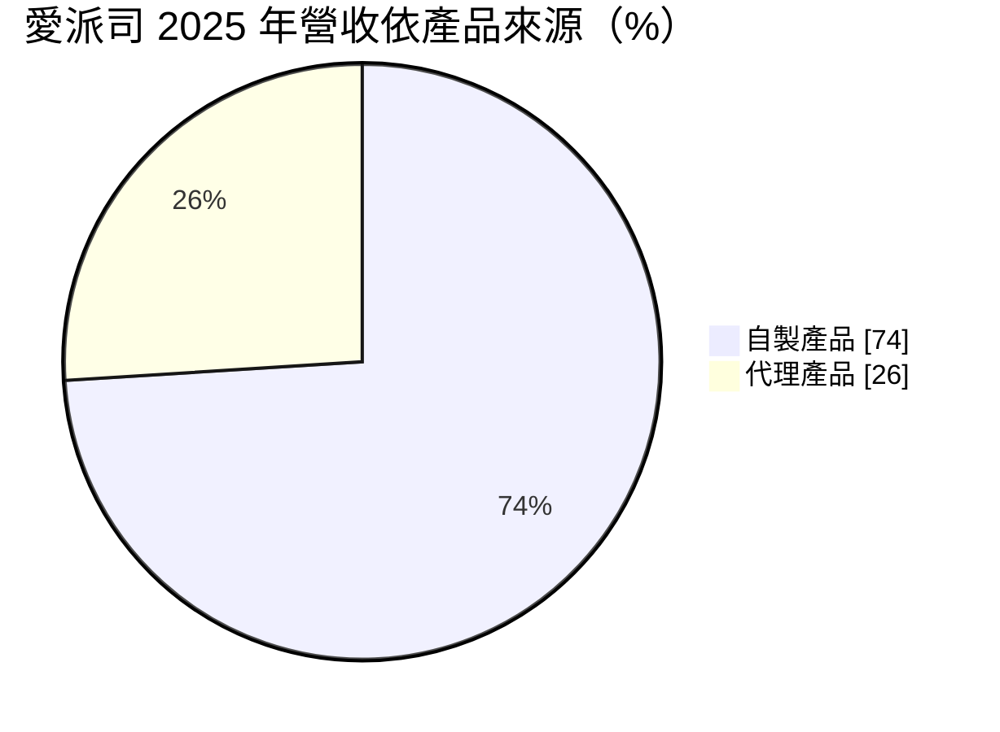
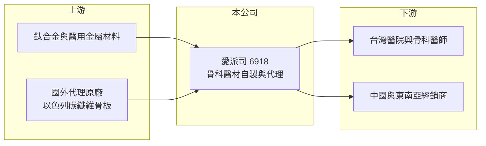

# 6918 愛派司

> 上市｜[[產業索引-生技醫療業|生技醫療業]]｜上市（櫃）日期 2025/06/10

# 第一章：企業模式與商業藍圖

> [!info] 撰寫說明
> 精簡版，由 Claude 依公開資料整理，架構比照 [[2330台積電]]，資料截至 2026-10-08。來源：證交所開放資料快照（基本資料、2026 年第二季財報與營益分析、2025 年度股利、2026 年 8 月營收）、Goodinfo 經營績效頁、富果 2026 年 8 月法說會摘要。#待校對

愛派司是一家以骨科醫材為主的台灣中型醫材公司，理解它要看「自製高毛利產品」與「代理產品擴充科別」兩條線如何互相支撐，以及海外市場的拓展。

- **核心業務：** 愛派司研發、製造並銷售骨科與骨外科醫材，自製產品包括拇指外翻矯正系統、保膝產品等，另外代理以色列的碳纖維骨板等產品。自製產品掌握設計與製造，毛利率高；代理產品則讓公司不必自己研發，就能擴大對醫院的產品線。兩者結合，使業務團隊每次拜訪醫師都能提供更完整的解決方案。
- **營收結構：** 2025 年自製產品占營收 74%、代理產品占 26%，代理產品營收年增 66%，比重較 2024 年的 17% 明顯提高。依地區，2026 年上半年台灣占 75%、海外（中國與東南亞）占 25%。非骨科產品已占台灣營收約 10%，代表公司正從單一科別往外科整體延伸。

- **營運據點：** 公司設立於 2009 年 9 月，總部位於新北市中和，2025 年 6 月 10 日上市，實收資本額約 3.46 億元。海外透過經銷商經營中國、泰國、香港、越南等市場。
- **長期方向：** 公司預估未來 2 至 3 年海外營收每年成長 20% 以上，並規劃 2027 年有 2 張自製產品在台取證、申請美國 FDA 許可。長期策略是持續改善製程降低成本，以因應中國[[帶量採購]]與東南亞的價格競爭，同時提高非骨科產品比重。

# 第二章：護城河深度與競爭優勢

骨科醫材市場由國際大廠主導，本章說明愛派司如何在利基產品與在地服務上建立護城河。

- **競爭優勢：** 骨科植入物需要醫師熟悉手術器械與操作流程，一旦醫師習慣某套系統，轉換意願低，這是醫材業典型的轉換成本。愛派司在新加坡與林口長庚醫院舉辦大體手術訓練課程，透過醫師教育建立使用習慣。自製產品毛利率約七成，代表產品設計與成本控制具有定價能力。
- **主要對手：** 國際大廠如史賽克（Stryker）、捷邁邦美（Zimmer Biomet）、嬌生旗下 DePuy Synthes 在產品線與品牌上遠大於愛派司（對手名單為產業常識整理，待校對）。台股同業有 [[4129聯合]]（人工關節）、[[4163鐿鈦]]（骨科與牙科代工）。愛派司的定位是在特定術式做出差異化，而不是全面對抗大廠。
- **觀察重點：** 中國非帶量採購產品已占中國營收 70%，未來集採範圍若擴大，價格壓力會加大。另一個重點是美國 FDA 取證能否如期完成，這將決定公司能否進入全球最大的骨科市場。

# 第三章：財務體質與盈利規模

資料日期：2026-10-08，表格是撰寫當時的快照；最新月營收、毛利率、累計 EPS 由自動排程寫在本筆記的屬性欄位（月營收、毛利率、累計EPS 等）。#待校對

醫材公司的財務品質主要看毛利率能否穩定維持，以及營收成長是否伴隨營業利益率提升，本章用多年度數據檢視愛派司。

| 年度 | 營收（億元） | [[毛利率]] | [[營業利益率]] | EPS（元） | [[ROE]] |
|---|---|---|---|---|---|
| 2020 | 5.03 | 63.2% | 8.45% | 1.26 | 5.06% |
| 2021 | 5.42 | 63.9% | 8.63% | 1.15 | 4.41% |
| 2022 | 6.15 | 60.4% | 10.9% | 1.50 | 5.31% |
| 2023 | 6.75 | 68.2% | 24.8% | -0.37 | -1.33% |
| 2024 | 7.70 | 69.5% | 23.7% | 4.99 | 17.3% |
| 2025 | 8.36 | 68.6% | 25.0% | 5.16 | 15.5% |
| 2026 上半年 | 4.62 | 66.3% | 24.7% | 3.03 | 未查得 |

- **營收規模：** 營收從 2020 年的 5.03 億元成長到 2025 年的 8.36 億元，年複合成長率約 10.7%（推算）。成長來自自製產品放量、代理產品擴充與海外市場，屬於穩健型成長。
- **獲利：** 2023 年起營業利益率由一成左右跳升到 25% 上下，顯示產品組合改善與規模經濟發揮效果。2023 年營業利益良好但 EPS 為負，推估受業外或一次性因素影響，原因未查得。2026 年上半年稅後淨利約 1.04 億元、EPS 3.03 元。
- **財務特色：** 2026 年第二季底股東權益約 12.03 億元、負債約 3.46 億元，負債比約 22%，財務保守。2025 年度配發現金股利 5 元，其中盈餘配發 3.5 元、資本公積配發 1.5 元，盈餘配發率約 68%（以 EPS 5.16 元推算）。
- **[[ROIC]] 與 [[WACC]]：** 以 2026 年上半年營業利益 1.14 億元年化為 2.28 億元，扣 20% 稅後約 1.83 億元，除以投入資本 12.03 至 13.65 億元（股東權益，加上最多 1.62 億元非流動負債，有息負債實際金額未查得），ROIC 約 13% 至 15%（推算）。WACC 以 CAPM 推估：無風險利率 1.75%、市場風險溢酬 6%、β 取醫材同業常見的 0.9（假設值），股權成本約 7.2%，負債比重低，WACC 約 7%（推算）。ROIC 高於 WACC 約 6 至 8 個百分點，代表公司近年確實在創造價值。
- **長期指標：** 近 5 年（2021 至 2025 年）ROE 平均約 8.2%（推算），但 2024 年起已穩定在 15% 以上；毛利率長期維持六成以上，是最重要的長期特徵。

# 第四章：總體風險與地緣政治

醫材公司的風險主要來自法規、價格政策與海外市場，本章分別說明。

- **產業週期：** 骨科手術需求與人口老化相關，景氣循環影響小，但疫情等事件會讓非急迫手術延後。整體需求長期向上，波動主要來自政策與通路。
- **營運風險：** 中國帶量採購會大幅壓低得標產品價格，2025 年公司已策略性減少中國低毛利產品出貨。越南市場曾因證照更新於 2025 年底暫停出貨，2026 年上半年才解決，顯示海外證照管理是持續性的風險。代理產品比重提高後，若原廠收回代理權，營收會受影響。
- **其他風險：** 台灣健保對醫材的給付與自付差額規定會影響產品定價。海外營收以外幣計價，有匯率風險。

# 專有名詞解析

## 產業

- **[[帶量採購]]**：中國由政府集中招標、以採購量換取低價的醫療採購制度，得標價常大幅低於原價。
- **[[骨科植入物]]**：植入人體用來固定或取代骨骼、關節的醫材，例如骨板、骨釘、人工關節。
- **[[醫材許可]]**：醫療器材上市前須取得的主管機關核准，例如台灣 TFDA 許可證、美國 FDA 510(k) 或 PMA。
- **[[代理產品]]**：公司取得國外原廠授權，在特定地區銷售的產品，無須自行研發但毛利率通常較低。

# 核心供應鏈

- 上游：醫用鈦合金等金屬材料供應商，以及以色列碳纖維骨板等代理原廠（個別名稱未查得）。
- 下游／客戶：台灣各級醫院骨科、林口長庚等教學醫院，以及中國、泰國、香港、越南的經銷商。
- 同業：[[4129聯合]]、[[4163鐿鈦]]；國際大廠史賽克、捷邁邦美。

## 最新新聞
<!-- news:start -->
<!-- news:end -->

## 相關連結
- [公開資訊觀測站](https://mopsov.twse.com.tw/mops/web/t05st03?step=1&firstin=1&co_id=6918)
- [Goodinfo](https://goodinfo.tw/tw/StockDetail.asp?STOCK_ID=6918)
- [Yahoo 股市](https://tw.stock.yahoo.com/quote/6918)
- [鉅亨網新聞](https://www.cnyes.com/twstock/6918/news)
