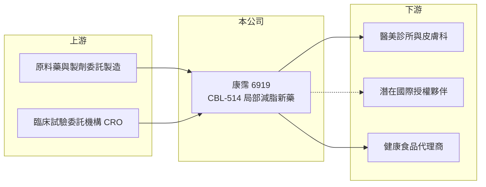

# 6919 康霈

> 上市｜[[產業索引-生技醫療業|生技醫療業]]｜上市（櫃）日期 2024/10/02

# 第一章：企業模式與商業藍圖

> [!info] 撰寫說明
> 精簡版，由 Claude 依公開資料整理，架構比照 [[2330台積電]]，資料截至 2026-10-08。來源：證交所開放資料快照（基本資料、2026 年第二季財報與營益分析、股利、2026 年 8 月營收）、Goodinfo 經營績效頁、蕃新聞轉載之公司 2026 年 5 月新聞稿。競爭產品部分憑記憶整理，已標「待校對」。#待校對

康霈是台灣少數以醫美適應症開發全新小分子新藥的公司，理解它的關鍵在於單一核心藥物 CBL-514 的臨床進度，以及上市募得的大筆資金如何支撐三期試驗。

- **核心業務：** 康霈的核心產品 CBL-514 是自行研發的全新小分子注射藥物，屬於美國 [[505(b)(1)]] 新成分新藥路線，作用機轉是誘導注射部位的脂肪細胞凋亡，達到非手術的[[局部減脂]]。適應症包括減少皮下脂肪與中重度橘皮組織，同成分不同劑型的 CBL-514D 另鎖定罕見疾病竇根氏症。醫美市場以自費為主、不受健保定價限制，若成功上市，定價空間與市場規模都相當可觀。
- **營收結構：** 新藥仍在研發階段，目前營收來源是健康食品銷售，僅在出貨給代理商的月份認列，2025 年營收約 0.38 億元。這部分營收規模小，對公司價值影響有限，主要作用是維持品牌與通路。
- **營運據點：** 公司於 2012 年 10 月創立，2024 年 10 月 2 日上市，實收資本額約 7.79 億元。研發在台灣，三期臨床則在美國、加拿大與澳洲進行。
- **長期方向：** CBL-514 已完成 10 項臨床試驗、累計 544 名受試者，兩項二期 b 試驗皆達標。第二項全球樞紐三期試驗 CBL-0302 於 2026 年 5 月通過美國 FDA 的 IND 30 天審查，預計納入約 320 位受試者，與 CBL-0301 同步推進，公司預計 2026 年開始收案、2027 年取得統計結果，作為後續新藥查驗登記的依據。

# 第二章：護城河深度與競爭優勢

康霈的護城河來自全新分子的專利與臨床數據，但也面臨醫美市場多種替代療法的競爭，本章說明兩者的平衡。

- **競爭優勢：** CBL-514 是全新成分，可取得較完整的專利與新藥資料專屬期保護，競爭者難以直接仿製。公司宣稱它是全球首創以誘導脂肪細胞凋亡方式減脂的藥物，若三期結果與二期一致，可望在「不開刀、恢復期短」的醫美需求中占有一席之地。
- **主要對手：** 同樣是注射溶脂的有艾伯維旗下 Kybella（以去氧膽酸溶解下巴脂肪），器械類有冷凍溶脂與抽脂手術（憑記憶，待校對）。近年 [[GLP-1]] 減重藥物普及，雖然是全身減重而非局部塑形，但會影響消費者對減脂療程的需求，是間接競爭。
- **觀察重點：** 兩項三期試驗的收案速度與 2027 年的統計結果最為關鍵。2025 年 9 月公司宣布三期時程延後，市場反應劇烈（依報導標題與日期），顯示時程的可信度本身就是估值的重要因素。此外，公司是否尋求國際授權或自建通路，也會決定上市後的獲利模式。

# 第三章：財務體質與盈利規模

資料日期：2026-10-08，表格是撰寫當時的快照；最新月營收、毛利率、累計 EPS 由自動排程寫在本筆記的屬性欄位（月營收、毛利率、累計EPS 等）。#待校對

新藥公司在上市前的財務重點是研發支出規模與現金存量，本章用多年度數據觀察康霈的資金狀況。

| 年度 | 營收（億元） | [[毛利率]] | [[營業利益率]] | EPS（元） | [[ROE]] |
|---|---|---|---|---|---|
| 2021 | 0.12 | 74.8% | -1870% | -3.41 | -64.9% |
| 2022 | 0.13 | 74.9% | -2493% | -4.89 | -31.6% |
| 2023 | 0.39 | 70.6% | -1319% | -3.94 | -19.9% |
| 2024 | 0.44 | 69.2% | -1614% | -4.12 | -8.76% |
| 2025 | 0.38 | 69.7% | -1859% | -0.23 | -3.68% |
| 2026 上半年 | 0.04 | 65.3% | 未具意義 | -0.21 | 未查得 |

- **營收規模：** 健康食品營收每年僅數千萬元，毛利率約七成，但對整體損益影響很小。營業利益率因營收過小而呈現極端負值，不具比較意義。
- **獲利：** 2026 年上半年營業損失約 5.09 億元，但業外收入約 1.79 億元（推估主要為利息收入），稅後淨損縮小為約 3.30 億元。2025 年第四季甚至因業外收入單季獲利約 0.80 億元，顯示大額現金部位的利息可以部分抵銷研發支出。EPS 由 2024 年的 -4.12 元變為 2025 年的 -0.23 元，主要反映股數大幅增加與業外收入，並非本業轉佳；依股本與每股淨值推算，每股面額可能不是 10 元（待校對）。
- **財務特色：** 2026 年第二季底股東權益約 92.07 億元、負債僅約 2.24 億元，資金主要來自上市前後的募資。以上半年營業損失速度推算，每年研發等支出約 10 億元，現有資金足以支撐兩項三期試驗（推算）。
- **[[ROIC]] 與 [[WACC]]：** 以 2026 年上半年營業損失 5.09 億元年化為 10.18 億元，除以股東權益 92.07 億元（幾乎無有息負債），ROIC 約 -11%（推算）。WACC 以 CAPM 推估：無風險利率 1.75%、市場風險溢酬 6%、β 取研發型生技常見的 1.3（假設值），公司幾乎無負債，WACC 約 9.5% 至 10%（推算）。ROIC 為負，代表目前仍在投入期，資本能否創造價值完全取決於 CBL-514 上市後的銷售或授權收入。
- **長期指標：** 近 5 年（2021 至 2025 年）ROE 平均約 -26%（推算），未配發現金股利，本業自由現金流長期為負。

# 第四章：總體風險與地緣政治

單一產品的新藥公司風險集中，本章從臨床、市場與法規三個面向說明。

- **產業週期：** 醫美療程屬自費消費，景氣差時需求會受影響，但新藥上市前公司營收不受此影響。生技資本市場的資金行情則會影響公司估值與未來募資條件。
- **營運風險：** 公司價值高度集中在 CBL-514，三期結果若未達主要療效指標，或時程再度延後，衝擊會非常大。三期試驗以 MRI 量測腹部脂肪體積與受試者自評量表為主要指標，兩者都需達標才有利於後續上市申請。
- **其他風險：** 美國 FDA 對美容適應症藥物的安全性要求嚴格，上市後也可能面臨副作用監測。GLP-1 減重藥普及可能改變消費者對局部減脂的需求。海外臨床費用以美元支付，有匯率影響。

# 專有名詞解析

## 產業

- **[[505(b)(1)]]**：美國 FDA 的全新成分新藥申請路徑，需要完整的臨床前與臨床試驗資料。
- **[[局部減脂]]**：以注射、冷凍或手術方式減少特定部位脂肪的醫美療程，不等同於全身減重。
- **[[樞紐三期試驗]]**：新藥上市前規模最大、作為核准依據的臨床試驗，通常需要數百名以上受試者。
- **[[IND]]**：試驗中新藥申請，向主管機關申請在人體進行臨床試驗的程序。
- **[[GLP-1]]**：一類模擬腸道荷爾蒙的藥物，可降低食慾與血糖，近年廣泛用於糖尿病與減重。

# 核心供應鏈

- 上游：原料藥與注射劑委託製造廠，以及在美國、加拿大、澳洲執行三期試驗的 CRO（個別名稱未查得）。
- 下游／客戶：目前為健康食品代理商；新藥上市後的客戶為醫美診所與皮膚科醫師，或國際授權夥伴。
- 同業：台股醫美相關的 [[4728雙美]]、[[1786科妍]]；新藥研發的 [[6576逸達]]、[[6446藥華藥]]。

## 最新新聞
<!-- news:start -->
<!-- news:end -->

## 相關連結
- [公開資訊觀測站](https://mopsov.twse.com.tw/mops/web/t05st03?step=1&firstin=1&co_id=6919)
- [Goodinfo](https://goodinfo.tw/tw/StockDetail.asp?STOCK_ID=6919)
- [Yahoo 股市](https://tw.stock.yahoo.com/quote/6919)
- [鉅亨網新聞](https://www.cnyes.com/twstock/6919/news)
