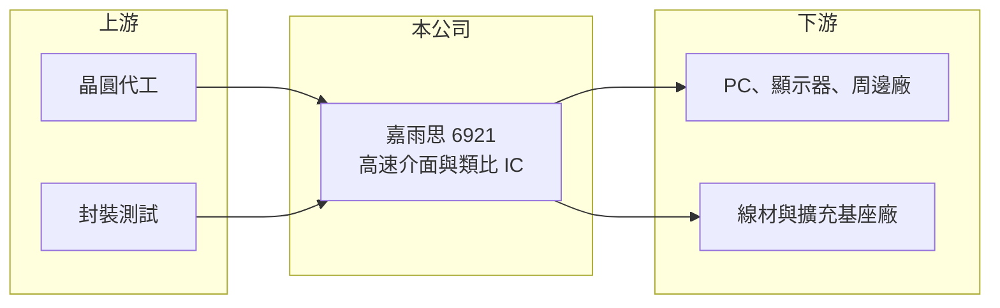

# 6921 嘉雨思-創

> 創新板｜[[產業索引-半導體業|半導體業]]｜上市（櫃）日期 2025/12/23

# 第一章：企業模式與商業藍圖

> [!info] 撰寫說明
> 精簡版，由 Claude 依公開資料整理，架構比照 [[2330台積電]] 的四章研究，資料截至 2026-10-08。來源：Goodinfo 年度經營績效頁、nStock 公司簡介、證交所開放資料（基本資料、2026 年第二季資產負債與綜合損益、營益分析、股利、每月營收）。創新板／新掛牌，公開資料有限；具體產品型號、應用與客戶未查得，產品類別描述多為推估。#待校對

嘉雨思科技是 2025 年底才掛牌的小型高速介面 IC 設計公司，本章說明它的業務定位與長期方向。

## 一、核心定位：高速訊號傳輸介面的 IC 設計公司

嘉雨思成立於 2020 年，總部位於新北市中和，2025 年 12 月在證交所[[創新板]]掛牌，實收資本額約 3.2 億元，董事長朱德祥（證交所開放資料）。公司主要業務是高速訊號傳輸介面及高速類比電路的設計、開發、生產與銷售（nStock）。

* **[[Fabless]] 模式：** 公司自行設計晶片，把晶圓製造與封裝測試外包，資本支出低，核心資產是電路設計人才與專利。
* **高速介面的角色：** 電腦、顯示器、伺服器與各種周邊之間的資料傳輸速度越來越快，訊號在線路上傳得越遠衰減越嚴重，需要專門晶片把訊號放大、整形或重新產生。這類晶片常見的有 [[Redriver]] 與 [[Retimer]]（嘉雨思的實際產品類別為推估，待校對）。

## 二、市場位置

高速介面晶片涵蓋 USB、DisplayPort、HDMI、PCIe 等規格，每次規格升級（例如傳輸速度倍增）都會帶來新一輪換晶片需求。小型設計公司的機會在於搶先推出新規格的利基產品，或專攻大廠不願投入的特定應用。公司毛利率在 2023 至 2025 年約 57% 至 73%（Goodinfo），顯示產品具一定技術含量；但營收規模只有 1 至 2 億元，仍處於早期階段。

## 三、長期方向

公司營收從 2021 年的 0.63 億元成長到 2025 年的 1.95 億元（Goodinfo），但 2026 年 1 至 8 月累計約 0.68 億元，較去年同期約 1.32 億元減少近五成（證交所每月營收）。長期能否成長，取決於新規格產品能否打進主要客戶，以及能否從單一產品擴展成完整產品線。

# 第二章：護城河深度與競爭優勢

高速介面晶片市場由少數大廠主導，本章分析嘉雨思的優勢與挑戰。

## 一、護城河的核心組成要素

* **高速類比設計能力：** 高速介面需要處理訊號完整性與雜訊問題，類比電路設計人才稀缺，是新進者最難跨越的門檻。
* **高毛利產品：** 毛利率長期在五成以上，代表產品不是純價格競爭的通用晶片。
* **輕資本結構：** 幾乎沒有負債、資本支出低，研發失敗時的財務衝擊相對有限。

## 二、主要競爭對手

| 對手 | 定位 | 對嘉雨思的威脅 |
|---|---|---|
| [[4966譜瑞-KY]] | 高速介面與顯示時序控制晶片大廠 | 產品線完整、客戶關係深 |
| [[5269祥碩]] | USB 與 PCIe 高速介面晶片 | 在 USB 高速傳輸市場領先 |
| [[6756威鋒電子]] | USB 控制與 PD 晶片 | 在 USB 周邊市場競爭 |
| 德州儀器、Diodes 等美系類比大廠 | 訊號調節與介面晶片 | 規模與產品線遠大於嘉雨思 |

## 三、守得住與守不住

* **守得住：** 已導入客戶的利基產品，以及高速類比設計團隊的技術累積。
* **守不住：** 營收穩定度。2026 年營收腰斬、上半年轉為虧損（證交所），小公司的營收常因單一客戶或單一產品的訂單變化而劇烈波動。
* **觀察重點：** 新規格產品的推出速度，以及營收能否回到 2 億元以上並維持獲利。

# 第三章：財務體質與盈利規模

資料日期：2026-10-08，表格是撰寫當時的快照；最新月營收、毛利率、累計 EPS 由自動排程寫在本筆記的屬性欄位（月營收、毛利率、累計EPS 等）。#待校對

本章用多年度數據檢視嘉雨思從新創走向損益兩平、又回到虧損的過程。

## 一、多年度三率與 ROE

| 年度 | 營收（新台幣） | [[毛利率]] | [[營業利益率]] | EPS（元） | [[ROE]] |
|---|---|---|---|---|---|
| 2021 | 0.63 億 | 71.9% | -46.7% | -1.80 | 未查得 |
| 2022 | 0.55 億 | 38.9% | -262% | -4.62 | 未查得 |
| 2023 | 1.09 億 | 73.3% | 6.22% | 0.22 | 3.39% |
| 2024 | 1.52 億 | 65.5% | 7.81% | 0.76 | 11.1% |
| 2025 | 1.95 億 | 57.5% | 8.19% | 0.35 | 4.23% |
| 2026 上半年 | 0.45 億 | 46.52% | -56.17% | -0.73 | 未查得 |

註：2021 至 2025 年取自 Goodinfo；2026 上半年取自證交所營益分析與綜合損益。2021、2022 年 Goodinfo 的 ROE 為 -368% 與 -140%，因當時權益規模極小而失真，表中以「未查得」處理。

* **成長後轉弱：** 2021 至 2025 年營收年複合成長率約 32.6%（推算），2023 至 2025 年連續三年小幅獲利；但 2026 年營收大減，上半年營業虧損率達 -56%。
* **毛利率逐年下滑：** 毛利率從 2023 年的 73% 降到 2026 年上半年的 46.5%，可能與產品組合或價格競爭有關（推估）。

## 二、股利與財務結構

2025 年度未配發股利（證交所股利資料）。2026 年第二季底總資產約 3.0 億元、總負債僅約 0.34 億元、權益約 2.7 億元，每股淨值 8.34 元，保留盈餘為 -0.55 億元（證交所資產負債）。公司幾乎沒有負債，主要靠掛牌前後募得的股本支應研發。

## 三、[[ROIC]] 與 [[WACC]]

**ROIC 推算：** 2025 年營業利益約 1.95 億 × 8.19% ≈ 0.16 億元，稅後約 0.13 億元。總負債僅 0.34 億元，假設一半約 0.17 億元為有息負債，加上權益 2.7 億元，投入資本約 2.8 億元，ROIC 約 4.5%（推算）。若以 2026 年上半年的營業虧損年化，ROIC 會轉為大幅負值。

**WACC 推算：** 台灣 10 年期公債 1.75%、市場風險溢酬 6%、β 取小型 IC 設計新創常見值 1.2，權益成本約 9.0%；幾乎沒有負債，權益占比約 94%，WACC 約 8.6%（推算）。

**結論：** 即使在獲利最好的 2025 年，ROIC 仍低於 WACC，2026 年則轉為負值，公司目前尚未證明能長期創造價值。小型 IC 設計公司的價值高度取決於能否做出一顆暢銷產品，在那之前，股東承擔的是研發成敗的風險。

# 第四章：總體風險與地緣政治

本章整理嘉雨思長期面對的技術、競爭與營運風險。

## 一、產業週期

* **PC 與消費性電子景氣：** 高速介面晶片多用於電腦、顯示器與周邊，終端需求隨 PC 與消費性電子景氣循環。
* **規格世代交替：** 每次介面規格升級都是機會，也是風險；若錯過一個世代，舊產品價格會快速下滑。

## 二、營運風險

* **規模過小：** 年營收不到 2 億元，研發資源有限，難以同時開發多個規格；客戶或產品集中度可能很高（推估）。
* **人才流動：** 高速類比設計人才搶手，核心工程師離職對小公司的影響特別大。

## 三、其他風險

* **大廠競爭：** 美系類比大廠與台灣介面晶片大廠可以用整合方案或價格壓縮小公司的空間。
* **晶圓代工產能與成本：** 小型設計公司在代工產能緊缺時議價力弱。

# 專有名詞解析

## 半導體

- **[[Fabless]]**：無晶圓廠的 IC 設計公司，只負責晶片電路設計，把製造外包給晶圓代工與封測廠。
- **[[Redriver]]**：訊號放大晶片，在高速傳輸線路中補償訊號衰減，讓訊號能傳得更遠，結構較簡單、成本較低。
- **[[Retimer]]**：訊號重整晶片，會把衰減的高速訊號還原並重新發送，比 Redriver 更能消除雜訊，用於 PCIe、USB4 等高速介面。

## 金融

- **[[創新板]]**：證交所 2021 年設立的板塊，讓尚未獲利但具技術或創新能力的公司掛牌，初期限合格投資人交易。
- **[[ROIC]]**：投入資本報酬率，衡量企業用股東與債權人投入的資本，每年能產生多少稅後營業利益。
- **[[WACC]]**：加權平均資金成本，股東要求報酬與負債利息依資本結構加權後的平均值，是判斷是否創造價值的門檻。

# 核心供應鏈

- 上游：晶圓代工與封裝測試廠（合作廠商未查得）。
- 下游／客戶：電腦、顯示器、周邊、線材與擴充基座廠商（推估，客戶名稱未查得）。
- 同業：[[4966譜瑞-KY]]、[[5269祥碩]]、[[6756威鋒電子]]、[[2379瑞昱]]、德州儀器、Diodes。

## 最新新聞
<!-- news:start -->
<!-- news:end -->

## 相關連結
- [公開資訊觀測站](https://mopsov.twse.com.tw/mops/web/t05st03?step=1&firstin=1&co_id=6921)
- [Goodinfo](https://goodinfo.tw/tw/StockDetail.asp?STOCK_ID=6921)
- [Yahoo 股市](https://tw.stock.yahoo.com/quote/6921)
- [鉅亨網新聞](https://www.cnyes.com/twstock/6921/news)
