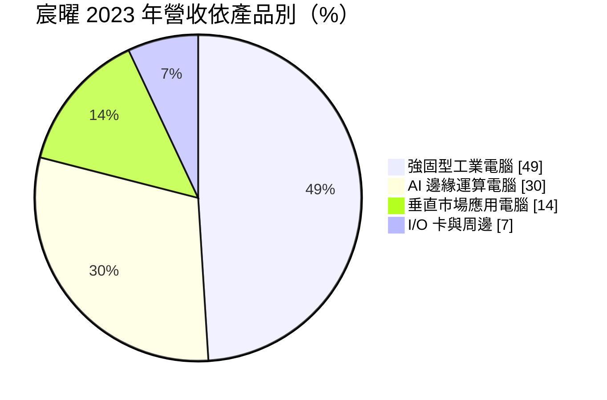
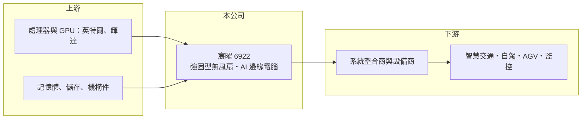

# 6922 宸曜

> 上櫃｜[[產業索引-電腦及週邊設備業|電腦及週邊設備業]]｜上市（櫃）日期 2023/11/09

# 第一章：企業模式與商業藍圖

> [!info] 撰寫說明
> 精簡版，由 Claude 依公開資料整理，架構比照 [[2330台積電]]，資料截至 2026-10-08。來源：櫃買中心開放資料快照（基本資料、2026 年第二季資產負債與損益、月營收）、富果研究「宸曜」公司介紹。2025 年以前的年度財務數字這次未查得，多年度表格多數為空格。公開資料有限。#待校對

宸曜科技（以下簡稱宸曜）是以「強固型無風扇電腦」起家的[[工業電腦]]廠，理解它的關鍵在於：它不做客製代工，而是針對特定應用設計標準化整機，以高於同業的定價賺取約四成的毛利率。

- **核心業務：** 宸曜成立於 2010 年，2023 年 11 月在櫃買中心掛牌，英文名 Neousys。主要產品為寬溫、無風扇的[[強固型電腦]]與[[邊緣 AI]]運算電腦，應用在智慧交通、自駕車、[[AGV]] 搬運機器人、工廠自動化與影像監控分析。宸曜只賣整機系統、不賣裸板，因為處理器與機殼的散熱設計必須一起規劃，才能在無風扇的條件下穩定運作。
- **營收結構：** 依富果研究，2023 年營收中強固型工業電腦占 49%、AI 邊緣運算電腦占 30%、垂直市場應用電腦占 14%、I/O 卡與周邊占 7%。地區別以歐洲約 40%、美洲約 32% 為主，其餘主要在亞洲。客製化產品占比不到 5%，代表宸曜的商業模式以標準品為核心。
- **營運據點：** 總部位於台灣，在美國與中國設有子公司服務當地客戶（富果研究）。生產與組裝據點細節未查得。以標準品為主的模式，讓宸曜不必像代工廠一樣為單一客戶建大量產能。
- **長期方向：** 長期成長動能來自 AI 推論從雲端走向車輛、機器人與工廠現場，這些場景需要能在震動、高溫與粉塵下執行 GPU 運算的電腦。宸曜在 NVIDIA 平台的強固邊緣電腦布局較早（待校對），若自駕、機器人與智慧交通持續擴大，它的利基市場也會跟著擴大。

# 第二章：護城河深度與競爭優勢

宸曜的護城河屬於「窄護城河」，來自強固設計的工程能力、標準品的品牌定價，以及設計導入後的轉換成本。

- **競爭優勢：** 富果研究指出，宸曜採取價值定價，售價約高於市場平均 10% 至 15%，[[毛利率]]長期約四成，高於同業普遍的 20% 至 30%。能維持溢價，是因為無風扇、寬溫又要跑 GPU 運算的整機設計門檻高，客戶在自駕車與機器人等專案中重視可靠度勝過價格。2026 年上半年營業利益率約 18.2%，在工業電腦業屬於前段。
- **主要對手：** 同業包括 [[2395研華]]、[[6166凌華]]、3088艾訊、[[6680鑫創電子]]、[[3594磐儀]]、3022威強電，以及歐美的強固電腦品牌。大廠產品線完整，但宸曜專注在 AI 強固邊緣電腦這一塊，產品推出速度與應用深度是它的差異。
- **觀察重點：** 長期最該追蹤的是毛利率能否守在四成，以及 AI 邊緣運算電腦的占比能否持續提高。2023 年上半年曾因景氣放緩提列庫存跌價，壓低毛利率（富果研究），代表標準品模式也要承擔庫存風險。若同業大舉推出同類產品，溢價空間可能被壓縮。

# 第三章：財務體質與盈利規模

資料日期：2026-10-08，表格是撰寫當時的快照；最新月營收、毛利率、累計 EPS 由自動排程寫在本筆記的屬性欄位（月營收、毛利率、累計EPS 等）。#待校對

宸曜的財務呈現「高毛利、高營益、輕資產」的利基品牌廠樣貌，但這次查得的多年度數字有限，下表以櫃買中心最新資料為主。

| 期間 | 營收（億元） | [[毛利率]] | [[營業利益率]] | EPS（元） | [[ROE]] |
|---|---|---|---|---|---|
| 2021 | 未查得 | 未查得 | 未查得 | 未查得 | 未查得 |
| 2022 | 未查得 | 未查得 | 未查得 | 未查得 | 未查得 |
| 2023 | 未查得 | 約 40%（公司預估） | 未查得 | 未查得 | 未查得 |
| 2024 | 未查得 | 未查得 | 未查得 | 未查得 | 未查得 |
| 2025 | 未查得 | 未查得 | 未查得 | 未查得 | 未查得 |
| 2026 上半年 | 11.36 | 40.1% | 18.2% | 5.63 | 約 14%（半年，推算） |

（來源：2026 年上半年為櫃買中心綜合損益資料；2023 年毛利率為富果研究引述公司說法。ROE 以上半年母公司淨利 1.53 億元 ÷ 股東權益 10.8 億元推算。）

- **營收規模：** 2026 年 1 至 8 月累計營收約 16.8 億元，年增約 46%（櫃買中心月營收資料）。富果研究指出 2023 年為低基期，公司預期 2024 年恢復雙位數成長，推估近年營收呈上升趨勢（推估）。營收年複合成長率未查得。
- **獲利：** 2026 年上半年營業利益 2.07 億元、母公司淨利 1.53 億元，業外收支幾乎為零，代表獲利幾乎全部來自本業，品質高。若下半年維持相同水準，年化 ROE 約 28%（推算，僅供參考）。
- **財務特色：** 2026 年第二季總資產約 24.2 億元、負債約 13.4 億元、股東權益約 10.8 億元，負債比約 55%，每股淨值 39.86 元。非流動負債約 5.6 億元，推估包含長期借款或租賃負債（推估，明細未查得）。股本僅 2.72 億元，股數少，EPS 對獲利變化很敏感。配息紀錄與自由現金流未查得。
- **[[ROIC]] 與 [[WACC]]：** 以 2026 年上半年營業利益 2.07 億元年化約 4.14 億元、稅率 20% 計算，稅後營業利益約 3.31 億元；有息負債未查得，投入資本以股東權益 10.8 億元到總資產 24.2 億元為區間，ROIC 約 13.7% 至 30.7%（推算，年化）。WACC 以 [[CAPM]] 推估：無風險利率 1.75%、市場風險溢酬 6%、β 假設 1.0（中小型工業電腦股常見值），權益成本約 7.75%；稅後負債成本 2%、負債占三成，WACC 約 6.0%（推算）。ROIC 明顯高於 WACC，代表宸曜的高毛利標準品模式能長期創造價值，前提是毛利率與營益率能維持。

# 第四章：總體風險與地緣政治

宸曜的風險集中在利基市場的規模、庫存與匯率，屬於高品質但體量仍小的工業電腦股。

- **產業週期：** 工業電腦需求跟著全球製造業、交通與物流投資走，2023 年上半年的庫存跌價就是週期反轉的例子。自駕與機器人專案時程常延後，訂單可能集中在少數大案，造成季度波動。
- **營運風險：** 標準品模式需要先備庫存，市場轉弱時要承擔跌價損失。GPU 平台更新快，舊世代產品若未及時去化，也會壓縮毛利。公司規模小，關鍵人才與研發團隊的穩定性很重要。
- **其他風險：** 營收超過七成來自歐美，新台幣升值與美國關稅會直接影響獲利。高階 AI 晶片的出口管制與供貨，可能限制部分產品在特定市場的銷售。

# 專有名詞解析

## 應用

- **[[邊緣 AI]]**：在終端設備或現場電腦上直接執行 AI 推論，不必把資料傳回雲端，延遲低、隱私性高。
- **[[AGV]]**：自動導引車，依循導引或感測器在工廠與倉庫中自動搬運物料的車輛。

## 產業

- **[[工業電腦]]**：用於工廠自動化、交通、醫療等場域的電腦，強調耐用、長期供貨與客製化。
- **[[強固型電腦]]**：為軍事、戶外、交通等嚴苛環境設計的電腦，需耐震、耐溫、防水防塵並長期供貨。

# 核心供應鏈

- 上游：處理器與 GPU 運算平台來自 [[INTC英特爾]]、[[NVDA輝達]]，另需記憶體、儲存裝置與鋁製散熱機殼。
- 下游／客戶：歐美為主的系統整合商與設備製造商，應用在智慧交通、自駕車、AGV 機器人、工廠自動化與影像分析（具體客戶未點名，#待校對）。
- 同業：[[2395研華]]、[[6166凌華]]、3088艾訊、[[6680鑫創電子]]、[[3594磐儀]]、3022威強電。

## 最新新聞
<!-- news:start -->
<!-- news:end -->

## 相關連結
- [公開資訊觀測站](https://mopsov.twse.com.tw/mops/web/t05st03?step=1&firstin=1&co_id=6922)
- [Goodinfo](https://goodinfo.tw/tw/StockDetail.asp?STOCK_ID=6922)
- [Yahoo 股市](https://tw.stock.yahoo.com/quote/6922)
- [鉅亨網新聞](https://www.cnyes.com/twstock/6922/news)
