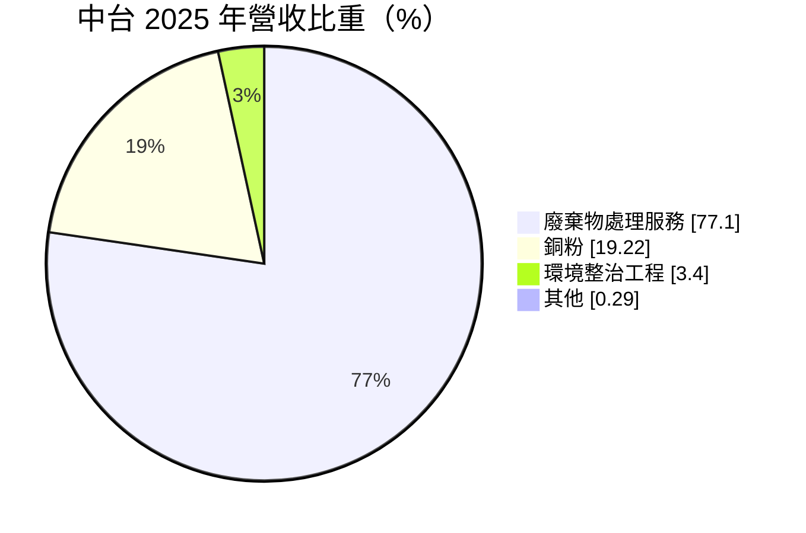
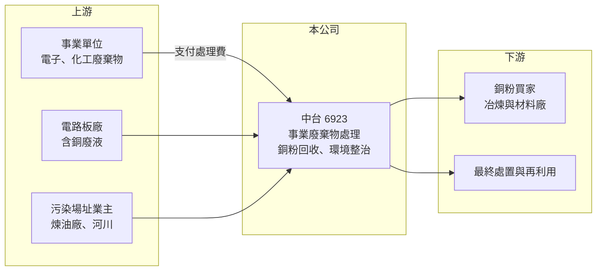

# 6923 中台

> 上市｜[[產業索引-綠能環保|綠能環保]]｜上市（櫃）日期 2024/09/25

# 第一章：企業模式與商業藍圖

> [!info] 撰寫說明
> 精簡版，由 Claude 依公開資料整理，架構比照 [[2330台積電]]，資料截至 2026-10-08。來源：富邦 MoneyDJ 財務比率年表（2019 至 2025 年）與基本資料（2025 年營收比重）；證交所開放資料快照（基本資料、2026 年上半年資產負債與損益、2025 年度股利、每月營收）；優分析、理財周刊、證交所市場動態新聞標題。處理設施類型、許可量與客戶產業為憑記憶整理，已標「待校對」；歷年營收由每股營業額與成長率推算。#待校對

中台資源科技成立於 2001 年 5 月、2024 年 9 月上市，董事長鄭光傑。它是以[[事業廢棄物]]處理為核心的環保公司，向產生廢棄物的工廠收取處理費，並從含銅廢液中回收銅粉出售，近年再承接土壤與地下水的[[環境整治]]工程，例如新聞提到的高雄煉油廠與二仁溪整治專案。

- **核心業務：** 2025 年營收中廢棄物處理服務占 77.10%、銅粉占 19.22%、環境整治工程占 3.40%。廢棄物處理是向電子、化工等事業單位收取處理費，把有害或一般事業廢棄物以物化處理、固化或最終處置等方式妥善處理（處理方式與設施類型待校對）。銅粉來自處理電路板含銅廢液時回收的金屬，售價跟著國際銅價走。
- **營收結構：** 依每股營業額與成長率推算，2025 年營收約 11.4 億元（推算），年減 32.69%，2024 年約 17.0 億元（推算）為高點。2024 年的高峰推估與大型一次性處理案或整治專案有關（未查得細節），2026 年 1 至 8 月累計營收 8.99 億元，年增約 17%。
- **營運據點：** 處理設施位於台灣（地點與許可量待校對），非流動資產約 36.88 億元占總資產近九成，代表處理場與土地是公司最主要的資產。新聞提到中台在取得高雄煉油廠整治案後，又取得二仁溪專案，可挹注逾 10 億元營運動能（工期與認列期間待校對）。
- **長期方向：** 台灣事業廢棄物的合法處理容量長期不足，尤其最終處置場地稀缺，讓既有處理業者擁有定價空間。中台的長期方向是擴大處理量能，並以土壤整治工程開拓新的收入來源，把處理場的經驗延伸到污染場址的整治與再利用。

# 第二章：護城河深度與競爭優勢

中台的護城河來自處理許可與場地的稀缺性，屬於典型「有許可、有場地才能做」的特許型環保事業。

- **競爭優勢：** 新設廢棄物處理或最終處置場需要環評、地方同意與長時間審查，台灣多年來新增處理容量有限，既有業者的許可本身就是護城河。[[營業利益率]]在 2019 至 2025 年間維持在 26.9% 至 31.2%，顯示處理費有穩定的定價能力。銅粉回收讓廢液處理同時產生產品收入，提高單位廢棄物的價值。
- **主要對手：** 事業廢棄物處理同業包括 [[8422可寧衛]]、[[8341日友]]、[[8476台境]]、[[6803崑鼎]] 等，各自專長不同（掩埋、焚化、醫療廢棄物等）；電路板廢液回收方面則與 [[6894衛司特]] 等廠內再生技術形成替代競爭。
- **觀察重點：** 環境整治專案的金額大，可能讓營收與獲利出現明顯的年度起伏，需區分經常性的處理費與一次性的工程收入。另一個重點是處理場的剩餘容量與擴充計畫，若場地容量用盡而新場尚未取得，營收成長會受限。

# 第三章：財務體質與盈利規模

資料日期：2026-10-08，表格是撰寫當時的快照；最新月營收、毛利率、累計 EPS 由自動排程寫在本筆記的屬性欄位（月營收、毛利率、累計EPS 等）。#待校對

中台的獲利率長期穩定在高檔，但營收規模受大型案件影響，ROE 在 2024 年達高點後回落。

| 年度 | 營收（億元） | [[毛利率]] | [[營業利益率]] | EPS（元） | [[ROE]] |
|---|---|---|---|---|---|
| 2021 | 約 5.2（推算） | 40.66% | 28.79% | 1.51 | 8.25% |
| 2022 | 約 8.3（推算） | 35.06% | 28.36% | 2.22 | 11.41% |
| 2023 | 約 12.6（推算） | 32.26% | 26.94% | 3.08 | 15.06% |
| 2024 | 約 17.0（推算） | 34.95% | 29.97% | 4.80 | 18.04% |
| 2025 | 約 11.4（推算） | 38.34% | 30.95% | 3.03 | 10.42% |

註：2025 年營收以每股營業額 12.63 元乘以約 9,044 萬股推算，其他年度依 MoneyDJ 營收成長率回推；上市前股本較小，推算值僅供參考。2026 年上半年營收 6.72 億元、毛利率 37.15%、營業利益率 30.54%、EPS 2.37 元（證交所資料）。

- **長期指標：** 2021 至 2025 年營收年複合成長率約 22%（推算），近 5 年平均 [[ROE]] 約 12.6%（推算）。2025 年度配發現金股利 3 元（盈餘 2.65 元加資本公積 0.35 元），超過 EPS 3.03 元的 99%，分配後期末未分配盈餘僅約 682 萬元，配息已接近極限。每股現金流量 2019 至 2025 年皆為正值（1.53 至 5.42 元），[[自由現金流]]長期為正（推估）。
- **[[ROIC]] 與 [[WACC]]：** 2025 年稅後營業利益約 2.8 億元（營業利益率 30.95% × 營收約 11.4 億元 × 0.8），投入資本約 35.3 億元（2026 年第二季權益總計 25.01 億元，加上以總負債 17.19 億元的六成推估的有息負債約 10.3 億元），ROIC 約 8%（推算）。WACC 約 5.2%（推算：無風險利率 1.75%、市場風險溢酬 6%、β 取環保同業常見值 0.8，股東權益成本 6.55%；稅前負債成本 2.5%、稅率 20%；權益比重約 71%）。ROIC 高於 WACC 約 3 個百分點，2024 年利差更大，代表處理場資產能持續創造價值。
- **財務特色：** 2026 年第二季負債比率約 41%（負債 17.19 億元 ÷ 資產 42.21 億元），流動資產 5.33 億元低於流動負債 8.38 億元，短期資金調度需要留意。2026 年上半年業外收益 5,017 萬元，使稅前純益率達 38.01%。庫藏股 8,570 萬元（104.9 萬股），資本公積 12.50 億元主要來自上市溢價。

# 第四章：總體風險與地緣政治

中台的風險集中在場地容量、法規與大型案件的不連續性。

- **產業週期：** 事業廢棄物量與製造業景氣相關，電子業減產時廢液與廢棄物量會減少。銅粉售價隨國際銅價波動，影響約兩成營收的產品收入。
- **營運風險：** 處理場與最終處置場容量有限，若無法取得擴充許可，成長將受限；環境整治專案屬一次性工程，結束後營收會出現落差。處理過程若發生污染或工安事件，可能面臨停業與罰款。
- **其他風險：** 環保法規對處理標準、運輸與申報的要求持續提高，合規成本上升；地方政府與居民對處理設施的態度可能影響擴廠；高配息率加上流動比率偏低，未來擴產可能需要增加借款或增資。

# 專有名詞解析

## 金融

- **[[ROIC]]**：投入資本報酬率，稅後營業利益除以股東權益加有息負債，衡量本業運用資本的效率。
- **[[WACC]]**：加權平均資金成本，股東與債權人要求報酬率的加權平均，是 ROIC 要超越的門檻。
- **[[自由現金流]]**：營業活動現金流減去資本支出，代表企業可自由用於配息、還債或併購的現金。

## 產業

- **[[環境整治]]**：針對受污染的土壤與地下水進行調查、清除與復原，讓土地恢復可使用的工程。
- **[[事業廢棄物]]**：工廠、醫院等事業單位產生的廢棄物，依危害程度分為有害與一般，需委由合格業者處理。

# 核心供應鏈

- 上游：委託處理的電子、化工與電路板業者（名單未查得），整治案業主包括台灣中油（高雄煉油廠，待校對）與地方政府。
- 下游／客戶：銅粉買家、再利用與最終處置業者。
- 同業：[[8422可寧衛]]、[[8341日友]]、[[8476台境]]、[[6803崑鼎]]、[[6894衛司特]]。

## 最新新聞
<!-- news:start -->
<!-- news:end -->

## 相關連結
- [公開資訊觀測站](https://mopsov.twse.com.tw/mops/web/t05st03?step=1&firstin=1&co_id=6923)
- [Goodinfo](https://goodinfo.tw/tw/StockDetail.asp?STOCK_ID=6923)
- [Yahoo 股市](https://tw.stock.yahoo.com/quote/6923)
- [鉅亨網新聞](https://www.cnyes.com/twstock/6923/news)
