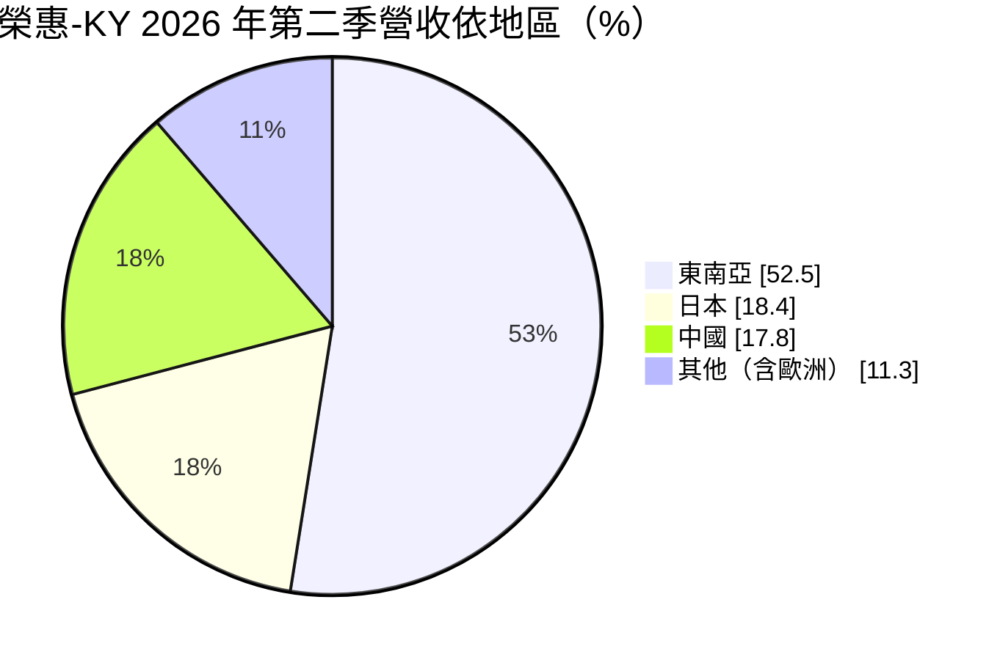
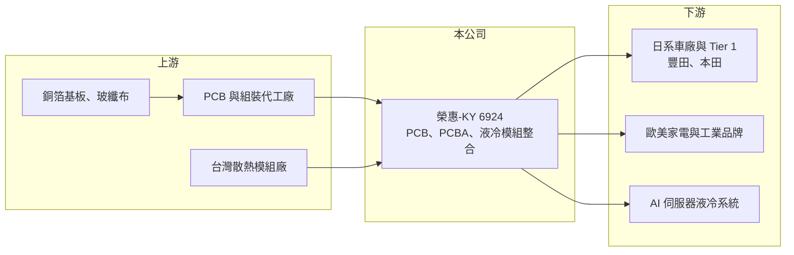

# 6924 榮惠-KY創

> 創新板｜[[產業索引-電子零組件業|電子零組件業]]｜上市（櫃）日期 2024/12/03

# 第一章：企業模式與商業藍圖

> [!info] 撰寫說明
> 精簡版，由 Claude 依公開資料整理，架構比照 [[2330台積電]] 的四章研究，資料截至 2026-10-08。來源：Goodinfo 年度經營績效頁、富果 2026 年 8 月法說會備忘錄、證交所開放資料（基本資料、2026 年第二季資產負債與綜合損益、營益分析、股利、每月營收）。創新板／新掛牌，公開資料有限；產品別營收比重與委外製造夥伴未查得。#待校對

榮惠-KY 是一家以日系客戶為主的電子零組件供應鏈整合商，近年從印刷電路板延伸到 AI 伺服器液冷模組。本章說明它的商業模式與成長方向。

## 一、核心定位：不自建工廠的電子零組件整合商

榮惠註冊於開曼群島，營運總部在台北內湖，2024 年 12 月在證交所[[創新板]]掛牌，實收資本額約 2.1 億元，董事長劉世璘（證交所開放資料）。公司採[[輕資產]]模式，專注業務、技術、品質與生產管理，製造委外給合作工廠，不需要龐大的資本支出（富果）。

* **從 [[PCB]] 延伸到模組：** 公司從傳統印刷電路板起家，涵蓋單雙面板、HDI 與軟硬結合板，再延伸到 [[PCBA]]、機構件與模組化產品。越往模組走，單價與附加價值越高，客戶也越依賴公司的整合能力。
* **日系客戶為主：** 2026 年第二季日系客戶占營收 75.78%，車用電子約占 PCB 業務的一半，供應日系車廠的電源管理模組、車燈與儀表板相關板件，文中提及的車用客戶包括豐田與本田（富果）。

## 二、營收結構

註：「其他」為 100% 減去前三項的推算值。東南亞比重高，主要反映日系客戶在東南亞的生產基地（推估）。

除了車用，公司也供應英國吸塵器品牌、德國料理機品牌、歐美咖啡機品牌，以及科研設備、商用照明、醫療美容儀器等客戶（富果），應用分散在高階消費性與工業產品。

## 三、新成長引擎：AI 伺服器液冷模組

公司近年最重要的轉變是切入 AI 伺服器[[液冷]]模組，包括 [[CDU]]、CDM 等產品，單價比傳統 PCB 高出 5 至 10 倍。In Rack 系統已量產三至四年，供應連接器、感測器、膨脹罐與客製化模組；In Row 系統在 2026 年進入量產初期，2026 年下半年將導入熱交換器、壓力罐、幫浦等高單價零組件（富果）。

## 四、長期藍圖

公司以亞洲為基礎拓展歐美：2025 年設立墨西哥營業辦事處，2026 年計畫在斯洛伐克設立歐洲子公司，2026 年截至 8 月的歐洲接單已達 2025 全年的三倍，目標 2027 年歐洲營收占比達兩位數（富果）。產品面則從 PCB 走向液冷與風冷模組，增加單一客戶的採購品項。

# 第二章：護城河深度與競爭優勢

輕資產整合商的護城河在於客戶關係與管理能力，本章分析榮惠的優勢與限制。

## 一、護城河的核心組成要素

* **日系客戶關係：** 日系車廠與品牌對供應商的品質與交期要求嚴格，認證期長，一旦進入供應名單，合作關係通常穩定且長久。榮惠超過七成營收來自日系客戶，這是最核心的資產。
* **供應鏈整合能力：** 公司不自建工廠，但能整合 PCB、組裝、機構件與散熱零件，替客戶一站式採購。客戶越依賴這種整合服務，轉換供應商的成本越高。
* **輕資產的資本效率：** 不需投資廠房設備，ROE 長期在 20% 以上（Goodinfo），資本報酬遠高於自建工廠的 PCB 同業。

## 二、主要競爭對手

| 對手 | 定位 | 對榮惠的威脅 |
|---|---|---|
| [[3017奇鋐]]、[[3324雙鴻]] | AI 伺服器散熱與液冷大廠 | 在液冷模組領域規模遠大於榮惠 |
| [[3653健策]] | 均熱片與液冷零件 | 液冷關鍵零組件競爭 |
| 台灣與中國 PCB 製造商 | 自有工廠、直接接單 | 可繞過整合商直接供貨 |
| 日系電子零件商社 | 傳統日系供應鏈整合者 | 搶同一批日系客戶 |

## 三、守得住與守不住

* **守得住：** 日系車用與工業客戶的長期訂單，以及液冷系統中客製化的連接器、感測器等零件。
* **守不住：** 製造端的成本控制。公司不擁有工廠，上游原料（銅箔基板、玻纖布）短缺時，必須靠調整付款條件與向客戶漲價來因應（富果）。
* **觀察重點：** 液冷產品營收比重能否持續提高，以及歐洲子公司能否帶動新客戶。

# 第三章：財務體質與盈利規模

資料日期：2026-10-08，表格是撰寫當時的快照；最新月營收、毛利率、累計 EPS 由自動排程寫在本筆記的屬性欄位（月營收、毛利率、累計EPS 等）。#待校對

本章用多年度數據檢視榮惠「高 ROE、高配息、利潤率逐年提升」的財務特性。

## 一、多年度三率與 ROE

| 年度 | 營收（新台幣） | [[毛利率]] | [[營業利益率]] | EPS（元） | [[ROE]] |
|---|---|---|---|---|---|
| 2021 | 14.4 億 | 16.5% | 5.05% | 2.77 | 24.1% |
| 2022 | 14.4 億 | 17.5% | 6.06% | 4.09 | 30.6% |
| 2023 | 14.3 億 | 22.4% | 9.00% | 6.31 | 37.4% |
| 2024 | 17.6 億 | 23.0% | 9.40% | 7.30 | 31.3% |
| 2025 | 16.9 億 | 22.4% | 9.05% | 5.68 | 20.4% |
| 2026 上半年 | 9.87 億 | 24.77% | 12.15% | 4.31 | 未查得 |

註：2021 至 2025 年取自 Goodinfo；2026 上半年取自證交所營益分析與綜合損益。

* **利潤率逐步提升：** 毛利率從 16.5% 升到 2026 年上半年的 24.8%，營業利益率從 5% 升到 12%，反映產品往模組與液冷等高附加價值方向移動。
* **營收溫和成長：** 2021 至 2025 年營收年複合成長率約 4.1%（推算）；2026 年 1 至 8 月累計約 14.1 億元、年增約 23%（證交所每月營收），液冷產品開始貢獻。
* **ROE 很高：** 2021 至 2025 年平均 ROE 約 28.8%（推算）；2025 年降到 20.4%，部分原因是掛牌後權益增加。

## 二、股利與財務結構

2025 年度配發現金股利 5.00 元，以 EPS 5.68 元計算配發率約 88%；2026 年上半年再配發 3.50 元（證交所股利資料），公司表示現金股利發放率維持八成以上。2026 年第二季底總資產約 12.3 億元、總負債約 6.7 億元（幾乎全為流動負債，多為應付帳款，推估）、權益約 5.6 億元，每股淨值 27.01 元（證交所資產負債）。

## 三、[[ROIC]] 與 [[WACC]]

**ROIC 推算：** 2025 年營業利益約 16.9 億 × 9.05% ≈ 1.53 億元，稅後約 1.22 億元。有息負債未查得，假設總負債 6.7 億元的一半約 3.4 億元為有息負債（實際可能更低，因負債多為營運性質），加上權益 5.6 億元，投入資本約 9.0 億元，ROIC 約 13.7%（推算）；若有息負債實際更少，ROIC 會更高。

**WACC 推算：** 台灣 10 年期公債 1.75%、市場風險溢酬 6%、β 取電子零組件同業常見值 1.0，權益成本約 7.75%；負債成本 3%、稅率 20%，權益占比約 62%，WACC 約 5.7%（推算）。

**結論：** ROIC 約為 WACC 的兩倍以上，輕資產模式讓公司用很少的資本就能創造可觀的營業利益，並以高配息把現金回饋給股東。只要日系客戶關係穩定、液冷產品持續放量，這個價值創造模式就能延續。

# 第四章：總體風險與地緣政治

本章整理榮惠長期面對的客戶、供應鏈與地緣風險。

## 一、產業週期

* **車用與消費性電子景氣：** 車用電子約占 PCB 業務一半，日系車廠的產量變化直接影響訂單；高階家電與消費性產品也隨景氣循環。
* **AI 伺服器投資循環：** 液冷產品的成長取決於雲端業者的 AI 資本支出，投資放緩時訂單可能快速縮減。

## 二、營運風險

* **客戶集中於日系：** 日系客戶占營收七成以上，日本車廠或品牌的供應鏈調整會造成營收波動，2025 年曾因客戶供應鏈調整影響單月營收。
* **委外製造風險：** 不擁有工廠，品質與交期依賴合作廠商，原料短缺時議價力不如自有工廠的同業。
* **液冷競爭：** 液冷是熱門領域，大型散熱廠積極擴產，價格競爭可能加劇。

## 三、其他風險

* **地緣政治與關稅：** 營運跨東南亞、中國與日本，並擴展墨西哥與歐洲，各地關稅與貿易政策變動會影響供應鏈布局。
* **匯率：** 營收以日圓與美元計價為主（推估），日圓貶值會壓低以新台幣計算的營收。

# 專有名詞解析

## 金融

- **[[創新板]]**：證交所 2021 年設立的板塊，讓尚未獲利但具技術或創新能力的公司掛牌，初期限合格投資人交易。

## 產業

- **[[PCB]]**：印刷電路板，承載並連接電子元件的基板，是所有電子產品的基礎零件。
- **[[PCBA]]**：已完成元件焊接組裝的電路板，比空板 PCB 附加價值更高。
- **[[液冷]]**：以冷卻液帶走晶片熱量的散熱方式，散熱效率遠高於風冷，是高功耗 AI 伺服器的主流方案。
- **[[CDU]]**：冷卻液分配裝置，液冷系統中負責輸送冷卻液並與機房水路做熱交換的核心設備。
- **[[輕資產]]**：企業不自建大量廠房設備，把生產外包，專注在設計、品牌與銷售的經營模式。

# 核心供應鏈

- 上游：PCB 製造與組裝代工廠、銅箔基板與玻纖布供應商，以及合作的台灣散熱模組廠（合作廠商名稱未查得）。
- 下游／客戶：日系車廠與一階供應商（豐田、本田相關）、英國吸塵器品牌、德國料理機品牌、歐美咖啡機品牌、科研與醫療美容設備客戶、AI 伺服器液冷系統客戶。
- 同業：[[3017奇鋐]]、[[3324雙鴻]]、[[3653健策]]、日系電子零件商社。

## 最新新聞
<!-- news:start -->
<!-- news:end -->

## 相關連結
- [公開資訊觀測站](https://mopsov.twse.com.tw/mops/web/t05st03?step=1&firstin=1&co_id=6924)
- [Goodinfo](https://goodinfo.tw/tw/StockDetail.asp?STOCK_ID=6924)
- [Yahoo 股市](https://tw.stock.yahoo.com/quote/6924)
- [鉅亨網新聞](https://www.cnyes.com/twstock/6924/news)
