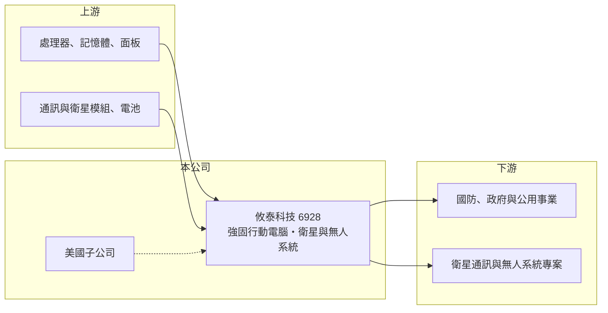

# 6928 攸泰科技

> 上市｜[[產業索引-電腦及週邊設備業|電腦及週邊設備業]]｜上市（櫃）日期 2024/05/16

# 第一章：企業模式與商業藍圖

> [!info] 撰寫說明
> 精簡版，由 Claude 依公開資料整理，架構比照 [[2330台積電]]，資料截至 2026-10-08。來源：證交所開放資料快照（基本資料、2026 年第二季資產負債與損益、股利）、Goodinfo 經營績效頁、優分析 2026 年 9 月報導。產品線（強固平板、手持裝置）與英文名稱有部分憑記憶整理，已標「待校對」。公開資料有限。#待校對

攸泰科技（以下簡稱攸泰）是做強固型行動裝置與關鍵任務電腦的[[工業電腦]]廠，理解它的關鍵在於：它的客戶多是國防、政府與大型專案，營收會隨少數專案的出貨時點大起大落，近年則把成長押在[[低軌衛星]]通訊與無人系統。

- **核心業務：** 攸泰成立於 2011 年，2024 年 5 月在證交所上市，英文名 Ubiqconn（待校對）。產品以[[強固型電腦]]為主，包括強固平板、手持裝置與車載電腦（產品線待校對），用於軍警、公用事業、物流與戶外作業。依優分析報導，近年新增衛星應用與無人系統兩條成長線。
- **營收結構：** 依優分析報導，衛星應用營收占比已提升到約一成，主要來自政府方案相關專案；亞洲市場在 2026 年 1 至 8 月占營收約 18%。產品別完整營收比重未查得。公司設有美國子公司，並提到併購整合綜效，推估美國市場是重要營收來源（推估）。
- **營運據點：** 總部位於台灣，設有美國子公司（優分析）。生產據點未查得。國防與政府客戶通常要求產品在台灣或非中國地區生產，這讓台灣廠商在[[非紅供應鏈]]的趨勢下具備優勢。
- **長期方向：** 公司中長期聚焦衛星通訊、無人系統等關鍵任務應用，並透過美國子公司與併購擴大規模（優分析）。若低軌衛星地面終端與無人機市場持續成長，攸泰可能從強固裝置廠轉型為國防與通訊專案的設備供應商，但這個轉型仍在初期。

# 第二章：護城河深度與競爭優勢

攸泰的護城河很窄，主要來自國防與專案客戶的驗證門檻，以及強固設計的工程經驗；目前規模小、專案集中，優勢尚未轉化為穩定獲利。

- **競爭優勢：** 強固型裝置需要通過摔落、防水、耐溫等嚴格測試，國防與政府專案還要求長期供貨與資安規範，新進者不易短期打入。攸泰的[[毛利率]]由 2020 年的 12.6% 一路提升到 2025 年的 26.4%，代表產品組合正從低毛利代工轉向較高附加價值的專案產品。
- **主要對手：** 台灣強固型電腦龍頭 [[3005神基]] 規模遠大於攸泰，其他同業包括 [[6206飛捷]]、[[3594磐儀]]、[[6922宸曜]]，國際上則有 Panasonic、Getac（神基品牌）與 Zebra 等品牌。攸泰必須靠衛星、無人系統等新興利基市場與大廠區隔。
- **觀察重點：** 長期最該追蹤的是營收能否擺脫專案波動、回到 2023 年 37 億元的水準。2024 年營收腰斬到 20.2 億元，2025 年再降到 19.7 億元，同時營業利益率轉負，原因這次未查得。衛星應用與美國子公司若能帶來穩定的經常性訂單，才能證明轉型成功。

# 第三章：財務體質與盈利規模

資料日期：2026-10-08，表格是撰寫當時的快照；最新月營收、毛利率、累計 EPS 由自動排程寫在本筆記的屬性欄位（月營收、毛利率、累計EPS 等）。#待校對

攸泰的財務呈現「毛利率上升、營收大幅波動、近兩年虧損」的專案型公司樣貌，獲利高度取決於大型專案的出貨時點。

| 年度 | 營收（億元） | [[毛利率]] | [[營業利益率]] | EPS（元） | [[ROE]] |
|---|---|---|---|---|---|
| 2021 | 32.1 | 13.6% | 3.26% | 2.99 | 31.0% |
| 2022 | 33.2 | 18.4% | 5.82% | 3.13 | 23.2% |
| 2023 | 37.2 | 21.4% | 8.43% | 3.44 | 20.4% |
| 2024 | 20.2 | 23.0% | -7.02% | -0.82 | -3.84% |
| 2025 | 19.7 | 26.4% | -5.75% | -0.73 | -3.00% |

（來源：Goodinfo 經營績效頁。2026 年上半年依證交所資料，營收 9.42 億元、毛利率約 28.4%、營業利益率約 -5.4%、EPS -0.34 元。）

- **營收規模：** 2020 年營收 16.2 億元，2025 年 19.7 億元，年複合成長率約 4.0%（推算），但中間經歷 2021 年倍增、2024 年腰斬的劇烈波動。2026 年 1 至 8 月累計營收約 12.3 億元，年減約 18%，公司表示部分專案因關鍵零組件供應時程而遞延（優分析）。
- **獲利：** 2021 至 2025 年平均 ROE 約 13.6%（推算），但這是被上市前股本小、ROE 偏高的年度拉高；2024 年起連續兩年虧損。毛利率持續提升而營業利益率轉負，代表營收規模縮小後，研發與管銷費用無法被攤薄。
- **財務特色：** 2026 年第二季總資產約 27.1 億元、負債僅約 7.0 億元，負債比約 26%，每股淨值 23.40 元。流動資產 23.4 億元占總資產近九成，推估含上市募得的現金（推估）。保留盈餘只剩約 0.2 億元，114 年度未配發現金股利。自由現金流是否長期為正未查得。
- **[[ROIC]] 與 [[WACC]]：** 2025 年營業虧損約 1.13 億元（19.7 億元 × -5.75%），以股東權益 20.1 億元到總資產 27.1 億元為投入資本區間，ROIC 約 -4.2% 至 -5.6%（推算，虧損年度不計稅盾）。2023 年營業利益約 3.14 億元、稅後約 2.5 億元，以同樣的資本規模估算 ROIC 約 9% 至 12%（推算）。WACC 以 [[CAPM]] 推估：無風險利率 1.75%、市場風險溢酬 6%、β 假設 1.0（中小型電子股常見值），權益成本約 7.75%；負債比低，WACC 約 7.3%（推算）。目前 ROIC 為負、明顯低於 WACC，公司正在消耗股東資本，需要營收回升才能重新創造價值。

# 第四章：總體風險與地緣政治

攸泰的風險集中在專案依賴、轉型執行與零組件供應，屬於高不確定性的轉型股。

- **產業週期：** 國防、政府與公用事業採購依預算年度與標案時程進行，訂單集中且常延遲。大型專案結束後若沒有新案接續，營收就會出現 2024 年那種斷崖式下滑。
- **營運風險：** 客戶與專案集中，單一大客戶或大案的變動影響極大。衛星與無人系統是新事業，需要持續投入研發與認證，短期內費用負擔重。併購美國子公司後的整合成效，也是能否擴大規模的關鍵。關鍵零組件供應不穩，已造成 2026 年部分出貨遞延。
- **其他風險：** 國防與衛星產品受出口管制規範，各國政策變動可能影響接單。營收以外銷為主，新台幣升值與美國關稅都會壓縮獲利。

# 專有名詞解析

## 應用

- **[[低軌衛星]]**：在約 500 至 2,000 公里高度運行的通訊衛星，延遲低，需要大量地面終端與衛星零組件。

## 產業

- **[[工業電腦]]**：用於工廠自動化、交通、醫療等場域的電腦，強調耐用、長期供貨與客製化。
- **[[強固型電腦]]**：為軍事、戶外、交通等嚴苛環境設計的電腦，需耐震、耐溫、防水防塵並長期供貨。
- **[[非紅供應鏈]]**：排除中國大陸產地與廠商的供應鏈安排，常見於美系客戶與國防相關採購。

# 核心供應鏈

- 上游：處理器、記憶體、強固觸控面板、電池與衛星／行動通訊模組供應商。
- 下游／客戶：國防、政府與公用事業單位，以及衛星通訊、無人系統的專案客戶（具體客戶未點名，#待校對）。
- 同業：[[3005神基]]、[[6206飛捷]]、[[3594磐儀]]、[[6922宸曜]]。

## 最新新聞
<!-- news:start -->
<!-- news:end -->

## 相關連結
- [公開資訊觀測站](https://mopsov.twse.com.tw/mops/web/t05st03?step=1&firstin=1&co_id=6928)
- [Goodinfo](https://goodinfo.tw/tw/StockDetail.asp?STOCK_ID=6928)
- [Yahoo 股市](https://tw.stock.yahoo.com/quote/6928)
- [鉅亨網新聞](https://www.cnyes.com/twstock/6928/news)
