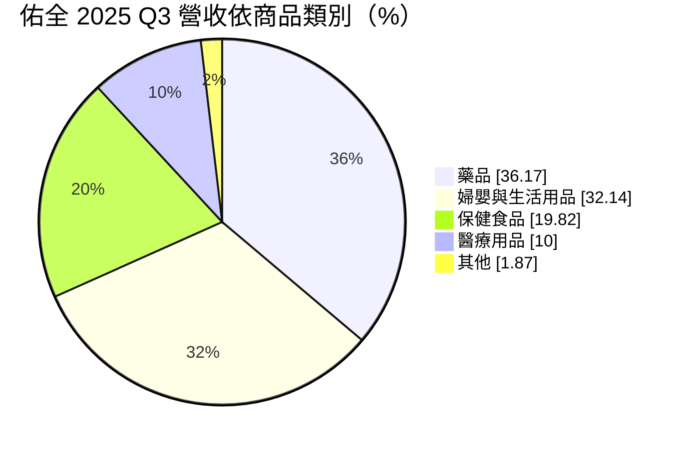
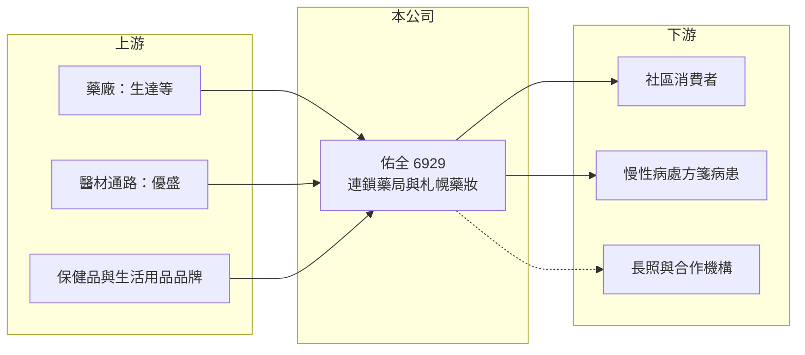

# 6929 佑全

> 上櫃｜[[產業索引-生技醫療業|生技醫療業]]｜上市（櫃）日期 2024/03/28

# 第一章：企業模式與商業藍圖

> [!info] 撰寫說明
> 精簡版，由 Claude 依公開資料整理，架構比照 [[2330台積電]]，資料截至 2026-10-08。來源：櫃買中心開放資料快照（基本資料、2026 年第二季財報、2026 年 8 月營收）、Goodinfo 經營績效頁、富果 2025 年 11 月法說會摘要。門市總數未查得。#待校對

佑全是台灣連鎖藥局通路之一，理解它的重點在於零售通路的規模經濟、處方藥與保健品的商品組合，以及從藥妝零售轉型為社區健康平台的策略。

- **核心業務：** 佑全經營連鎖藥局與藥妝門市，旗下另有札幌藥妝品牌，多設在百貨商場與交通要點。門市銷售處方用藥、成藥、保健食品、婦嬰與生活用品，並提供藥事服務。藥局通路的價值在於社區據點與藥師專業，讓顧客在慢性病領藥、保健諮詢與日常採購上形成回訪習慣。
- **營收結構：** 依 2025 年第三季資料，藥品占營收 36.17%（2020 年為 25.88%），婦嬰與生活用品約 32.14%，保健食品約 19.82%，醫療用品約 10%。藥品比重逐年提高，代表公司正把重心從一般零售轉向毛利較穩定、回購率較高的健康相關商品。

- **營運據點：** 公司設立於 2000 年 4 月，2024 年 3 月 28 日上櫃，實收資本額約 4.51 億元。門市分布全台，總門市數未查得；2024 年底至 2025 年初關閉 7 家表現不佳的門市、新開 9 家。主要股東依法說資料為優盛醫學約 46%、生達製藥約 30%、富邦媒體約 7%（持股時點以 2025 年 11 月法說資料為準）。
- **長期方向：** 公司目標是從藥妝零售轉型為「社區健康整合平台」，重點包括強化藥事服務、擴大[[長照]]布局、推動數位與智慧銷售，並完成符合 [[GDP]] 標準的自動化倉儲。這個方向若成功，可以把藥局從價格競爭的零售店，轉為提供健康服務的社區據點。

# 第二章：護城河深度與競爭優勢

藥局通路的競爭力取決於據點密度、採購規模與藥師服務，本章說明佑全的優勢與對手。

- **競爭優勢：** 佑全的大股東 [[4121優盛]] 是醫療器材與耗材通路商、[[1720生達]] 是藥廠，股東背景讓公司在商品取得與藥品供應上有一定支持。處方箋釋出與慢性病連續處方箋需要藥師與健保特約資格，門檻高於一般零售，這部分顧客的回訪頻率也較高。
- **主要對手：** 連鎖藥局有 [[6469大樹]]、[[4175杏一]]、丁丁藥局；藥妝與生活用品則與屈臣氏、康是美（[[2912統一超]] 集團）、[[5904寶雅]] 重疊。電商與 [[8454富邦媒]] 等平台也在保健品與婦嬰用品上分食市場。大樹在展店速度與規模上明顯領先，是佑全最直接的比較對象。
- **觀察重點：** 2023 至 2024 年新開門市表現不如預期，公司已進行調整，未來單店營收與坪效能否改善是關鍵。藥品比重能否持續提高、長照與數位銷售能否帶來新營收，也決定公司能否轉虧為盈。

# 第三章：財務體質與盈利規模

資料日期：2026-10-08，表格是撰寫當時的快照；最新月營收、毛利率、累計 EPS 由自動排程寫在本筆記的屬性欄位（月營收、毛利率、累計EPS 等）。#待校對

零售通路的毛利率通常穩定，獲利關鍵在於費用控制與門市效率，本章用多年度數據觀察佑全的營運槓桿。

| 年度 | 營收（億元） | [[毛利率]] | [[營業利益率]] | EPS（元） | [[ROE]] |
|---|---|---|---|---|---|
| 2020 | 26.7 | 32.6% | 1.30% | 1.33 | 6.62% |
| 2021 | 27.9 | 32.8% | 1.09% | 0.97 | 5.83% |
| 2022 | 33.0 | 33.7% | 3.55% | 2.50 | 13.6% |
| 2023 | 31.2 | 32.8% | 0.77% | 0.37 | 1.84% |
| 2024 | 32.7 | 33.8% | -1.53% | -1.09 | -4.88% |
| 2025 | 32.2 | 33.2% | -2.11% | -1.63 | -6.76% |
| 2026 上半年 | 16.0 | 33.0% | -1.51% | -0.53 | 未查得 |

- **營收規模：** 營收從 2020 年的 26.7 億元成長到 2025 年的 32.2 億元，年複合成長率約 3.8%（推算），2022 年因防疫商品需求達到高峰後持平。2026 年 1 至 8 月累計營收約 21.45 億元，與前一年同期相近。
- **獲利：** 毛利率長期穩定在 33% 左右，但營業利益率從 2022 年的 3.55% 轉為 2024 年起的負值。主因是新店開辦與人事租金等固定費用上升，而營收沒有同步成長，屬於零售業典型的營運槓桿反向作用。
- **財務特色：** 2026 年第二季底股東權益約 10.08 億元、負債約 17.99 億元，負債中包含大量門市租約的租賃負債（實際有息借款金額未查得）。零售業的租賃負債屬於長期固定支出，營收下滑時對獲利的壓力較大。
- **[[ROIC]] 與 [[WACC]]：** 以 2026 年上半年營業損失 0.24 億元年化為 0.48 億元，除以投入資本約 19.1 億元（股東權益 10.08 億元加非流動負債 9.02 億元，主要為租賃負債），ROIC 約 -2.5%（推算）。WACC 以 CAPM 推估：無風險利率 1.75%、市場風險溢酬 6%、β 取零售通路常見的 0.7（假設值），股權成本約 6%；負債成本假設 2.5%、稅率 20%，股債比約 53：47，WACC 約 4% 至 5%（推算）。ROIC 低於 WACC，代表近兩年營運未能創造價值，需要靠門市調整與商品組合改善扭轉。
- **長期指標：** 近 5 年（2021 至 2025 年）ROE 平均約 1.9%（推算）。依官方本益比殖利率資料，2026 年 10 月的每股股利為 0，近年配息不穩定。

# 第四章：總體風險與地緣政治

連鎖藥局面對的是政策、競爭與成本三種壓力，本章分別說明。

- **產業週期：** 藥品與保健品屬民生必需，景氣循環影響小，但婦嬰與生活用品容易受消費力與少子化影響。疫情期間的防疫商品需求屬一次性，2022 年後已回落。
- **營運風險：** 連鎖藥局展店競爭激烈，新店若選址不佳會拖累整體獲利，2024 至 2025 年的虧損即與此有關。人力成本、藥師招募與租金上漲是長期壓力。
- **其他風險：** 健保藥價調整會影響處方藥的利潤，慢箋與藥事服務費的給付政策也直接影響藥局收入。電商平台在保健品與日用品上的價格競爭持續擠壓實體通路。

# 專有名詞解析

## 產業

- **[[連續處方箋]]**：慢性病患者可憑一張處方在一段期間內多次領藥，常由社區藥局調劑。
- **[[長照]]**：長期照顧服務，為失能或失智者提供居家、社區或機構式照護。
- **[[GDP]]**：藥品優良運銷規範，規範藥品在倉儲與配送過程中的溫度與品質管理。
- **[[租賃負債]]**：企業承租門市或設備，依會計準則把未來租金折現認列的負債。

# 核心供應鏈

- 上游：藥廠 [[1720生達]]、醫材與耗材通路 [[4121優盛]]，以及各保健食品、婦嬰與生活用品品牌商。
- 下游／客戶：社區一般消費者與慢性病處方箋病患；合作對象包括南山人壽、工研院與健保署（依 2025 年法說資料）。
- 同業：[[6469大樹]]、[[4175杏一]]、[[5904寶雅]]，康是美（[[2912統一超]] 集團）、屈臣氏、丁丁藥局。

## 最新新聞
<!-- news:start -->
<!-- news:end -->

## 相關連結
- [公開資訊觀測站](https://mopsov.twse.com.tw/mops/web/t05st03?step=1&firstin=1&co_id=6929)
- [Goodinfo](https://goodinfo.tw/tw/StockDetail.asp?STOCK_ID=6929)
- [Yahoo 股市](https://tw.stock.yahoo.com/quote/6929)
- [鉅亨網新聞](https://www.cnyes.com/twstock/6929/news)
