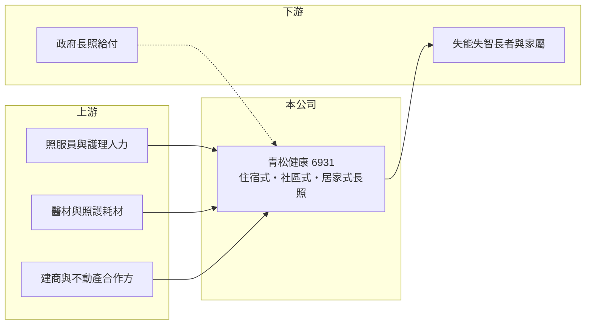

# 6931 青松健康

> 上市｜[[產業索引-生技醫療業|生技醫療業]]｜上市（櫃）日期 2025/01/15

# 第一章：企業模式與商業藍圖

> [!info] 撰寫說明
> 精簡版，由 Claude 依公開資料整理，架構比照 [[2330台積電]]，資料截至 2026-10-08。來源：證交所開放資料快照（基本資料、2026 年第二季財報與營益分析、季度股利、2026 年 8 月營收）、Goodinfo 經營績效頁、富果 2025 年 11 月法說會摘要。#待校對

青松健康是台灣少數上市的長照服務公司，理解它要看三件事：人口高齡化帶來的長期需求、政府長照制度的給付結構，以及公司如何以連鎖化經營擴大據點。

- **核心業務：** 青松健康提供[[長照]]服務，長照占總營收約 95%。服務分三類：住宿式（護理之家等 24 小時照護機構）、社區式（[[日間照顧]]中心、失智長輩團體家屋、小規模多機能中心），以及到府的居家式照護。三種服務彼此銜接，長輩從居家、日照到住宿都能留在同一個體系，這是連鎖長照業者提高服務黏著度的方式。
- **營收結構：** 自 2024 年起，社區式服務（日照與居家）營收已超越住宿式機構，2025 年差距擴大。社區式服務主要由政府長照 2.0 給付支撐，展點成本低於住宿機構，因此是近年成長最快的部分；各類服務的具體比重未查得。
- **營運據點：** 公司設立於 2007 年 5 月，2025 年 1 月 15 日上市，實收資本額約 6.62 億元。截至 2025 年 10 月共有 62 家機構，2025 年新增 7 家，展點以六都優先，彰化與新北淡水有住宿園區規劃，淡水案與建商合資成立子公司開發。
- **長期方向：** 公司計畫把服務對象從失能失智長者延伸到亞健康與健康銀髮族，發展高齡住宅與全齡住宅。2025 年 7 月推出員工持股信託、2025 年起改為季配息，顯示經營層重視留才與股東回報。公司表示有信心維持營收雙位數年增。

# 第二章：護城河深度與競爭優勢

長照業的護城河不是技術，而是據點、人力與政府評鑑累積的信任，本章說明青松健康在這些面向的位置。

- **競爭優勢：** 長照機構需要取得設立許可、通過評鑑並長期維持照護品質，新進者要花多年才能建立口碑與轉介網絡。青松健康以連鎖化管理，在照服員培訓、排班、採購與資訊系統上享有規模經濟，這是單一機構難以複製的。員工持股信託則有助於留住最稀缺的護理人力。
- **主要對手：** 台灣長照市場高度分散，多數業者為財團法人、社團法人或小型私立機構，上市同業很少；大型醫療體系附設的護理之家與養生村也是競爭者。在居家服務上，各地的居服單位競爭激烈，價格主要由政府給付標準決定。
- **觀察重點：** 新住宿園區（彰化、淡水）能否如期取得執照並填滿床位，以及社區式服務能否持續擴點。另一個關鍵是護理與照服人力是否足夠，人力不足會直接限制開床數量。

# 第三章：財務體質與盈利規模

資料日期：2026-10-08，表格是撰寫當時的快照；最新月營收、毛利率、累計 EPS 由自動排程寫在本筆記的屬性欄位（月營收、毛利率、累計EPS 等）。#待校對

長照服務的毛利率不高、人力成本占比大，財務分析的重點是營收成長能否帶來營業利益率提升，以及展點投資的報酬。

| 年度 | 營收（億元） | [[毛利率]] | [[營業利益率]] | EPS（元） | [[ROE]] |
|---|---|---|---|---|---|
| 2020 | 2.40 | 22.9% | 12.0% | 0.49 | 3.82% |
| 2021 | 3.58 | 7.5% | -1.11% | -0.05 | 0.04% |
| 2022 | 6.37 | 10.3% | 2.25% | 0.44 | 3.21% |
| 2023 | 8.69 | 13.2% | 6.16% | 1.08 | 9.39% |
| 2024 | 9.83 | 12.6% | 4.49% | 0.68 | 6.12% |
| 2025 | 11.2 | 13.2% | 5.08% | 1.39 | 10.2% |
| 2026 上半年 | 6.30 | 15.8% | 7.55% | 2.68 | 未查得 |

- **營收規模：** 營收由 2020 年的 2.40 億元成長到 2025 年的 11.2 億元，年複合成長率約 36%（推算），主要來自展點與社區式服務擴張。2026 年 1 至 8 月累計營收約 8.55 億元，年增約 18%。
- **獲利：** 毛利率長期在 10% 至 15% 之間，營業利益率約 5% 至 7.5%，屬於人力密集服務業的典型水準。2026 年上半年稅前淨利約 2.02 億元，其中營業外收益約 1.55 億元，來源未查得（推估為一次性項目），因此上半年 EPS 2.68 元不宜直接視為常態獲利能力。
- **財務特色：** 2026 年第二季底股東權益約 13.30 億元、負債約 14.65 億元，非流動負債約 12.14 億元，推估多為機構租約的租賃負債與建設借款。2025 年起改為季配息，2025 年第四季配 0.24 元、2026 年第一與第二季各配 0.12 元。
- **[[ROIC]] 與 [[WACC]]：** 以 2026 年上半年營業利益 0.48 億元年化為 0.95 億元，扣 20% 稅後約 0.76 億元，除以投入資本約 25.4 億元（股東權益 13.30 億元加非流動負債 12.14 億元），ROIC 約 3%（推算）。WACC 以 CAPM 推估：無風險利率 1.75%、市場風險溢酬 6%、β 取醫療服務業常見的 0.8（假設值），股權成本約 6.6%；負債成本假設 2.5%、稅率 20%，股債比約 52：48，WACC 約 4.5%（推算）。ROIC 略低於 WACC，代表展點仍在成熟期前，本業尚未明顯創造價值；新機構填滿後營業利益率能否提升是關鍵。
- **長期指標：** 近 5 年（2021 至 2025 年）ROE 平均約 5.8%（推算），2023 年起明顯改善。改為季配息後股利金額不大，自由現金流受展點投資影響，是否長期為正未查得。

# 第四章：總體風險與地緣政治

長照業的風險主要來自政策、人力與展點投資，本章分別說明。

- **產業週期：** 長照需求由人口老化驅動，幾乎不受景氣循環影響，是長期向上的產業。真正的週期來自政府政策，長照 2.0 的給付標準與預算調整會直接影響社區式與居家式服務的收入。
- **營運風險：** 照服員與護理人力長期短缺，薪資上漲會壓縮本來就不高的毛利率。新住宿園區投資金額大、回收期長，若入住率爬升太慢，折舊與利息會拖累獲利。照護品質事件也可能影響評鑑與商譽。
- **其他風險：** 住宿機構涉及建築、消防與土地法規，取得執照的時程常有延誤。外籍看護政策與移工引進規定變化，也會影響人力成本與家庭選擇。

# 專有名詞解析

## 產業

- **[[長照]]**：長期照顧服務，為失能或失智者提供居家、社區或機構式照護。
- **[[長照 2.0]]**：台灣政府自 2017 年起推動的長期照顧計畫，擴大服務對象並以給付支付各類照顧服務。
- **[[日間照顧]]**：長輩白天到中心接受照顧與活動、晚上回家的社區式長照服務。
- **[[護理之家]]**：提供 24 小時護理照護的住宿式機構，主要收住失能或需醫療照護的長者。
- **[[租賃負債]]**：企業承租門市或設備，依會計準則把未來租金折現認列的負債。

# 核心供應鏈

- 上游：照服員與護理人力（最關鍵的投入）、醫材與照護耗材供應商、合資開發住宿園區的建商（淡水案合作方為龍遠建設）。
- 下游／客戶：失能失智長者與家屬，社區式與居家式服務的大部分費用由政府長照給付支付。
- 同業：多為財團法人與私立機構，上市同業少；醫療通路相關可參考 [[6929佑全]]、[[4175杏一]]，兩者也在布局長照。

## 最新新聞
<!-- news:start -->
<!-- news:end -->

## 相關連結
- [公開資訊觀測站](https://mopsov.twse.com.tw/mops/web/t05st03?step=1&firstin=1&co_id=6931)
- [Goodinfo](https://goodinfo.tw/tw/StockDetail.asp?STOCK_ID=6931)
- [Yahoo 股市](https://tw.stock.yahoo.com/quote/6931)
- [鉅亨網新聞](https://www.cnyes.com/twstock/6931/news)
