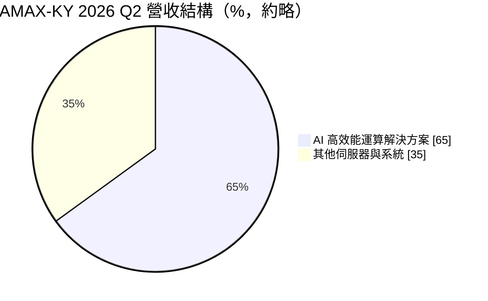
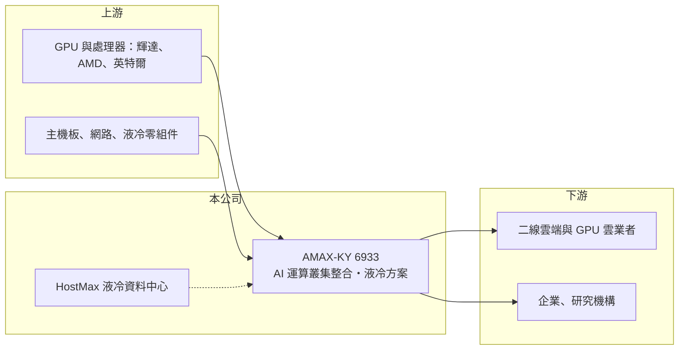

# 6933 AMAX-KY

> 上市｜[[產業索引-電腦及週邊設備業|電腦及週邊設備業]]｜上市（櫃）日期 2023/11/08

# 第一章：企業模式與商業藍圖

> [!info] 撰寫說明
> 精簡版，由 Claude 依公開資料整理，架構比照 [[2330台積電]]，資料截至 2026-10-08。來源：證交所開放資料快照（基本資料、2026 年第二季資產負債與損益、股利、月營收）、Goodinfo 經營績效頁、萬寶週刊 2026 年 10 月分析（經濟日報轉載）、優分析新聞標題。公司沿革與美國總部描述憑記憶整理，已標「待校對」。#待校對

AMAX-KY 是源自美國矽谷的伺服器與運算系統整合商，理解它的關鍵在於：它不是大量生產的代工廠，而是替企業與二線雲端客戶設計、組裝並部署整套 [[AI 伺服器]]運算叢集，價值來自整合與工程服務，而不是單台伺服器的製造。

- **核心業務：** AMAX 原為美國加州的伺服器與儲存系統整合商（創立年份與沿革待校對），2022 年成立開曼控股公司，2023 年 11 月在證交所上市。依萬寶週刊分析，公司正從伺服器硬體供應商轉型為「AI 資料中心整體解決方案商」，服務範圍涵蓋設計、[[液冷散熱]]、網路、儲存、資料中心建置、測試、部署、維運與顧問。每個專案的整合範圍愈大，單案價值就愈高。
- **營收結構：** 依萬寶週刊，2026 年第二季營收約 65% 來自 AI 高效能運算解決方案。地區別與客戶別營收比重未查得，依優分析新聞標題，亞洲與美國市場需求都強。第二代 AI 加速產品採用全密封液冷架構，支援 OCP ORv3 機櫃規格與 800G 網路，顯示產品已走向[[機櫃級整合]]。
- **營運據點：** 依記憶，研發與業務總部在美國加州（待校對）；依優分析新聞標題，台灣中壢廠正在擴建產能。公司另設有 HostMax 液冷資料中心，提供客戶測試、驗證、短期託管與 AI Factory 建置服務。
- **長期方向：** AMAX 表示自 2015 年起就投入液冷技術，早於這波 AI 熱潮，並有自家軟體管理伺服器、工作負載、泵浦與水流。長期方向是成為二線雲端、企業與研究機構建置 AI 資料中心時的一站式夥伴，與大型 ODM 主攻超大型雲端客戶的路線區隔。

# 第二章：護城河深度與競爭優勢

AMAX 的護城河屬於「窄護城河」，來自液冷與機櫃級整合的工程經驗、與 GPU 平台廠的合作關係，以及從設計到維運的服務能力。

- **競爭優勢：** 高階 AI 機櫃單櫃功耗可達 150 至 250 kW（萬寶週刊），這種規模的散熱、供電與網路整合，一般企業與中型雲端業者自己做不來，需要有經驗的整合商。AMAX 擁有冷板液冷、[[CDU]]、熱模擬與資料中心工程能力，又能提供測試場地與後續維運，客戶一旦交付一座叢集，後續擴充與維護常會延續同一家廠商。
- **主要對手：** 美國的 Supermicro、Dell、HPE 是最直接的競爭者，台灣的 [[7711永擎]]、[[2376技嘉]]、[[3231緯創]]、[[2382廣達]] 也供應 GPU 伺服器與整櫃方案。AMAX 規模遠小於這些對手，[[毛利率]]僅約 12% 至 19%，必須靠專案客製與服務深度競爭，而不是價格。
- **觀察重點：** 長期最該追蹤的是整合專案帶來的毛利率與營業利益率能否維持。2026 年上半年毛利率約 18.6%、營業利益率約 10.1%，明顯高於 2024、2025 年，若是專案組合改善所致，代表轉型開始見效；若只是 GPU 世代交替的短期紅利，獲利率可能回落。

# 第三章：財務體質與盈利規模

資料日期：2026-10-08，表格是撰寫當時的快照；最新月營收、毛利率、累計 EPS 由自動排程寫在本筆記的屬性欄位（月營收、毛利率、累計EPS 等）。#待校對

AMAX 的財務呈現「低毛利、高周轉、隨 GPU 世代起伏」的系統整合商樣貌：毛利率 10% 至 19%，營業利益率多在 2% 至 5%，2026 年起才明顯提升。

| 年度 | 營收（億元） | [[毛利率]] | [[營業利益率]] | EPS（元） | [[ROE]] |
|---|---|---|---|---|---|
| 2021 | 52.1 | 12.5% | 3.09% | 6.90 | 30.5% |
| 2022 | 67.5 | 12.4% | 4.15% | 5.10 | 17.2% |
| 2023 | 60.8 | 16.3% | 5.39% | 6.88 | 16.2% |
| 2024 | 54.9 | 13.5% | 2.43% | 3.94 | 7.96% |
| 2025 | 69.9 | 12.5% | 3.47% | 5.04 | 9.51% |

（來源：Goodinfo 經營績效頁。2026 年上半年依證交所資料，營收 44.9 億元、毛利率約 18.6%、營業利益率約 10.1%、EPS 6.43 元。）

- **營收規模：** 2020 年營收 34.1 億元，2025 年 69.9 億元，年複合成長率約 15.4%（推算）。2026 年 1 至 8 月累計營收約 72.8 億元、年增約 52%，已超過 2025 年全年。營收跟著 GPU 平台換代與大型專案交付起伏，2024 年曾年減約一成。
- **獲利：** 2021 至 2025 年平均 ROE 約 16.3%（推算），2021 年的 30.5% 受上市前股本較小影響。2026 年上半年營業利益 4.52 億元，業外損失約 0.99 億元（推估與匯兌有關，未查得），母公司淨利 2.72 億元。
- **財務特色：** 2026 年第二季總資產約 63.1 億元，其中流動資產 59.2 億元，負債約 38.0 億元，負債比約 60%，每股淨值 59.28 元。資產幾乎都是存貨、應收帳款與現金，屬於輕資產但重營運資金的模式。依證交所股利資料，114 年度現金股利 2.5 元，約為 2025 年 EPS 的 50%。大型 GPU 專案需要先墊付採購款，營業現金流可能隨專案時點大幅波動（推估）。
- **[[ROIC]] 與 [[WACC]]：** 以 2025 年營業利益約 2.43 億元（69.9 億元 × 3.47%）、稅率 20% 計算，稅後營業利益約 1.94 億元；有息負債未查得，投入資本以股東權益 25.1 億元到總資產 63.1 億元為區間，ROIC 約 3.1% 至 7.7%（推算）。2026 年上半年年化後約 11% 至 29%（推算）。WACC 以 [[CAPM]] 推估：無風險利率 1.75%、市場風險溢酬 6%、β 假設 1.2（AI 伺服器股波動較大），權益成本約 9.0%；稅後負債成本 2%、負債占三成，WACC 約 6.9%（推算）。2024、2025 年 ROIC 大致與 WACC 相當，2026 年若高營益率能維持，才算明確創造價值。

# 第四章：總體風險與地緣政治

AMAX 的風險集中在 GPU 供貨、專案集中與營運資金，屬於受 AI 資本支出週期驅動的整合商。

- **產業週期：** 營收高度連動 AI 資本支出與 GPU 平台換代。新平台推出初期供不應求、整合商議價力強，平台成熟後價格競爭加劇。客戶一旦放緩建置，訂單會比終端需求更劇烈地下滑。
- **營運風險：** GPU 與高階網路設備由少數原廠供應，配貨優先順序直接影響出貨。大型專案需要墊付大量採購款，客戶延遲驗收時存貨與應收帳款會快速升高。液冷系統的可靠度與現場施工品質若出問題，可能造成高額賠償。
- **其他風險：** 美國對高階 AI 晶片的出口管制，限制了對部分國家客戶的銷售。營收以美元計價，匯率波動影響業外損益。KY 公司跨境營運，資訊揭露與治理也是投資人需要留意的面向。

# 專有名詞解析

## 應用

- **[[AI 伺服器]]**：搭載 GPU 等加速晶片、用於訓練與推論 AI 模型的伺服器，對散熱與電源規格要求很高。

## 產業

- **[[液冷散熱]]**：以液體帶走晶片熱量的散熱方式，散熱效率高於風冷，適用高功耗 AI 伺服器。
- **[[機櫃級整合]]**：以整個機櫃為單位整合伺服器、網路、電源與散熱，出貨後可直接上線運作。
- **[[CDU]]**：冷卻液分配單元，負責在液冷系統中輸送、控溫並監控冷卻液，是機櫃級液冷的核心設備。

# 核心供應鏈

- 上游：GPU 與處理器來自 [[NVDA輝達]]、[[AMD超微]]、[[INTC英特爾]]，另需伺服器主機板、交換器、儲存與液冷零組件。
- 下游／客戶：二線雲端與 GPU 雲業者、企業與研究機構的 AI 伺服器叢集專案（具體客戶未點名，#待校對）。
- 同業：Supermicro、Dell、HPE，以及 [[7711永擎]]、[[2376技嘉]]、[[3231緯創]]、[[2382廣達]]。

## 最新新聞
<!-- news:start -->
<!-- news:end -->

## 相關連結
- [公開資訊觀測站](https://mopsov.twse.com.tw/mops/web/t05st03?step=1&firstin=1&co_id=6933)
- [Goodinfo](https://goodinfo.tw/tw/StockDetail.asp?STOCK_ID=6933)
- [Yahoo 股市](https://tw.stock.yahoo.com/quote/6933)
- [鉅亨網新聞](https://www.cnyes.com/twstock/6933/news)
