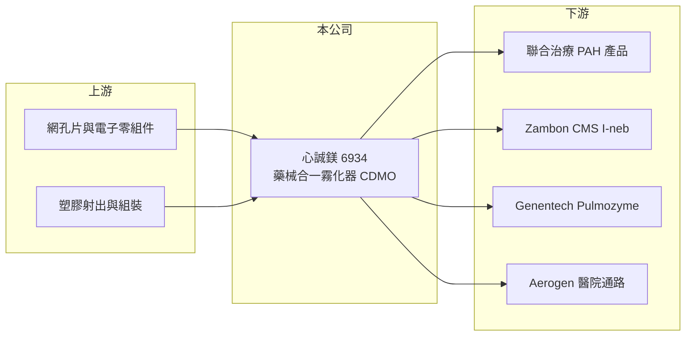

# 6934 心誠鎂

> 上市｜[[產業索引-生技醫療業|生技醫療業]]｜上市（櫃）日期 2026/02/02

# 第一章：企業模式與商業藍圖

> [!info] 撰寫說明
> 精簡版，由 Claude 依公開資料整理，架構比照 [[2330台積電]]，資料截至 2026-10-08。來源：證交所開放資料快照（基本資料、2026 年第二季財報與營益分析、2025 年度股利、2026 年 8 月營收）、Goodinfo 經營績效頁、優分析 2026 年 1 月上市前報導。霧化技術細節與部分對手憑記憶整理，已標「待校對」。#待校對

心誠鎂是一家替藥廠開發吸入藥物專用霧化器的醫材公司，理解它的關鍵是「藥械合一」的商業模式：霧化器跟著特定藥物一起取證、一起上市，一旦綁定就很難被替換。

- **核心業務：** 心誠鎂聚焦高階醫用霧化器的[[藥械合一]] [[CDMO]]，替藥廠開發吸入藥物的遞送裝置。產品包括連續式霧化器 Pulmogine，以及為義大利藥廠 Zambon 的 CMS I-neb 計畫開發的呼吸偵測式霧化器，技術屬於[[振動網孔霧化]]（技術類型憑記憶，待校對）。吸入藥物的療效高度依賴霧化粒徑與給藥效率，因此藥廠會把特定霧化器寫進藥品仿單，裝置本身成為藥品的一部分。
- **營收結構：** 與美國聯合治療（United Therapeutics）的授權合約分三階段收入：300 萬美元簽約金、2025 年起陸續入帳的開發里程碑金，以及產品上市後（預計 2027 至 2028 年）的銷貨收入。目前營收仍小，2025 年約 1 億元，2026 年 1 至 8 月約 0.20 億元，主要是開發服務與少量銷售。
- **營運據點：** 公司設立於 2014 年 10 月，2026 年 2 月 2 日上市，實收資本額約 3.61 億元。現有年產能約 10 至 12 萬台霧化器，規劃擴產到每年 30 至 40 萬台，資本支出不超過 1 億元。
- **長期方向：** 合作藥廠的產品上市後，霧化器會隨藥物長期銷售，形成類似耗材的重複性收入。羅氏子公司 Genentech 的 Pulmozyme 仿單已列入 Pulmogine，並與 Aerogen 合作切入歐美醫院市場。公司預期 2027 至 2028 年營收大幅成長。

# 第二章：護城河深度與競爭優勢

藥械合一的護城河來自法規綁定，本章說明心誠鎂的優勢、對手與觀察重點。

- **競爭優勢：** 霧化器一旦和藥物一起完成臨床並寫入仿單，藥廠若要換裝置，必須重新做相容性試驗甚至臨床試驗，轉換成本很高。這使心誠鎂的合作關係具有長期性，只要合作藥物銷售成長，霧化器的需求就跟著成長。Zambon 的 CMS I-neb 已完成三期臨床並獲美國 FDA 突破性療法認定，心誠鎂的霧化器將取代原本搭配的飛利浦 I-neb。
- **主要對手：** 國際霧化器廠如愛爾蘭 Aerogen（同時也是合作夥伴）、德國 PARI，以及飛利浦、歐姆龍等（對手名單憑記憶，待校對）。台股醫材同業有 [[4735豪展]] 等居家醫材廠，但多數以居家用一般霧化器為主，與藥械合一的高階產品定位不同。
- **觀察重點：** 聯合治療與 Zambon 合作產品的上市時程、擴產進度，以及是否再取得新的藥廠合作案。合作案數量越多，對單一客戶的依賴就越低。

# 第三章：財務體質與盈利規模

資料日期：2026-10-08，表格是撰寫當時的快照；最新月營收、毛利率、累計 EPS 由自動排程寫在本筆記的屬性欄位（月營收、毛利率、累計EPS 等）。#待校對

在合作藥物上市前，心誠鎂的營收主要是一次性的授權與開發收入，財務分析的重點是虧損規模與資金能否撐到量產期。

| 年度 | 營收（億元） | [[毛利率]] | [[營業利益率]] | EPS（元） | [[ROE]] |
|---|---|---|---|---|---|
| 2021 | 0.54 | 64.1% | -75.6% | -2.29 | -23.3% |
| 2022 | 0.06 | -475% | -2254% | -6.66 | 未查得 |
| 2023 | 0.09 | -283% | -1557% | -6.25 | -72.5% |
| 2024 | 1.42 | 70.4% | -26.5% | -2.60 | -32.2% |
| 2025 | 1.00 | 24.9% | -119% | -3.92 | -50.8% |
| 2026 上半年 | 0.20 | -165.9% | -493% | -2.69 | 未查得 |

- **營收規模：** 營收在 2024 年跳升到 1.42 億元、毛利率 70%，推估與授權簽約金入帳有關；其他年度營收很小，毛利率常為負，反映小量生產時固定成本無法攤提。營收要等合作藥物上市後才會穩定。
- **獲利：** 2025 年稅後淨損約 1.26 億元，2026 年上半年營業損失約 0.98 億元、EPS -2.69 元。2025 年底累積虧損約 6.64 億元，短期內無法配息。（2022 年 ROE 因當時權益極低而呈現異常值，表中以未查得表示。）
- **財務特色：** 2026 年第二季底股東權益約 5.30 億元、負債約 1.38 億元，上市募資後資金較充裕，但以目前虧損速度推算，每年約消耗 2 億元（推算），擴產與量產前的資金仍需管理。
- **[[ROIC]] 與 [[WACC]]：** 以 2026 年上半年營業損失 0.98 億元年化為 1.95 億元，除以投入資本約 6.16 億元（股東權益加非流動負債 0.86 億元），ROIC 約 -32%（推算）。WACC 以 CAPM 推估：無風險利率 1.75%、市場風險溢酬 6%、β 取研發型醫材常見的 1.3（假設值），負債比重低，WACC 約 9.5% 至 10%（推算）。ROIC 遠低於 WACC，公司仍在投入期，價值取決於合作藥物上市後霧化器能否穩定出貨。
- **長期指標：** 近 5 年皆為虧損，未配發現金股利，自由現金流長期為負。

# 第四章：總體風險與地緣政治

藥械合一公司的命運和合作藥物綁在一起，本章說明主要風險。

- **產業週期：** 吸入藥物市場與呼吸道疾病、罕見肺病相關，不太受景氣循環影響。但營收時點取決於合作藥廠的臨床與上市進度，波動大且難以預測。
- **營運風險：** 營收高度集中在少數合作案，聯合治療或 Zambon 的產品若延後上市、銷售不佳或改用其他裝置，心誠鎂會直接受影響。擴產後若出貨未如預期，折舊會加重虧損。
- **其他風險：** 產品需同時符合藥品與醫材法規，美國 FDA 與歐盟的審查要求都很嚴格。合作收入多以美元計價，有匯率影響。

# 專有名詞解析

## 產業

- **[[藥械合一]]**：藥品與醫療器材一起開發、一起取證的組合產品，例如吸入藥物與專用霧化器。
- **[[CDMO]]**：委託開發暨製造服務，替客戶從產品開發一路做到量產。
- **[[振動網孔霧化]]**：利用高頻振動的微孔金屬片把藥液打成細小霧粒，粒徑均勻、適合深入肺部。
- **[[肺動脈高壓]]**：肺部血管阻力升高、使右心負擔過重的罕見疾病，治療藥物單價高。
- **[[突破性療法認定]]**：美國 FDA 給初步證據顯示明顯優於現有療法的藥物的認定，可加快審查。

# 核心供應鏈

- 上游：霧化網孔片、電子零組件、塑膠射出與組裝供應商（個別名稱未查得）。
- 下游／客戶：美國聯合治療、義大利 Zambon、羅氏子公司 Genentech，以及合作切入歐美醫院市場的 Aerogen。
- 同業：國際的 PARI、Aerogen；台股醫材同業 [[4735豪展]]；同樣走吸入劑型的新藥公司 [[6875國邑]]。

## 最新新聞
<!-- news:start（自動產生，請勿手動編輯此範圍） -->
- 2026-10-08 📰 媒體 17:24｜營收速報 - 心誠鎂(6934)9月營收3,476萬元年增率高達822.86％｜[鉅亨網](https://news.cnyes.com/news/id/6625041)
- 2026-10-08 🏛️ 重訊 14:25｜本公司與某國際製藥公司簽署主服務合約｜[觀測站](https://mops.twse.com.tw/mops/#/web/t05st01)

完整紀錄：[[6934心誠鎂 新聞]]
<!-- news:end -->

## 相關連結
- [公開資訊觀測站](https://mopsov.twse.com.tw/mops/web/t05st03?step=1&firstin=1&co_id=6934)
- [Goodinfo](https://goodinfo.tw/tw/StockDetail.asp?STOCK_ID=6934)
- [Yahoo 股市](https://tw.stock.yahoo.com/quote/6934)
- [鉅亨網新聞](https://www.cnyes.com/twstock/6934/news)
