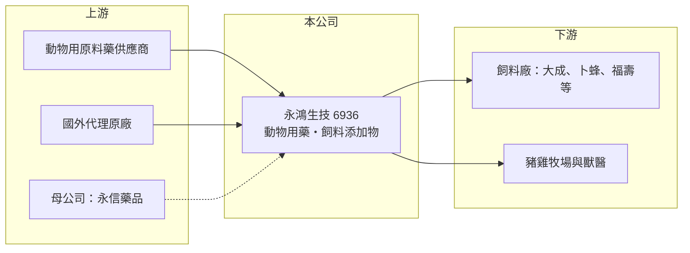

# 6936 永鴻生技

> 上市｜[[產業索引-生技醫療業|生技醫療業]]｜上市（櫃）日期 2025/04/28

# 第一章：企業模式與商業藍圖

> [!info] 撰寫說明
> 精簡版，由 Claude 依公開資料整理，架構比照 [[2330台積電]]，資料截至 2026-10-08。來源：證交所開放資料快照（基本資料、2026 年第二季財報與營益分析、2025 年度股利、2026 年 8 月營收）、Goodinfo 經營績效頁、nStock 公司沿革。公開資料有限，產品營收比重未查得。#待校對

永鴻生技是 [[3705永信]] 集團旗下的動物保健公司，理解它要從畜牧業的需求出發：豬、雞等經濟動物的疾病預防與生長效率，直接決定養殖戶的收益，而動物用藥與飼料添加物就是養殖成本中的關鍵投入。

- **核心業務：** 永鴻生技進口、製造並銷售動物用藥、動物保健食品、[[飼料添加物]]與飼料，代表性產品包括飼料添加物品牌「歐羅肥」（依 2025 年上市報導）。動物用藥與添加物的客戶是飼料廠與養殖戶，產品一旦在牧場用出效果，養殖戶通常會長期沿用，因此具有重複採購的特性。
- **營收結構：** 各產品線的營收比重未查得。依公司營業項目，營收來自動物用藥、保健食品、飼料添加物與飼料四大類，客戶以經濟動物的飼料廠與牧場為主。
- **營運據點：** 公司於 2012 年 5 月設立，原名碩騰生技，2016 年由永信藥品取得全部股權並更名為永鴻國際生技；2023 年 3 月登錄興櫃，2025 年 4 月 28 日上市，實收資本額約 7.28 億元。截至 2026 年 6 月底，永信藥品工業持股約 50.02%。
- **長期方向：** 全球畜牧業正從大量使用抗生素轉向疫苗、益生菌與功能性添加物等[[減抗]]方案，這是動物保健產業最重要的長期趨勢。永鴻生技背靠永信集團的製藥經驗，可以在人用藥與動物藥之間共享研發與製造能力（集團綜效為推估）。

# 第二章：護城河深度與競爭優勢

動物保健業的護城河來自藥證、通路關係與產品口碑，本章說明永鴻生技的位置。

- **競爭優勢：** 動物用藥需要取得主管機關核發的動物用藥品許可證，新產品從開發到取證需時數年，形成進入門檻。永鴻生技屬於永信集團，可借助集團在製藥品質管理與原料採購上的經驗；長期經營的經銷與獸醫網絡，也讓產品更容易進入牧場。
- **主要對手：** 國際動物保健大廠如碩騰（Zoetis）、勃林格殷格翰動物保健、Elanco 在疫苗與處方藥上具有規模優勢（對手名單為產業常識，待校對）。在飼料添加物領域，則與國內外多家添加物廠競爭。下游的大型飼料與肉品集團如 [[1210大成]]、[[1215卜蜂]]、[[1219福壽]] 議價能力強，也會影響價格。
- **觀察重點：** 減抗政策下新產品的推出速度、海外市場的拓展，以及毛利率能否維持在三成以上。2024 年毛利率提升到 34.1%，顯示產品組合改善有空間。

# 第三章：財務體質與盈利規模

資料日期：2026-10-08，表格是撰寫當時的快照；最新月營收、毛利率、累計 EPS 由自動排程寫在本筆記的屬性欄位（月營收、毛利率、累計EPS 等）。#待校對

動物保健業的財務特色是需求穩定、獲利波動小，本章用多年度數據檢視永鴻生技的獲利品質與配息能力。

| 年度 | 營收（億元） | [[毛利率]] | [[營業利益率]] | EPS（元） | [[ROE]] |
|---|---|---|---|---|---|
| 2020 | 11.1 | 31.0% | 12.2% | 1.89 | 11.7% |
| 2021 | 11.8 | 30.4% | 11.6% | 2.00 | 11.6% |
| 2022 | 11.9 | 29.8% | 10.5% | 1.69 | 10.6% |
| 2023 | 12.1 | 29.5% | 9.24% | 1.38 | 8.68% |
| 2024 | 12.9 | 34.1% | 13.2% | 2.06 | 12.5% |
| 2025 | 14.2 | 31.9% | 11.0% | 1.82 | 10.4% |
| 2026 上半年 | 7.44 | 37.4% | 14.0% | 1.14 | 未查得 |

- **營收規模：** 營收從 2020 年的 11.1 億元成長到 2025 年的 14.2 億元，年複合成長率約 5%（推算），屬於穩定的低速成長。2026 年 1 至 8 月累計營收約 10.03 億元，年增約 9%。
- **獲利：** 毛利率長期在 30% 上下，營業利益率約 9% 至 14%，2023 年因原料成本或產品組合因素降到低點後回升。2026 年上半年毛利率 37.4%、稅後淨利約 0.83 億元，獲利結構有所改善。
- **財務特色：** 2026 年第二季底股東權益約 13.25 億元、負債約 4.50 億元，負債以流動負債為主（實際有息借款未查得），財務穩健。2025 年度稅後淨利約 1.29 億元，配發現金股利 1.51 元，配發率約 83%（以 EPS 1.82 元推算），顯示公司傾向把大部分盈餘發還股東。
- **[[ROIC]] 與 [[WACC]]：** 以 2026 年上半年營業利益 1.04 億元年化為 2.08 億元，扣 20% 稅後約 1.66 億元，除以投入資本約 13.25 至 15.3 億元（股東權益，加上假設最多約 2 億元有息負債），ROIC 約 11% 至 12.5%（推算）。WACC 以 CAPM 推估：無風險利率 1.75%、市場風險溢酬 6%、β 取民生型醫藥同業常見的 0.8（假設值），股權成本約 6.6%，負債比重低，WACC 約 6% 至 6.5%（推算）。ROIC 高於 WACC 約 5 個百分點，代表公司長期穩定創造價值。
- **長期指標：** 近 5 年（2021 至 2025 年）ROE 平均約 10.8%（推算），波動小；高配息率搭配穩定獲利，是這家公司最主要的長期特徵。

# 第四章：總體風險與地緣政治

動物保健業的風險主要來自畜牧業本身的循環與疫病，本章分別說明。

- **產業週期：** 豬價、雞價與飼料原料（玉米、黃豆）價格會影響養殖戶的獲利與用藥意願，畜牧業景氣差時，養殖戶會壓縮添加物與保健品支出。整體需求與肉品消費相關，長期穩定但會有年度波動。
- **營運風險：** 非洲豬瘟、禽流感等重大疫病若爆發，飼養頭數驟減會直接影響需求。下游客戶集中在大型飼料廠與畜牧集團，議價能力強。原料多仰賴進口，國際原料價格與供應穩定度也會影響毛利率。
- **其他風險：** 各國對動物用抗生素的限制持續趨嚴，舊產品可能被淘汰，需要持續投入新產品開發與取證。母公司持股過半，集團的資本配置決策也會影響小股東權益。

# 專有名詞解析

## 產業

- **[[飼料添加物]]**：加入飼料中以促進生長、改善消化或預防疾病的物質，例如酵素、益生菌、胺基酸。
- **[[減抗]]**：減少畜牧業使用抗生素，以疫苗、益生菌等替代方案降低抗藥性風險的政策趨勢。
- **[[動物用藥品許可證]]**：動物用藥上市前須取得的主管機關核准，台灣由農業部主管。
- **[[經濟動物]]**：為生產肉、蛋、奶而飼養的動物，例如豬、雞、牛，相對於寵物。

# 核心供應鏈

- 上游：動物用原料藥與添加物原料供應商（多為進口，個別名稱未查得），母公司 [[3705永信]] 提供集團製藥資源。
- 下游／客戶：飼料廠與畜牧集團（[[1210大成]]、[[1215卜蜂]]、[[1219福壽]] 等為產業代表，是否為客戶未查得），以及豬雞牧場與獸醫。
- 同業：國際的碩騰、勃林格殷格翰動物保健、Elanco；台股保健原料相關的 [[8279生展]]。

## 最新新聞
<!-- news:start -->
<!-- news:end -->

## 相關連結
- [公開資訊觀測站](https://mopsov.twse.com.tw/mops/web/t05st03?step=1&firstin=1&co_id=6936)
- [Goodinfo](https://goodinfo.tw/tw/StockDetail.asp?STOCK_ID=6936)
- [Yahoo 股市](https://tw.stock.yahoo.com/quote/6936)
- [鉅亨網新聞](https://www.cnyes.com/twstock/6936/news)
