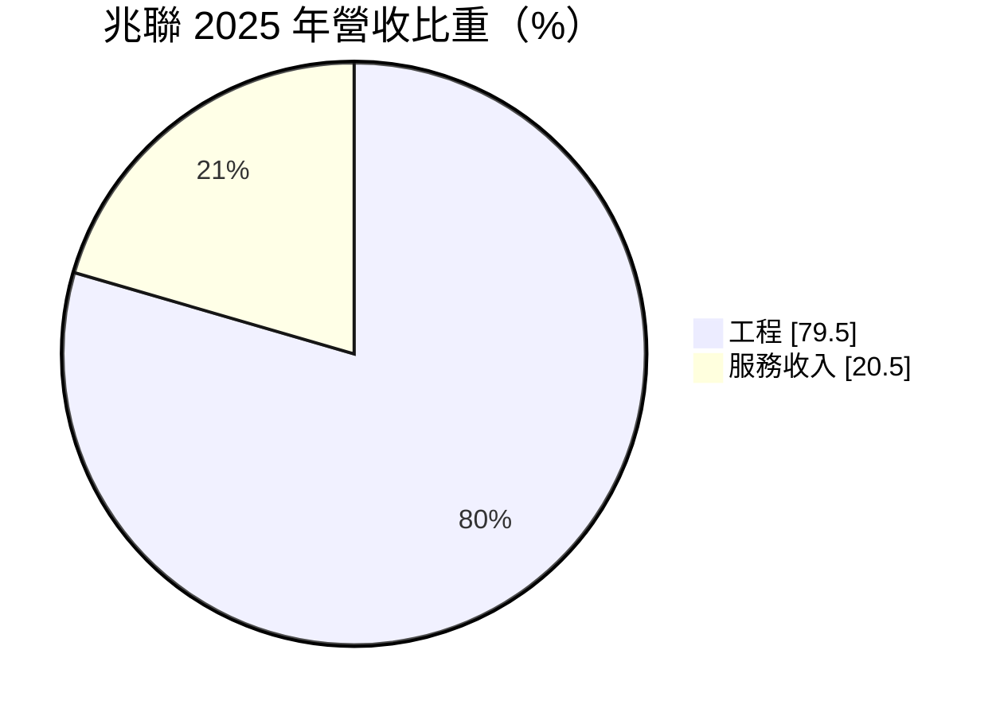
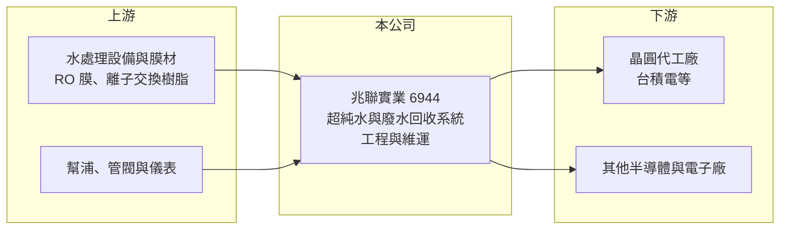

# 6944 兆聯實業

> 上市｜[[產業索引-綠能環保|綠能環保]]｜上市（櫃）日期 2025/05/28

# 第一章：企業模式與商業藍圖

> [!info] 撰寫說明
> 精簡版，由 Claude 依公開資料整理，架構比照 [[2330台積電]]，資料截至 2026-10-08。來源：富邦 MoneyDJ 財務比率年表（2019 至 2025 年）與基本資料（2025 年營收比重）；證交所開放資料快照（基本資料、2026 年上半年資產負債與損益、2025 年度股利、每月營收）；優分析、證交所市場動態新聞標題。主要客戶與技術內容為憑記憶與新聞標題整理，已標「待校對」；歷年營收由每股營業額與成長率推算。#待校對

兆聯實業成立於 2004 年 12 月、2025 年 5 月上市，董事長林國清、總經理周志銘，總部在新竹地區（待校對）。它是替半導體廠設計、建造與維運水處理系統的工程公司，主要做[[超純水]]製造系統與廢水回收系統，新聞以「台積電水系統工程廠」形容它，營收高度跟著 [[2330台積電]] 的建廠與資本支出走。

- **核心業務：** 2025 年營收中工程占 79.5%、服務收入占 20.5%。工程是替新晶圓廠興建超純水、廢水處理與[[廢水回收]]系統，屬於按工程進度認列的專案收入；服務則是系統完工後的操作維護、耗材更換與擴充改善。晶圓製造每一道清洗製程都需要大量超純水，水質直接影響良率，因此水處理系統是晶圓廠不可缺少的廠務基礎設施。
- **營收結構：** 依每股營業額與成長率推算，2025 年營收約 169 億元（推算），年增 64.2%，2021 年約 77 億元（推算），四年成長一倍以上。主要客戶為台積電（占比待校對），因此營收的節奏取決於台積電在台灣、美國、日本等地的新廠進度。
- **營運據點：** 以台灣為主，隨客戶赴海外設廠，也承接海外廠區的水處理工程（地點與規模待校對）。工程人員必須長期駐廠施工與維運，人力與專案管理能力是營運的核心資源。
- **長期方向：** 半導體製程越先進，用水量與水質要求越高，加上台灣缺水與環保法規要求提高水回收率，廢水回收與再生水的比重會持續上升。兆聯的長期方向是擴大服務收入比重，讓營收不只依賴建廠高峰，也能從已完工的系統持續收取維運費用（策略細節待校對）。

# 第二章：護城河深度與競爭優勢

兆聯的護城河來自與台積電長期合作累積的實績與技術認證，這是半導體廠務領域最難取得的資格。

- **競爭優勢：** 晶圓廠對水質的要求達到極低雜質濃度，系統一旦出問題就可能影響整條產線，因此客戶傾向沿用經過驗證的供應商，形成很高的[[轉換成本]]。兆聯參與客戶多個世代廠區，熟悉其標準與規格，新廠設計時能快速複製。2023 年起毛利率從過去不到 12% 跳升到 20% 以上，顯示議價能力與專案組合明顯改善。
- **主要對手：** 半導體廠務工程同業包括 [[2404漢唐]]、[[6139亞翔]]、[[6196帆宣]]、[[5536聖暉]]（以無塵室與機電為主），水處理專業廠商則有日商栗田工業、野村微科學與歐美水處理集團（在台業務待校對）。兆聯與漢唐等業者有時是合作關係，由統包商分包水處理系統。
- **觀察重點：** 營收中服務收入的比重能否持續提高，以及非台積電客戶（記憶體、封測、面板）的開發進度，決定兆聯能否降低客戶集中度。另一個重點是海外工程的毛利率，海外人力與物料成本較高，若專案管控不佳會拉低整體獲利。

# 第三章：財務體質與盈利規模

資料日期：2026-10-08，表格是撰寫當時的快照；最新月營收、毛利率、累計 EPS 由自動排程寫在本筆記的屬性欄位（月營收、毛利率、累計EPS 等）。#待校對

兆聯在 2023 年後進入高成長、高 ROE 階段，獲利能力隨半導體建廠潮大幅躍升。

| 年度 | 營收（億元） | [[毛利率]] | [[營業利益率]] | EPS（元） | [[ROE]] |
|---|---|---|---|---|---|
| 2021 | 約 77（推算） | 8.78% | 4.36% | 5.66 | 25.84% |
| 2022 | 約 100（推算） | 9.70% | 6.21% | 7.44 | 23.18% |
| 2023 | 約 90（推算） | 20.20% | 15.77% | 17.57 | 36.82% |
| 2024 | 約 103（推算） | 22.80% | 18.70% | 22.33 | 38.49% |
| 2025 | 約 169（推算） | 22.61% | 18.42% | 32.29 | 37.95% |

註：2025 年營收以每股營業額 220.54 元乘以約 7,669 萬股（扣除 2026 年盈餘轉增資 2,301 萬股前的股數）推算，其他年度依 MoneyDJ 營收成長率回推，股本曾多次變動，推算值僅供參考。2026 年上半年營收 97.87 億元、毛利率 27.82%、營業利益率 23.20%、EPS 16.50 元（證交所資料）。

- **長期指標：** 2021 至 2025 年營收年複合成長率約 21.6%（推算），近 5 年平均 [[ROE]] 約 32.5%（推算），2023 至 2025 年都在 36% 以上。2025 年度配發現金股利 17 元加股票股利 3 元，現金部分約為 EPS 32.29 元的 53%。每股現金流量 2022 至 2025 年皆為正（22.84 至 40.09 元），2019 至 2021 年為負，工程預收款增加讓近年現金流明顯改善。
- **[[ROIC]] 與 [[WACC]]：** 2025 年稅後營業利益約 24.9 億元（營業利益率 18.42% × 營收約 169 億元 × 0.8），投入資本約 94 億元（2026 年第二季權益總計 84.64 億元，加上推估的有息負債約 9.8 億元；總負債 97.63 億元多為工程預收款與應付帳款，故只取一成），ROIC 約 26%（推算）。WACC 約 6.6%（推算：無風險利率 1.75%、市場風險溢酬 6%、β 取半導體廠務同業常見值 0.9，股東權益成本 7.15%；稅前負債成本 2.5%、稅率 20%；權益比重約 90%）。ROIC 遠高於 WACC，代表目前處於強力創造價值的階段，但工程業的 ROIC 會隨建廠週期起伏。
- **財務特色：** 2026 年第二季負債比率約 54%（負債 97.63 億元 ÷ 資產 182.26 億元），流動負債 92.80 億元占負債九成以上，屬工程業典型的「用客戶的錢做工程」結構。流動資產 151.56 億元，現金與合約資產充足。股價淨值比約 7.48 倍（2026 年 10 月初快照），市場給予高成長評價。

# 第四章：總體風險與地緣政治

兆聯的風險集中在單一客戶與半導體資本支出週期。

- **產業週期：** 工程營收取決於晶圓廠的興建時程，半導體資本支出是有週期的，2023 年營收年減約 10% 就是建廠進度放緩的結果。若 AI 需求降溫導致客戶延後新廠，工程營收可能出現明顯下滑。
- **營運風險：** 客戶高度集中於台積電（比重待校對），客戶策略或供應商分配一旦改變，影響巨大。工程以固定總價承攬時，物料、人力成本上漲或工期延誤會吃掉毛利；海外專案也有當地法規與勞動力不足的風險。
- **其他風險：** 半導體產業的地緣政治變化會改變客戶在各國的建廠布局；台灣水資源吃緊時，政府對用水與回收率的規範可能提高，這對兆聯是商機，但也意味技術要求持續升級。

# 專有名詞解析

## 半導體

- **[[超純水]]**：去除幾乎所有離子、微粒與有機物的高純度水，用於晶圓清洗，水質直接影響良率。

## 金融

- **[[ROIC]]**：投入資本報酬率，稅後營業利益除以股東權益加有息負債，衡量本業運用資本的效率。
- **[[WACC]]**：加權平均資金成本，股東與債權人要求報酬率的加權平均，是 ROIC 要超越的門檻。

## 產業

- **[[廢水回收]]**：把工廠製程廢水處理後再送回製程或冷卻系統使用，可降低取水量與排放量。
- **[[轉換成本]]**：客戶更換供應商時需付出的時間、金錢與風險，轉換成本愈高，供應商的客戶黏著度愈高。

# 核心供應鏈

- 上游：RO 膜、離子交換樹脂、幫浦與管閥供應商（多為日、美、歐廠商，名單未查得）。
- 下游／客戶：[[2330台積電]]（主要客戶，比重待校對）及其他半導體廠。
- 同業：[[2404漢唐]]、[[6139亞翔]]、[[6196帆宣]]、[[5536聖暉]]。

## 最新新聞
<!-- news:start -->
<!-- news:end -->

## 相關連結
- [公開資訊觀測站](https://mopsov.twse.com.tw/mops/web/t05st03?step=1&firstin=1&co_id=6944)
- [Goodinfo](https://goodinfo.tw/tw/StockDetail.asp?STOCK_ID=6944)
- [Yahoo 股市](https://tw.stock.yahoo.com/quote/6944)
- [鉅亨網新聞](https://www.cnyes.com/twstock/6944/news)
