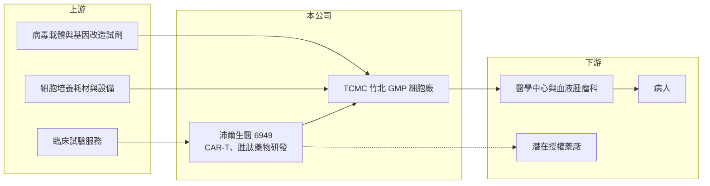

# 6949 沛爾生醫-創

> 創新板｜[[產業索引-生技醫療業|生技醫療業]]｜上市（櫃）日期 2024/03/08

# 第一章：企業模式與商業藍圖

> [!info] 撰寫說明
> 精簡版，由 Claude 依公開資料整理，架構比照 [[2330台積電]] 的四章研究，資料截至 2026-10-08。來源：富果 2026 年 5 月法說會備忘錄、證交所開放資料（基本資料、2026 年第二季資產負債與綜合損益、營益分析、股利、每月營收）。創新板／新掛牌，公開資料有限；Goodinfo 頁面未能讀取，2021 至 2025 年營收、毛利率與 EPS 未查得。#待校對

沛爾生醫是一家以 CAR-T 細胞治療為核心的新藥研發公司，尚未有主力產品上市。本章說明它的研發管線、生產布局與長期方向。

## 一、核心定位：仍在研發期的細胞治療公司

沛爾生醫成立於 2017 年，總部位於台北內湖，2024 年 3 月在證交所[[創新板]]掛牌，實收資本額約 6.6 億元，董事長林成龍（證交所開放資料）。公司主要研發 [[CAR-T]] [[細胞治療]]（自體、針對血液腫瘤與實體腫瘤）與小分子胜肽藥物（類風濕性關節炎、帕金森氏症）（富果）。

* **研發型生技公司的特性：** 公司目前沒有主力產品上市，營收主要來自子公司博生銷售與核心業務關聯不大的產品，金額很小。公司價值幾乎完全建立在研發管線未來能否取得藥證並商業化。
* **CAR-T 的商業意義：** CAR-T 是把病人自己的 T 細胞取出、經基因改造後再輸回體內攻擊癌細胞的療法，對部分復發型血癌效果顯著，但製造複雜、單次治療費用高，需要專屬的 GMP 細胞製造廠。

## 二、研發管線

* **PL001（CD19 CAR-T，B 細胞淋巴瘤）：** 最接近上市的產品。二期臨床因數據良好提前完成收案，公司計畫走 RMAT 相關途徑申請許可，預期 2026 年底至 2027 年初可能取得核准，並規劃在台灣、新加坡與日本進行三期試驗（富果）。
* **多鏈 CAR-T（實體腫瘤，如卵巢癌）、BCMA CAR-T（多發性骨髓瘤）：** 前者在臨床前階段，後者恩慈治療結果正面，但正式臨床暫緩，等待更好的抗體設計。
* **PL004（體內 CAR-T）：** 臨床前，公司已把原本投入異體 CAR-T 的資源轉到這裡，是長期重點。
* **胜肽藥物 PP011（類風濕性關節炎）、PP021（帕金森氏症）：** 前者規劃在中國進行一期臨床，後者一期安全性試驗預計 2026 年底至 2027 年初完成。

## 三、生產與集團布局

子公司臺灣細胞製造（TCMC，持股 66.88%）的竹北新廠在 2026 年 6 月啟用，負責生產 PL001，未來可能延伸為 [[CDMO]] 代工服務；全資子公司配泰醫療科技（上海張江）負責中國的胜肽臨床試驗（富果）。2026 年上半年公司募資約 18.6 億元，為研發與建廠提供資金。

## 四、長期藍圖

公司的策略分三階段：短期取得 PL001 台灣許可、建立穩定現金流；中期將 PL001 推向國際並加速胜肽藥物開發；長期聚焦體內 CAR-T 與多鏈 CAR-T 平台。這是典型的新藥公司路徑，每一階段都伴隨臨床失敗與時程延後的風險。

# 第二章：護城河深度與競爭優勢

新藥研發公司的護城河來自專利、臨床數據與製造能力，本章分析沛爾生醫的優勢與風險。

## 一、護城河的核心組成要素

* **臨床數據與先行者優勢：** PL001 若能成為台灣較早取得許可的本土 CAR-T 產品，可在本地醫院建立治療經驗與轉介網絡，後進者需要更長時間追趕。
* **自有 GMP 細胞製造廠：** CAR-T 的製造是品質與成本的關鍵，自建竹北廠讓公司掌握產能與製程，不必依賴外部代工。
* **多元管線：** 同時布局血液腫瘤、實體腫瘤、體內 CAR-T 與胜肽藥物，單一產品失敗不至於讓公司失去所有價值。

## 二、主要競爭對手

| 對手 | 定位 | 對沛爾生醫的威脅 |
|---|---|---|
| 諾華（Kymriah）、吉利德 Kite（Yescarta） | 全球已上市 CD19 CAR-T | 已有完整臨床數據與上市經驗 |
| 中國 CAR-T 公司 | 價格較低、開發速度快 | 在亞洲市場以價格競爭 |
| [[6712長聖]] | 台灣細胞治療公司 | 在台灣細胞治療市場競爭 |
| [[1784訊聯]] | 細胞儲存與細胞治療 | 在再生醫療與細胞治療競爭 |

## 三、守得住與守不住

* **守得住：** 若取得許可，台灣本地市場的價格與可近性優勢，以及自有製造廠的成本控制。
* **守不住：** 研發時程與資金。新藥開發成本高、時間長，在產品上市前公司每年都會虧損，必須持續募資。
* **觀察重點：** PL001 能否在 2026 年底至 2027 年初如期取得許可，以及上市後的病人數與定價。

# 第三章：財務體質與盈利規模

資料日期：2026-10-08，表格是撰寫當時的快照；最新月營收、毛利率、累計 EPS 由自動排程寫在本筆記的屬性欄位（月營收、毛利率、累計EPS 等）。#待校對

本章用可取得的數據檢視沛爾生醫的虧損規模與資金狀況。新藥公司在研發期沒有穩定營收，三率意義有限，重點在燒錢速度與現金能撐多久。

## 一、多年度財務數據

| 年度 | 營收（新台幣） | [[毛利率]] | [[營業利益率]] | EPS（元） | [[ROE]] |
|---|---|---|---|---|---|
| 2023 | 未查得 | 未查得 | 未查得 | 未查得 | 未查得 |
| 2024 | 未查得 | 未查得 | 未查得 | 未查得 | 未查得 |
| 2025 | 未查得 | 未查得 | 未查得 | 未查得 | 未查得 |
| 2026 上半年 | 0.15 億 | -19.60% | -1,292.9% | -2.54 | 未查得 |

註：2026 上半年取自證交所營益分析與綜合損益。2025 年度本期淨損約 4.24 億元（證交所股利資料中的本期淨利欄位）；其他年度未查得。

* **營收極小：** 2026 年上半年營收約 0.15 億元，1 至 8 月累計約 0.24 億元（證交所每月營收），主要來自子公司與非核心產品，不代表研發成果。
* **虧損規模：** 2026 年上半年營業虧損約 1.98 億元、歸屬母公司淨損約 1.65 億元（證交所綜合損益）；2025 年全年淨損約 4.24 億元。以此估算，公司每年燒錢約 4 億元上下（推估）。

## 二、股利與財務結構

公司尚未配發股利（證交所股利資料）。2026 年第二季底總資產約 31.6 億元、總負債約 3.3 億元、權益約 28.2 億元（歸屬母公司約 25.7 億元），保留盈餘為 -18.0 億元，每股淨值 39.24 元（證交所資產負債）。2026 年上半年募資約 18.6 億元後，帳上資金相對充裕，以每年約 4 億元的虧損估算可支應數年研發（推估）。

## 三、[[ROIC]] 與 [[WACC]]

**ROIC 推算：** 2026 年上半年營業利益約 -1.98 億元，年化約 -3.96 億元（虧損不計稅）。假設總負債 3.3 億元的一半約 1.7 億元為有息負債，加上權益 28.2 億元，投入資本約 29.9 億元，ROIC 約 -13%（推算）。

**WACC 推算：** 台灣 10 年期公債 1.75%、市場風險溢酬 6%、β 取新藥研發公司常見值 1.3，權益成本約 9.6%；幾乎沒有負債，權益占比約 94%，WACC 約 9.2%（推算）。

**結論：** ROIC 為負，是研發期新藥公司的正常狀態，不能用來判斷公司好壞。真正的價值創造要等 PL001 等產品取得許可、產生營收後才會出現；在那之前，評估重點是臨床進度、資金能撐多久，以及每一輪增資對股東權益的稀釋。

# 第四章：總體風險與地緣政治

本章整理沛爾生醫長期面對的研發、法規與財務風險。

## 一、研發與臨床風險

* **臨床失敗或延後：** 新藥從臨床到上市的成功率不高，任何一期試驗數據不佳或審查延後，都會大幅改變公司價值。
* **技術路線轉換：** 公司已從異體 CAR-T 轉向體內 CAR-T，若產業主流技術再次改變，前期投入可能無法回收。

## 二、營運與財務風險

* **持續燒錢與增資稀釋：** 產品上市前每年虧損數億元，資金用完前若無法取得許可或授權收入，就必須再增資，稀釋既有股東。
* **商業化挑戰：** CAR-T 單價高，即使取得許可，健保給付、醫院採用與病人數都可能低於預期。
* **製造品質：** 細胞治療製造流程複雜，竹北新廠的品質系統必須持續通過主管機關查核。

## 三、其他風險

* **法規變動：** 台灣再生醫療相關法規仍在發展，審查標準與給付政策改變會影響上市時程與收入。
* **中國布局風險：** 胜肽藥物在中國進行早期臨床，面臨兩岸關係與數據跨境使用的不確定性。

# 專有名詞解析

## 金融

- **[[創新板]]**：證交所 2021 年設立的板塊，讓尚未獲利但具技術或創新能力的公司掛牌，初期限合格投資人交易。
- **[[ROIC]]**：投入資本報酬率，衡量企業用股東與債權人投入的資本，每年能產生多少稅後營業利益。
- **[[WACC]]**：加權平均資金成本，股東要求報酬與負債利息依資本結構加權後的平均值，是判斷是否創造價值的門檻。

## 產業

- **[[CAR-T]]**：嵌合抗原受體 T 細胞療法，把病人的 T 細胞經基因改造後輸回體內，使其能辨識並攻擊癌細胞。
- **[[細胞治療]]**：以活細胞作為藥物治療疾病的療法，包括 CAR-T、幹細胞等，製造需在 GMP 細胞廠進行。
- **[[CDMO]]**：委託開發暨製造服務，替藥廠或生技公司從製程開發到量產一手包辦的代工模式。

# 核心供應鏈

- 上游：病毒載體與基因改造試劑、細胞培養耗材與設備、臨床試驗服務機構（供應商未查得）。
- 下游／客戶：醫學中心與血液腫瘤科、病人，未來可能的國際授權合作藥廠。
- 同業：諾華、吉利德 Kite、中國 CAR-T 公司、[[6712長聖]]、[[1784訊聯]]。

## 最新新聞
<!-- news:start -->
<!-- news:end -->

## 相關連結
- [公開資訊觀測站](https://mopsov.twse.com.tw/mops/web/t05st03?step=1&firstin=1&co_id=6949)
- [Goodinfo](https://goodinfo.tw/tw/StockDetail.asp?STOCK_ID=6949)
- [Yahoo 股市](https://tw.stock.yahoo.com/quote/6949)
- [鉅亨網新聞](https://www.cnyes.com/twstock/6949/news)
