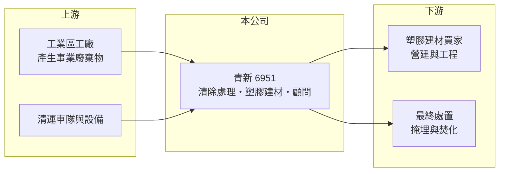

# 6951 青新-創

> 創新板｜[[產業索引-綠能環保|綠能環保]]｜上市（櫃）日期 2024/06/18

# 第一章：企業模式與商業藍圖

> [!info] 撰寫說明
> 精簡版，由 Claude 依公開資料整理，架構比照 [[2330台積電]]，資料截至 2026-10-08。創新板／新掛牌，公開資料有限。來源：證交所開放資料快照（基本資料、2026 年第二季綜合損益與資產負債、股利）、Goodinfo 年度經營績效、nStock 公司簡介。營收比重與客戶結構未查得，業務描述為整理性內容。#待校對

青新環境工程（以下簡稱青新）是一家位於雲林縣莿桐鄉的環保服務公司，2024 年 6 月登上[[創新板]]。本章說明它靠什麼賺錢，以及為什麼這類生意的獲利率可以遠高於一般製造業。

- **核心業務：** 青新的業務分為三塊：[[事業廢棄物]]的清除與處理、塑膠建材的製造與銷售，以及環保相關的管理顧問。清除處理是向產生廢棄物的工廠收取處理費，屬於服務收入；塑膠建材則是把部分回收料製成產品再賣出，兩者結合，形成「收費處理、再生利用」的[[循環經濟]]模式。
- **營收結構：** 各業務的營收比重未查得。從 2025 年[[毛利率]] 59.0%、2026 年上半年 60.0% 來看，高毛利的處理服務應是主要獲利來源，因為單純的塑膠建材製造很難有這麼高的毛利（推估）。投資人若要確認結構，需要查閱公司年報的產品別營收。
- **營運據點：** 公司登記地與主要營運地在雲林縣莿桐鄉。廢棄物處理業高度依賴在地許可與運輸距離，處理場址通常服務方圓一定距離內的工業區，因此據點本身就是競爭條件的一部分。
- **長期方向：** 台灣工業廢棄物量隨製造業擴張而增加，但新的處理設施很難取得環評與地方同意，長期呈現處理量能不足的結構。青新的成長取決於能否擴充許可量能與提高再利用比例，而不是單純搶價格。

# 第二章：護城河深度與競爭優勢

廢棄物處理業的護城河來自許可證與場址，而不是技術專利。本章分析青新的競爭優勢、同業，以及值得長期追蹤的指標。

- **競爭優勢：** 事業廢棄物處理需要環保主管機關核發的許可，新設處理場要經過環評與地方協調，往往耗時多年，這讓既有業者具備明顯的進入障礙。青新營業利益率從 2021 年的 21.0% 一路升到 2025 年的 40.8%，代表處理費率或處理量在提升，而成本相對固定，這是許可稀缺下典型的營運槓桿。
- **主要對手：** 同屬環保處理產業的上市櫃公司包括 [[9930中聯資源]]、[[8473山林水]]、[[8422可寧衛]] 與 [[6803崑鼎]]。可寧衛以最終處置的[[掩埋場]]為主，崑鼎以焚化廠營運為主，業務模式不完全相同，但都在爭取同一批工業廢棄物的處理需求。
- **觀察重點：** 第一是許可處理量是否擴增，這決定營收天花板；第二是毛利率能否維持在五成以上，反映處理價格是否穩定；第三是公司是否持續高配息。2025 年度配發現金股利 4 元並配股約 1.3 元，配息率很高，顯示資本支出需求目前不大，但若未來要新建處理設施，配息政策可能改變。

# 第三章：財務體質與盈利規模

資料日期：2026-10-08，表格是撰寫當時的快照；最新月營收、毛利率、累計 EPS 由自動排程寫在本筆記的屬性欄位（月營收、毛利率、累計EPS 等）。#待校對

財務數字是驗證許可型護城河是否真實存在的方法。青新掛牌時間短，以下用 Goodinfo 年度資料與證交所 2026 年上半年財報檢視。

| 年度 | 營收（億元） | [[毛利率]] | [[營業利益率]] | EPS（元） | [[ROE]] |
|---|---|---|---|---|---|
| 2021 | 2.50 | 40.3% | 21.0% | 3.51 | 11.0% |
| 2022 | 4.47 | 48.0% | 25.2% | 2.64 | 17.6% |
| 2023 | 4.87 | 52.6% | 26.9% | 2.61 | 16.5% |
| 2024 | 6.99 | 57.6% | 36.0% | 4.87 | 24.3% |
| 2025 | 8.66 | 59.0% | 40.8% | 5.39 | 22.3% |
| 2026 上半年 | 4.42 | 60.0% | 40.9% | 2.83 | 未查得 |

- **營收規模：** 營收從 2021 年 2.50 億元成長到 2025 年 8.66 億元，四年年複合成長率約 36%（推算）。2026 年 1 至 8 月累計營收 6.05 億元，較前一年同期增加約 19%。成長同時來自處理量與價格，毛利率逐年上升就是證據。
- **獲利：** 2026 年上半年營業利益 1.81 億元、稅後淨利 1.47 億元，EPS 2.83 元。近五年平均 ROE 約 18%（推算），2024 年後穩定在兩成以上，屬於高資本效率的服務業。Goodinfo 早期年度 EPS 與淨利、股本的對應關係不易驗算，2021 至 2022 年數字建議以財報核對。
- **財務特色：** 2026 年第二季底股東權益 11.13 億元，負債 5.97 億元，其中非流動負債僅 0.25 億元，長期借款很少。2024 年度現金股利 3.8 元、2025 年度 4 元，配息率在七成以上，現金回饋股東是公司的資本配置習慣。
- **[[ROIC]] 與 [[WACC]]：** 官方快照未拆分有息負債，以非流動負債 0.25 億元作為有息負債上限。2026 年上半年營業利益年化約 3.61 億元，扣除 20% 稅後約 2.89 億元，除以股東權益加非流動負債 11.38 億元，ROIC 約 25%（推算）。WACC 以 CAPM 推估：無風險利率 1.75%、市場風險溢酬 6%、β 假設 1.1（中小型環保股常見值，推估），權益成本約 8.4%；公司幾乎無長期借款，WACC 約 8.4%（推算）。ROIC 高出 WACC 約 16 個百分點，代表目前的業務持續創造價值。

# 第四章：總體風險與地緣政治

環保處理業的需求穩定，但政策與場址風險集中。本章整理青新長期需要面對的風險。

- **產業週期：** 廢棄物量與製造業景氣連動，工廠減產時產生的廢棄物也會減少，但處理需求屬於剛性，波動遠小於電子業。真正的週期來自處理量能的供需：若同業或公部門新增大量處理設施，處理費率可能回落。
- **營運風險：** 公司營運集中在雲林單一地區，處理場若因火災、污染事件或許可展延不順而停工，對營收的影響會很直接。廢棄物設施普遍面臨地方居民的鄰避壓力，擴建或新設場址都需要長期溝通。
- **其他風險：** 法規是最大的外部變數，環保署的處理標準、再利用規範與罰則若趨嚴，可能提高營運成本；反過來，法規趨嚴也會淘汰不合規業者，對合規的既有業者有利。掛牌時間短、股本僅 5.2 億元，股票流動性與資訊揭露深度也低於大型公司。

# 專有名詞解析

## 金融

- **[[創新板]]**：臺灣證券交易所為新創與成長型企業設立的上市板塊，掛牌條件較寬，但初期限制一般投資人交易資格。

## 產業

- **[[事業廢棄物]]**：工廠與事業單位在生產過程中產生的廢棄物，依法須委託合格業者清除與處理。
- **[[循環經濟]]**：把廢棄物回收、處理後重新變成原料或產品，以減少資源消耗與最終處置量的經濟模式。
- **[[掩埋場]]**：以掩埋方式最終處置廢棄物的設施，新設難度高，是廢棄物處理業的稀缺資源。

# 核心供應鏈

- 上游：產生事業廢棄物的各類工廠是青新的付費客戶，也是原料來源；清運車隊與處理設備是主要資本投入。
- 下游／客戶：處理後的再生料製成塑膠建材出售給營建與工程用途；無法再利用的殘餘物則交由最終處置業者。
- 同業：[[9930中聯資源]]、[[8473山林水]]、[[8422可寧衛]]、[[6803崑鼎]]、[[2072世紀風電]]（同屬綠能環保分類）。

## 最新新聞
<!-- news:start -->
<!-- news:end -->

## 相關連結
- [公開資訊觀測站](https://mopsov.twse.com.tw/mops/web/t05st03?step=1&firstin=1&co_id=6951)
- [Goodinfo](https://goodinfo.tw/tw/StockDetail.asp?STOCK_ID=6951)
- [Yahoo 股市](https://tw.stock.yahoo.com/quote/6951)
- [鉅亨網新聞](https://www.cnyes.com/twstock/6951/news)
