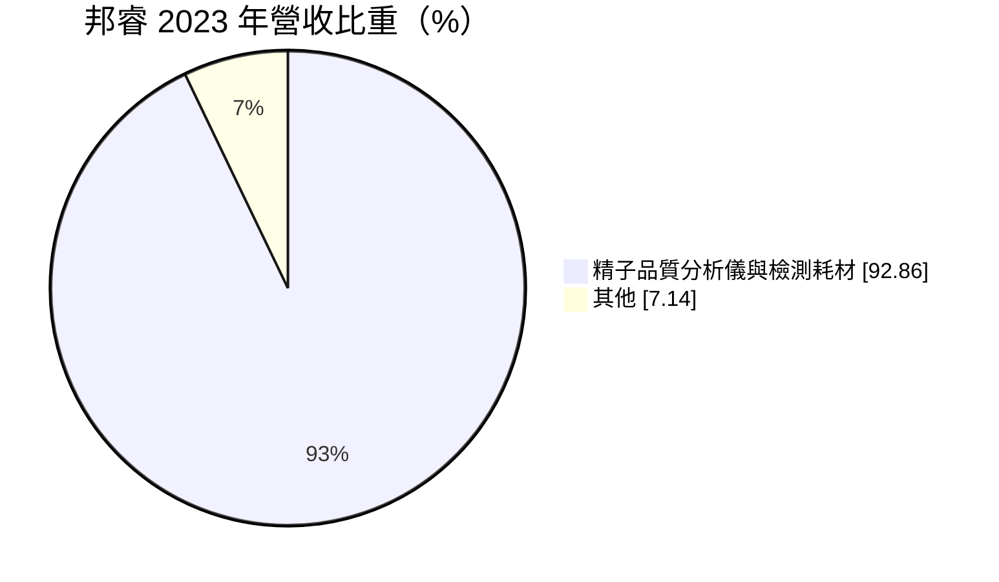
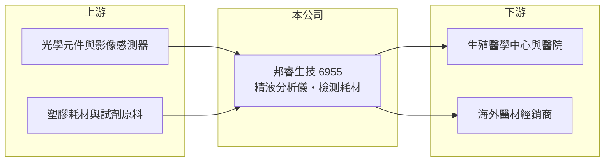

# 6955 邦睿生技-創

> 創新板｜[[產業索引-生技醫療業|生技醫療業]]｜上市（櫃）日期 2024/12/06

# 第一章：企業模式與商業藍圖

> [!info] 撰寫說明
> 精簡版，由 Claude 依公開資料整理，架構比照 [[2330台積電]]，資料截至 2026-10-08。創新板／新掛牌，公開資料有限。來源：證交所開放資料快照（基本資料、2026 年第二季綜合損益與資產負債、每月營收、股利）、MoneyDJ 基本資料（營收比重）。年度財務表格多數年度未查得；品牌名稱與通路描述憑記憶整理，標示待校對。#待校對

邦睿生技（以下簡稱邦睿）是台中大里的醫療器材公司，專注在男性生育力檢測，2024 年 12 月登上[[創新板]]。本章說明它的產品、營收來源與長期方向。

- **核心業務：** 邦睿開發與銷售[[精液分析]]儀器與配套檢測耗材，用來量測精子濃度、活動力與型態等指標，屬於[[體外診斷]]醫療器材，主要使用者是生殖醫學中心、醫院與檢驗所。公司的產品結合光學影像與 AI 演算法，能縮短傳統人工鏡檢的時間並降低判讀差異；對外品牌據記憶為 LensHooke（待校對）。
- **營收結構：** 依 MoneyDJ 資料，2023 年精子品質分析檢測儀及檢測耗材占營收 92.86%，其他占 7.14%。這種「儀器＋耗材」的組合類似印表機與墨水：儀器裝機之後，每次檢測都需要耗材，裝機量越大，後續的重複性收入越穩定。

- **營運據點：** 總部與生產位於台中市大里區。產品以外銷為主（推估，依公司定位與醫材出口特性），需要取得各國醫療器材上市許可，例如美國 FDA 與歐盟 CE 認證，每多一個國家的許可，就多一個可銷售的市場。
- **長期方向：** 全球不孕症比例上升、生育年齡延後，帶動[[輔助生殖]]與男性生育力檢測需求。邦睿的成長路徑是擴大各國裝機量，並延伸到居家檢測與其他生殖醫學產品，提高耗材的重複購買比重。

# 第二章：護城河深度與競爭優勢

醫療器材的護城河來自法規許可、臨床驗證與通路。本章分析邦睿的競爭位置。

- **競爭優勢：** 醫療器材要進入一個國家，必須通過當地主管機關審查並累積臨床數據，這個過程往往需要數年，新進者難以短時間複製。邦睿 2026 年上半年[[毛利率]] 77.5%，高毛利代表產品具備技術差異與定價能力，也反映耗材收入的貢獻。
- **主要對手：** 精液分析領域的國際對手包括 Hamilton Thorne（IVOS 系列）、Medical Electronic Systems（SQA 系列）等外國專業廠商，傳統人工鏡檢也是替代方案（待校對）。台股中沒有直接以精液分析為主業的上市公司，生殖醫學相關的台股可參考 [[4160訊聯基因]] 等。
- **觀察重點：** 一是耗材營收占比是否提升，這代表裝機基礎是否在擴大；二是新市場許可取得的進度；三是營業利益率能否在擴張業務、增加行銷費用的同時維持三成左右。2026 年上半年營業利益率 31.7%，是判斷規模經濟是否出現的基準。

# 第三章：財務體質與盈利規模

資料日期：2026-10-08，表格是撰寫當時的快照；最新月營收、毛利率、累計 EPS 由自動排程寫在本筆記的屬性欄位（月營收、毛利率、累計EPS 等）。#待校對

邦睿掛牌未滿兩年，公開的年度資料有限，以下以證交所開放資料為主。

| 年度 | 營收（億元） | [[毛利率]] | [[營業利益率]] | EPS（元） | [[ROE]] |
|---|---|---|---|---|---|
| 2023 | 未查得 | 未查得 | 未查得 | 未查得 | 未查得 |
| 2024 | 未查得 | 未查得 | 未查得 | 未查得 | 未查得 |
| 2025 | 未查得 | 未查得 | 未查得 | 未查得（稅後淨利 1.03 億元） | 未查得 |
| 2026 上半年 | 1.77 | 77.5% | 31.7% | 2.11 | 未查得 |

- **營收規模：** 2026 年 1 至 8 月累計營收 2.34 億元，較前一年同期 1.98 億元成長約 18%。營收規模仍小，但成長穩定，屬於早期擴張階段的醫材公司。
- **獲利：** 依股利公告，2025 年度稅後淨利約 1.03 億元。2026 年上半年營業利益 0.56 億元、稅後淨利 0.52 億元，EPS 2.11 元，淨利率約 29.6%。
- **財務特色：** 2026 年第二季底股東權益 6.57 億元，負債僅 0.66 億元，幾乎沒有長期負債，帳上以流動資產為主（6.40 億元），掛牌募得的資金尚未大量投入。股利方面，2024 與 2025 年度各配發現金 1.5 元，並搭配股票股利，以配股擴大股本是成長型公司常見做法。
- **[[ROIC]] 與 [[WACC]]：** 以 2026 年上半年營業利益年化約 1.12 億元，扣除 20% 稅後約 0.90 億元，除以股東權益加非流動負債 6.59 億元，ROIC 約 14%（推算）；由於分母含大量閒置現金，實際營運資產的報酬率應更高。WACC 以 CAPM 推估：無風險利率 1.75%、市場風險溢酬 6%、β 假設 1.0（醫材同業常見值，推估），公司無有息負債，WACC 約 7.8%（推算）。ROIC 高於 WACC 約 6 個百分點，代表目前業務在創造價值。

# 第四章：總體風險與地緣政治

小型醫材公司的風險集中在產品線單一與海外市場。本章整理邦睿的長期風險。

- **產業週期：** 生殖醫學需求受經濟景氣影響相對小，但醫院與診所的設備採購預算會隨景氣調整，儀器銷售因此有波動；耗材收入則較穩定。
- **營運風險：** 營收九成以上集中在單一產品類別，若出現技術更好的競品，或主要市場的法規改變，衝擊會很直接。公司規模小，研發與行銷資源有限，與國際大廠競爭時需要依賴經銷夥伴。
- **其他風險：** 海外銷售占比高時，新台幣升值會壓縮營收與毛利；各國醫材法規（例如歐盟 MDR 新規）提高認證成本，也是持續性的費用壓力。

# 專有名詞解析

## 應用

- **[[精液分析]]**：量測精子濃度、活動力與型態的檢驗，是評估男性生育力的第一步。

## 金融

- **[[創新板]]**：臺灣證券交易所為新創與成長型企業設立的上市板塊，掛牌條件較寬，但初期限制一般投資人交易資格。

## 產業

- **[[輔助生殖]]**：以人工授精、試管嬰兒等醫療技術協助不孕夫妻懷孕的醫療領域。
- **[[體外診斷]]**：在人體外以檢體（血液、尿液、精液等）進行檢測的醫療器材與試劑。

# 核心供應鏈

- 上游：光學鏡頭、影像感測元件、電子零件，以及耗材所需的塑膠與化學原料。
- 下游／客戶：生殖醫學中心、醫院、檢驗所，海外市場多透過當地經銷商銷售。
- 同業：Hamilton Thorne、Medical Electronic Systems（國外，待校對）；台股生殖醫學相關可參考 [[4160訊聯基因]]。

## 最新新聞
<!-- news:start -->
<!-- news:end -->

## 相關連結
- [公開資訊觀測站](https://mopsov.twse.com.tw/mops/web/t05st03?step=1&firstin=1&co_id=6955)
- [Goodinfo](https://goodinfo.tw/tw/StockDetail.asp?STOCK_ID=6955)
- [Yahoo 股市](https://tw.stock.yahoo.com/quote/6955)
- [鉅亨網新聞](https://www.cnyes.com/twstock/6955/news)
