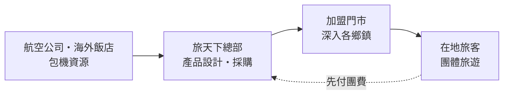
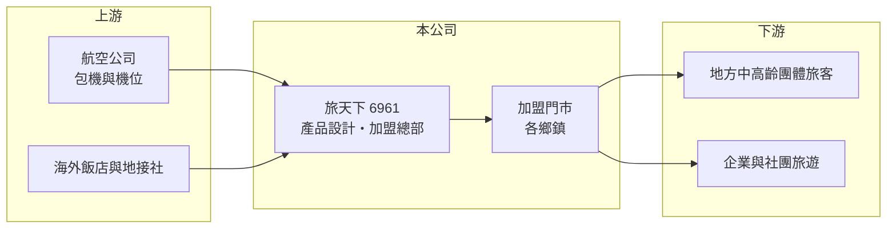

# 6961 旅天下

> 上櫃｜[[產業索引-觀光餐旅|觀光餐旅]]｜上市（櫃）日期 2026/01/22

# 第一章：企業模式與商業藍圖

> [!info] 撰寫說明
> 本文由 Claude 依公開資料整理，架構比照 [[2330台積電]] 的四章研究，資料截至 2026-10-08。財務數字來源：櫃買中心開放資料（基本資料、2026 年第二季資產負債表與綜合損益表）、Goodinfo 年度經營績效頁、nStock 公司簡介與股利資料、科技新報與今周刊 2025 年 12 月新聞標題；公開資料有限，查不到各產品線營收比重與確切門市數，產業描述為整理性內容，尚未逐條比對原始文件。#待校對

在評估單一個股的長期投資價值時，首要步驟是拆解企業的底層獲利邏輯。本章說明旅天下聯合國際旅行社（股票代號：6961，以下簡稱旅天下）如何以[[加盟]]門市模式，把旅遊產品賣進台灣各鄉鎮。

## 一、核心定位：雄獅體系出身的加盟型旅行社

旅天下於 2015 年 3 月設立，原名雙獅聯合國際旅行社，2021 年 7 月更名為旅天下，2023 年 7 月登錄興櫃，2026 年 1 月 22 日在櫃買中心掛牌。依 nStock 整理，公司以包辦旅遊方式經營[[團體旅遊]]，自行組團安排國內外旅遊食宿、接待旅客、代售運輸客票與代辦簽證，並出版旅遊產業雜誌。

旅天下與台灣最大旅行社 [[2731雄獅]] 關係密切，原名「雙獅」即反映這層淵源。依 nStock 整理的新聞，2023 年 10 月雄獅放棄參與旅天下的增資，持股重新認列，雄獅因此認列約 5.3 億元業外收益，旅天下則取得更大的經營獨立性。

## 二、資本轉化邏輯：加盟擴張、輕資產

旅天下的核心策略是由加盟主出資開設門市，總部負責產品設計、機位與飯店採購。依今周刊 2025 年 12 月的報導標題，旅天下的加盟數即將突破百家，目標是讓台灣 368 個鄉鎮都有門市。這種模式讓總部不必負擔門市租金與人事，就能把銷售網路延伸到大型旅行社較少經營的地方市場；旅客先付團費的[[預收款]]特性，也讓公司不需要大量資本。2023 年 8 月推出的函館[[包機]]載客率接近百分之百（依 nStock 整理的新聞），顯示總部也透過包機開發獨家行程。

## 三、長期方向

依科技新報 2025 年 12 月報導，旅天下為上櫃辦理現金增資 320 萬股，暫定發行價每股 58 元，掛牌後帳上資本公積增加到 5.43 億元。長期來看，公司的成長取決於三件事：加盟門市能否持續擴張並維持服務品質、包機等獨家產品能否提升毛利，以及地方市場的團體旅遊需求能否抵擋自由行趨勢。

# 第二章：護城河深度與競爭優勢

「護城河」指企業抵禦競爭、維持超額利潤的保護機制。旅行社進入門檻低，本章說明旅天下的加盟模式帶來哪些相對優勢。

## 一、相對優勢

旅天下的優勢在於加盟網路與地方滲透。鄉鎮地區的中高齡旅客習慣到實體門市諮詢、與熟識的業務員報名，這種信任關係是線上平台難以取代的；加盟主本身就是在地人脈的經營者，能把這層關係轉為穩定客源。加盟數愈多，總部向航空公司與飯店的採購量就愈大，議價能力也愈強，形成規模經濟。這道護城河目前仍在建立中，強度取決於加盟網路的擴張速度與加盟主的留存率。

## 二、主要競爭對手

| 對手 | 定位 | 對旅天下的威脅 |
|---|---|---|
| [[2731雄獅]] | 台灣最大綜合旅行社 | 品牌、直營門市與產品線最完整 |
| [[5706鳳凰]] | 長程精緻團體旅遊 | 爭奪中高齡團體客 |
| [[2743山富]] | 團體旅遊與郵輪 | 團體旅遊市場競爭 |
| [[2734易飛網]]、線上旅遊平台 | 機票、訂房與自由行 | 讓年輕旅客轉向自行訂購 |

## 三、守得住／守不住／觀察重點

守得住的是地方門市與在地人脈。守不住的是毛利率，旅行社產品透明、比價容易，毛利率長期只有 13% 至 17%。長期觀察重點是加盟門市數的成長、單店營收，以及營業利益率能否從 2% 左右提升。

# 第三章：財務體質與盈利規模

資料日期：2026-10-08，表格是撰寫當時的快照；最新月營收、毛利率、累計 EPS 由自動排程寫在本筆記的屬性欄位（月營收、毛利率、累計EPS 等）。#待校對

財務報表是檢驗護城河是否真實存在的最終標準。本章用六年的三率、ROE 與資本報酬檢視旅天下的獲利品質。

## 一、多年度經營績效

| 年度 | 營收（新台幣） | [[毛利率]] | [[營業利益率]] | EPS（元） | [[ROE]] |
|---|---|---|---|---|---|
| 2020 | 5.72 億 | 12.3% | -1.59% | 0.90 | 6.71% |
| 2021 | 0.48 億 | 13.6% | -118% | -1.20 | -12% |
| 2022 | 2.10 億 | 14.5% | -16.9% | -1.73 | -16% |
| 2023 | 30.1 億 | 16.5% | 5.55% | 8.65 | 25.6% |
| 2024 | 45.2 億 | 13.4% | 2.29% | 3.63 | 9.77% |
| 2025 | 41.3 億 | 14.8% | 2.39% | 4.23 | 11.9% |
| 2026 上半年 | 22.45 億 | 14.0% | 2.1% | 1.81 | 未查得 |

資料來源：2020 至 2025 年為 Goodinfo，2026 上半年為櫃買中心開放資料。

旅天下在 2021 至 2022 年疫情期間營收幾乎停擺，2023 年國境開放後營收跳到 30.1 億元，2024 年再成長到 45.2 億元。營業利益率約 2% 至 6%，是旅行社業典型的薄利水準，ROE 則因輕資產而維持在 10% 至 26%。2021 至 2025 年平均 ROE 約 4%（推算），若只看 2023 至 2025 年約 16%。2023 至 2025 年營收年複合成長率約 17%（推算）。

配息方面，依 nStock 整理，2024 年度配發現金股利 5 元，現金配發率約 138%，超過當年 EPS；2025 年度同樣配發現金股利 5 元，已於 2026 年 6 月除息。配發率偏高代表公司把大部分獲利甚至部分保留盈餘回饋股東，未來股利能否維持取決於獲利成長。

## 二、財務結構

2026 年第二季底，旅天下總資產 15.5 億元，其中流動資產 13.6 億元；負債 6.08 億元，多為流動負債 5.6 億元（推估以預收團費為主），流動比率約 242%。權益 9.39 億元，其中資本公積 5.43 億元來自歷次增資溢價，每股淨值 34.18 元。

## 三、[[ROIC]] 與 [[WACC]]：價值創造利差

**ROIC 推算：** 2025 年營業利益約 0.99 億元（41.3 億 × 2.39%），稅後約 0.79 億元。2026 年第二季底權益約 9.39 億元；負債多為預收團費，假設僅 5% 為有息負債約 0.30 億元（推估），投入資本約 9.7 億元，ROIC 約 8%（推算）。由於上櫃增資後帳上現金增加，若扣除閒置現金，本業 ROIC 會明顯更高。

**WACC 推算：** 台灣 10 年期公債取 1.75%、市場風險溢酬 6%、β 取旅行社股常見值 0.9，股東權益成本約 7.15%；有息負債極少，WACC 約 7%（推算）。

**結論：** ROIC 略高於 WACC，旅天下的本業大致在創造價值，但利差不大。加盟模式若能把營業利益率提升到 3% 以上，以目前的資本規模就能明顯擴大價值創造；反之，若營收成長停滯而持續高配息，資本報酬的優勢會逐漸消失。

# 第四章：總體風險與地緣政治

任何企業都無法脫離宏觀環境獨立存在。本章分析旅天下長期必須面對的風險。

## 一、外部衝擊風險

旅行社營收完全依賴旅客能出入境。2021 年營收只剩 0.48 億元，說明疫情、戰爭或天災等外部事件可以讓營收在短時間內近乎歸零，而加盟主在停擺期間也可能大量退出。

## 二、加盟管理風險

加盟擴張速度快，總部對服務品質與銷售行為的控管難度也隨之增加。若加盟門市發生糾紛或財務問題，可能影響整體品牌形象；加盟主若因獲利不佳而退出，網路擴張會停滯。

## 三、毛利與競爭風險

團體旅遊市場面臨自由行與線上平台的長期侵蝕，旅行社之間的價格競爭也讓毛利率難以提升。包機需要事先承諾購買機位，若銷售不如預期，空位成本會直接壓縮獲利；匯率波動同樣影響海外成本。

# 專有名詞解析

## 金融

- **[[預收款]]**：顧客先付款、公司尚未提供服務的金額，在帳上列為負債，服務完成後轉為營收。
- **[[ROIC]]**：投入資本報酬率，稅後營業利益除以股東權益加有息負債，衡量本業運用資本的效率。
- **[[WACC]]**：加權平均資金成本，股東與債權人要求報酬率的加權平均，是 ROIC 要超越的門檻。

## 產業

- **[[加盟]]**：由總部提供品牌、技術與物料，加盟主出資開店並支付加盟金與權利金的經營模式。
- **[[包機]]**：旅行社向航空公司包下整架飛機或固定航班座位，自行負責銷售，可確保旺季機位但須承擔空位風險。
- **[[團體旅遊]]**：旅行社把機票、住宿、交通與導遊打包成固定行程販售的旅遊產品，以團費總額認列營收。

# 核心供應鏈

## 1. 上游：運力與海外資源
- 航空公司：[[2610華航]]、[[2618長榮航]] 及外籍航空；海外飯店與地接社

## 2. 中游：旅天下與加盟網路
- 總部負責產品設計與採購；加盟門市負責在地銷售
- 關係企業：[[2731雄獅]]

## 3. 下游與同業
- 客戶：地方中高齡團體旅客、企業與社團旅遊
- 同業：[[5706鳳凰]]、[[2743山富]]、[[2734易飛網]]

## 最新新聞
<!-- news:start -->
<!-- news:end -->

## 相關連結
- [公開資訊觀測站](https://mopsov.twse.com.tw/mops/web/t05st03?step=1&firstin=1&co_id=6961)
- [Goodinfo](https://goodinfo.tw/tw/StockDetail.asp?STOCK_ID=6961)
- [Yahoo 股市](https://tw.stock.yahoo.com/quote/6961)
- [鉅亨網新聞](https://www.cnyes.com/twstock/6961/news)
