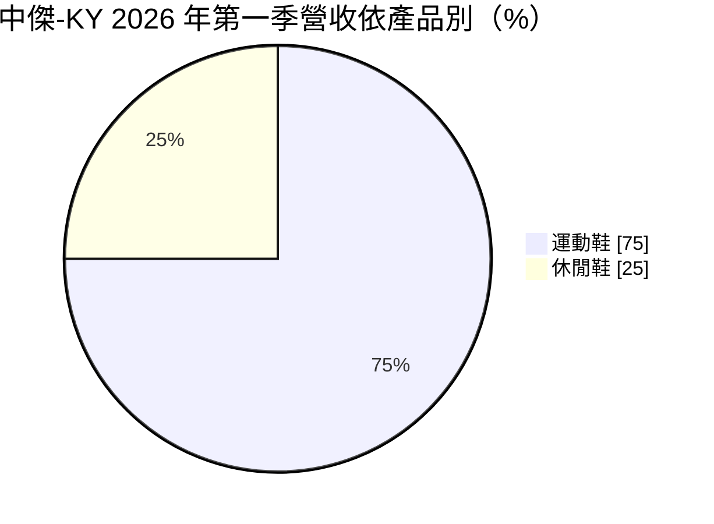
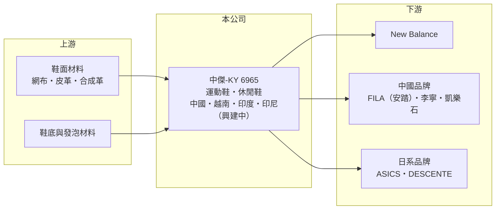

# 6965 中傑-KY

> 上市｜[[產業索引-運動休閒|運動休閒]]｜上市（櫃）日期 2025/03/07

# 第一章：企業模式與商業藍圖

> [!info] 撰寫說明
> 精簡版，由 Claude 依公開資料整理，架構比照 [[2330台積電]]，資料截至 2026-10-08。來源：MoneyDJ 理財網財務比率年表（2021 至 2025 年）；富果研究 2026 年 5 月法說會備忘錄（產品、客戶、產地、出貨雙數、長期目標、資本支出、2026 年第一季財務數字）；證交所開放資料快照（基本資料、2026 年上半年資產負債與損益、2025 年度股利）。2025 年營收以每股營業額乘以約 1.56 億股推算，2024 年以前因上市前股數不同未推算。#待校對

中傑投資控股是開曼群島註冊的[[KY股]]控股公司，控股公司成立於 2018 年 12 月、2025 年 3 月上市，台灣據點在台中大雅，董事長劉安哲、總經理劉佑軒，實收資本額約 15.6 億元。集團擁有超過 40 年的製鞋經驗，是 New Balance 的長期主要代工夥伴，2025 年出貨約 3,233 萬雙。

- **核心業務：** 中傑替國際品牌代工運動鞋與休閒鞋，2026 年第一季運動鞋占營收 75%、出貨 570 萬雙，休閒鞋占 25%、出貨 144 萬雙。主力客戶 New Balance 與中傑合作超過 40 年，產品涵蓋跑鞋、生活鞋款等。
- **營收結構：** 依富果整理的 2026 年 5 月法說會，2025 年最大客戶（推估為 New Balance）占營收 51%；其他客戶包括安踏旗下 FILA、李寧，以及新開發的 ASICS、凱樂石（KAILAS）與迪桑特（DESCENTE）。2025 年銷售地區以中國 32%、美國 30% 為主，中國品牌客戶比重高是中傑與其他台灣鞋廠最大的不同。
- **營運據點：** 生產基地在中國、越南與印度，印尼東爪哇新廠 2025 年 10 月動工（投產時間說法在 2026 年底至 2027 年初之間）。越南北部新廠（法說紀錄寫作「北見廠」，推估位於北江省，待校對）2025 年第三季投產，印度廠年產量預估由約 60 萬雙提升到 180 萬至 190 萬雙。2026 年資本支出預估 2,000 萬至 2,800 萬美元，主要用於印尼新廠與越南、印度擴產。
- **長期方向：** 公司訂下 2034 年出貨超過 8,000 萬雙的長期目標，也就是十年內產量約成長 1.5 倍，並設定長期 ROE 20% 以上。策略是把產能從中國逐步移往越南、印度與印尼，同時拓展中國運動品牌與日本品牌客戶，降低對單一客戶的依賴。

# 第二章：護城河深度與競爭優勢

中傑的護城河主要是與 New Balance 的長期關係，以及兼顧中國品牌與國際品牌的客戶組合。

- **競爭優勢：** 與 New Balance 合作超過 40 年，代表中傑在品質、開發速度與社會責任稽核上長期獲得品牌信任，大品牌更換主要供應商的成本很高。中傑在中國有生產基地，又能服務安踏、李寧等中國品牌，在中國運動品牌崛起的趨勢中有地利之便。
- **主要對手：** 運動鞋代工大廠 [[9904寶成]]、[[9910豐泰]]、[[6768志強-KY]]、[[6890來億-KY]]、[[9802鈺齊-KY]]，以及中國華利集團；中國品牌的訂單則還要面對大量中國本土鞋廠的價格競爭。
- **觀察重點：** 中傑 2022 年毛利率約 20%，之後一路降到 2025 年的 11.6%，營業利益率由 11.8% 降到 2.1%。長期要看產能移轉與新廠爬坡期的成本何時回穩、新客戶能否放量，以及最大客戶占比能否降到五成以下。

# 第三章：財務體質與盈利規模

資料日期：2026-10-08，表格是撰寫當時的快照；最新月營收、毛利率、累計 EPS 由自動排程寫在本筆記的屬性欄位（月營收、毛利率、累計EPS 等）。#待校對

中傑在 2022 至 2024 年 ROE 約 19% 至 33%，2025 年上市後因訂單下滑與產能移轉成本，獲利大幅縮水，2026 年上半年轉為小幅虧損。

| 年度 | 營收（億元） | [[毛利率]] | [[營業利益率]] | EPS（元） | [[ROE]] |
|---|---|---|---|---|---|
| 2021 | 未查得 | 16.22% | 6.70% | 6.01 | 未查得 |
| 2022 | 未查得 | 20.03% | 11.83% | 16.35 | 33.41% |
| 2023 | 未查得 | 18.57% | 9.40% | 13.55 | 22.70% |
| 2024 | 未查得 | 15.21% | 6.68% | 12.22 | 18.67% |
| 2025 | 約 217（推算） | 11.61% | 2.08% | 3.50 | 4.91% |

註：MoneyDJ 每股營業額 2021 至 2025 年依序為 111.64、174.76、162.42、192.76、138.62 元；2024 年以前為上市前股數，未換算營收金額。富果整理 2025 年第四季營收 49.48 億元、年減 27%。

- **長期指標：** 2022 至 2025 年平均 ROE 約 19.9%（推算），但趨勢明顯向下。2025 年度現金股利 5 元，高於當年 EPS 3.50 元，配發率約 143%（證交所資料），是動用過去保留盈餘的高配息。每股現金流量 2022 至 2025 年皆為正，2026 年第一季帳上淨現金約 40.9 億元。
- **[[ROIC]] 與 [[WACC]]：** 2025 年營業利益約 4.5 億元（營收約 217 億元 × 2.08%），稅後約 3.6 億元（稅率 20%）。投入資本以 2026 年第二季權益總計 115.9 億元，加有息負債推估約 20 億元計算（負債總計 72.8 億元，官方快照未拆分），ROIC 約 2.6%（推算）。WACC 約 7%（推算：無風險利率 1.75%、市場風險溢酬 6%、β 取 0.9，股東權益成本 7.15%；負債比重低，稅率 20%）。2025 年 ROIC 明顯低於 WACC，代表當年未能創造價值；2022 至 2024 年 ROIC 推估在 15% 以上，關鍵是能否回到公司自訂的 ROE 20% 目標。
- **財務特色：** 2026 年第二季總資產 188.7 億元、負債 72.8 億元，負債比率約 39%，每股淨值 72.92 元，股價淨值比約 0.83 倍。2026 年上半年營收 104.5 億元、毛利率 11.5%、營業利益率 0.7%、EPS -0.35 元，所得稅費用高於稅前淨利，造成稅後虧損。

# 第四章：總體風險與地緣政治

中傑的風險在於客戶集中、中國市場曝險與產能移轉期的獲利壓力。

- **產業週期：** 品牌商的庫存調整會沿供應鏈放大，2025 年以來客戶下單保守，中傑營收與毛利率同步下滑，是典型的[[長鞭效應]]。運動鞋需求也受消費景氣影響，中國與美國兩大市場的消費動能都會直接反映在訂單上。
- **營運風險：** 最大客戶占營收約五成，若其產地策略調整，影響非常大。產能從中國移往越南、印度與印尼，新廠需要招工、訓練與良率爬坡，期間成本偏高；為維持產能利用率而接受較低價格的訂單，也會壓低毛利率。
- **其他風險：** 中國營收占三成以上，又有中國生產基地，美中關稅與中國經濟情勢是重要變數；印度與印尼的法規、基礎建設與勞動條件差異大。營收以美元與人民幣計價，匯率影響獲利；作為 KY 公司，法律適用與資訊揭露與本國公司不同。

# 專有名詞解析

## 金融

- **[[KY股]]**：在台灣上市櫃、但註冊於開曼群島等境外地區的公司，適用的公司法與揭露規範與本國公司不同。
- **[[長鞭效應]]**：終端需求的小幅變動，沿供應鏈往上游傳遞時被逐級放大，造成上游庫存與訂單劇烈波動。
- **[[ROIC]]**：投入資本報酬率，稅後營業利益除以股東權益加有息負債，衡量本業運用資本的效率。
- **[[WACC]]**：加權平均資金成本，股東與債權人要求報酬率的加權平均，是 ROIC 要超越的門檻。

# 核心供應鏈

- 上游：網布、皮革、合成革等鞋面材料；鞋底與發泡材料；鞋材配件如 [[9938百和]]（實際往來未查得）。
- 下游／客戶：New Balance；安踏旗下 FILA、李寧、凱樂石；ASICS、DESCENTE。
- 同業：[[9904寶成]]、[[9910豐泰]]、[[6768志強-KY]]、[[6890來億-KY]]、[[9802鈺齊-KY]]；中國華利集團。

## 最新新聞
<!-- news:start -->
<!-- news:end -->

## 相關連結
- [公開資訊觀測站](https://mopsov.twse.com.tw/mops/web/t05st03?step=1&firstin=1&co_id=6965)
- [Goodinfo](https://goodinfo.tw/tw/StockDetail.asp?STOCK_ID=6965)
- [Yahoo 股市](https://tw.stock.yahoo.com/quote/6965)
- [鉅亨網新聞](https://www.cnyes.com/twstock/6965/news)
