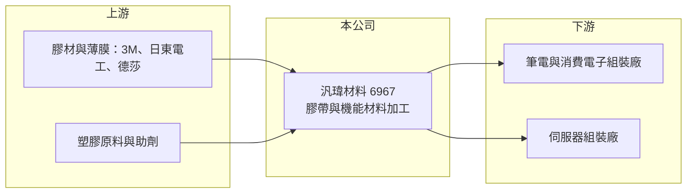

# 6967 汎瑋材料

> 上櫃｜[[產業索引-電子零組件業|電子零組件業]]｜上市（櫃）日期 2024/09/25

# 第一章：企業模式與商業藍圖

> [!info] 撰寫說明
> 精簡版，由 Claude 依公開資料整理，架構比照 [[2330台積電]]，資料截至 2026-10-08。來源：櫃買中心開放資料快照（基本資料、2026 年第二季資產負債與損益、本益比殖利率）、Goodinfo 經營績效頁、nStock 公司簡介、優分析與科技新報等報導標題。產品應用與客戶依記憶整理，公開資料有限，已標註待校對。#待校對

汎瑋材料（以下簡稱汎瑋）做的是電子產品內部看不見的「輔料」：膠帶、保護膜與各種機能性塑膠材料。理解它的關鍵在於：這類材料單價不高，但每一款筆電、手機或伺服器都要重新設計與驗證，供應商的價值在於快速打樣、穩定品質與貼近組裝廠的服務。

- **核心業務：** 汎瑋成立於 1992 年，總部在台中西屯，2024 年 9 月在櫃買中心掛牌。依 nStock 的營業項目，公司從事工業用塑膠製品與膠帶製造，並經營電子材料、塑膠膜袋與工業助劑的批發。實務上可理解為把上游的膠材、薄膜加工成[[模切]]件，供電子組裝廠使用（產品細節待校對）。
- **營收結構：** 產品別與地區別比重未查得。依財經媒體報導標題，汎瑋近年受惠於電子材料與 [[AI 伺服器]] 相關需求成長，代表產品應用正從消費性電子延伸到伺服器（比重待校對）。
- **營運據點：** 依 2024 年科技新報報導標題，汎瑋在越南北寧設廠。北寧是電子組裝廠在越南的主要聚落，就近供貨可以縮短交期，也符合客戶把產能移出中國的需求。
- **長期方向：** 長期動能來自客戶產能往東南亞移動，以及伺服器等高單價產品對散熱、絕緣、遮蔽等機能材料的需求。2026 年公司辦理現金增資，股本由約 2.49 億元增至約 3.04 億元，推估用於擴產或營運周轉（用途待校對）。

# 第二章：護城河深度與競爭優勢

汎瑋的護城河屬於窄護城河，來自客戶驗證、快速打樣服務與在地產能，而不是材料配方本身。

- **競爭優勢：** 電子輔料要跟著終端產品一起設計，供應商要在研發階段就參與打樣，量產後才有訂單。一旦進入某款產品的料號，通常會供應到該產品生命週期結束，因此客戶黏著度不錯。在越南設廠，則讓汎瑋能跟著組裝廠一起移動，這是許多純台灣或中國廠商做不到的。
- **主要對手：** 國際膠材大廠如 3M、日東電工、德莎（tesa）掌握上游材料，台灣與中國有大量模切與材料加工廠，價格競爭激烈。台灣相關業者例如 [[4721美琪瑪]] 等材料通路與加工業者，與汎瑋在部分產品重疊（重疊程度待校對）。
- **觀察重點：** 2020 至 2025 年營收大致停在 13 至 16 億元，規模成長有限。長期要觀察越南廠與伺服器材料能否讓營收突破這個區間，以及毛利率能否維持在 26% 以上，這代表產品組合是否真的往高附加價值移動。

# 第三章：財務體質與盈利規模

資料日期：2026-10-08，表格是撰寫當時的快照；最新月營收、毛利率、累計 EPS 由自動排程寫在本筆記的屬性欄位（月營收、毛利率、累計EPS 等）。#待校對

汎瑋的財務特色是營收規模平穩、負債低、配息率高，2025 年起利潤率回升。

| 年度 | 營收（億元） | [[毛利率]] | [[營業利益率]] | EPS（元） | [[ROE]] |
|---|---|---|---|---|---|
| 2020 | 13.7 | 22.9% | 12.1% | 9.38 | 15.0% |
| 2021 | 16.5 | 20.6% | 9.13% | 8.24 | 15.6% |
| 2022 | 13.4 | 22.7% | 8.08% | 7.13 | 16.1% |
| 2023 | 13.3 | 24.0% | 9.51% | 4.56 | 14.9% |
| 2024 | 13.4 | 22.8% | 5.64% | 3.37 | 10.2% |
| 2025 | 14.2 | 26.2% | 9.32% | 4.02 | 11.9% |
| 2026 上半年 | 8.20 | 27.8% | 11.6% | 2.73 | 未查得 |

（來源：Goodinfo 經營績效頁；2026 上半年依櫃買中心開放資料計算。2020 至 2022 年 EPS 受掛牌前股本較小影響，與後期不可直接比較，Goodinfo 部分欄位前後不一致，#待校對。）

- **營收規模：** 2020 至 2025 年營收由 13.7 億元增至 14.2 億元，年複合成長率不到 1%（推算），屬成熟型業務。2026 年 1 至 9 月營收約 12.4 億元，年增約 21%，是近年少見的明顯成長。
- **獲利：** 2021 至 2025 年平均 ROE 約 13.7%（推算），表現穩定。2026 年上半年毛利率約 27.8%、營業利益率約 11.6%，為近六年較高水準。
- **財務特色：** 2026 年第二季總資產約 13.1 億元、權益約 8.2 億元、負債約 5.0 億元，非流動負債不到 0.1 億元，幾乎沒有長期借款，權益比約 62%。2025 年 EPS 4.02 元，擬發現金股利 3.7 元，配發率超過九成；2024 年現金股利 2.8 元、配發率約 83%，顯示公司偏好高配息。
- **[[ROIC]] 與 [[WACC]]：** 以 2025 年營業利益約 1.32 億元（14.2 億元 × 9.32%）、稅率 20% 計算，稅後營業利益約 1.06 億元。有息負債未查得，投入資本以權益 8.2 億元到總資產 13.1 億元為區間，ROIC 約 8.1% 至 13.0%（推算）；2026 年上半年年化約 11.6% 至 18.6%（推算）。WACC 以 CAPM 推估：無風險利率 1.75%、市場風險溢酬 6%、β 假設 1.1（電子零組件常見值），權益成本約 8.4%；負債比重低，假設一成、稅後成本 2%，WACC 約 7.7%（推算）。ROIC 高於 WACC，代表汎瑋以輕資產模式持續創造價值，只是成長幅度有限。

# 第四章：總體風險與地緣政治

汎瑋的風險在於產品同質性高、客戶議價力強，以及對消費性電子景氣的依賴。

- **產業週期：** 電子輔料的需求跟著筆電、手機與伺服器的出貨量走，終端庫存調整時訂單會同步下滑。2024 年營業利益率降到 5.6%，顯示景氣或產品組合不利時，獲利下修速度快於營收。
- **營運風險：** 模切與膠材加工的進入門檻不高，組裝廠每年要求降價是常態，毛利率長期受壓。若主要客戶的機種轉給其他供應商，或客戶產能移轉速度與汎瑋的建廠節奏不一致，產能利用率會受影響（客戶結構待校對）。
- **其他風險：** 膠材與薄膜原料多來自石化產品，油價與原料價格上漲會壓縮毛利。越南廠面臨當地勞動成本上升與關稅政策變化；產品多以美元計價，也有匯率風險。

# 專有名詞解析

## 應用

- **[[AI 伺服器]]**：搭載 GPU 或 ASIC 加速器、用於訓練與推論 AI 模型的伺服器，功耗與散熱需求遠高於一般伺服器。

## 產業

- **[[模切]]**：把膠帶、薄膜、泡棉等材料依圖面裁切成特定形狀的加工方式，是電子組裝常用的輔料製程。

# 核心供應鏈

- 上游：國際膠材與薄膜大廠 3M、日東電工、德莎，以及塑膠原料商（實際供應商未查得，#待校對）。
- 下游／客戶：筆電與伺服器組裝廠，例如 [[2382廣達]]、[[4938和碩]]、[[2324仁寶]]、[[3231緯創]] 所在的產業；是否為汎瑋客戶未查得，#待校對。
- 同業：國際的 3M、日東電工，台灣與中國的模切與電子材料加工廠；台灣上市櫃可比公司例如 [[4721美琪瑪]]（業務重疊度待校對）。

## 最新新聞
<!-- news:start（自動產生，請勿手動編輯此範圍） -->
- 2026-10-19 🏛️ 重訊 15:00｜本公司受邀參加兆豐證券舉辦之法人說明會｜[觀測站](https://mops.twse.com.tw/mops/#/web/t05st01)

完整紀錄：[[6967汎瑋材料 新聞]]
<!-- news:end -->

## 相關連結
- [公開資訊觀測站](https://mopsov.twse.com.tw/mops/web/t05st03?step=1&firstin=1&co_id=6967)
- [Goodinfo](https://goodinfo.tw/tw/StockDetail.asp?STOCK_ID=6967)
- [Yahoo 股市](https://tw.stock.yahoo.com/quote/6967)
- [鉅亨網新聞](https://www.cnyes.com/twstock/6967/news)
