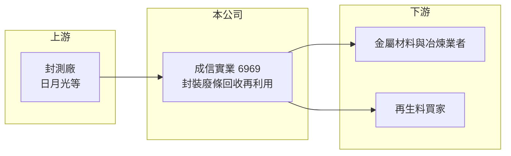

# 6969 成信實業-創

> 創新板｜[[產業索引-綠能環保|綠能環保]]｜上市（櫃）日期 2024/09/09

# 第一章：企業模式與商業藍圖

> [!info] 撰寫說明
> 精簡版，由 Claude 依公開資料整理，架構比照 [[2330台積電]]，資料截至 2026-10-08。創新板／新掛牌，公開資料有限。來源：證交所開放資料快照（基本資料、2026 年第二季綜合損益與資產負債、每月營收、股利）、Goodinfo 年度經營績效、科技新報 2024 年 8 月掛牌報導標題。營收比重未查得，回收製程細節為整理性描述。#待校對

成信實業（以下簡稱成信）位於台南柳營，2024 年 9 月登上[[創新板]]，主要業務是把半導體封裝廠產生的金屬廢料回收再利用。本章說明它在半導體供應鏈中的位置與商業邏輯。

- **核心業務：** 科技新報 2024 年 8 月的報導將成信描述為「日月光廢條再利用最大供應商」。封裝廠在生產過程中會產生大量[[導線架]]邊料與不良品（俗稱廢條），裡面含有銅與貴金屬；成信向封裝廠取得這些廢料，經過處理後回收金屬，再賣回材料市場，屬於半導體業的[[循環經濟]]環節。
- **營收結構：** 各產品營收比重未查得。從商業模式推估，收入來源包括回收金屬的銷售，以及向封裝廠收取的處理費（推估）。由於回收金屬以國際金屬價格計價，營收會隨銅價與貴金屬價格波動。
- **營運據點：** 公司與工廠位於台南市柳營區的環保科技園區附近，鄰近南部的封裝與半導體聚落，運輸距離短，有助於降低廢料收運成本。
- **長期方向：** 半導體大廠對供應鏈的 [[ESG]] 要求越來越嚴格，廢料必須可追溯、合規處理，並提高再利用比例。成信若能從單一大客戶擴大到更多封測廠，並提升回收金屬的純度與價值，才能把規模經濟做出來。

# 第二章：護城河深度與競爭優勢

回收業的競爭力在於取得料源的關係、處理許可與回收效率。本章分析成信的優勢與限制。

- **競爭優勢：** 半導體廢料的處理需要環保許可，並通過客戶對資料保密與流向追蹤的稽核，一旦成為合格供應商，客戶通常不會輕易更換。成信與 [[3711日月光投控]] 的長期合作就是最主要的料源保障。
- **主要對手：** 半導體廢料與貴金屬回收的台股同業包括 [[1785光洋科]]、[[8435鉅邁]] 等，部分業者規模與資本遠大於成信。成信的定位較專注在封裝廢條，業務範圍相對窄。
- **觀察重點：** 公司至今仍處於虧損或微利邊緣，2025 年[[營業利益率]]首次轉正為 4.8%。後續要看毛利率能否穩定在三成以上、業外的財務成本能否下降，以及客戶是否分散，這三點決定它能否從虧損轉為穩定獲利。

# 第三章：財務體質與盈利規模

資料日期：2026-10-08，表格是撰寫當時的快照；最新月營收、毛利率、累計 EPS 由自動排程寫在本筆記的屬性欄位（月營收、毛利率、累計EPS 等）。#待校對

成信仍在爬坡期，財務表現波動大，適合用多年度資料觀察趨勢。

| 年度 | 營收（億元） | [[毛利率]] | [[營業利益率]] | EPS（元） | [[ROE]] |
|---|---|---|---|---|---|
| 2021 | 0.99 | 20.1% | -38.7% | -1.36 | -12.9% |
| 2022 | 1.90 | 36.9% | -6.8% | 0.23 | 2.8% |
| 2023 | 1.25 | 18.1% | -74.8% | -2.74 | -30.2% |
| 2024 | 2.00 | 10.0% | -37.8% | -2.15 | -23.9% |
| 2025 | 3.60 | 29.0% | 4.8% | -0.09 | -1.1% |
| 2026 上半年 | 1.45 | 33.1% | 4.3% | -0.04 | 未查得 |

- **營收規模：** 營收從 2021 年的 0.99 億元成長到 2025 年的 3.60 億元，年複合成長率約 38%（推算），但 2023 年曾大幅衰退，顯示料源與金屬價格的波動很大。2026 年 1 至 8 月累計營收 1.91 億元，較前一年同期減少約 6%。
- **獲利：** 2026 年上半年營業利益 0.06 億元，但業外損失 0.08 億元（主要應為利息等財務成本，推估），稅後淨損 0.02 億元，EPS -0.04 元。近五年平均 ROE 約 -13%（推算），尚未證明能長期獲利。
- **財務特色：** 2026 年第二季底股東權益 4.85 億元，累積虧損 2.27 億元；非流動負債 4.50 億元，相對股東權益偏高，應與廠房設備的長期借款有關（推估）。2025 年度未配發股利。實收資本額 7.09 億元，發行股數約 4,386 萬股，兩者換算的每股面額不是 10 元，細節待校對。
- **[[ROIC]] 與 [[WACC]]：** 官方快照未拆分有息負債，以非流動負債 4.50 億元作為有息負債的近似值。2026 年上半年營業利益年化約 0.13 億元，扣除 20% 稅後約 0.10 億元，除以股東權益加非流動負債 9.35 億元，ROIC 約 1.1%（推算）。WACC 以 CAPM 推估：無風險利率 1.75%、市場風險溢酬 6%、β 假設 1.2（小型回收業推估值），權益成本約 9.0%；負債成本假設 3%、稅後 2.4%，負債占比約 48%，WACC 約 5.8%（推算）。ROIC 明顯低於 WACC，代表目前投入的資本尚未創造價值，需靠營收放大與毛利改善縮小差距。

# 第四章：總體風險與地緣政治

回收業同時受原物料價格與單一客戶影響，本章整理成信的長期風險。

- **產業週期：** 封測產能利用率決定廢料產生量，半導體景氣下行時，料源會同步減少；回收金屬的售價則隨國際銅價與貴金屬價格波動，兩者疊加使營收起伏較大。
- **營運風險：** 料源高度依賴主要封測客戶，若客戶自行回收或改用其他廠商，影響會很直接。公司尚有累積虧損，財務槓桿偏高，若營運不如預期，可能需要增資或再融資。
- **其他風險：** 廢棄物處理法規與許可展延是持續性風險；處理過程若發生污染事件，可能面臨停工與罰款。股票流動性低、資訊揭露有限，也是創新板小型股的共同限制。

# 專有名詞解析

## 半導體

- **[[導線架]]**：封裝時承載晶片並把訊號引出的金屬框架，多以銅合金製成，表面常鍍貴金屬。

## 金融

- **[[創新板]]**：臺灣證券交易所為新創與成長型企業設立的上市板塊，掛牌條件較寬，但初期限制一般投資人交易資格。

## 產業

- **[[循環經濟]]**：把廢棄物回收、處理後重新變成原料或產品，以減少資源消耗與最終處置量的經濟模式。
- **[[ESG]]**：環境、社會與公司治理三個面向的永續指標，大廠以此要求供應鏈。

# 核心供應鏈

- 上游：封測廠產生的導線架廢條與不良品是主要料源，最大來源為 [[3711日月光投控]]。
- 下游／客戶：回收後的銅與貴金屬賣給金屬冶煉與材料業者。
- 同業：[[1785光洋科]]、[[8435鉅邁]]、[[9930中聯資源]]（廣義資源回收）。

## 最新新聞
<!-- news:start -->
<!-- news:end -->

## 相關連結
- [公開資訊觀測站](https://mopsov.twse.com.tw/mops/web/t05st03?step=1&firstin=1&co_id=6969)
- [Goodinfo](https://goodinfo.tw/tw/StockDetail.asp?STOCK_ID=6969)
- [Yahoo 股市](https://tw.stock.yahoo.com/quote/6969)
- [鉅亨網新聞](https://www.cnyes.com/twstock/6969/news)
