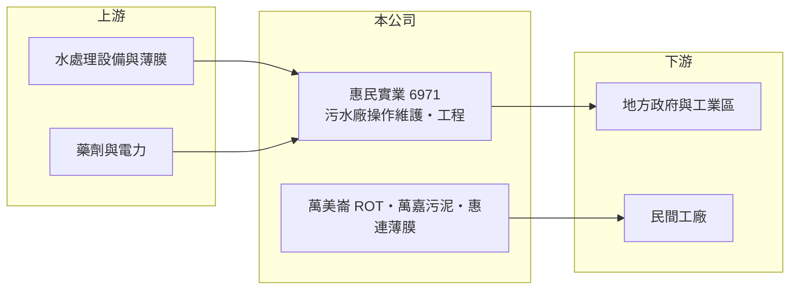

# 6971 惠民實業

> 上櫃｜[[產業索引-綠能環保|綠能環保]]｜上市（櫃）日期 2025/10/02

# 第一章：企業模式與商業藍圖

> [!info] 撰寫說明
> 精簡版，由 Claude 依公開資料整理，架構比照 [[2330台積電]]，資料截至 2026-10-08。來源：Goodinfo 台灣股市資訊網年度經營績效（2021 至 2025 年）；ETtoday 財經雲 2025 年上櫃前報導；櫃買中心開放資料快照（基本資料、2026 年上半年資產負債與損益、股利）。業務別營收比重與案場清單未查得。#待校對

惠民實業成立於 1997 年 4 月、2025 年 10 月上櫃，總部在台北，董事長吳萬益，實收資本額 3.9 億元。惠民是水資源處理的專業操作與工程公司，主要承接公共污水處理廠、再生水、海水淡化與淨水場的操作維護，並延伸到污泥處理與薄膜清洗。

- **核心業務：** 惠民的收入分為兩類：一是長期的[[操作維護]]合約，替政府或工業區營運污水處理廠、淨水場與抽水站；二是興建、更新與修繕工程，包括抽水站、滯洪池等水利工程。操作維護是一次簽約、多年收費的模式，提供穩定的基本收入；工程則帶來成長但波動較大。
- **營收結構：** 業務別比重這次未查得。依報導，2021 年以來案場續約率約 93%，未續約者多為公司因毛利率不足而主動放棄的專案，顯示操作維護客戶的黏著度高。
- **營運據點：** 子公司萬美崙（持股 100%）營運大社石化工業區污水處理廠 [[ROT]] 案；萬嘉（持股 100%）處理生活污水與工業廢水產生的污泥；惠連薄膜（持股 51%）提供[[逆滲透]]膜清洗服務。案場遍及台灣各地（清單未查得）。
- **長期方向：** 公司從水處理操作向上下游整合，把污泥處理與薄膜清洗推向民間企業客戶。台灣再生水與海水淡化政策推進、半導體等產業用水需求上升，長期會增加水處理設施的委外營運需求。

# 第二章：護城河深度與競爭優勢

惠民的護城河來自長期操作合約的實績與續約率，屬於服務型的窄護城河。

- **競爭優勢：** 公共污水廠與淨水場的委外營運重視過往實績與人員證照，新進者難以取得大型標案。約 93% 的續約率代表客戶更換營運商的意願低，因為交接期的水質與停機風險由業主承擔。污泥與薄膜清洗服務則可以跨售給既有客戶。
- **主要對手：** 水處理工程與操作同業包括 [[9933中鼎]] 旗下水處理事業、[[8936國統]]、[[6803崑鼎]] 等（各自業務重疊程度待校對），以及多家中小型操作維護業者。
- **觀察重點：** 毛利率長期只有 8% 至 10%，營業利益率約 5% 至 7%，屬於薄利但穩定的模式。長期要看 ROT 等長約案與廢棄物處理能否提高毛利。

# 第三章：財務體質與盈利規模

資料日期：2026-10-08，表格是撰寫當時的快照；最新月營收、毛利率、累計 EPS 由自動排程寫在本筆記的屬性欄位（月營收、毛利率、累計EPS 等）。#待校對

惠民營收從 2021 年的 16 億元成長到 2025 年 23 億元，利潤率穩定但偏低，ROE 在 6% 至 16% 之間。

| 年度 | 營收（億元） | [[毛利率]] | [[營業利益率]] | EPS（元） | [[ROE]] |
|---|---|---|---|---|---|
| 2021 | 16.1 | 8.42% | 5.46% | 1.14 | 6.42% |
| 2022 | 14.9 | 9.76% | 5.86% | 1.55 | 8.45% |
| 2023 | 19.2 | 10.2% | 6.81% | 2.98 | 16.0% |
| 2024 | 20.9 | 9.94% | 6.32% | 2.71 | 13.4% |
| 2025 | 23.1 | 10.3% | 6.54% | 2.42 | 10.7% |

註：Goodinfo 合併報表，2020 年未查得。2026 年上半年營收 9.80 億元、毛利率約 9.8%、EPS 0.82 元（櫃買中心資料）。

- **長期指標：** 2021 至 2025 年營收年複合成長率約 9.4%（推算），近 5 年平均 ROE 約 11.0%（推算）。現金股利 1.5 元（櫃買中心資料），以 2025 年 EPS 2.42 元計算配息率約 62%（推算）。
- **[[ROIC]] 與 [[WACC]]：** 2025 年營業利益約 1.51 億元（23.1 億元 × 6.54%），稅後約 1.21 億元；投入資本約 14.5 億元（2026 年第二季權益總計 8.97 億元，加上以非流動負債 5.56 億元推估的有息負債，可能包含 ROT 案的長期負債），ROIC 約 8.3%（推算）。WACC 約 4.5%（推算：無風險利率 1.75%、市場風險溢酬 6%、β 取公用與環境服務常見值 0.7，股東權益成本 5.95%；稅前負債成本 2.5%、稅率 20%，負債占資本約 38%）。ROIC 高於 WACC，屬於低利潤率但高周轉、仍能創造價值的服務業。
- **財務特色：** 2026 年第二季負債比率約 72%（負債 22.98 億元 ÷ 資產 31.94 億元），流動負債 17.42 億元偏高，可能與工程預收款與 ROT 案的融資有關（推估）。高負債比讓 ROE 高於 ROIC。

# 第四章：總體風險與地緣政治

惠民的風險在於工程收入的波動、薄利模式與政府預算。

- **產業週期：** 操作維護收入穩定，工程收入隨政府水利與污水建設預算起伏。2022 年營收下滑即顯示工程進度對營收的影響。
- **營運風險：** 毛利率約一成，人力、電費與藥劑成本上升時利潤容易被壓縮；續約時若業主壓低價格，公司可能放棄案場。負債比率高，利率上升會增加財務成本。
- **其他風險：** 公共工程標案受政府政策與預算影響；放流水標準變嚴會增加營運成本，但也可能帶來設備更新工程。

# 專有名詞解析

## 金融

- **[[ROIC]]**：投入資本報酬率，稅後營業利益除以股東權益加有息負債，衡量本業運用資本的效率。
- **[[WACC]]**：加權平均資金成本，股東與債權人要求報酬率的加權平均，是 ROIC 要超越的門檻。

## 產業

- **[[操作維護]]**：替業主營運與保養污水廠、淨水場等設施的長期服務合約，簡稱 O&M，收入穩定、毛利率較低。
- **[[ROT]]**：增建、整建、營運、移轉，民間業者整修既有公共設施並營運一定期間後交還政府。
- **[[逆滲透]]**：以高壓推動水分子通過半透膜、濾除鹽分與雜質的技術，是再生水與海水淡化的核心製程。

# 核心供應鏈

- 上游：水處理設備、薄膜與藥劑供應商（名單未查得）。
- 下游／客戶：地方政府公共污水處理廠、淨水場與水利設施；大社石化工業區；需要污泥處理與薄膜清洗的民間工廠。
- 同業：[[9933中鼎]]、[[8936國統]]、[[6803崑鼎]]。

## 最新新聞
<!-- news:start -->
<!-- news:end -->

## 相關連結
- [公開資訊觀測站](https://mopsov.twse.com.tw/mops/web/t05st03?step=1&firstin=1&co_id=6971)
- [Goodinfo](https://goodinfo.tw/tw/StockDetail.asp?STOCK_ID=6971)
- [Yahoo 股市](https://tw.stock.yahoo.com/quote/6971)
- [鉅亨網新聞](https://www.cnyes.com/twstock/6971/news)
