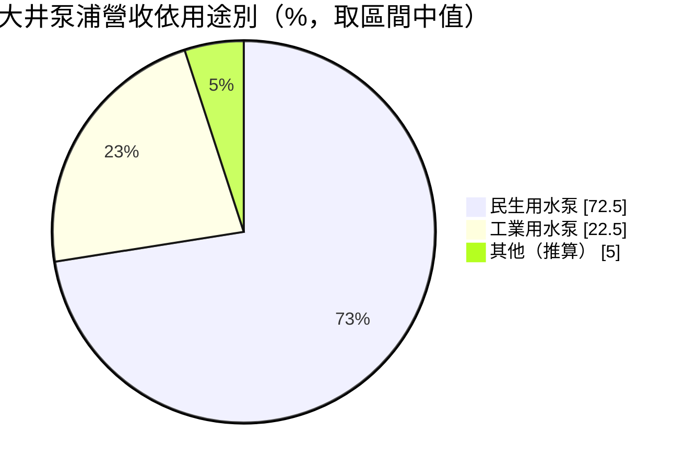
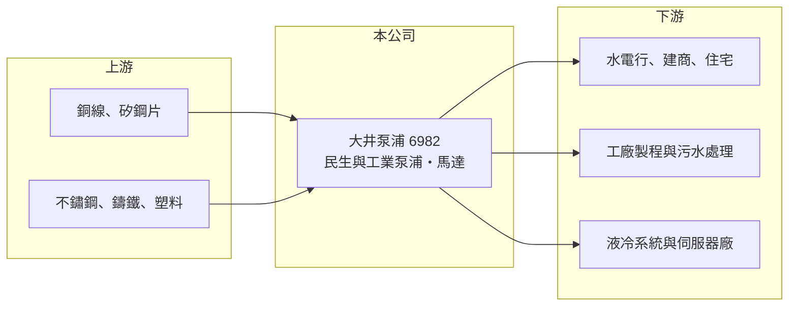

# 6982 大井泵浦

> 上櫃｜[[產業索引-電機機械|電機機械]]｜上市（櫃）日期 2024/12/18

# 第一章：企業模式與商業藍圖

> [!info] 撰寫說明
> 精簡版，由 Claude 依公開資料整理，架構比照 [[2330台積電]]，資料截至 2026-10-08。來源：櫃買中心開放資料快照（基本資料、2026 年第二季資產負債與損益、每月營收、本益比殖利率）、優分析個股介紹、nStock 公司簡介。Goodinfo 經營績效頁本次無法讀取，多年度數字不完整。#待校對

大井泵浦（以下簡稱大井）是台灣最大的民生用水[[泵浦]]品牌，英文品牌為 Walrus。理解它的關鍵在於：大井的本業是需求穩定的家用與建築用水泵，近年投入大筆資金興建新廠，並切入 AI 伺服器[[液冷散熱]]用的冷卻水泵，正處於「穩定本業加上高成長新應用」的轉型期。

- **核心業務：** 大井成立於 1978 年，2024 年 12 月在櫃買中心上櫃，實收資本額約 4.08 億元，董事長為黃景豐、總經理為黃錦雲，總部位於新北三芝。營業項目包括泵浦、馬達、噴霧機、油壓與氣壓省力設備及自動化機械。產品用於住宅供水加壓、污水處理、排水防洪，以及工廠製程與伺服器冷卻。
- **營收結構：** 依優分析資料，民生用水泵約占營收七成至七成五，工業用水泵約占兩成至兩成五。大井在台灣民生泵浦市場的市占率約 30%，是本土第一品牌，進口品牌價格常是大井的二至三倍，形成明顯的性價比優勢。
- **營運據點：** 原有生產基地在台灣，新建的高雄環球廠投資約 10 億元，2025 年下半年試產，完成後年產能預計倍增到約 105 萬台。台灣是核心市場，中國與東協是拓展目標。
- **長期方向：** 新的成長動能來自工業用泵，特別是 AI 伺服器液冷系統所需的冷卻水泵，預計 2025 年下半年開始出貨；另有美國工具機廠的新訂單。公司也推出符合 IE3 效率等級的高效率馬達，因應各國節能法規。長期而言，工業與 AI 冷卻泵比重能否提高，決定大井能否從內需品牌變成具成長性的工業零組件廠。

# 第二章：護城河深度與競爭優勢

大井的護城河來自本土品牌、通路與服務網，以及相對進口品牌的成本優勢。

- **競爭優勢：** 民生泵浦的購買決策常由水電行與建商決定，大井長年建立的通路、維修服務與品牌知名度，使它在台灣維持約三成市占。泵浦故障直接影響住戶用水，使用者重視快速維修，在地服務網是外商難以複製的優勢。
- **主要對手：** 全球泵浦市場由丹麥 Grundfos、美國 Xylem、Flowserve 與瑞士 Sulzer 等大廠主導，在台灣則與進口品牌及本土中小型泵浦廠競爭。AI 冷卻泵市場的對手包括國際泵浦大廠與液冷系統廠自行開發的方案（待校對）。
- **觀察重點：** 長期要看 AI 冷卻泵能否打進主要液冷系統與伺服器廠的供應鏈，以及新廠產能利用率能否在幾年內拉高。新廠完工後折舊增加，若營收放量不如預期，毛利率會受到壓縮。

# 第三章：財務體質與盈利規模

資料日期：2026-10-08，表格是撰寫當時的快照；最新月營收、毛利率、累計 EPS 由自動排程寫在本筆記的屬性欄位（月營收、毛利率、累計EPS 等）。#待校對

大井的財務呈現「本業穩定、擴廠期獲利下滑、負債升高」的轉型樣貌。由於本次未取得完整的年度財報摘要，表格多數格子未查得。

| 年度 | 營收（億元） | [[毛利率]] | [[營業利益率]] | EPS（元） | [[ROE]] |
|---|---|---|---|---|---|
| 2023 | 未查得 | 未查得 | 未查得 | 2.07 | 未查得 |
| 2024 | 未查得（前三季 12.27） | 未查得 | 未查得 | 約 2.85（推算） | 未查得 |
| 2025 | 16.18 | 未查得 | 未查得 | 0.06 | 未查得 |
| 2026 上半年 | 10.16 | 23.8% | 3.29% | 0.40 | 未查得 |

（來源：優分析、nStock、櫃買中心開放資料。2024 年 EPS 以 2024 年度現金股利 2.1 元、配息率 73.68% 推算；2025 年 EPS 取自 nStock，待校對。）

- **營收規模：** 2024 年前三季營收 12.27 億元，年增約 15.6%；2025 年全年營收約 16.18 億元。2026 年上半年營收 10.16 億元，前八月累計較前一年同期成長約 17%，規模持續擴大。
- **獲利：** 2023 年 EPS 2.07 元、2024 年約 2.85 元（推算），2025 年驟降到 0.06 元（待校對），推估與新廠開辦費用、折舊與 AI 新產品的投入有關。2026 年上半年毛利率約 23.8%、營業利益率約 3.3%，業外為淨損約 0.12 億元，推估包含利息費用。
- **財務特色：** 依 2026 年第二季資料，總資產約 29.6 億元、權益約 8.7 億元、負債約 20.9 億元，負債比約 71%，其中非流動負債約 13.3 億元，推估主要為新廠的長期借款。保留盈餘僅約 0.53 億元。2025 年度仍發放約 1.6 元現金股利，遠高於當年 EPS，推估部分來自資本公積或以前年度盈餘（待校對），這種配息方式不可長期持續。
- **[[ROIC]] 與 [[WACC]]：** 2026 年上半年營業利益約 0.33 億元，年化後稅後營業利益約 0.54 億元（推算，稅率 20%），以權益 8.7 億元到「權益加全部負債」29.6 億元計算，ROIC 約 1.8% 至 6.1%（推算），若以權益加推估的有息負債約 13 億元計算約 2.5%。WACC 以 [[CAPM]] 推估：無風險利率 1.75%、市場風險溢酬 6%、β 假設 0.9（工業零組件股常見值），權益成本約 7.15%；假設有息負債占資本約 60%、稅前負債成本 2.5%，WACC 約 4.1%（推算）。目前 ROIC 低於 WACC，屬於擴廠期的常見現象，新廠能否把 ROIC 拉回擴廠前的水準，是判斷這筆資本支出是否創造價值的關鍵。

# 第四章：總體風險與地緣政治

大井的風險集中在擴廠後的財務槓桿、新產品放量的不確定性，以及本業的成熟度。

- **產業週期：** 民生泵浦需求與房屋新建、老屋更新與天候（乾旱、颱風）相關，波動相對溫和。工業與 AI 冷卻泵則跟著資料中心建設與製造業投資循環，波動較大。
- **營運風險：** 負債比超過七成，利率上升或營收不如預期時，利息與還款壓力會快速放大。新廠產能倍增後，需要找到足夠的訂單填滿產能，否則固定成本會長期壓抑獲利。
- **其他風險：** 銅、矽鋼片與不鏽鋼等原料價格影響馬達與泵體成本；外銷擴張面對匯率與關稅風險；AI 冷卻市場技術規格變化快，客戶驗證與標準可能改變。

# 專有名詞解析

## 應用

- **[[AI 伺服器]]**：搭載 GPU 等加速晶片、用於訓練與推論 AI 模型的伺服器，對散熱與電源規格要求很高。

## 金融

- **[[CAPM]]**：資本資產定價模型，以無風險利率加上 β 乘以市場風險溢酬，推估股東要求的報酬率。

## 產業

- **[[泵浦]]**：利用馬達驅動葉輪，把液體加壓或輸送的機械，用於供水、排水、工業製程與冷卻循環。
- **[[液冷散熱]]**：以液體帶走晶片熱量的散熱方式，透過冷板、泵浦與熱交換器循環，用於高功耗 AI 伺服器。

# 核心供應鏈

- 上游：馬達用的銅線與矽鋼片，泵體用的不鏽鋼、鑄鐵與工程塑料；實際供應商未查得，#待校對。
- 下游／客戶：水電行與建商通路、住宅用戶、工廠與污水處理設施，以及 AI 伺服器液冷系統廠；具體客戶名稱未查得。
- 同業：國際的 Grundfos、Xylem、Flowserve、Sulzer；液冷相關台廠如 [[3017奇鋐]]、[[3324雙鴻]] 屬於下游系統整合端，與大井為潛在合作或客戶關係（推估）。

## 最新新聞
<!-- news:start -->
<!-- news:end -->

## 相關連結
- [公開資訊觀測站](https://mopsov.twse.com.tw/mops/web/t05st03?step=1&firstin=1&co_id=6982)
- [Goodinfo](https://goodinfo.tw/tw/StockDetail.asp?STOCK_ID=6982)
- [Yahoo 股市](https://tw.stock.yahoo.com/quote/6982)
- [鉅亨網新聞](https://www.cnyes.com/twstock/6982/news)
