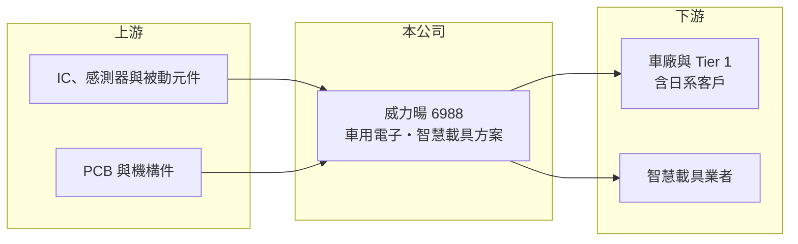

# 6988 威力暘-創

> 創新板｜[[產業索引-汽車工業|汽車工業]]｜上市（櫃）日期 2024/10/23

# 第一章：企業模式與商業藍圖

> [!info] 撰寫說明
> 精簡版，由 Claude 依公開資料整理，架構比照 [[2330台積電]]，資料截至 2026-10-08。創新板／新掛牌，公開資料有限。來源：證交所開放資料快照（基本資料、2026 年第二季綜合損益與資產負債、每月營收、股利）、Goodinfo 年度經營績效、科技新報 2024 年 9 月上市前業績發表會報導。營收比重與產品細項未查得。#待校對

威力暘電子（以下簡稱威力暘）總部位於新竹竹北，2024 年 10 月登上[[創新板]]，自我定位為車用電子與智慧載具解決方案供應商。本章說明它的業務輪廓與長期策略。

- **核心業務：** 威力暘替車廠與車用系統廠開發、生產車用電子模組，以及智慧載具（例如電動機車、特殊用途車輛）所需的電子產品與系統整合方案。產品細項未查得，公開報導以「車用電子」與「智慧載具」兩大類描述（待校對）。這類業務的特點是先參與客戶的新車型開發，量產後依出貨量認列營收。
- **營收結構：** 各產品營收比重未查得。依 2024 年 9 月業績發表會報導，公司約在 2022 年切入日本車用市場，目標五年內讓日本車用營收比重達到 30% 至 40%。這代表公司正把客戶結構從原有市場延伸到門檻較高的日系車廠供應鏈。
- **營運據點：** 公司登記於新竹縣竹北市，研發與營運集中在新竹地區；生產據點與海外子公司未查得。
- **長期方向：** 汽車電子化與電動化讓每台車的電子零件價值持續提高，[[ADAS]]、車載影像、電控模組都是成長領域。威力暘的長期成長取決於能否在日系車廠站穩，並把單一車型的合作擴大到多個平台。

# 第二章：護城河深度與競爭優勢

車用電子的護城河來自認證週期與客戶黏著度。本章分析威力暘的競爭位置與限制。

- **競爭優勢：** 車用產品必須通過 IATF 16949 品質系統與車廠的長期驗證，從送樣到量產往往要兩到三年，一旦導入，同一車型的生命週期內很少更換供應商。威力暘[[毛利率]]長期維持在 26% 至 30% 之間，顯示它具備一定的設計與整合附加價值，而不是純代工。
- **主要對手：** 台灣車用電子模組同業包括 [[2231為升]]、[[6279胡連]]、[[4551智伸科]]、[[1533車王電]] 等，國際上則有日本與歐洲的大型 [[Tier 1]] 供應商。威力暘規模遠小於這些對手，需靠利基產品與彈性服務爭取訂單。
- **觀察重點：** 公司近四年營收停留在 7.6 億至 8.9 億元之間，[[營業利益率]]在 2025 年轉為 -5.8%。後續要看日本車用訂單能否帶動營收突破十億元，以及費用率能否隨規模下降。

# 第三章：財務體質與盈利規模

資料日期：2026-10-08，表格是撰寫當時的快照；最新月營收、毛利率、累計 EPS 由自動排程寫在本筆記的屬性欄位（月營收、毛利率、累計EPS 等）。#待校對

威力暘的財務表現顯示，毛利率尚屬穩定，但營收規模不足以攤提費用。

| 年度 | 營收（億元） | [[毛利率]] | [[營業利益率]] | EPS（元） | [[ROE]] |
|---|---|---|---|---|---|
| 2022 | 7.58 | 29.1% | 2.5% | 0.50 | 3.0% |
| 2023 | 8.13 | 27.9% | 0.1% | 0.01 | 0.1% |
| 2024 | 8.85 | 29.7% | 2.1% | 0.51 | 3.0% |
| 2025 | 7.92 | 26.5% | -5.8% | -1.13 | -6.9% |
| 2026 上半年 | 3.60 | 29.5% | -2.3% | -0.20 | 未查得 |

- **營收規模：** 2022 至 2025 年營收年複合成長率約 1.5%（推算），成長幾乎停滯。2026 年 1 至 8 月累計營收 4.68 億元，較前一年同期減少約 13%。
- **獲利：** 2026 年上半年營業損失 0.08 億元、稅後淨損 0.10 億元，EPS -0.20 元；2025 年度淨損約 0.54 億元。近四年平均 ROE 約 0%（推算），獲利能力薄弱。
- **財務特色：** 2026 年第二季底股東權益 6.95 億元，每股淨值 15.31 元；非流動負債 3.31 億元。2025 年度因虧損未配發股利。毛利率穩定、但營業費用（研發與管理）占營收比重高，是典型「規模不夠大」的小型車用電子公司。
- **[[ROIC]] 與 [[WACC]]：** 官方快照未拆分有息負債，以非流動負債 3.31 億元作為有息負債近似值。2026 年上半年營業損失年化約 -0.17 億元，虧損不計稅盾，稅後約 -0.17 億元，除以股東權益加非流動負債 10.26 億元，ROIC 約 -1.6%（推算）；若以 2025 全年營業損失約 0.46 億元計算，ROIC 約 -4.5%（推算）。WACC 以 CAPM 推估：無風險利率 1.75%、市場風險溢酬 6%、β 假設 1.2（小型車用電子推估值），權益成本約 9.0%；負債成本假設 2.5%、稅後 2.0%，負債占比約 32%，WACC 約 6.7%（推算）。ROIC 為負且低於 WACC，代表目前營運在消耗股東價值，轉機關鍵在營收規模。

# 第四章：總體風險與地緣政治

車用電子受車市景氣與客戶集中度影響，本章整理威力暘的長期風險。

- **產業週期：** 全球汽車銷量與車廠庫存調整會直接影響零組件訂單；電動車滲透率的變化，也會改變不同車用電子產品的需求。
- **營運風險：** 公司規模小、客戶數有限，單一車型量產時程延後或停產，就可能讓營收明顯波動。持續虧損下，研發投入與營運資金的壓力會逐步增加。
- **其他風險：** 日本市場以日圓計價時，日圓匯率波動會影響營收與毛利；車用供應鏈的地緣政治重組（例如要求非中國製造）既是機會也是成本壓力。

# 專有名詞解析

## 應用

- **[[ADAS]]**：先進駕駛輔助系統，以攝影機、雷達等感測器協助駕駛，例如自動煞車與車道維持。

## 金融

- **[[創新板]]**：臺灣證券交易所為新創與成長型企業設立的上市板塊，掛牌條件較寬，但初期限制一般投資人交易資格。

## 產業

- **[[Tier 1]]**：直接供貨給車廠的一級供應商，負責系統或模組的設計與整合。

# 核心供應鏈

- 上游：車規 IC、影像與雷達感測器、被動元件、PCB 與機構件。
- 下游／客戶：車廠與 Tier 1 系統廠（含 2022 年起切入的日本市場）、智慧載具業者。
- 同業：[[2231為升]]、[[6279胡連]]、[[4551智伸科]]、[[1533車王電]]。

## 最新新聞
<!-- news:start -->
<!-- news:end -->

## 相關連結
- [公開資訊觀測站](https://mopsov.twse.com.tw/mops/web/t05st03?step=1&firstin=1&co_id=6988)
- [Goodinfo](https://goodinfo.tw/tw/StockDetail.asp?STOCK_ID=6988)
- [Yahoo 股市](https://tw.stock.yahoo.com/quote/6988)
- [鉅亨網新聞](https://www.cnyes.com/twstock/6988/news)
