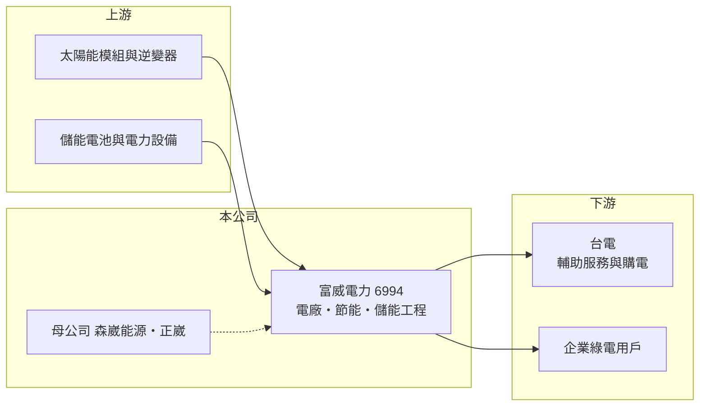

# 6994 富威電力

> 上市｜[[產業索引-綠能環保|綠能環保]]｜上市（櫃）日期 2025/01/15

# 第一章：企業模式與商業藍圖

> [!info] 撰寫說明
> 精簡版，由 Claude 依公開資料整理，架構比照 [[2330台積電]]，資料截至 2026-10-08。來源：Goodinfo 台灣股市資訊網年度經營績效（2022 至 2025 年）；nStock 公司概況；證交所開放資料快照（基本資料、2026 年上半年資產負債、損益與營益分析、2025 年度股利）。公開資料有限，業務別營收比重、案場容量與主要客戶未查得。#待校對

富威電力成立於 2019 年 6 月、2025 年 1 月上市，總部在新北市土城，董事長兼總經理為郝遐鵬，實收資本額 7.4 億元。公司是 [[6806森崴能源]] 持股約 29% 的子公司，最終母公司為 [[2392正崴]]，主要經營再生能源售電、節能與[[儲能]]系統輔助服務等工程與服務業務。

- **核心業務：** 富威的業務可分成三塊：再生能源電廠的開發與售電、企業節能工程，以及儲能系統參與台電[[輔助服務]]市場（各業務細節待校對）。工程收入在完工時集中認列，售電與輔助服務則是長期、重複的收入，兩者性質不同。
- **營收結構：** 業務別比重這次未查得。營收由 2022 年 3.6 億元暴增到 2025 年 49.9 億元，推估主要來自大型儲能或電廠工程的認列；2026 年上半年營收 14.20 億元、毛利率 13.0%，規模與獲利都明顯低於 2025 年。
- **營運據點：** 以台灣為主，透過子公司開發與持有案場（子公司名稱與案場容量未查得）。2026 年第二季有非控制權益 3.51 億元，代表部分案場與外部投資人合資。
- **長期方向：** 台灣企業的 [[RE100]] 需求、電網韌性與儲能政策，是富威長期的需求來源。公司能否把一次性的工程收入轉化為長期持有的售電與儲能收入，決定未來獲利的穩定度。

# 第二章：護城河深度與競爭優勢

富威的競爭力來自集團資源與工程執行能力，但工程業務的護城河有限。

- **競爭優勢：** 背後有森崴能源與正崴集團的資金與案場資源，在大型案場的承攬與融資上具優勢。同時具備工程與售電能力，可以提供企業從建置到購電的整合服務。
- **主要對手：** 再生能源與儲能工程同業包括 [[6806森崴能源]]、[[6873泓德能源]]、[[6869雲豹能源]]、[[1513中興電]]、[[1503士電]] 等。
- **觀察重點：** 2025 年[[營業利益率]] 14.1%、ROE 23.3%，但 2026 年上半年營業利益率降到 4.6%、出現小幅虧損，顯示獲利高度依賴大型專案的認列時點。長期要看持有型案場的規模能否擴大。

# 第三章：財務體質與盈利規模

資料日期：2026-10-08，表格是撰寫當時的快照；最新月營收、毛利率、累計 EPS 由自動排程寫在本筆記的屬性欄位（月營收、毛利率、累計EPS 等）。#待校對

富威在 4 年間營收成長十幾倍，2025 年是獲利高峰，2026 年上半年回落，呈現典型的專案型波動。

| 年度 | 營收（億元） | [[毛利率]] | [[營業利益率]] | EPS（元） | [[ROE]] |
|---|---|---|---|---|---|
| 2022 | 3.62 | 19.9% | 9.41% | 0.64 | 2.94% |
| 2023 | 8.80 | 12.7% | 5.19% | 0.94 | 6.18% |
| 2024 | 18.9 | 15.8% | 9.28% | 1.42 | 8.76% |
| 2025 | 49.9 | 19.2% | 14.1% | 6.34 | 23.3% |

註：Goodinfo 合併報表，2020 至 2021 年未查得。2026 年上半年營收 14.20 億元、毛利率 13.02%、營業利益率 4.60%、EPS -0.09 元（證交所資料）。

- **長期指標：** 2022 至 2025 年營收年複合成長率約 140%（推算），4 年平均 ROE 約 10.3%（推算）。2025 年度現金股利 3 元，配息率約 47%（3 ÷ 6.34）；2024 年度現金股利 0.95 元（nStock）。
- **[[ROIC]] 與 [[WACC]]：** 2025 年營業利益約 7.0 億元（49.9 億元 × 14.1%），稅後約 5.6 億元；投入資本約 45 億元（2026 年第二季權益總計 26.75 億元，加上以非流動負債 18.48 億元推估的有息負債），ROIC 約 12.5%（推算）。以 2026 年上半年營業利益 0.65 億元年化計算，ROIC 只有約 2.3%（推算）。WACC 約 5.4%（推算：無風險利率 1.75%、市場風險溢酬 6%、β 取能源工程業常見值 1.0，股東權益成本 7.75%；稅前負債成本 2.5%、稅率 20%，負債占資本約 41%）。2025 年 ROIC 高於 WACC，但 2026 年上半年低於 WACC，長期是否創造價值要看多年平均。
- **財務特色：** 2026 年第二季負債比率約 63%（負債 45.09 億元 ÷ 資產 71.84 億元），持有庫藏股約 180 萬股。2026 年上半年業外支出 0.53 億元，加上所得稅後轉為虧損。

# 第四章：總體風險與地緣政治

富威的風險集中在專案認列的波動與再生能源政策。

- **產業週期：** 工程收入依大型案場的完工時點認列，年度間落差很大，2025 年的高基期使 2026 年獲利明顯下滑。
- **營運風險：** 案場開發涉及土地、併網與許可，延誤會影響收入時點；儲能設備若發生安全事故，會影響整體產業與公司聲譽。負債比率偏高，利率上升會增加財務負擔。
- **其他風險：** 台電輔助服務市場的價格與規則調整、再生能源政策變動，都會改變儲能與售電的報酬；儲能電池多為進口，匯率與供應鏈影響成本。

# 專有名詞解析

## 金融

- **[[ROIC]]**：投入資本報酬率，稅後營業利益除以股東權益加有息負債，衡量本業運用資本的效率。
- **[[WACC]]**：加權平均資金成本，股東與債權人要求報酬率的加權平均，是 ROIC 要超越的門檻。

## 產業

- **[[儲能]]**：以電池等設備儲存電力，在用電尖峰或電網需要時釋放，可參與電力交易市場賺取收入。
- **[[輔助服務]]**：儲能或發電設備依台電調度即時提供或吸收電力，協助維持電網頻率穩定並收取服務費。
- **[[RE100]]**：企業承諾 100% 使用再生能源電力的國際倡議，帶動企業對綠電的長期需求。

# 核心供應鏈

- 上游：太陽能模組、逆變器、儲能電池與電力設備供應商（名單未查得）。
- 下游／客戶：台電（購電與輔助服務）、有綠電需求的企業。
- 同業：[[6806森崴能源]]、[[6873泓德能源]]、[[6869雲豹能源]]、[[1513中興電]]、[[1503士電]]。

## 最新新聞
<!-- news:start -->
<!-- news:end -->

## 相關連結
- [公開資訊觀測站](https://mopsov.twse.com.tw/mops/web/t05st03?step=1&firstin=1&co_id=6994)
- [Goodinfo](https://goodinfo.tw/tw/StockDetail.asp?STOCK_ID=6994)
- [Yahoo 股市](https://tw.stock.yahoo.com/quote/6994)
- [鉅亨網新聞](https://www.cnyes.com/twstock/6994/news)
