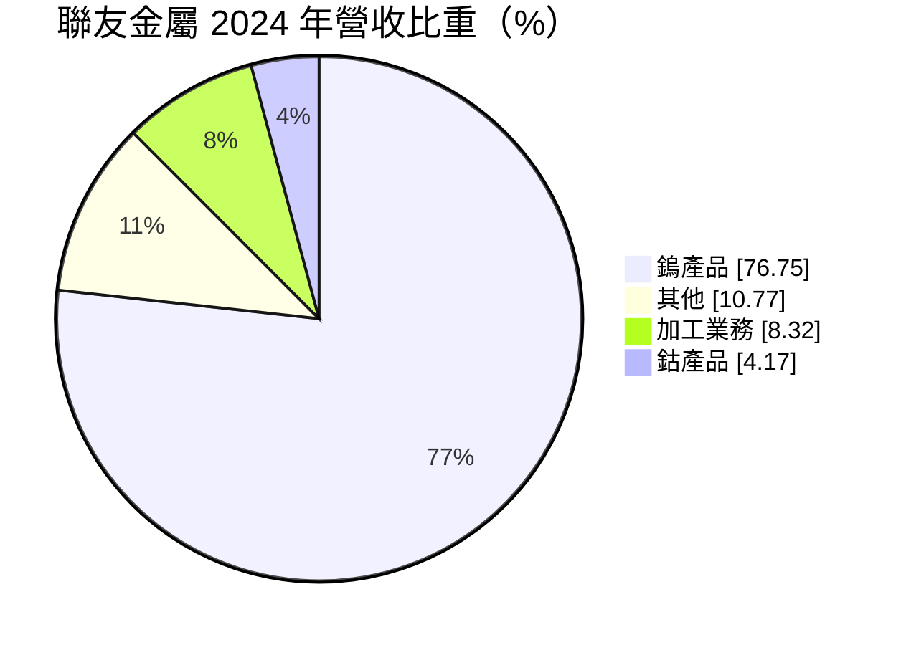
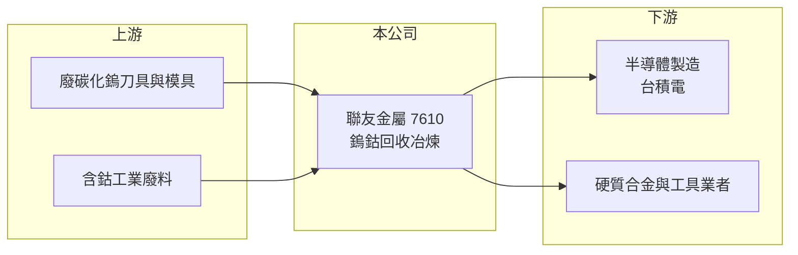

# 7610 聯友金屬-創

> 創新板｜[[產業索引-綠能環保|綠能環保]]｜上市（櫃）日期 2025/09/09

# 第一章：企業模式與商業藍圖

> [!info] 撰寫說明
> 精簡版，由 Claude 依公開資料整理，架構比照 [[2330台積電]]，資料截至 2026-10-08。創新板／新掛牌，公開資料有限。來源：證交所開放資料快照（基本資料、2026 年第二季綜合損益與資產負債、每月營收、股利）、Goodinfo 年度經營績效、MoneyDJ 基本資料（2024 年營收比重）、科技新報與 Yahoo 新聞 2025 年申請與掛牌報導標題。鎢價上漲原因屬推估。#待校對

聯友金屬（以下簡稱聯友）位於屏東縣枋寮鄉，2025 年 9 月登上[[創新板]]，是台灣少數具備[[鎢]]、鈷等稀有金屬回收冶煉能力的公司。本章說明它的原料、產品與商業模式。

- **核心業務：** 聯友回收含鎢、含鈷的廢料，例如廢[[碳化鎢]]刀具、模具與工業廢料，經過化學與冶煉製程，重新製成鎢、鈷產品出售。2025 年申請上市時的報導稱它是「台積電在台唯一鎢金屬合格供應商」，代表其產品已達半導體製程可用的品質標準，鎢在晶片中用於金屬接觸與導線材料。
- **營收結構：** 依 MoneyDJ 資料，2024 年鎢產品占營收 76.75%、其他 10.77%、加工業務 8.32%、鈷產品 4.17%。鎢產品是絕對主力，因此公司營收與獲利對國際鎢價高度敏感。

- **營運據點：** 工廠位於屏東枋寮的屏南工業區。冶煉與化學處理需要環保許可與特定工業用地，這類場址取得不易，本身就是進入門檻。
- **長期方向：** 全球鎢原礦供應高度集中在中國，各國把鎢列為關鍵礦產，推動在地回收與供應鏈分散。聯友的長期價值在於成為台灣半導體與工具機產業的在地鎢供應來源，並把回收比例從工業用途延伸到更高純度的電子級產品。

# 第二章：護城河深度與競爭優勢

稀有金屬回收的護城河來自冶煉技術、環保許可與客戶認證。本章分析聯友的競爭位置。

- **競爭優勢：** 半導體用的鎢材料要經過嚴格的純度與穩定性認證，認證期長、客戶不輕易更換供應商；成為半導體大廠合格供應商，是其他回收業者短期難以複製的資格。加上國內具備鎢冶煉許可的業者很少，聯友在台灣市場的稀缺性高。
- **主要對手：** 全球鎢產品供應以中國廠商為主，例如廈門鎢業等大型集團；歐洲與日本也有專業鎢材料廠（例如 H.C. Starck、日本新金屬，待校對）。台股中沒有以鎢冶煉為主業的直接同業，貴金屬與金屬回收類可參考 [[1785光洋科]]。
- **觀察重點：** 一是鎢價走勢，二是半導體用高純度產品的比重是否提升，三是擴產與原料取得。2026 年上半年[[毛利率]]高達 69.8%，明顯高於 2023 年的 8.9%，反映的主要是鎢價大幅上漲（推估），並不代表長期常態。

# 第三章：財務體質與盈利規模

資料日期：2026-10-08，表格是撰寫當時的快照；最新月營收、毛利率、累計 EPS 由自動排程寫在本筆記的屬性欄位（月營收、毛利率、累計EPS 等）。#待校對

聯友的財務數字劇烈波動，主要跟隨國際鎢價，閱讀時要區分週期高點與長期平均。

| 年度 | 營收（億元） | [[毛利率]] | [[營業利益率]] | EPS（元） | [[ROE]] |
|---|---|---|---|---|---|
| 2020 | 3.72 | 22.8% | 16.0% | 4.58 | 60.9% |
| 2021 | 4.01 | 30.0% | 20.5% | 4.89 | 27.5% |
| 2022 | 5.99 | 28.1% | 18.4% | 3.79 | 19.3% |
| 2023 | 9.16 | 8.9% | 1.7% | 0.14 | 0.7% |
| 2024 | 11.0 | 12.0% | 5.7% | 1.71 | 7.7% |
| 2025 | 14.1 | 30.8% | 22.0% | 5.45 | 20.1% |
| 2026 上半年 | 29.3 | 69.8% | 63.2% | 25.37 | 未查得 |

- **營收規模：** 營收從 2020 年 3.72 億元成長到 2025 年 14.1 億元，五年年複合成長率約 31%（推算）。2026 年上半年營收 29.3 億元，已是 2025 年全年的兩倍；1 至 8 月累計 50.3 億元，較前一年同期成長約 5.6 倍，屬於價格與出貨量同時放大的週期高峰。
- **獲利：** 2026 年上半年營業利益 18.5 億元、稅後淨利 14.7 億元，EPS 25.37 元。對照 2023 年毛利率僅 8.9%，可以看出這門生意的獲利由「原料成本與產品售價的價差」決定，金屬價格上漲時存貨與售價同步受惠，下跌時則相反。近五年（2021 至 2025）平均 ROE 約 15%（推算）。
- **財務特色：** 2026 年第二季底股東權益 31.3 億元、負債 34.5 億元，其中非流動負債 18.6 億元，負債比約 52%，顯示擴產或營運資金需求以借款支應（推估）。股利方面，2025 年度配發現金 0.5 元與股票股利約 2 元，以保留現金、擴大股本為主。
- **[[ROIC]] 與 [[WACC]]：** 官方快照未拆分有息負債，以非流動負債 18.6 億元作為有息負債近似值。2026 年上半年營業利益年化約 37.0 億元，扣除 20% 稅後約 29.6 億元，除以股東權益加非流動負債 49.9 億元，ROIC 約 59%（推算），屬於鎢價高峰期的數字。以 2025 年營業利益約 3.1 億元估算，同一資本基礎下 ROIC 約 5%；2023 年低谷時則接近零（推算）。WACC 以 CAPM 推估：無風險利率 1.75%、市場風險溢酬 6%、β 假設 1.3（原物料循環股推估值），權益成本約 9.6%；負債成本假設 2.5%、稅後 2.0%，負債占比約 37%，WACC 約 6.8%（推算）。高峰期 ROIC 遠高於 WACC，但跨週期平均是否持續高於 WACC，要再觀察幾個鎢價循環。

# 第四章：總體風險與地緣政治

原物料回收冶煉業的最大風險是價格循環。本章整理聯友的長期風險。

- **產業週期：** 鎢價受中國供給政策、出口管制與全球工具機、半導體需求影響，歷史上曾多次大漲大跌。價格反轉時，高價買進的原料會造成存貨跌價損失，毛利率可能像 2023 年一樣快速壓縮。
- **營運風險：** 廢料原料的取得量與品質不穩定，擴產若依賴借款，景氣反轉時財務壓力會放大。冶煉製程涉及化學品與高溫作業，工安與環保事件可能導致停工。
- **其他風險：** 地緣政治是雙面刃：中國管制鎢出口使在地回收價值上升，但若管制放寬，價格回落也會直接衝擊獲利。環保法規趨嚴會提高處理成本；產品以美元計價時，匯率也會影響營收。

# 專有名詞解析

## 金融

- **[[創新板]]**：臺灣證券交易所為新創與成長型企業設立的上市板塊，掛牌條件較寬，但初期限制一般投資人交易資格。

## 產業

- **[[鎢]]**：熔點最高的金屬之一，用於硬質合金刀具、工具機與半導體金屬導線，被多國列為關鍵礦產。
- **[[碳化鎢]]**：鎢與碳結合的硬質材料，常製成切削刀具與模具，使用後的廢料可回收提煉鎢。
- **[[循環經濟]]**：把廢棄物回收、處理後重新變成原料或產品，以減少資源消耗與最終處置量的經濟模式。

# 核心供應鏈

- 上游：工具機、刀具業與工業用戶產生的廢碳化鎢與含鈷廢料，是主要原料來源，屬於[[循環經濟]]的料源回收。
- 下游／客戶：半導體製造（報導指出為 [[2330台積電]] 合格供應商）、硬質合金與工具材料業者。
- 同業：中國鎢業集團與國際鎢材料廠（純文字）；台股金屬材料回收可參考 [[1785光洋科]]。

## 最新新聞
<!-- news:start -->
<!-- news:end -->

## 相關連結
- [公開資訊觀測站](https://mopsov.twse.com.tw/mops/web/t05st03?step=1&firstin=1&co_id=7610)
- [Goodinfo](https://goodinfo.tw/tw/StockDetail.asp?STOCK_ID=7610)
- [Yahoo 股市](https://tw.stock.yahoo.com/quote/7610)
- [鉅亨網新聞](https://www.cnyes.com/twstock/7610/news)
