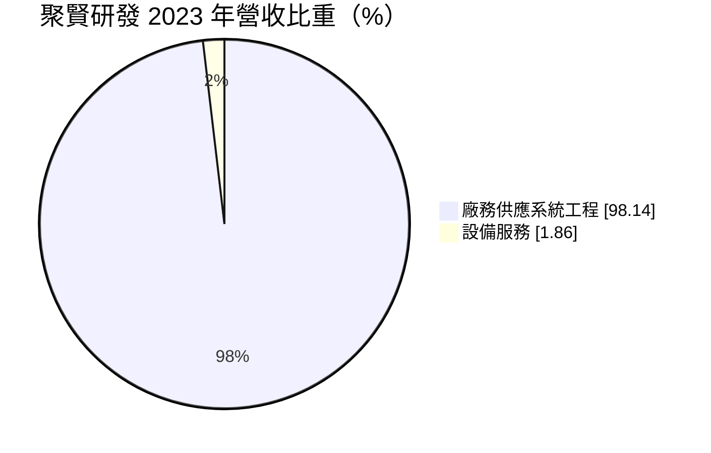
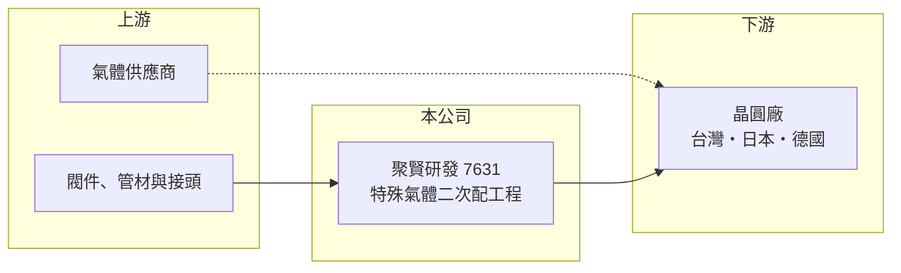

# 7631 聚賢研發-創

> 創新板｜[[產業索引-其他電子業|其他電子業]]｜上市（櫃）日期 2025/03/13

# 第一章：企業模式與商業藍圖

> [!info] 撰寫說明
> 精簡版，由 Claude 依公開資料整理，架構比照 [[2330台積電]]，資料截至 2026-10-08。創新板／新掛牌，公開資料有限。來源：證交所開放資料快照（基本資料、2026 年第二季綜合損益與資產負債、每月營收、股利）、Goodinfo 年度經營績效、MoneyDJ 基本資料（2023 年營收比重）、科技新報 2025 年 2 月上市前業績發表會報導。主要客戶為台積電屬推估。#待校對

聚賢研發（以下簡稱聚賢）是新竹的廠務工程公司，2025 年 3 月登上[[創新板]]，專做半導體廠的[[特殊氣體]][[二次配]]工程。本章說明這門生意的位置與獲利來源。

- **核心業務：** 晶圓廠的特殊氣體從氣體櫃經主管線送到廠區，最後一段從主管線接到每台製程機台的管路與閥件安裝，就是二次配。聚賢負責這段工程的設計、施工與測試，機台每次新增、移機或換線都需要重新配管，因此需求跟著晶圓廠擴產與機台裝機量走。
- **營收結構：** 依 MoneyDJ 資料，2023 年高科技廠房廠務供應系統工程占營收 98.14%，設備服務占 1.86%。營收幾乎全部來自工程，按施工進度認列，屬於專案型收入。

- **營運據點：** 總部位於新竹市。依 2025 年 2 月業績發表會報導，公司因應主要客戶要求，在日本、德國、新加坡設立子公司，跟著客戶的海外晶圓廠一起出海；這些地點與台積電海外建廠地點相符，主要客戶推估為 [[2330台積電]]。
- **長期方向：** 同一份報導指出，當時在手訂單約 11 億元，中長期也規劃延伸到智慧農業與再生能源。核心成長仍來自先進製程與海外新廠的裝機需求。

# 第二章：護城河深度與競爭優勢

廠務工程的護城河來自客戶信任、施工品質與工安紀錄。本章分析聚賢的競爭位置。

- **競爭優勢：** 特殊氣體多具毒性、易燃或腐蝕性，二次配的焊接與測漏品質直接影響晶圓廠安全與良率，大廠只讓通過稽核的少數承包商進場。聚賢能隨客戶前往日本、德國施工，代表已被納入核心供應鏈，這種信任需要多年施工紀錄累積。
- **主要對手：** 台股廠務工程同業包括 [[2404漢唐]]、[[6139亞翔]]、[[6196帆宣]]、[[6667信紘科]]、[[6691洋基工程]]、[[5536聖暉]] 等，其中漢唐、帆宣規模大、業務涵蓋整廠無塵室與系統。聚賢專注在二次配這個環節，規模較小但專業度集中。
- **觀察重點：** 一是海外子公司的施工進度與獲利，海外人力成本高、管理難度大；二是[[毛利率]]走勢，從 2023 年的 39.9% 降到 2025 年的 27.5%，可能與海外工程初期成本或接單組合有關（推估）；三是客戶集中度，若主要客戶放緩擴產，營收會直接受影響。

# 第三章：財務體質與盈利規模

資料日期：2026-10-08，表格是撰寫當時的快照；最新月營收、毛利率、累計 EPS 由自動排程寫在本筆記的屬性欄位（月營收、毛利率、累計EPS 等）。#待校對

聚賢是輕資產的工程公司，資本效率高，但獲利隨專案起伏。

| 年度 | 營收（億元） | [[毛利率]] | [[營業利益率]] | EPS（元） | [[ROE]] |
|---|---|---|---|---|---|
| 2021 | 6.74 | 32.1% | 23.7% | 7.93 | 37.0% |
| 2022 | 8.55 | 36.9% | 25.7% | 11.59 | 53.0% |
| 2023 | 7.05 | 39.9% | 25.4% | 8.74 | 34.8% |
| 2024 | 8.51 | 31.3% | 16.3% | 5.51 | 18.7% |
| 2025 | 11.0 | 27.5% | 13.9% | 6.56 | 18.7% |
| 2026 上半年 | 9.00 | 29.8% | 19.6% | 6.26 | 未查得 |

- **營收規模：** 營收從 2021 年 6.74 億元成長到 2025 年 11.0 億元，年複合成長率約 13%（推算）。2026 年上半年營收 9.00 億元，接近 2025 年全年的八成；1 至 8 月累計 12.2 億元，較前一年同期成長約 118%，反映海外與先進製程工程進入認列高峰。
- **獲利：** 2026 年上半年營業利益 1.77 億元、稅後淨利 1.26 億元，EPS 6.26 元，營業利益率回升到 19.6%。近五年平均 ROE 約 32%（推算），雖然掛牌增資後股本變大使 ROE 下降，仍屬高水準。
- **財務特色：** 2026 年第二季底股東權益 9.22 億元、流動負債 7.51 億元，流動負債中應有不少是工程預收款（推估），這是工程業以客戶資金週轉的特性。股利方面，2024 年度配發現金 1.6 元，2025 年度改為兩次配發，合計 2.8 元（待校對）。
- **[[ROIC]] 與 [[WACC]]：** 官方快照未拆分有息負債，以非流動負債 2.23 億元作為有息負債近似值。2026 年上半年營業利益年化約 3.53 億元，扣除 20% 稅後約 2.83 億元，除以股東權益加非流動負債 11.45 億元，ROIC 約 25%（推算）。WACC 以 CAPM 推估：無風險利率 1.75%、市場風險溢酬 6%、β 假設 1.2（廠務工程同業推估值），權益成本約 9.0%；負債成本假設 2.5%、稅後 2.0%，負債占比約 19%，WACC 約 7.6%（推算）。ROIC 高出 WACC 約 17 個百分點，輕資產模式讓公司在擴張期仍能創造價值。

# 第四章：總體風險與地緣政治

廠務工程是晶圓廠資本支出的下游，本章整理聚賢的長期風險。

- **產業週期：** 二次配需求取決於晶圓廠的機台裝機量，半導體資本支出縮手時，工程訂單會在一到兩季後下滑。2023 至 2024 年營收與毛利下降，就是客戶擴產節奏放緩的反映（推估）。
- **營運風險：** 客戶高度集中，主要客戶的建廠計畫改變會直接影響營收；海外工程面臨當地法規、勞工成本與文化差異，若成本控管不佳，可能侵蝕毛利。工安事故則可能導致停權與賠償。
- **其他風險：** 海外子公司以日圓、歐元計價，匯率波動會影響獲利；跟隨客戶前往的國家若發生政策變化（例如補貼調整），建廠時程可能延後。

# 專有名詞解析

## 半導體

- **[[特殊氣體]]**：半導體製程使用的高純度蝕刻、沉積與摻雜氣體，多具毒性或易燃性，需專用管線輸送。

## 金融

- **[[創新板]]**：臺灣證券交易所為新創與成長型企業設立的上市板塊，掛牌條件較寬，但初期限制一般投資人交易資格。

## 產業

- **[[二次配]]**：從廠務主管線接到每台製程機台的管路、電力與氣體配接工程，機台裝機或移機時都需要施作。
- **[[廠務工程]]**：晶圓廠無塵室、水電、氣體與化學品供應系統的設計與施工。

# 核心供應鏈

- 上游：不鏽鋼管材、閥件、接頭與檢測設備供應商；氣體本身由氣體廠直接供應晶圓廠。
- 下游／客戶：國內外晶圓廠，主要客戶推估為 [[2330台積電]]，含其日本、德國廠區，屬[[廠務工程]]中的機台端環節。
- 同業：[[2404漢唐]]、[[6139亞翔]]、[[6196帆宣]]、[[6667信紘科]]、[[6691洋基工程]]、[[5536聖暉]]。

## 最新新聞
<!-- news:start（自動產生，請勿手動編輯此範圍） -->
- 2026-10-12 📰 媒體 17:52｜營收速報 - 聚賢研發-創(7631)9月營收1.73億元年增率高達139.68％｜[鉅亨網](https://news.cnyes.com/news/id/6628290)

完整紀錄：[[7631聚賢研發-創 新聞]]
<!-- news:end -->

## 相關連結
- [公開資訊觀測站](https://mopsov.twse.com.tw/mops/web/t05st03?step=1&firstin=1&co_id=7631)
- [Goodinfo](https://goodinfo.tw/tw/StockDetail.asp?STOCK_ID=7631)
- [Yahoo 股市](https://tw.stock.yahoo.com/quote/7631)
- [鉅亨網新聞](https://www.cnyes.com/twstock/7631/news)
