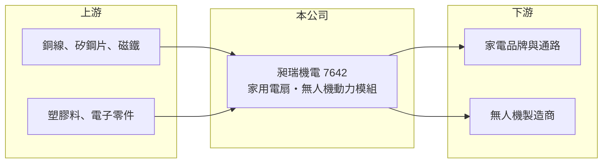

# 7642 昶瑞機電

> 上櫃｜[[產業索引-電機機械|電機機械]]｜上市（櫃）日期 2025/05/22

# 第一章：企業模式與商業藍圖

> [!info] 撰寫說明
> 精簡版，由 Claude 依公開資料整理，架構比照 [[2330台積電]]，資料截至 2026-10-08。來源：櫃買中心開放資料快照（基本資料、2026 年第二季資產負債與損益、每月營收、本益比殖利率）、Goodinfo 經營績效頁、工商時報 2025 年 5 月上櫃報導、nStock 公司簡介。產品結構與客戶未取得官方揭露，相關推論已標註待校對。公開資料有限。#待校對

昶瑞機電（以下簡稱昶瑞）是一家以家用電扇製造與銷售為主的公司，近年把馬達技術延伸到[[無人機]]動力模組。理解它的關鍵在於：電扇是季節性強、技術成熟的家電，昶瑞過去靠高效率生產維持不錯的獲利，未來的成長故事則押在無人機動力這個新市場。

- **核心業務：** 昶瑞成立於 2011 年，2025 年 5 月 22 日以每股 66.2 元在櫃買中心上櫃，實收資本額約 3.02 億元，董事長為蔡翔如、總經理為楊偉成，總部位於台中龍井。公司主要業務為家用電扇的製造與銷售。依產業常見模式，台灣電扇廠多以 [[OEM]] 或 ODM 方式替品牌商代工，並使用節能的 [[直流無刷馬達]]，昶瑞是否以代工為主、主要客戶是誰，本次未查得（待校對）。
- **營收結構：** 公開資料未揭露產品與地區別營收比重。2024 年營收約 9.58 億元、稅後淨利約 1.7 億元創新高。無人機動力模組於 2025 年通過日本廠商的認證測試，當時預計 2025 年下半年開始出貨，目前占營收比重仍小（推估）。
- **營運據點：** 總部位於台中龍井。依 2026 年第二季資料，非流動資產約 10.3 億元、占總資產約三分之二，推估包含自有廠房與土地；其他生產據點未查得（待校對）。
- **長期方向：** 電扇本業成熟，長期營收難以大幅成長，昶瑞的轉型方向是把馬達與驅動控制的能力，應用到無人機的動力系統（馬達、電調與螺旋槳組合）。在國際供應鏈尋求「非紅色供應鏈」無人機零組件的背景下，台灣廠商有機會切入日本與歐美市場，但規模化仍需時間驗證。

# 第二章：護城河深度與競爭優勢

昶瑞的護城河主要來自生產效率與成本控制，屬於製造型的窄護城河；無人機動力是否能形成新的技術門檻，仍待觀察。

- **競爭優勢：** 2021 至 2025 年營業利益率維持在 13% 至 20%，以家電代工產業來說相當高，代表公司在設計、量產與成本控制上具有效率。馬達是電扇與無人機共用的核心零件，累積的馬達設計與量產經驗，是跨入新應用的基礎。
- **主要對手：** 電扇市場的對手包括中國大量的小家電代工廠，以及台灣的電扇品牌與製造商（例如北方、華冠等，未上市，待校對）。無人機動力模組則面對中國大廠與日本、歐美專業馬達廠，台灣同業包括 [[8033雷虎]] 等無人機相關公司。
- **觀察重點：** 營收從 2022 年的 13.9 億元高峰回落到 2025 年的 8.08 億元，2026 年前八月再較前一年同期減少約 26%，電扇本業需求明顯轉弱。長期要看無人機動力模組能否接到持續性訂單，彌補本業下滑。

# 第三章：財務體質與盈利規模

資料日期：2026-10-08，表格是撰寫當時的快照；最新月營收、毛利率、累計 EPS 由自動排程寫在本筆記的屬性欄位（月營收、毛利率、累計EPS 等）。#待校對

昶瑞的財務呈現「小而賺錢、配息大方」的特徵，但營收已連續數年從高峰下滑。

| 年度 | 營收（億元） | [[毛利率]] | [[營業利益率]] | EPS（元） | [[ROE]] |
|---|---|---|---|---|---|
| 2021 | 10.2 | 17.6% | 13.2% | 4.57 | 28.8% |
| 2022 | 13.9 | 24.0% | 18.8% | 12.74 | 65.1% |
| 2023 | 9.14 | 28.6% | 19.2% | 5.80 | 22.2% |
| 2024 | 9.58 | 29.7% | 19.9% | 6.40 | 22.3% |
| 2025 | 8.08 | 26.9% | 14.9% | 3.29 | 10.6% |
| 2026 上半年 | 3.14 | 27.7% | 12.7% | 1.25 | 未查得 |

（來源：Goodinfo 經營績效頁，該頁僅涵蓋 2021 年起；2026 上半年取自櫃買中心開放資料。2025 年 EPS 受上櫃前現金增資使股本擴大影響。）

- **營收規模：** 2021 至 2025 年營收在 8 億至 14 億元之間，2022 年為高峰，年複合成長率約 -5.7%（推算）。電扇需求受天氣與家電景氣影響很大，營收難以穩定成長。
- **獲利：** 2021 至 2025 年平均 ROE 約 29.8%（推算），2022 年高達 65%，但這是上櫃前股本與權益較小時的數字。2025 年 ROE 降到 10.6%，一方面是獲利下滑，另一方面是上櫃增資後權益擴大。毛利率由 2021 年的 17.6% 提升到 27% 至 30%，代表產品組合或成本結構改善。
- **財務特色：** 依 2026 年第二季資料，總資產約 15.3 億元、權益約 9.5 億元、負債約 5.8 億元，負債比約 38%。2024 年度配發現金股利 5 元、配息率約 78%，2025 年度配發 3 元，以 EPS 3.29 元計算配息率約 91%（推算），公司傾向把多數盈餘發還股東。
- **[[ROIC]] 與 [[WACC]]：** 2025 年營業利益約 1.20 億元，稅後約 0.96 億元（推算，稅率 20%），以權益 9.5 億元到「權益加全部負債」15.3 億元計算，ROIC 約 6.3% 至 10.1%（推算）；2026 年上半年年化後約 4.2% 至 6.7%。WACC 以 [[CAPM]] 推估：無風險利率 1.75%、市場風險溢酬 6%、β 假設 0.9（家電零組件股常見值），權益成本約 7.15%；假設有息負債占資本約 25%、稅前負債成本 2.5%，WACC 約 5.9%（推算）。2021 至 2024 年 ROIC 遠高於 WACC，近期利差已收窄到接近零，本業下滑若持續，價值創造能力會明顯減弱。

# 第四章：總體風險與地緣政治

昶瑞的風險來自本業的季節性與需求下滑、新事業的不確定性，以及客戶集中的可能性。

- **產業週期：** 電扇是季節性家電，旺季集中在春夏，營收受氣候、家電換機週期與通路庫存影響。2022 年的高峰可能包含疫情期間居家家電需求的提前消化，之後需求回落（推估）。
- **營運風險：** 若業務以代工為主，少數品牌客戶的訂單變化會直接影響營收（待校對）。無人機動力模組需要投入研發與認證，客戶多為新創或國防相關，訂單規模與時程不確定性高。
- **其他風險：** 銅、矽鋼片、塑膠與電子零件價格波動；外銷日本等市場的匯率風險；中國小家電廠的低價競爭；無人機出口可能涉及各國的國防與出口管制法規。

# 專有名詞解析

## 應用

- **[[無人機]]**：不需駕駛員搭乘、以遙控或自主飛行的航空器，動力系統由馬達、電子調速器與螺旋槳組成。

## 金融

- **[[CAPM]]**：資本資產定價模型，以無風險利率加上 β 乘以市場風險溢酬，推估股東要求的報酬率。

## 產業

- **[[直流無刷馬達]]**：以電子換向取代碳刷的直流馬達，效率高、壽命長、噪音低，用於電扇、無人機與散熱風扇。
- **[[OEM]]**：原廠委託製造，代工廠依品牌客戶的設計生產，產品掛客戶品牌，毛利率通常低於自有品牌。

# 核心供應鏈

- 上游：馬達用的銅線、矽鋼片與磁鐵，扇體用的塑膠原料，以及控制板電子零件；實際供應商未查得，#待校對。
- 下游／客戶：家電品牌與零售通路（具體客戶未查得，待校對），以及日本等地的無人機製造商。
- 同業：電扇領域多為未上市廠商與中國代工廠；無人機相關的台灣同業有 [[8033雷虎]]。

## 最新新聞
<!-- news:start -->
<!-- news:end -->

## 相關連結
- [公開資訊觀測站](https://mopsov.twse.com.tw/mops/web/t05st03?step=1&firstin=1&co_id=7642)
- [Goodinfo](https://goodinfo.tw/tw/StockDetail.asp?STOCK_ID=7642)
- [Yahoo 股市](https://tw.stock.yahoo.com/quote/7642)
- [鉅亨網新聞](https://www.cnyes.com/twstock/7642/news)
