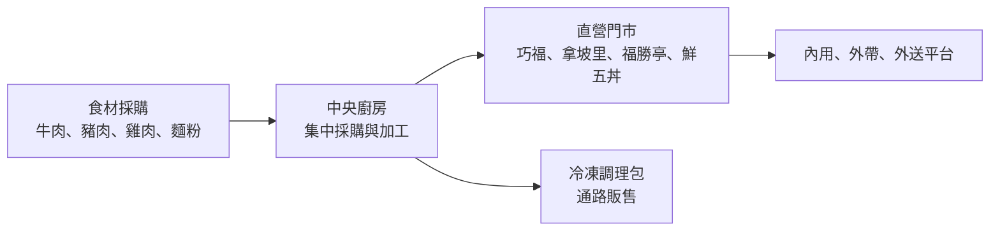
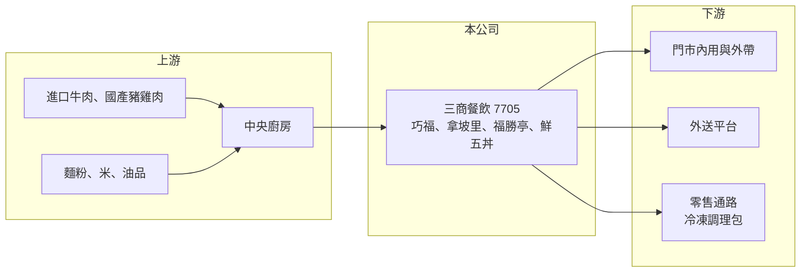

# 7705 三商餐飲

> 上市｜[[產業索引-觀光餐旅|觀光餐旅]]｜上市（櫃）日期 2024/11/26

# 第一章：企業模式與商業藍圖

> [!info] 撰寫說明
> 精簡版，由 Claude 依公開資料整理，架構比照 [[2330台積電]] 的四章研究，資料截至 2026-10-08。來源：Goodinfo 年度經營績效頁、食力 foodNEXT 2024 年 11 月報導、證交所開放資料（基本資料、2026 年第二季資產負債與綜合損益、營益分析、股利、每月營收）。各品牌營收比重與最新門市總數未查得，公開資料有限。#待校對

三商餐飲是台灣老牌的平價連鎖速食集團，旗下以三商巧福牛肉麵最為人熟知。本章說明它的品牌組合、營運方式與長期方向。

## 一、核心定位：平價日常餐的多品牌直營連鎖

三商餐飲成立於 1996 年，2024 年 11 月掛牌上市，董事長兼總經理為陳翔玢，實收資本額約 6.6 億元（證交所開放資料）。公司屬於三商集團，與 [[2905三商]]、[[2945三商家購]] 同一集團（集團關係待校對）。主要品牌包括三商巧福（牛肉麵）、拿坡里披薩．炸雞、福勝亭（日式豬排）、三商鮮五丼，以及 2024 年由部分拿坡里門市更名的三商炸雞（foodNEXT）。

* **價格帶集中在平價日常餐：** 牛肉麵、豬排飯、丼飯與炸雞都是一般上班族與學生的日常選項，客單價低、來客頻率高。這類需求受景氣影響較小，但也代表漲價空間有限。
* **多品牌分散單一品類風險：** 麵食、日式定食、披薩炸雞外送各自對應不同用餐情境，讓公司可以在同一商圈開設不同品牌，提高整體市占。

## 二、商業模式：中央廚房加上直營門市

公司以中央廚房集中採購與前處理食材，再配送到各門市，目的在於統一口味並壓低食材成本（foodNEXT）。2024 年起也把三商巧福的口味做成冷凍調理包，在集團通路美廉社獨家販售，這是把品牌延伸到零售通路的嘗試。連鎖餐飲的毛利率看食材成本，營業利益率則看人事與租金能否被營收攤薄。

## 三、門市與展店節奏

拿坡里披薩．炸雞在 2024 年底約有 137 家門市，是公司門市數最多的品牌之一；三商炸雞更名時約 12 家（foodNEXT）。營收從 2021 年的 47.8 億元成長到 2025 年的 65.3 億元（Goodinfo），成長主要來自展店與既有品牌調整。公司的長期方向是持續擴充門市、擴大炸雞品類並提升中央廚房效率；能否在人力短缺下維持展店速度，是成長的關鍵。

# 第二章：護城河深度與競爭優勢

平價連鎖餐飲的競爭門檻不高，本章分析三商餐飲的優勢在哪裡，以及哪些部分難以防守。

## 一、護城河的核心組成要素

* **品牌認知度：** 三商巧福經營數十年，在台灣幾乎無人不知，新品牌較難在短時間建立同樣的信任感。品牌熟悉度讓門市在新商圈開幕時較容易吸引客人。
* **規模採購與中央廚房：** 集團一次採購大量牛肉、豬肉與雞肉，議價能力優於單店或小型連鎖。中央廚房也讓門市不需要高技術廚師，降低對個別人力的依賴。
* **集團資源：** 背靠三商集團，在展店選址、通路合作（如冷凍調理包在美廉社販售）上有一定的協同效益（推估）。

## 二、主要競爭對手

| 對手 | 定位 | 對三商餐飲的威脅 |
|---|---|---|
| [[2753八方雲集]] | 平價鍋貼水餃，加盟為主 | 同樣搶日常平價餐，展店速度快 |
| [[7708全家餐飲]] | 日式定食與丼飯（大戶屋等） | 與福勝亭、鮮五丼客群重疊 |
| 麥當勞、肯德基、達美樂、必勝客 | 國際速食與披薩外送 | 直接與拿坡里競爭外送與炸雞市場 |
| [[2727王品]] | 多品牌餐飲集團 | 在平價副品牌與展店據點上競爭 |

## 三、守得住與守不住

* **守得住：** 熟客的日常消費。平價麵食與定食的回購率高，品牌老化的速度比潮流型餐飲慢。
* **守不住：** 獲利率。2025 年營業利益率從前一年的 4.42% 降到 2.03%（Goodinfo），顯示基本工資、食材與租金上漲時，平價品牌很難完全轉嫁給消費者。
* **觀察重點：** 營業利益率能否回到 4% 以上的歷史水準，以及炸雞與外送業務能否帶來新的成長。

# 第三章：財務體質與盈利規模

資料日期：2026-10-08，表格是撰寫當時的快照；最新月營收、毛利率、累計 EPS 由自動排程寫在本筆記的屬性欄位（月營收、毛利率、累計EPS 等）。#待校對

本章用多年度數據檢視三商餐飲的成長性、利潤率與資本報酬。

## 一、多年度三率與 ROE

| 年度 | 營收（新台幣） | [[毛利率]] | [[營業利益率]] | EPS（元） | [[ROE]] |
|---|---|---|---|---|---|
| 2021 | 47.8 億 | 38.5% | 4.91% | 3.84 | 20.5% |
| 2022 | 52.1 億 | 37.4% | 4.78% | 2.55 | 14.2% |
| 2023 | 57.7 億 | 37.6% | 5.05% | 3.11 | 17.1% |
| 2024 | 63.2 億 | 36.9% | 4.42% | 4.10 | 17.6% |
| 2025 | 65.3 億 | 35.3% | 2.03% | 1.92 | 7.88% |
| 2026 上半年 | 32.7 億 | 35.16% | 2.08% | 0.90 | 未查得 |

註：2021 至 2025 年取自 Goodinfo；2026 上半年取自證交所營益分析與綜合損益。2021 年以前未查得。

* **成長穩定、利潤率薄：** 2021 至 2025 年營收年複合成長率約 8.1%（推算），但營業利益率長期只有 2% 至 5%，屬於典型的薄利多銷連鎖餐飲。2026 年 1 至 8 月累計營收約 44.5 億元、年增約 3.3%（證交所每月營收）。
* **毛利率緩降：** 毛利率從 38.5% 一路降到 35% 左右，反映食材成本上升，價格調整跟不上。
* **ROE 曾經不錯：** 2021 至 2025 年平均 ROE 約 15.5%（推算），高 ROE 主要來自餐飲業資產輕、權益規模小；2025 年獲利下滑後 ROE 降到 7.88%。

## 二、股利與財務結構

2025 年度配發現金股利 1.6 元，以當年 EPS 1.92 元計算配發率約 83%（證交所股利資料，推算），公司章程規定股東紅利不低於稅後盈餘的 30%。2026 年第二季底總資產約 39.5 億元、總負債約 24.5 億元、權益約 15.0 億元（證交所資產負債）；負債中有相當比例應為門市租約認列的[[租賃負債]]，銀行借款金額未查得。

## 三、[[ROIC]] 與 [[WACC]]

**ROIC 推算：** 2025 年營業利益約 65.3 億 × 2.03% ≈ 1.33 億元，以 20% 稅率計算稅後約 1.06 億元。有息負債未查得，若只以權益約 15.0 億元作為投入資本，ROIC 約 7%；若計入租賃負債，實際 ROIC 更低，約 4% 至 5%（推算）。2024 年營業利益約 2.79 億元，同樣算法 ROIC 約 10% 至 15%（推算）。

**WACC 推算：** 台灣 10 年期公債 1.75%、市場風險溢酬 6%、β 取餐飲同業常見值 0.6，權益成本約 5.4%；計入少量租賃負債（稅後成本約 2%），WACC 約 5%（推算）。

**結論：** 2021 至 2024 年 ROIC 明顯高於 WACC，代表平價連鎖模式在利潤率 4% 至 5% 時能創造價值；2025 年利潤率掉到 2% 後利差幾乎消失。未來能否長期創造價值，取決於成本轉嫁與門市效率能否讓營業利益率回升。

# 第四章：總體風險與地緣政治

本章整理三商餐飲長期面對的成本、人力與競爭風險。

## 一、產業週期與成本

* **食材價格：** 牛肉多仰賴進口，豬肉、雞肉與麵粉價格也會隨國際穀物與疫病波動。平價品牌的定價彈性低，食材上漲會直接壓縮毛利率。
* **薪資與人力：** 台灣基本工資逐年調升，連鎖餐飲又長期缺工，人事成本占營收比重高，是營業利益率下滑的主要原因之一。

## 二、營運風險

* **展店與關店成本：** 直營模式需要自行負擔裝潢與租金，展店太快若選址失誤，會產生關店損失。
* **品牌老化：** 三商巧福等老品牌的主要客群年齡偏高，若無法吸引年輕消費者，來客數可能長期下滑。

## 三、其他風險

* **食安：** 中央廚房一旦出現食安事件，會同時影響所有門市與品牌形象。
* **外送平台抽成：** 拿坡里等品牌依賴外送，平台抽成比例上升會壓縮利潤。

# 專有名詞解析

## 金融

- **[[租賃負債]]**：依 IFRS 16，企業把長期租約未來應付的租金折現後認列在資產負債表上的負債，連鎖餐飲與零售業金額通常很大。
- **[[ROIC]]**：投入資本報酬率，衡量企業用股東與債權人投入的資本，每年能產生多少稅後營業利益。
- **[[WACC]]**：加權平均資金成本，股東要求報酬與負債利息依資本結構加權後的平均值，是判斷是否創造價值的門檻。

## 產業

- **[[中央廚房]]**：連鎖餐飲集中採購、清洗、切配與預先調理食材的工廠，再配送到各門市，以統一品質並降低成本。
- **[[直營門市]]**：由總公司自己投資、經營的門市，獲利全歸公司，但展店資本與營運風險也由公司承擔。

# 核心供應鏈

- 上游：進口牛肉、國產豬肉與雞肉、麵粉與米等民生食材；肉品與飼料供應鏈可參考 [[1215卜蜂]]、[[1210大成]]。
- 下游／客戶：一般消費者（內用、外帶）、外送平台；冷凍調理包透過集團通路美廉社（[[2945三商家購]]）販售。
- 同業：[[2753八方雲集]]、[[7708全家餐飲]]、[[2727王品]]、[[2729瓦城]]、麥當勞、肯德基、達美樂。
- 集團：[[2905三商]]。

## 最新新聞
<!-- news:start（自動產生，請勿手動編輯此範圍） -->
- 2026-10-08 🏛️ 重訊 16:15｜公告本公司申請股票上市所出具之承諾事項 暨其後續執行情形｜[觀測站](https://mops.twse.com.tw/mops/#/web/t05st01)

完整紀錄：[[7705三商餐飲 新聞]]
<!-- news:end -->

## 相關連結
- [公開資訊觀測站](https://mopsov.twse.com.tw/mops/web/t05st03?step=1&firstin=1&co_id=7705)
- [Goodinfo](https://goodinfo.tw/tw/StockDetail.asp?STOCK_ID=7705)
- [Yahoo 股市](https://tw.stock.yahoo.com/quote/7705)
- [鉅亨網新聞](https://www.cnyes.com/twstock/7705/news)
