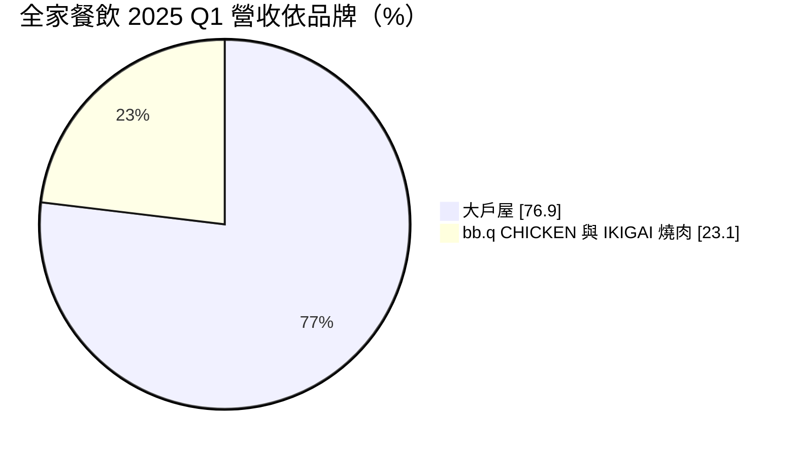
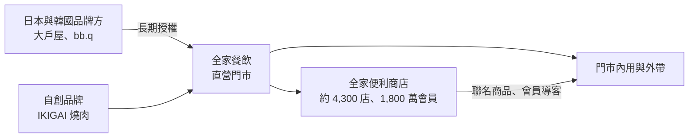
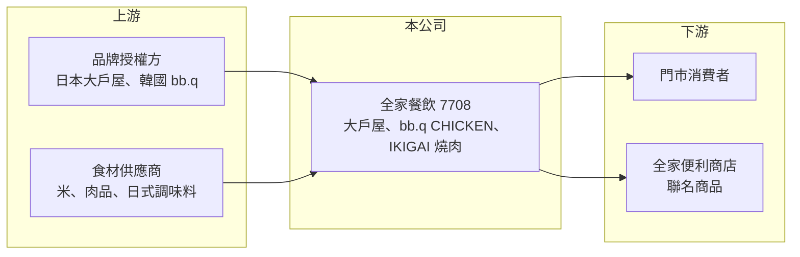

# 7708 全家餐飲

> 上櫃｜[[產業索引-觀光餐旅|觀光餐旅]]｜上市（櫃）日期 2024/11/15

# 第一章：企業模式與商業藍圖

> [!info] 撰寫說明
> 精簡版，由 Claude 依公開資料整理，架構比照 [[2330台積電]] 的四章研究，資料截至 2026-10-08。來源：Goodinfo 年度經營績效頁、富果研究 2025 年 5 月法說會整理、證交所與櫃買中心開放資料（基本資料、2026 年第二季資產負債與綜合損益、每月營收、本益比殖利率）。門市數為 2025 年 4 月資料，最新數字未查得。#待校對

全家餐飲是 [[5903全家]] 旗下的餐飲事業，以在台灣經營日本大戶屋定食為核心。本章說明它的品牌組合、與母公司的關係，以及展店策略。

## 一、核心定位：便利商店集團的「日常食」餐飲平台

全家餐飲成立於 2010 年，2024 年 11 月登錄上櫃，董事長為吳勝福、總經理為辛紫綾，實收資本額 2.55 億元（櫃買中心開放資料）。全家便利商店持股約 61.96%（富果研究）。公司把定位放在「日常食」與「個人食」，也就是一個人也能經常吃、價格中等的正餐，而不是聚餐型的高價餐廳。

* **大戶屋（OOTOYA）：** 日本知名定食連鎖，公司取得台灣長期經營權（15 年加 15 年）。2025 年 4 月有 48 家門市，2025 年第一季營收占比約 76.9%，是絕對主力。
* **bb.q CHICKEN：** 韓式炸雞授權品牌，2025 年 4 月有 19 家門市，授權期 10 年並已提前續約。
* **IKIGAI 燒肉：** 自創的一人燒肉品牌，2025 年 4 月有 6 家門市。

## 二、商業模式：授權品牌加上便利商店生態圈

公司的門市以直營為主，品牌多數來自國外授權，需支付權利金，但可以省去從零建立品牌的時間。最大的特色是與全家便利商店的協同：利用約 4,300 家門市與約 1,800 萬會員做交叉導客，並把 bb.q 聯名商品、大戶屋鹽麴雞胸肉放到便利商店販售（富果研究），讓餐廳品牌在門市以外也能產生收入。

## 三、門市與展店節奏

2025 年 4 月三個品牌合計 73 家門市，集中在六都與新竹，2024 年起拓展到嘉義與屏東。公司規劃每年新開約 8 至 10 家門市，長期目標是經營 5 個品牌，且每個品牌都要證明能規模化展店（富果研究）。營收從 2021 年的 12.7 億元成長到 2025 年的 27.2 億元（Goodinfo），代表展店與單店營收提升同時發揮作用。

# 第二章：護城河深度與競爭優勢

授權品牌的優勢在於品牌力，風險在於授權期限。本章分析全家餐飲的競爭優勢與限制。

## 一、護城河的核心組成要素

* **大戶屋的長期經營權：** 15 年加 15 年的台灣經營權，讓公司在長時間內獨占這個品牌。大戶屋在日本經營數十年，現點現做的健康定食形象，在台灣日式定食市場有明確的辨識度。
* **母公司生態圈：** 全家便利商店的會員、門市與聯名商品管道，是一般餐飲同業難以取得的行銷資源。新品牌可以先透過便利商店曝光，降低展店初期的推廣成本。
* **利潤率逐年改善：** 營業利益率從 2021 年的 1.78% 提升到 2025 年的 7.89%（Goodinfo），在連鎖餐飲中屬於中上水準，顯示規模擴大後費用攤提效果明顯。

## 二、主要競爭對手

| 對手 | 定位 | 對全家餐飲的威脅 |
|---|---|---|
| [[2727王品]] | 多品牌餐飲集團，含日式與燒肉品牌 | 在燒肉、日式定食與百貨商場據點競爭 |
| [[7705三商餐飲]] | 平價定食與丼飯（福勝亭、鮮五丼） | 價格更低，搶日常午晚餐客群 |
| [[2754亞洲藏壽司]] | 日系迴轉壽司 | 同樣爭取日式餐飲與商場據點 |
| 定食8、彌生軒等日系定食 | 日式定食連鎖 | 與大戶屋直接重疊 |

## 三、守得住與守不住

* **守得住：** 大戶屋在授權期間內的品牌獨占，以及便利商店集團帶來的通路與會員資源。
* **守不住：** 品牌集中度。大戶屋貢獻約四分之三營收，若日本品牌方經營策略改變或品牌熱度下降，公司缺乏同等規模的替代品牌。
* **觀察重點：** bb.q 與 IKIGAI 能否複製大戶屋的展店模式，以及每年 8 至 10 家的展店目標能否維持。

# 第三章：財務體質與盈利規模

資料日期：2026-10-08，表格是撰寫當時的快照；最新月營收、毛利率、累計 EPS 由自動排程寫在本筆記的屬性欄位（月營收、毛利率、累計EPS 等）。#待校對

本章用多年度數據檢視全家餐飲的成長、獲利與資本報酬。

## 一、多年度三率與 ROE

| 年度 | 營收（新台幣） | [[毛利率]] | [[營業利益率]] | EPS（元） | [[ROE]] |
|---|---|---|---|---|---|
| 2021 | 12.7 億 | 45.1% | 1.78% | 1.16 | 6.61% |
| 2022 | 17.4 億 | 47.0% | 3.75% | 1.99 | 10.7% |
| 2023 | 21.8 億 | 46.8% | 6.45% | 4.31 | 16.1% |
| 2024 | 23.8 億 | 47.4% | 6.66% | 5.39 | 15.5% |
| 2025 | 27.2 億 | 48.6% | 7.89% | 6.46 | 16.3% |
| 2026 上半年 | 14.7 億 | 48.0% | 9.3% | 4.15 | 未查得 |

註：2021 至 2025 年取自 Goodinfo；2026 上半年依櫃買中心綜合損益計算。2021 年以前未查得。

* **高成長：** 2021 至 2025 年營收年複合成長率約 21%（推算），2021 年仍受疫情影響，基期偏低。2026 年 1 至 8 月累計營收約 20.1 億元、年增約 12%（櫃買中心每月營收）。
* **營運槓桿：** 毛利率穩定在 45% 至 49%，營業利益率卻從不到 2% 升到 9% 左右，說明營收擴大後，總部費用與管理成本被有效攤薄。
* **ROE 改善：** 2021 至 2025 年平均 ROE 約 13%（推算），近三年穩定在 15% 至 16%。

## 二、股利與財務結構

2025 年度每股配發現金股利 5.5 元（櫃買中心本益比殖利率資料），以 EPS 6.46 元計算配發率約 85%（推算），屬於高配息政策。2026 年第二季底總資產約 20.3 億元、總負債約 10.3 億元、權益約 10.0 億元，流動資產約 12.3 億元（櫃買中心資產負債），負債以門市[[租賃負債]]與應付款為主（推估），銀行借款未查得。

## 三、[[ROIC]] 與 [[WACC]]

**ROIC 推算：** 2025 年營業利益約 27.2 億 × 7.89% ≈ 2.15 億元，以 20% 稅率計算稅後約 1.72 億元。有息負債未查得，以權益約 10.0 億元作為投入資本，ROIC 約 17%；若把租賃負債約 3 億元（推估）計入投入資本，ROIC 約 13%（推算）。

**WACC 推算：** 台灣 10 年期公債 1.75%、市場風險溢酬 6%、β 取餐飲同業常見值 0.6，權益成本約 5.4%；負債比重低，WACC 約 5% 至 5.5%（推算）。

**結論：** ROIC 約為 WACC 的兩倍以上，代表全家餐飲在現階段每開一家店都在創造價值。這也解釋了公司能同時維持高配息與持續展店：餐飲業資本需求不大，展店資金大多可由營業現金流支應。

# 第四章：總體風險與地緣政治

本章整理全家餐飲長期面對的品牌、成本與營運風險。

## 一、品牌與授權風險

* **授權到期與續約條件：** 大戶屋與 bb.q 都是授權品牌，到期續約時的權利金條件、展店義務，會影響長期獲利。若授權方調整全球策略，台灣經營權可能有變數。
* **品牌集中：** 大戶屋占營收約四分之三，品牌熱度下降或食安事件，對公司影響遠大於多品牌分散的同業。

## 二、成本與人力

* **食材與匯率：** 日式料理部分食材仰賴進口，日圓與食材價格波動會影響毛利率。
* **薪資上漲與缺工：** 現點現做的定食需要較多人力，基本工資調升與服務業缺工，是連鎖餐飲共同的長期壓力。

## 三、其他風險

* **母公司依賴：** 與全家便利商店的協同是重要優勢，但關係人交易、品牌合作條件也受母公司策略左右。
* **展店地點：** 主要開在百貨與商場，商場人流變化與租金調整會影響門市獲利。

# 專有名詞解析

## 金融

- **[[租賃負債]]**：依 IFRS 16，企業把長期租約未來應付的租金折現後認列在資產負債表上的負債，連鎖餐飲與零售業金額通常很大。
- **[[ROIC]]**：投入資本報酬率，衡量企業用股東與債權人投入的資本，每年能產生多少稅後營業利益。
- **[[WACC]]**：加權平均資金成本，股東要求報酬與負債利息依資本結構加權後的平均值，是判斷是否創造價值的門檻。

## 產業

- **[[品牌授權]]**：企業向品牌所有者取得在特定區域經營品牌的權利，需支付權利金並遵守品牌規範，可快速取得知名度。
- **[[直營門市]]**：由總公司自己投資、經營的門市，獲利全歸公司，但展店資本與營運風險也由公司承擔。

# 核心供應鏈

- 上游：品牌授權方（日本大戶屋、韓國 bb.q）、米與肉品等食材供應商。
- 下游／客戶：門市消費者；母公司 [[5903全家]] 的便利商店通路販售聯名商品。
- 同業：[[2727王品]]、[[7705三商餐飲]]、[[2754亞洲藏壽司]]、[[2753八方雲集]]、[[2729瓦城]]。

## 最新新聞
<!-- news:start -->
<!-- news:end -->

## 相關連結
- [公開資訊觀測站](https://mopsov.twse.com.tw/mops/web/t05st03?step=1&firstin=1&co_id=7708)
- [Goodinfo](https://goodinfo.tw/tw/StockDetail.asp?STOCK_ID=7708)
- [Yahoo 股市](https://tw.stock.yahoo.com/quote/7708)
- [鉅亨網新聞](https://www.cnyes.com/twstock/7708/news)
