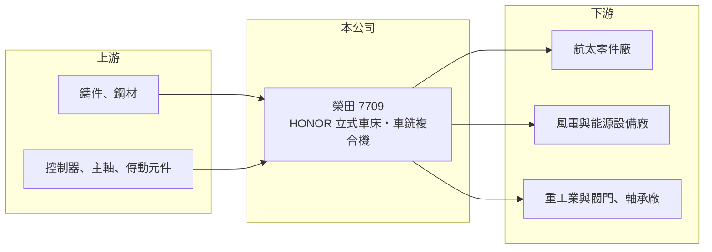

# 7709 榮田

> 上櫃｜[[產業索引-電機機械|電機機械]]｜上市（櫃）日期 2025/02/25

# 第一章：企業模式與商業藍圖

> [!info] 撰寫說明
> 精簡版，由 Claude 依公開資料整理，架構比照 [[2330台積電]]，資料截至 2026-10-08。來源：櫃買中心開放資料快照（基本資料、2026 年第二季資產負債與損益、每月營收、本益比殖利率）、Goodinfo 經營績效頁、工商時報 2024 年 11 月報導。產品應用與工廠配置部分依產業常識整理，已標註待校對。公開資料有限。#待校對

榮田精機（以下簡稱榮田）以自有品牌 HONOR 銷售 [[CNC]] [[立式車床]]與立式車銑複合加工中心，被業界稱為「台灣立式車床專家」。理解它的關鍵在於：立式車床專門加工大型、重型的圓盤類工件，客戶集中在航太、能源與重工業，和一般小型車床的市場邏輯不同。

- **核心業務：** 榮田成立於 1987 年，2025 年 2 月在櫃買中心上櫃，實收資本額約 3.91 億元，董事長為陳松田、總經理為陳政鈞，總部與工廠位於高雄湖內。公司負責立式車床與車銑複合機的研發、生產與銷售，並以 HONOR 品牌行銷全球。立式車床的工件放在水平旋轉的工作台上加工，適合直徑大、重量重的零件，例如風電軸承座、航太引擎機匣與大型閥體（待校對）。
- **營收結構：** 公開資料未揭露產品與地區別營收比重。2024 年的報導指出，航太與綠能客戶訂單持續湧入，是當年營運成長的主要動力。
- **營運據點：** 總部與主要工廠位於高雄湖內，地處南部金屬與重工業聚落，鄰近鋼鐵、造船與能源設備客戶（待校對）。海外銷售據點配置未查得。
- **長期方向：** 榮田的長期成長方向是航太與綠能（風電、能源設備）這類大型精密零件市場，並持續推動 HONOR 品牌的國際化。立式車銑複合機能在一次夾持中完成車削與銑削，減少大型工件的搬運與重新定位，是附加價值較高的產品方向。

# 第二章：護城河深度與競爭優勢

榮田的護城河來自在立式車床這個細分市場的專注與品牌，屬於利基型的窄護城河。

- **競爭優勢：** 大型立式車床的床台剛性、承重與精度要求高，設計與組裝經驗不易複製，台灣專精於此的廠商不多。自有品牌直接面對終端客戶，比代工廠更能掌握訂價與售後服務收入。2024 年前三季 EPS 3.65 元，在報導比較的亞崴、協易機、百德、瀧澤科等工具機同業中最高。
- **主要對手：** 台灣同業包括 1530亞崴、1583程泰、[[4526東台]]、[[4533協易機]]、[[4563百德]]、[[6609瀧澤科]] 等工具機廠，國際上則有日本 Okuma、Mazak 與歐洲的大型立車廠（待校對）。
- **觀察重點：** 毛利率在 24% 至 29% 之間，營業利益率約 10% 至 12%，屬於工具機業中段水準。長期要看航太與能源訂單能否讓毛利率往 30% 以上移動，以及品牌在歐美高階市場的滲透程度。

# 第三章：財務體質與盈利規模

資料日期：2026-10-08，表格是撰寫當時的快照；最新月營收、毛利率、累計 EPS 由自動排程寫在本筆記的屬性欄位（月營收、毛利率、累計EPS 等）。#待校對

榮田的財務呈現工具機業典型的循環性，但在同業中獲利相對穩定，資產負債表也相當穩健。

| 年度 | 營收（億元） | [[毛利率]] | [[營業利益率]] | EPS（元） | [[ROE]] |
|---|---|---|---|---|---|
| 2022 | 10.1 | 25.4% | 9.19% | 3.04 | 9.34% |
| 2023 | 13.5 | 24.1% | 12.0% | 3.87 | 10.6% |
| 2024 | 14.6 | 24.5% | 10.4% | 5.19 | 12.8% |
| 2025 | 10.0 | 28.5% | 10.3% | 2.48 | 6.07% |
| 2026 上半年 | 4.80 | 26.5% | 10.4% | 1.73 | 未查得 |

（來源：Goodinfo 經營績效頁，該頁僅涵蓋 2022 年起；2026 上半年取自櫃買中心開放資料。）

- **營收規模：** 2022 至 2024 年營收由 10.1 億元成長到 14.6 億元，2025 年回落到 10.0 億元，2022 至 2025 年年複合成長率約 -0.3%（推算），反映工具機業的景氣循環。2026 年前八月累計營收較前一年同期成長約 6%。
- **獲利：** 2022 至 2025 年平均 ROE 約 9.7%（推算）。2025 年營收下滑三成，毛利率反而升到 28.5%，代表產品組合往高單價機種移動。2026 年上半年稅前淨利約 0.85 億元，其中約 0.34 億元來自業外收入，推估包含匯兌或處分收益（待校對）。
- **財務特色：** 依 2026 年第二季資料，總資產約 27.9 億元、權益約 17.0 億元、負債約 10.9 億元，負債比約 39%；保留盈餘約 11.1 億元，接近股本的三倍，代表長年累積的盈餘多留在公司。現金股利約 1.5 元，以 2025 年 EPS 2.48 元計算配息率約六成（推算）。
- **[[ROIC]] 與 [[WACC]]：** 2025 年營業利益約 1.03 億元，稅後約 0.82 億元（推算，稅率 20%），以權益約 17.0 億元到「權益加全部負債」27.9 億元計算，ROIC 約 2.9% 至 4.8%（推算）；2026 年上半年年化後同樣約 2.9% 至 4.7%。WACC 以 [[CAPM]] 推估：無風險利率 1.75%、市場風險溢酬 6%、β 假設 1.0（工具機股常見值），權益成本約 7.75%；假設有息負債占資本約 25%、稅前負債成本 2.5%，WACC 約 6.3%（推算）。目前 ROIC 低於 WACC，2024 年景氣高點時才接近或略高於 WACC，代表帳上累積的資產與盈餘尚未被充分有效運用。

# 第四章：總體風險與地緣政治

榮田的風險來自工具機景氣循環、終端產業集中，以及國際競爭。

- **產業週期：** 工具機是典型的資本財，客戶在景氣不明時最先延後購買。航太與風電雖是長期成長產業，但訂單常隨大型專案與政策補貼起伏，風電產業近年也經歷過擴產後的修正。
- **營運風險：** 大型立式車床單價高、訂單數量少，單一客戶或專案的延遲就可能影響單季營收。高階市場需要持續投入研發與海外服務，若國際化速度不如預期，成長會受限。
- **其他風險：** 新台幣匯率影響外銷報價；鑄件、鋼材與控制器價格波動；中國工具機廠在中低階市場的削價競爭，以及美國關稅政策對外銷的影響。

# 專有名詞解析

## 金融

- **[[CAPM]]**：資本資產定價模型，以無風險利率加上 β 乘以市場風險溢酬，推估股東要求的報酬率。

## 產業

- **[[CNC]]**：電腦數值控制，用程式控制機台的刀具路徑進行切削、鑽孔或雕刻，是現代工具機的基礎。
- **[[立式車床]]**：工件放在水平旋轉工作台上、由上方刀具車削的車床，適合加工直徑大、重量重的圓盤類零件。
- **[[工具機]]**：用來切削、加工金屬零件的機器，是製造業的母機，台灣中部有完整的工具機聚落。

# 核心供應鏈

- 上游：大型鑄件與鋼材，以及 CNC 控制器、主軸、滾珠螺桿與線性滑軌等零組件；傳動元件常見供應商如 [[2049上銀]]，實際往來未查得，#待校對。
- 下游／客戶：航太零件加工廠、風電與能源設備廠、重工業與大型閥門、軸承製造商；具體客戶名稱未查得。
- 同業：1530亞崴、1583程泰、[[4526東台]]、[[4533協易機]]、[[4563百德]]、[[6609瀧澤科]]。

## 最新新聞
<!-- news:start -->
<!-- news:end -->

## 相關連結
- [公開資訊觀測站](https://mopsov.twse.com.tw/mops/web/t05st03?step=1&firstin=1&co_id=7709)
- [Goodinfo](https://goodinfo.tw/tw/StockDetail.asp?STOCK_ID=7709)
- [Yahoo 股市](https://tw.stock.yahoo.com/quote/7709)
- [鉅亨網新聞](https://www.cnyes.com/twstock/7709/news)
