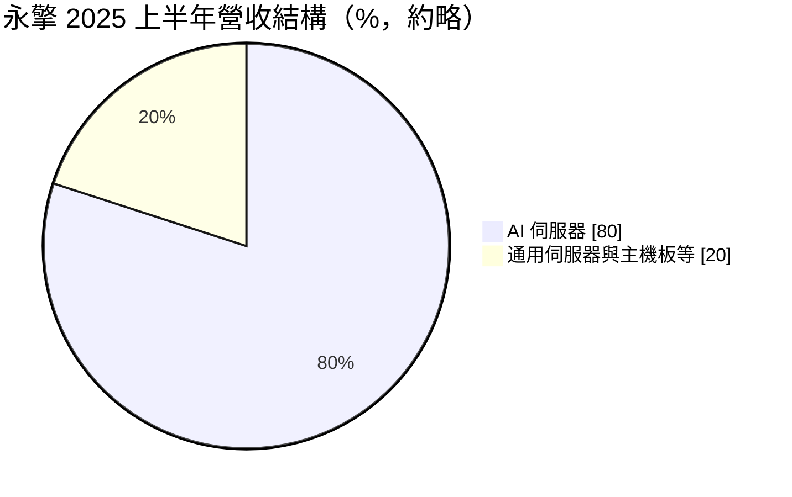
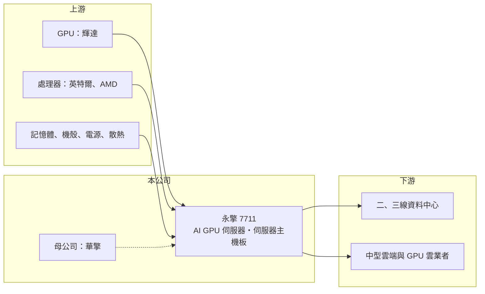

# 7711 永擎

> 上市｜[[產業索引-電腦及週邊設備業|電腦及週邊設備業]]｜上市（櫃）日期 2025/11/19

# 第一章：企業模式與商業藍圖

> [!info] 撰寫說明
> 精簡版，由 Claude 依公開資料整理，架構比照 [[2330台積電]]，資料截至 2026-10-08。來源：證交所開放資料快照（基本資料、2026 年第二季資產負債與損益、股利、月營收）、Goodinfo 經營績效頁、優分析 2025 年 10 月上市前業績發表會報導。伺服器主機板業務與集團持股描述有部分憑記憶整理，已標「待校對」。#待校對

永擎電子（以下簡稱永擎，英文 ASRock Rack）是主機板廠 [[3515華擎]] 旗下的伺服器子公司，理解它的關鍵在於：它從伺服器主機板起家，在 2024 年抓住 NVIDIA GPU 伺服器的浪潮，營收在兩年內放大近八倍，成為華擎集團的主要獲利來源。

- **核心業務：** 永擎成立於 2013 年，2025 年 11 月在證交所上市。早期以伺服器與工作站[[主機板]]為主（待校對），近年主力轉為搭載 NVIDIA Blackwell 平台的 [[AI 伺服器]]，包括 HGX B200、B300 與 GB300 NVL72 等機種（優分析）。永擎以自有品牌銷售，介於大型 [[ODM]] 代工廠與美系伺服器品牌之間。
- **營收結構：** 依優分析報導，2025 年上半年 AI 伺服器占營收近八成，其餘為通用伺服器與主機板等產品。最大市場是亞洲，客戶以二、三線資料中心業者與新興的中型雲端業者為主，而不是四大超大型雲端業者。這個客群規模較小、需要彈性服務，正是品牌型中小廠的生存空間。
- **營運據點：** 總部位於台灣，生產據點與組裝產能這次未查得（待校對）。依證交所資料，2026 年第二季總資產 159.8 億元中流動資產高達 154.1 億元，固定資產極少，推估生產多委外或借助集團資源，屬於輕資產模式（推估）。
- **長期方向：** 永擎下一步是從訓練伺服器延伸到推論伺服器，以 NVIDIA RTX Pro 6000 平台爭取企業推論需求，客戶通常需要約兩季的測試驗證（優分析）。長期能否在 AI 伺服器站穩，取決於它能否持續拿到新世代 GPU 的配貨，並把服務範圍從單機延伸到整櫃。

# 第二章：護城河深度與競爭優勢

永擎的護城河屬於「窄護城河」，來自主機板設計能力、與 NVIDIA 平台的合作關係，以及服務中型資料中心客戶的彈性，但在 AI 伺服器產業中規模仍屬中小型。

- **競爭優勢：** 伺服器主機板是伺服器的核心，永擎具備自行設計主機板與整機的能力，能較快推出對應新平台的產品。二、三線資料中心客戶下單量不如超大型雲端業者，大型 ODM 通常不優先服務，永擎以品牌與彈性交期切入這個市場。2025 年 [[ROE]] 達 25.9%，顯示輕資產模式在 AI 景氣中的資本效率很高。
- **主要對手：** 品牌伺服器對手包括 Supermicro、Dell、HPE，以及台灣的 [[2376技嘉]]、[[6933AMAX-KY]]；大型代工廠 [[2382廣達]]、[[3231緯創]]、[[6669緯穎]]、[[2317鴻海]] 主攻超大型雲端業者，但也會向下爭取中型客戶。永擎必須與這些大廠搶同一批 GPU 配貨。
- **觀察重點：** 長期最該追蹤的是[[毛利率]]走勢與客戶分散程度。AI 伺服器 GPU 成本占比極高，2025 年毛利率降到 8.54%，2026 年上半年回到約 15.2%，波動很大。另一個重點是推論伺服器能否成為第二成長曲線，降低對單一世代訓練伺服器的依賴。

# 第三章：財務體質與盈利規模

資料日期：2026-10-08，表格是撰寫當時的快照；最新月營收、毛利率、累計 EPS 由自動排程寫在本筆記的屬性欄位（月營收、毛利率、累計EPS 等）。#待校對

永擎的財務呈現「營收暴增、毛利率被 GPU 成本稀釋、資本效率高」的 AI 伺服器品牌樣貌：營收由 2023 年的 27 億元跳到 2025 年的 249 億元。

| 年度 | 營收（億元） | [[毛利率]] | [[營業利益率]] | EPS（元） | [[ROE]] |
|---|---|---|---|---|---|
| 2021 | 未查得 | 未查得 | 未查得 | 未查得 | 未查得 |
| 2022 | 32.1 | 25.7% | 4.36% | 2.41 | 16.4% |
| 2023 | 27.0 | 26.8% | -0.29% | 0.13 | 0.94% |
| 2024 | 88.0 | 17.1% | 6.31% | 8.36 | 46.4% |
| 2025 | 249 | 8.54% | 3.86% | 13.04 | 25.9% |

（來源：Goodinfo 經營績效頁。2026 年上半年依證交所資料，營收 157.1 億元、毛利率約 15.2%、營業利益率約 9.6%、EPS 17.44 元。）

- **營收規模：** 2022 至 2025 年營收年複合成長率約 98%（推算），2024 年年增 2.3 倍、2025 年再增 1.8 倍。2026 年 1 至 8 月累計營收約 230.1 億元、年增約 61%。這種成長來自 AI 伺服器單價極高，一台 GPU 伺服器的售價是一般伺服器的數十倍，營收規模因此快速放大。
- **獲利：** 2022 至 2025 年平均 ROE 約 22%（推算），其中 2023 年 AI 浪潮前幾乎不賺錢，2024 年 ROE 衝上 46.4%。2026 年上半年營業利益 15.13 億元、母公司淨利 12.25 億元，獲利幾乎全部來自本業。
- **財務特色：** 2026 年第二季總資產約 159.8 億元、負債約 105.5 億元且幾乎全為流動負債，負債比約 66%，每股淨值 75.72 元。高負債比主要反映 GPU 採購的應付帳款與營運資金需求（推估），而非長期借款。依證交所股利資料，114 年度現金股利 9.0 元，約為 2025 年 EPS 的 69%。存貨與應收帳款隨營收快速膨脹，自由現金流可能不穩定（推估）。
- **[[ROIC]] 與 [[WACC]]：** 以 2025 年營業利益約 9.61 億元（249 億元 × 3.86%）、稅率 20% 計算，稅後營業利益約 7.69 億元；有息負債未查得，投入資本以股東權益 54.3 億元到總資產 159.8 億元為區間，ROIC 約 4.8% 至 14.2%（推算）。由於負債多為無息的應付帳款，實際 ROIC 較接近區間上緣（推估）。WACC 以 [[CAPM]] 推估：無風險利率 1.75%、市場風險溢酬 6%、β 假設 1.3（AI 伺服器股波動大），權益成本約 9.6%；有息負債推估不多，WACC 約 8.5% 至 9%（推算）。2024、2025 年 ROIC 高於 WACC，代表 AI 伺服器業務正在創造價值，但這個利差高度依賴 AI 景氣。

# 第四章：總體風險與地緣政治

永擎的風險集中在 AI 景氣、GPU 配貨與客戶信用，屬於成長快但週期性極強的伺服器股。

- **產業週期：** 營收幾乎完全由 AI 資本支出驅動。二、三線資料中心與 GPU 雲業者的投資對融資環境與算力租價很敏感，一旦租價下滑或資金收緊，訂單可能快速縮減，波動會比超大型雲端業者更劇烈。
- **營運風險：** GPU 由 [[NVDA輝達]] 供應，配貨順序與平台換代時程直接決定出貨。產品世代交替快，舊世代存貨若無法及時出清，會造成跌價損失。客戶多為中型業者，信用風險與應收帳款回收比大型雲端客戶更需留意。
- **其他風險：** 美國對高階 AI 晶片的出口管制，限制對特定國家的銷售，亞洲客戶的最終用途審查也愈來愈嚴。新台幣匯率、關稅與母公司華擎的集團策略，也會影響永擎的經營空間。

# 專有名詞解析

## 應用

- **[[AI 伺服器]]**：搭載 GPU 等加速晶片、用於訓練與推論 AI 模型的伺服器，對散熱與電源規格要求很高。

## 產業

- **[[ODM]]**：原廠委託設計製造，代工廠同時負責產品設計與生產，再由品牌商掛牌銷售。
- **[[主機板]]**：電腦與伺服器中連接處理器、記憶體與擴充卡的主要電路板，決定整機的規格與擴充能力。

# 核心供應鏈

- 上游：GPU 來自 [[NVDA輝達]]，處理器來自 [[INTC英特爾]]、[[AMD超微]]，另需記憶體、伺服器機殼（如 [[8210勤誠]]）、電源與散熱模組。
- 下游／客戶：亞洲為主的二、三線資料中心業者與新興中型雲端業者（具體客戶未點名，#待校對）。
- 同業：Supermicro、Dell、HPE，以及 [[2376技嘉]]、[[6933AMAX-KY]]、[[2382廣達]]、[[3231緯創]]、[[6669緯穎]]；集團關係：[[3515華擎]]。

## 最新新聞
<!-- news:start -->
<!-- news:end -->

## 相關連結
- [公開資訊觀測站](https://mopsov.twse.com.tw/mops/web/t05st03?step=1&firstin=1&co_id=7711)
- [Goodinfo](https://goodinfo.tw/tw/StockDetail.asp?STOCK_ID=7711)
- [Yahoo 股市](https://tw.stock.yahoo.com/quote/7711)
- [鉅亨網新聞](https://www.cnyes.com/twstock/7711/news)
