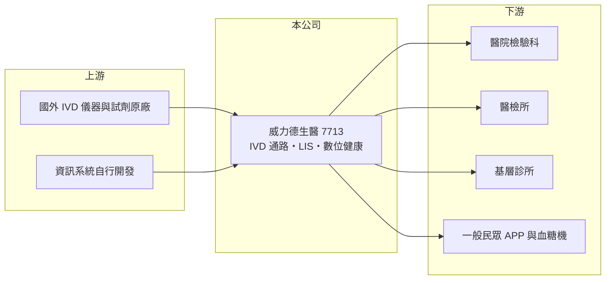

# 7713 威力德生醫

> 上櫃｜[[產業索引-生技醫療業|生技醫療業]]｜上市（櫃）日期 2025/02/24

# 第一章：企業模式與商業藍圖

> [!info] 撰寫說明
> 精簡版，由 Claude 依公開資料整理，架構比照 [[2330台積電]]，資料截至 2026-10-08。來源：櫃買中心開放資料快照（基本資料、2026 年第二季財報、本益比殖利率、2026 年 8 月營收）、Goodinfo 經營績效頁、富果 2026 年 3 月法說會摘要、時報資訊 2026 年 2 月報導。代理原廠名稱與營收比重未查得。#待校對

威力德生醫是一家以體外診斷（IVD）為核心的醫療通路與資訊服務公司，理解它的關鍵是「儀器帶動試劑」的商業模式：儀器放進醫院或檢驗所後，試劑與耗材會隨每天的檢驗量持續銷售。

- **核心業務：** 威力德的 B2B 業務對象是醫院、醫檢所與基層診所，經銷[[體外診斷]]儀器與試劑耗材，範圍涵蓋免疫、生化、尿液、血液氣體分析與分子生物檢驗。公司同時提供[[實驗室資訊系統]]（LIS）與醫療資訊服務平台，把檢驗儀器、資料傳輸與報告管理整合在一起。B2C 端則有「健康行動 go」APP 與血糖機等產品，子公司優品生醫（100% 持股）負責數位健康平台服務。
- **營收結構：** 產品、地區與通路別的營收比重未查得。依業務性質，營收以 IVD 試劑耗材為主、儀器與資訊服務為輔（推估），試劑屬於重複性收入，使營收波動小於一般設備商。
- **營運據點：** 公司設立於 2003 年 4 月，2025 年 2 月 24 日上櫃，實收資本額約 4.55 億元。截至 2025 年底，使用其資訊平台的診所達 2,731 間，並與全台 8 間醫檢所合作。新總部預計 2026 年第二季啟用，導入健檢中心與優品醫事檢驗所。
- **長期方向：** 公司持續推動 LIS 與 IVD 產品整合，用資訊系統提高客戶黏著度，再帶動試劑耗材銷售。政府 2025 年啟動「健康臺灣深耕計畫」、擴大公費檢測項目並下修免費健檢年齡，檢驗量增加對試劑通路是長期利多。

# 第二章：護城河深度與競爭優勢

IVD 通路的護城河來自儀器裝機基礎與資訊系統綁定，本章說明威力德的優勢與競爭者。

- **競爭優勢：** 儀器裝進檢驗室後，檢驗流程、品管與報告格式都會圍繞這台儀器建立，換機成本高，因此試劑訂單具有長期性。威力德另外提供 LIS 系統，診所與檢驗所的資料流也接在公司平台上，進一步提高轉換成本。2,731 間診所的資訊平台用戶，是單純賣試劑的通路商難以複製的基礎。
- **主要對手：** 國際 IVD 原廠如羅氏診斷、亞培、西門子醫療、Sysmex 在台設有直營或經銷體系（對手名單為產業常識，待校對）；國內則有多家 IVD 代理商。台股相關公司有在中國經營 IVD 通路的 [[4745合富-KY]]，以及醫療資訊系統的 [[8409商之器]]。
- **觀察重點：** 新總部的健檢中心與檢驗所能否帶來新營收、公費檢測擴大後檢驗量的成長幅度，以及代理原廠關係是否穩定。代理權若被原廠收回改為直營，是通路商最大的結構風險。

# 第三章：財務體質與盈利規模

資料日期：2026-10-08，表格是撰寫當時的快照；最新月營收、毛利率、累計 EPS 由自動排程寫在本筆記的屬性欄位（月營收、毛利率、累計EPS 等）。#待校對

威力德的財務特色是高 ROE、高配息與營業利益率逐年提升，本章用多年度數據說明。

| 年度 | 營收（億元） | [[毛利率]] | [[營業利益率]] | EPS（元） | [[ROE]] |
|---|---|---|---|---|---|
| 2021 | 8.41 | 26.0% | 15.7% | 3.79 | 29.6% |
| 2022 | 10.4 | 28.2% | 18.8% | 5.13 | 30.6% |
| 2023 | 9.41 | 31.7% | 21.0% | 3.74 | 20.4% |
| 2024 | 9.91 | 31.9% | 21.6% | 4.09 | 19.4% |
| 2025 | 11.1 | 33.4% | 23.5% | 4.64 | 19.2% |
| 2026 上半年 | 6.18 | 35.5% | 26.1% | 2.90 | 未查得 |

（2020 年資料未查得。）

- **營收規模：** 營收從 2021 年的 8.41 億元成長到 2025 年的 11.09 億元，年複合成長率約 7%（推算）。2022 年受防疫檢測需求推升，2023 年回落後恢復成長；2026 年 1 至 8 月累計營收約 8.54 億元，年增約 20%。
- **獲利：** 毛利率從 2021 年的 26% 逐年提高到 2026 年上半年的 35.5%，營業利益率從 15.7% 提高到 26.1%，代表產品組合往高毛利試劑與資訊服務移動，費用也有效控制。2025 年營業利益約 2.61 億元、稅後淨利約 2.09 億元。
- **財務特色：** 2026 年第二季底股東權益約 12.0 億元、負債約 13.2 億元，其中非流動負債約 8.71 億元，推估與新總部建置的長期借款有關（未查得明細）。2025 年度現金股利 4.1 元，配發率約 88%，屬於高配息政策；每股淨值由 2021 年的 18.47 元提高到 2025 年的 27.71 元。
- **[[ROIC]] 與 [[WACC]]：** 以 2026 年上半年營業利益 1.61 億元年化為 3.22 億元，扣 20% 稅後約 2.58 億元，除以投入資本約 12.0 至 20.7 億元（股東權益，加上最多 8.71 億元非流動負債），ROIC 約 12% 至 21%（推算）。WACC 以 CAPM 推估：無風險利率 1.75%、市場風險溢酬 6%、β 取醫療通路常見的 0.8（假設值），股權成本約 6.6%；負債成本假設 2.5%、稅率 20%，依負債比重不同，WACC 約 4.5% 至 6.5%（推算）。ROIC 明顯高於 WACC，代表公司長期創造價值；新總部投入後投入資本增加，ROIC 可能短期下降。
- **長期指標：** 近 5 年（2021 至 2025 年）ROE 平均約 23.8%（推算），雖從 30% 降到 19% 左右（主要因上櫃增資擴大權益），仍屬高水準；高配息率顯示自由現金流長期為正（推估）。

# 第四章：總體風險與地緣政治

IVD 通路業的風險主要來自代理權、政策與檢驗需求變化，本章分別說明。

- **產業週期：** 檢驗需求與就醫人次、健檢政策相關，受景氣影響小。2022 年防疫檢測帶來一次性需求，之後回落，說明特殊事件會造成短期波動，但長期需求隨人口老化穩定成長。
- **營運風險：** 通路商依賴國外原廠授權，原廠若改變在台銷售策略或收回代理權，營收會受影響。新總部、健檢中心與檢驗所屬於新業務，前期投資與營運效率需要時間驗證。
- **其他風險：** 健保檢驗給付點數調整會影響醫院與診所的採購預算。進口儀器與試劑以外幣計價，新台幣貶值會壓縮毛利率。醫療資訊系統涉及個資，資安事件會帶來法律與商譽風險。

# 專有名詞解析

## 產業

- **[[體外診斷]]**：在人體外檢測血液、尿液等檢體的醫療檢驗，包括儀器、試劑與相關軟體。
- **[[實驗室資訊系統]]**：管理檢驗室檢體、儀器資料與檢驗報告的軟體系統，簡稱 LIS。
- **[[試劑耗材]]**：檢驗儀器每次檢測都要消耗的試劑與配件，是 IVD 業者主要的重複性收入。
- **[[代理產品]]**：公司取得國外原廠授權，在特定地區銷售的產品，無須自行研發但毛利率通常較低。

# 核心供應鏈

- 上游：國外 IVD 儀器與試劑原廠（代理品牌未查得），以及公司自行開發的 LIS 與醫療資訊平台。
- 下游／客戶：醫院檢驗科、醫檢所（合作 8 間）、基層診所（平台用戶 2,731 間），以及使用健康行動 go APP 的一般民眾。
- 同業：[[4745合富-KY]]、[[8409商之器]]；國際原廠羅氏診斷、亞培、西門子醫療。

## 最新新聞
<!-- news:start -->
<!-- news:end -->

## 相關連結
- [公開資訊觀測站](https://mopsov.twse.com.tw/mops/web/t05st03?step=1&firstin=1&co_id=7713)
- [Goodinfo](https://goodinfo.tw/tw/StockDetail.asp?STOCK_ID=7713)
- [Yahoo 股市](https://tw.stock.yahoo.com/quote/7713)
- [鉅亨網新聞](https://www.cnyes.com/twstock/7713/news)
