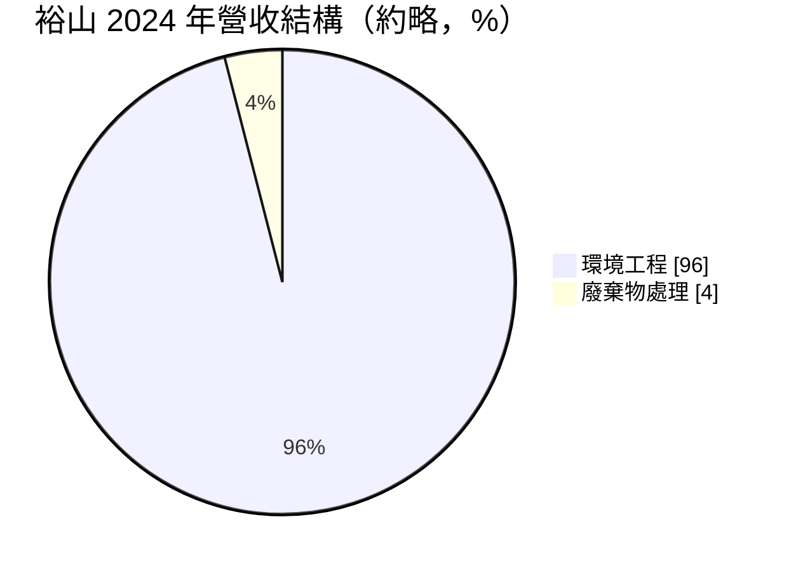
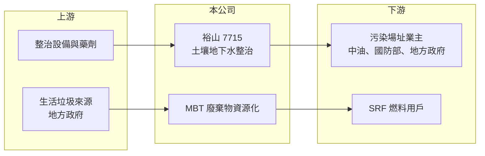

# 7715 裕山

> 上櫃｜[[產業索引-綠能環保|綠能環保]]｜上市（櫃）日期 2025/01/15

# 第一章：企業模式與商業藍圖

> [!info] 撰寫說明
> 精簡版，由 Claude 依公開資料整理，架構比照 [[2330台積電]]，資料截至 2026-10-08。來源：Goodinfo 台灣股市資訊網年度經營績效（2020 至 2025 年）；優分析 UAnalyze 2024 至 2025 年報導；櫃買中心開放資料快照（基本資料、2026 年上半年資產負債與損益、股利）。#待校對

裕山環境工程成立於 1993 年 11 月、2025 年 1 月上櫃，總部在高雄，董事長劉原宏、總經理張育祺，實收資本額 3.3 億元。裕山是台灣[[土壤及地下水整治]]的主要業者，同時經營以 [[MBT]] 把生活垃圾轉成 [[SRF]] 燃料的廢棄物資源化業務。

- **核心業務：** 環境工程是本業，從污染調查、整治規劃到施工一條龍處理，技術包括化學處理、水洗與熱脫附。客戶多為石化廠、軍營與公有土地等污染場址的業主，案例包括高雄煉油廠土壤污染整治、旗津 168 營區等。整治需求來自法規強制，污染土地必須整治才能開發或解除列管。
- **營收結構：** 依 2024 年報導，環境工程約占 96%，廢棄物處理約占 4%（推估）。2024 年營收 17.15 億元，年增 17%，主要來自環境工程；同年上半年雲林 MBT 設備整改，廢棄物處理營收減少且一度負毛利。
- **營運據點：** 以台灣為主，報導稱裕山是同業中唯一在中國取得並完成整治標案的業者，並與德國 IEG 合作開發地下水循環井技術，業務版圖延伸到東南亞（細節未查得）。
- **長期方向：** 公司目標提高廢棄物資源化的營收比重，參與台中 MBT 設備採購案與高雄仁武 MBT [[BOT]] 案（2025 年報導已取得第一階段第一順位資格，最終結果待校對）。若取得長期營運合約，可補足工程收入的波動性。

# 第二章：護城河深度與競爭優勢

裕山的護城河來自整治技術與實績，但工程標案的競爭性高，屬於較窄的護城河。

- **競爭優勢：** 土壤及地下水整治需要針對不同污染物選擇工法，熱脫附等設備投資大，且業主評選時重視過往實績。裕山累積多個大型石化與軍方場址經驗，在大型標案的評選上具優勢。MBT 處理生活垃圾的經驗在台灣少見，報導稱裕山是唯一業者。
- **主要對手：** 國內土壤整治與環境工程業者眾多，以中小型工程公司為主；大型環境服務集團如 [[6803崑鼎]]、[[8422可寧衛]] 也有整治與處理業務。中國市場面對地方國企與大型環保企業。
- **觀察重點：** 2022 年毛利率曾達 28%，其餘年份在 12% 至 21%，獲利取決於大型標案的取得與執行。2025 年營收降到 12.4 億元，顯示工程收入有明顯的年度落差，長期要看在手訂單與 MBT 長約能否平滑營收。

# 第三章：財務體質與盈利規模

資料日期：2026-10-08，表格是撰寫當時的快照；最新月營收、毛利率、累計 EPS 由自動排程寫在本筆記的屬性欄位（月營收、毛利率、累計EPS 等）。#待校對

裕山營收在 2020 至 2024 年由 5 億元成長到 17 億元，2025 年回落；ROE 在 10% 至 28% 間隨標案起伏。

| 年度 | 營收（億元） | [[毛利率]] | [[營業利益率]] | EPS（元） | [[ROE]] |
|---|---|---|---|---|---|
| 2021 | 8.99 | 11.8% | 5.16% | 1.37 | 9.73% |
| 2022 | 9.83 | 28.0% | 18.7% | 4.92 | 27.8% |
| 2023 | 14.6 | 17.4% | 9.21% | 3.50 | 15.9% |
| 2024 | 17.2 | 21.2% | 11.6% | 5.06 | 19.9% |
| 2025 | 12.4 | 21.3% | 9.42% | 3.09 | 11.8% |

註：Goodinfo 合併報表；2020 年營收 5.01 億元、EPS 0.63 元、ROE 3.97%。2026 年上半年營收 4.35 億元、毛利率約 19.9%、EPS 0.65 元（櫃買中心資料）。

- **長期指標：** 2020 至 2025 年營收年複合成長率約 19.8%（推算），2021 至 2025 年平均 ROE 約 17.0%（推算）。現金股利 1.8 元（櫃買中心資料），以 2025 年 EPS 3.09 元計算配息率約 58%（推算）。
- **[[ROIC]] 與 [[WACC]]：** 2025 年營業利益約 1.17 億元（12.4 億元 × 9.42%），稅後約 0.93 億元；投入資本約 11.8 億元（2026 年第二季股東權益 9.00 億元，加上以非流動負債 2.80 億元推估的有息負債），ROIC 約 7.9%（推算）。WACC 約 5.5%（推算：無風險利率 1.75%、市場風險溢酬 6%、β 取工程業常見值 0.8，股東權益成本 6.55%；稅前負債成本 2.5%、稅率 20%，負債占資本約 24%）。ROIC 高於 WACC，近年有創造價值，但 2026 年上半年營收縮小，利差需要新標案支撐。
- **財務特色：** 2026 年第二季負債比率約 43%（負債 6.67 億元 ÷ 資產 15.68 億元）。工程業的營收依完工比例認列，年度間的波動大於一般製造業。

# 第四章：總體風險與地緣政治

裕山的風險在於工程標案的不連續性與政府政策。

- **產業週期：** 整治需求來自法規與土地開發，與景氣關聯不大，但大型標案的開標時程不固定，營收會出現 2024 年高峰、2025 年回落的落差。
- **營運風險：** 工程執行若遇到污染範圍超出預期或工期延誤，可能產生成本超支；MBT 設備故障曾在 2024 年造成廢棄物處理負毛利。
- **其他風險：** 環保政策與預算變動影響標案量；中國業務面臨地方企業競爭與房地產低迷造成的整治需求減少。

# 專有名詞解析

## 金融

- **[[ROIC]]**：投入資本報酬率，稅後營業利益除以股東權益加有息負債，衡量本業運用資本的效率。

## 產業

- **[[土壤及地下水整治]]**：清除或降低受污染土壤與地下水中的有害物質，使土地恢復可使用狀態，受土污法規範。
- **[[MBT]]**：機械生物處理，以破碎分選結合生物分解處理生活垃圾，可產出再生燃料並減少掩埋量。
- **[[SRF]]**：固體再生燃料，把可燃廢棄物破碎、篩選、乾燥後製成的燃料，可供鍋爐或汽電共生使用。
- **[[BOT]]**：興建、營運、移轉，由民間出資興建公共設施並在一定期間營運收費，期滿後移轉給政府。

# 核心供應鏈

- 上游：熱脫附與水洗設備、化學藥劑供應商；地方政府的生活垃圾（MBT 原料）。
- 下游／客戶：中油等石化業者、軍方與地方政府的污染場址；SRF 燃料使用者（名單未查得）。
- 同業：[[6803崑鼎]]、[[8422可寧衛]]。技術夥伴：德國 IEG。

## 最新新聞
<!-- news:start -->
<!-- news:end -->

## 相關連結
- [公開資訊觀測站](https://mopsov.twse.com.tw/mops/web/t05st03?step=1&firstin=1&co_id=7715)
- [Goodinfo](https://goodinfo.tw/tw/StockDetail.asp?STOCK_ID=7715)
- [Yahoo 股市](https://tw.stock.yahoo.com/quote/7715)
- [鉅亨網新聞](https://www.cnyes.com/twstock/7715/news)
