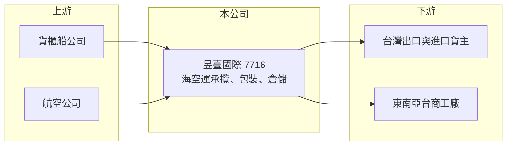

# 7716 昱臺國際

> 上櫃｜[[產業索引-航運業|航運業]]｜上市（櫃）日期 2025/10/28

# 第一章：企業模式與商業藍圖

> [!info] 撰寫說明
> 精簡版，由 Claude 依公開資料整理，架構比照 [[2330台積電]] 的四章研究，資料截至 2026-10-08。來源：Goodinfo 年度經營績效頁、nStock 公司簡介、優分析與 ETtoday 上櫃前報導標題、櫃買中心開放資料（基本資料、2026 年第二季資產負債與綜合損益、每月營收、本益比殖利率）。公司 2025 年才上櫃，公開資料有限，營收比重與據點數未查得。#待校對

昱臺國際是 2025 年上櫃的國際貨運承攬商，以東南亞航線為發展重心。本章說明它的業務內容、規模定位，以及小型承攬商在產業中的生存方式。

## 一、核心定位：以東南亞為重心的海空運承攬商

昱臺國際成立於 1994 年，2025 年 10 月 28 日在櫃買中心掛牌，董事長為劉枋，實收資本額約 2.25 億元（櫃買中心開放資料）。主要業務是海運與空運的[[承攬運送]]，另提供包裝與倉儲等物流服務（nStock）。和其他承攬商一樣，昱臺不擁有船舶或飛機，而是向船公司與航空公司購買艙位，再替貨主安排運送、報關與交貨，賺取服務價差。

上櫃前的報導以「強攻東南亞物流市場」為主軸（優分析、ETtoday 報導標題），代表公司的定位是承接台灣與東南亞之間的貨流。這個市場的成長動力來自台商把產能移往越南、泰國、馬來西亞等地後，原物料、零組件與成品在台灣與東南亞之間來回運輸的需求。

## 二、規模與營運特徵

2025 年營收約 19.8 億元（Goodinfo），約為 [[5609中菲行]] 的十五分之一，屬於台灣承攬業中的小型業者。小型承攬商通常專注在特定航線或特定產業，以靈活的報價與服務彈性和大型業者競爭。各業務比重、海外據點數與主要客戶產業，在本次查得的資料中未揭露。

## 三、資本轉化邏輯

承攬業的營收高度受運價影響。昱臺 2021 至 2022 年疫情運價高峰時營收達 32.3 億元與 28.9 億元，EPS 為 7.05 元與 6.61 元；2023 年運價回落後營收降到 14.5 億元、EPS 1.75 元（Goodinfo），波動幅度明顯大於大型同業。

## 四、企業長期藍圖

上櫃後取得的資金與知名度，可用於擴充東南亞據點、倉儲與人才。長期能否成長，取決於能否在東南亞建立自有據點與穩定客戶，從單純的價差交易，升級為提供倉儲與包裝等加值服務的區域物流商。

# 第二章：護城河深度與競爭優勢

承攬業進入門檻低、業者眾多，本章分析昱臺國際的競爭定位與限制。

## 一、競爭優勢

* **區域專注：** 集中在台灣與東南亞航線，能累積特定航線的艙位關係與在地報關經驗，對中小型貨主而言，專注的承攬商往往能提供比大型業者更即時的服務。
* **加值服務：** 包裝與倉儲服務讓昱臺不只賺取運費價差，也能參與貨物出口前的作業，提高客戶黏著度。
* **上櫃後的信用：** 公開發行公司的財務透明度較高，有助於爭取對供應商資格要求較嚴格的客戶。

## 二、主要競爭對手

| 對手 | 定位 | 與昱臺的比較 |
|---|---|---|
| [[5609中菲行]] | 台灣大型承攬商，空運與科技業見長 | 規模約為昱臺的 15 倍，自營網絡完整 |
| [[2636台驊控股]] | 台灣大型承攬商，中國與亞洲網絡 | 在亞洲航線直接競爭 |
| [[2643捷迅]]、[[2611志信]] | 台灣承攬與報關業者 | 規模相近或較大，業務重疊 |
| 國際大型承攬商 | DHL、DSV、Kuehne+Nagel 等 | 在東南亞有完整網絡與議價能力 |

## 三、守得住與守不住

* **守得住：** 熟悉的特定客戶與航線。只要服務品質穩定，中小型貨主不容易頻繁更換承攬商。
* **守不住：** 規模經濟與運價。小型承攬商向船公司與航空公司的議價能力有限，運價下跌時營收縮水，運價上漲時又可能拿不到足夠艙位。
* **觀察重點：** 東南亞據點的擴充速度、營業利益率能否由 3% 左右提升，以及營收在運價正常化後能否穩定成長。

# 第三章：財務體質與盈利規模

資料日期：2026-10-08，表格是撰寫當時的快照；最新月營收、毛利率、累計 EPS 由自動排程寫在本筆記的屬性欄位（月營收、毛利率、累計EPS 等）。#待校對

本章用多年度數據檢視昱臺國際在運價循環中的獲利波動與資本效率。

## 一、多年度三率與 ROE

| 年度 | 營收（新台幣） | [[毛利率]] | [[營業利益率]] | EPS（元） | [[ROE]] |
|---|---|---|---|---|---|
| 2020 | 15.4 億 | 22.2% | 4.52% | 2.53 | 18.9% |
| 2021 | 32.3 億 | 16.8% | 5.64% | 7.05 | 51.2% |
| 2022 | 28.9 億 | 18.7% | 5.51% | 6.61 | 36.0% |
| 2023 | 14.5 億 | 23.7% | 2.65% | 1.75 | 8.21% |
| 2024 | 20.3 億 | 19.9% | 3.19% | 2.65 | 12.9% |
| 2025 | 19.8 億 | 20.8% | 3.48% | 2.23 | 9.97% |
| 2026 上半年 | 10.0 億 | 20.42% | 3.13% | 0.87 | 未查得 |

註：2020 至 2025 年取自 Goodinfo；2026 上半年依櫃買中心綜合損益推算。

* **獲利結構：** 毛利率約 17% 至 24%，但營業利益率只有 2.5% 至 5.6%，代表人事與營運費用吃掉大部分毛利。規模不大的承攬商費用率偏高，是營業利益率難以提升的主因。
* **營收趨勢：** 2020 至 2025 年營收年複合成長率約 5%（推算），中間經歷疫情高峰。2026 年 1 至 8 月累計營收約 14.4 億元、年增約 4.2%（櫃買中心每月營收）。
* **ROE：** 2021 至 2025 年平均 ROE 約 23.7%（推算），但扣除疫情高峰後的 2023 至 2025 年約 8% 至 13%，才是較具代表性的常態水準。2025 年上櫃增資擴大了股本與權益，也會稀釋短期 ROE。

## 二、股利與財務結構

最近一次現金股利為 1.7 元（櫃買中心本益比殖利率資料），以 2025 年 EPS 2.23 元計算配發率約 76%（推算）。2026 年第二季底權益約 4.8 億元、總負債約 2.9 億元，流動資產約 5.6 億元（櫃買中心資產負債），財務結構保守，負債多為營運性的應付帳款。

## 三、[[ROIC]] 與 [[WACC]]

**ROIC 推算：** 2025 年營業利益約 19.8 億元 × 3.48% ≈ 0.69 億元，稅後約 0.55 億元。投入資本以權益 4.8 億元加上假設有息負債約 0.3 億元（推估）計算，約 5.1 億元，ROIC 約 11%（推算）。

**WACC 推算：** 公債殖利率 1.75%、市場風險溢酬 6%、β 取小型物流股常見值 0.9，權益成本約 7.15%；負債比重很低，WACC 約 7%（推算）。

**結論：** 在 2025 年的常態運價下，ROIC 略高於 WACC，代表昱臺仍在創造價值，但利差不大。承攬業輕資產的特性讓資本報酬不差，真正的挑戰是規模：營業利益率若無法提升，景氣轉弱時 ROIC 可能落到資金成本以下。

# 第四章：總體風險與地緣政治

本章整理昱臺國際長期面對的產業週期、營運與外部風險。

## 一、產業週期

* **運價循環：** 承攬業營收隨海空運價大幅波動，昱臺在疫情後營收一年內腰斬，顯示小型業者對運價的敏感度更高。
* **東南亞貿易流向：** 公司以東南亞為重心，若台商在東南亞的投資放緩，或區域貿易政策改變，貨量成長可能不如預期。

## 二、營運風險

* **規模與議價能力：** 小型承攬商在旺季缺艙時較難取得艙位，淡季又面臨大型業者的低價競爭。
* **客戶集中：** 規模不大的承攬商通常仰賴少數大客戶，大客戶流失對營收的影響較大（客戶集中度未查得）。
* **人才與據點擴張：** 擴充海外據點需要投入人力與管理資源，若擴張過快可能拉高費用率。

## 三、其他風險

* **匯率：** 運費多以美元計價，新台幣升值會使換算後的營收下降。
* **關稅與貿易政策：** 美國關稅與各國原產地規則的變化，可能改變東南亞與台灣之間的貨流。
* **流動性：** 上櫃時間短、股本小，股票成交量有限。

# 專有名詞解析

## 金融

- **[[ROIC]]**：投入資本報酬率，衡量企業用股東與債權人投入的資本，每年能產生多少稅後營業利益。
- **[[WACC]]**：加權平均資金成本，股東要求報酬與負債利息依資本結構加權後的平均值，是判斷是否創造價值的門檻。

## 產業

- **[[承攬運送]]**：貨運承攬商不擁有飛機或船，而是向運輸業者購買艙位，替貨主安排運送、報關與配送，賺取服務價差。

# 核心供應鏈

- 上游：貨櫃船公司如 [[2603長榮]]、[[2609陽明]]、[[2615萬海]]；航空公司如 [[2610華航]]、[[2618長榮航]]（皆為產業代表，非指名供應商）。
- 下游／客戶：台灣與東南亞之間的進出口貨主（客戶名單未公開）。
- 同業：[[5609中菲行]]、[[2636台驊控股]]、[[2643捷迅]]、[[2611志信]]。

## 最新新聞
<!-- news:start -->
<!-- news:end -->

## 相關連結
- [公開資訊觀測站](https://mopsov.twse.com.tw/mops/web/t05st03?step=1&firstin=1&co_id=7716)
- [Goodinfo](https://goodinfo.tw/tw/StockDetail.asp?STOCK_ID=7716)
- [Yahoo 股市](https://tw.stock.yahoo.com/quote/7716)
- [鉅亨網新聞](https://www.cnyes.com/twstock/7716/news)
