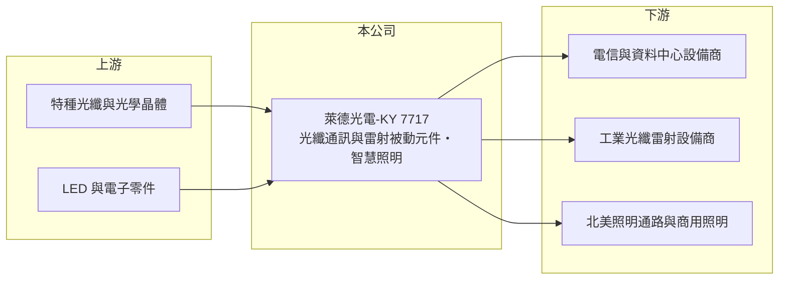

# 7717 萊德光電-KY

> 上櫃｜[[產業索引-通信網路業|通信網路業]]｜上市（櫃）日期 2025/11/17

# 第一章：企業模式與商業藍圖

> [!info] 撰寫說明
> 本文由 Claude 依公開資料整理，架構比照 [[2330台積電]] 的四章研究，資料截至 2026-10-08。財務數字來源：Goodinfo 年度經營績效頁與基本資料頁、櫃買中心開放資料（基本資料、2026 年第二季資產負債與損益、本益比殖利率）。公司 2025 年才掛牌，公開資料有限，2023 年以前的財務數字未查得；產品應用描述部分為推論，已標「待校對」。#待校對

評估光通訊被動元件廠，要看它能否在高單價、少量多樣的利基產品上維持高毛利，並隨光纖網路與雷射加工的升級持續擴大應用。本章說明萊德光電-KY（股票代號：7717，以下簡稱萊德）的商業模式。

## 一、核心定位：光纖被動元件與 LED 照明

萊德是開曼群島註冊的外國公司，2014 年設立，2025 年 11 月在櫃買中心掛牌，實收資本額約 2.5 億元。依公司揭露的主要業務，產品分為三類：光纖通訊被動元件、光纖雷射被動元件，以及智慧照明。營運主體包括深圳的萊德光電子公司（光通訊產品與電子器件的製造銷售）、美國的 Lightel Technologies（光通訊產品製造銷售）與美國的 Aleddra（LED 照明產品研發）。董事長席次由環隆科技股份有限公司的代表人擔任。

光纖被動元件不需要電力，功能是讓光訊號分光、耦合、隔離或濾波，用於電信網路、資料中心與量測設備。光纖雷射被動元件則用在工業雷射加工設備中，負責合束、隔離與保護雷射光路，需承受高功率，規格要求比通訊用元件更嚴格（應用描述待校對）。各產品的營收比重未查得。

## 二、高毛利的來源

萊德 2024 至 2026 年上半年的毛利率都在 60% 以上，遠高於一般光通訊元件廠的二至三成。合理的解釋是公司聚焦少量多樣的利基與客製化規格，而非大量生產的標準品，加上美國子公司直接面對北美客戶，定價能力較強（推估，待校對）。這種模式的營收規模有限，但每一張訂單的利潤率高。

## 三、長期方向

萊德的長期方向是在高功率雷射、高速光通訊與特殊應用（例如衛星與國防通訊，推估）等需要高可靠度的領域擴大產品線。這些市場重視規格與可靠度多於價格，若能持續取得新設計案，就能在小市場中維持高毛利。

# 第二章：護城河深度與競爭優勢

在長期價值投資中，「護城河」指企業抵禦競爭、維持超額利潤的保護機制。本章分析萊德的優勢與限制。

## 一、護城河的組成

* **利基規格與客製能力：** 高功率雷射與特殊光通訊元件需要客製設計與可靠度驗證，一旦導入客戶系統，替換成本高，這是高毛利得以維持的基礎。
* **美國在地據點：** 美國子公司直接面對北美客戶，在需要非中國供應或在地技術支援的專案上具有優勢（推估）。
* **專利與照明事業：** Aleddra 在 LED 照明領域持有專利並曾與同業發生專利訴訟（時間未查得），顯示照明產品線也有一定的智慧財產布局。

## 二、主要競爭對手

| 對手 | 定位 | 對萊德的威脅 |
|---|---|---|
| [[3363上詮]] | 光纖連接與被動元件 | 在光通訊被動元件重疊 |
| [[6442光聖]] | 光纖跳線與被動元件 | 資料中心光纖產品重疊 |
| 中國大陸光纖被動元件廠 | 規模大、價格低 | 壓低標準品報價 |
| 美日光纖雷射元件供應商 | 高功率元件技術領先 | 爭取同一批雷射設備客戶 |

## 三、守得住／守不住／觀察重點

守得住的是高規格、客製化的利基產品。守不住的是標準化光通訊元件，這類產品在中國大陸有大量供應商。長期觀察重點是 60% 以上的毛利率能否在營收擴大後維持，以及深圳產能在地緣政治下的配置調整。

# 第三章：財務體質與盈利規模

資料日期：2026-10-08，表格是撰寫當時的快照；最新月營收、毛利率、累計 EPS 由自動排程寫在本筆記的屬性欄位（月營收、毛利率、累計EPS 等）。#待校對

財務報表是檢驗護城河是否真實存在的最終標準。本章用掛牌後可取得的年度資料，檢視萊德的獲利品質。

## 一、多年度經營績效

| 年度 | 營收（新台幣） | [[毛利率]] | [[營業利益率]] | EPS（元） | [[ROE]] |
|---|---|---|---|---|---|
| 2023 | 未查得 | 未查得 | 未查得 | 未查得 | 未查得 |
| 2024 | 6.93 億 | 60.6% | 13.4% | 3.35 | 13.0% |
| 2025 | 8.62 億 | 61.6% | 22.4% | 6.13 | 17.5% |
| 2026 上半年 | 5.90 億 | 61.2% | 25.4% | 4.34 | 未查得 |

萊德的財務特徵是高毛利加上快速擴張的營業利益率：2025 年營收成長約 24%，營業利益率從 13.4% 提高到 22.4%，2026 年上半年進一步升到 25.4%，顯示營收增加後費用攤提的槓桿效果明顯。2024 至 2025 年平均 ROE 約 15.3%（推算）。最近一次現金股利約每股 3.29 元，配發率約 54%（推算）。年度資料只有兩年，長期穩定度仍需更多年度驗證。

## 二、[[ROIC]] 與 [[WACC]]：價值創造利差

**ROIC 推算：** 2025 年營業利益約 1.93 億元（8.62 億 × 22.4%），稅後約 1.54 億元。2026 年第二季權益總計約 10.5 億元，負債約 5.5 億元，假設有息負債約 2 億元（推估），投入資本約 12.5 億元，2025 年 ROIC 約 12.3%（推算）；以 2026 年上半年營業利益 1.50 億元年化，ROIC 約 19%（推算）。

**WACC 推算：** 台灣 10 年期公債 1.75%、市場風險溢酬 6%、β 取光通訊同業常見值 1.3，股東權益成本約 9.6%；負債成本 2.5%、稅後 2.0%；權益占投入資本約 84%，WACC 約 8.3%（推算）。

**結論：** 萊德的 ROIC 明顯高於 WACC，代表本業正在創造價值。由於掛牌時間短、年度資料少，這個利差能否在景氣循環中延續，是長期最需要驗證的地方。

# 第四章：總體風險與地緣政治

任何企業都無法脫離宏觀環境獨立存在。本章分析萊德長期必須面對的風險。

## 一、地緣政治與生產布局

主要製造據點在深圳，產品銷往北美，美中關稅與出口管制可能提高成本或要求產地轉移。開曼控股架構也讓投資人較難掌握各子公司的營運細節。

## 二、需求與競爭風險

光纖雷射元件跟著工業設備投資起伏，光通訊元件則跟著電信與資料中心資本支出起伏。中國大陸同業若切入高規格產品，可能壓縮目前的高毛利。

## 三、規模、智財與匯率

公司營收不到十億元，單一大客戶或大型專案的變化都會影響獲利。照明事業涉及專利訴訟，結果可能帶來費用或收入波動。營收以美元計價為主（推估），匯率變動會影響以新台幣計的獲利。

# 專有名詞解析

## 應用

- **[[光纖被動元件]]**：不需電力、用來分光、耦合、隔離或濾波光訊號的元件，例如分光器、隔離器與濾波器。
- **[[光纖雷射]]**：以摻雜稀土元素的光纖作為增益介質的雷射，常用於金屬切割與焊接等工業加工。

## 金融

- **[[ROIC]]**：投入資本報酬率，稅後營業利益除以股東權益與有息負債的合計，衡量本業對所有資金提供者的報酬。
- **[[WACC]]**：加權平均資金成本，依股東權益與負債的比重加權計算的資金成本，ROIC 高於它才代表創造價值。

# 核心供應鏈

## 1. 上游：材料
- 特種光纖、光學晶體與 LED 零件供應商（實際供應商未查得）

## 2. 中游：萊德與同業
- 同業：[[3363上詮]]、[[6442光聖]]、中國大陸光纖被動元件廠

## 3. 下游：客戶
- 電信與資料中心設備商、工業雷射設備商、北美照明客戶（具體客戶未查得）

## 最新新聞
<!-- news:start（自動產生，請勿手動編輯此範圍） -->
- 2026-10-06 📰 媒體 10:38｜〈焦點股〉SpaceX股價飛漲 萊德光電-KY漲停衝上600元｜[鉅亨網](https://news.cnyes.com/news/id/6622537)

完整紀錄：[[7717萊德光電-KY 新聞]]
<!-- news:end -->

## 相關連結
- [公開資訊觀測站](https://mopsov.twse.com.tw/mops/web/t05st03?step=1&firstin=1&co_id=7717)
- [Goodinfo](https://goodinfo.tw/tw/StockDetail.asp?STOCK_ID=7717)
- [Yahoo 股市](https://tw.stock.yahoo.com/quote/7717)
- [鉅亨網新聞](https://www.cnyes.com/twstock/7717/news)
