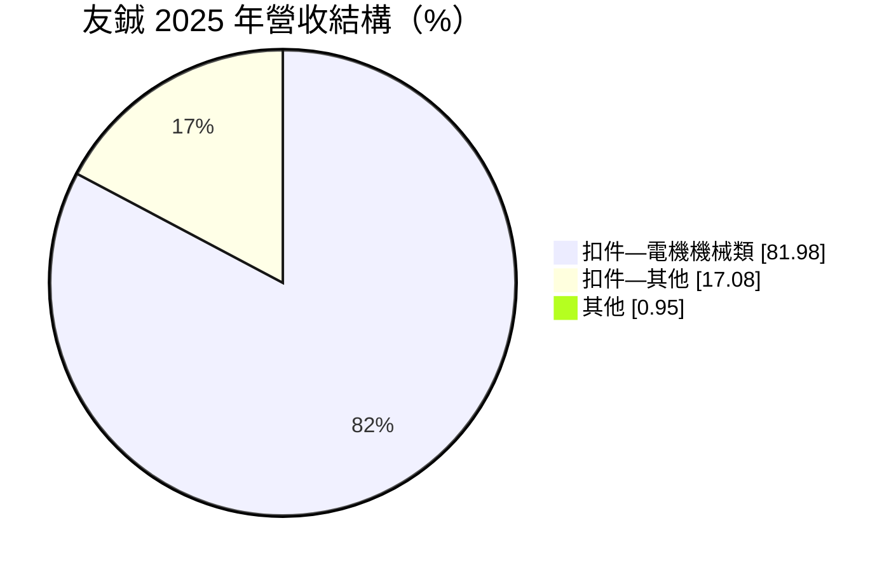
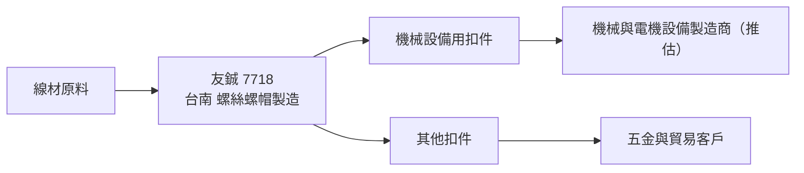
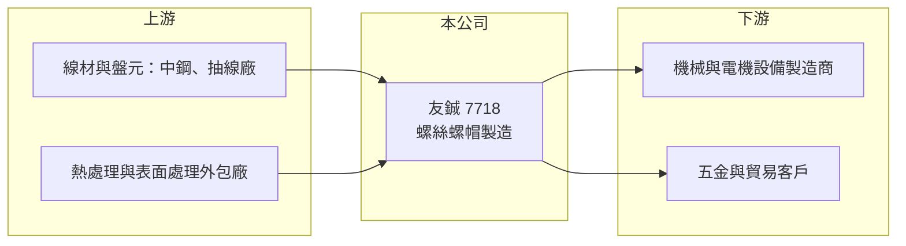

# 7718 友鋮

> 上櫃｜[[產業索引-鋼鐵工業|鋼鐵工業]]｜上市（櫃）日期 2025/03/18

# 第一章：企業模式與商業藍圖

> [!info] 撰寫說明
> 本文由 Claude 依公開資料整理，架構比照 [[2330台積電]] 的四章研究，資料截至 2026-10-08。財務數字來源：Goodinfo 年度經營績效頁、MoneyDJ（富邦證券）公司基本資料（2025 年營收比重）、nStock 公司資料、櫃買中心開放資料（基本資料、資產負債、綜合損益、每月營收、本益比殖利率）。公開資料有限，主要客戶、終端應用、產能與海外據點未查得；產業描述為整理性內容。#待校對

在評估單一個股的長期投資價值時，首要步驟是拆解企業的底層獲利邏輯。本章說明友鋮（股票代號：7718）這家 2025 年才上櫃的台南扣件廠，以及它與一般外銷螺絲廠的差異。

## 一、核心定位：台南的螺絲螺帽製造商

友鋮成立於 2001 年 10 月，2025 年 3 月 18 日上櫃，總部位於台南市東區，2026 年實收資本額約 4.6 億元，董事長兼總經理為張宏誠，英文名稱 SPEC。友鋮的營業項目為螺絲、螺帽等[[螺絲扣件]]的製造，以及五金批發與國際貿易。值得注意的是，友鋮在櫃買中心的產業分類是「電機機械」而不是「鋼鐵工業」，2025 年營收中「扣件—電機機械類」占約 82%，代表它的產品主要賣給機械與設備產業，而非建築五金通路。

這個定位的意義在於：機械與設備用扣件通常規格較特殊、品質要求較高，客戶在設計階段就會指定供應商，訂單比標準建築螺絲穩定，毛利率也較高。友鋮的毛利率長年維持在 15% 至 20%，高於許多以標準件為主的同業，就是這種產品組合的反映（推估）。

## 二、營運模式

友鋮以台南為生產與營運基地（是否有海外工廠未查得），從線材採購、成型到熱處理與表面處理的分工方式未查得。年營收約 24 億元，在台灣扣件業屬於中型規模。

## 三、長期方向

上櫃為友鋮提供了資本市場籌資管道與知名度。公開資料未查得明確的擴產或新事業計畫。長期觀察重點是：上櫃資金是否用於擴充產能或自動化、客戶結構是否更多元，以及能否維持高於同業的獲利率。對一家上市時間短、資訊揭露有限的公司，投資人應以多年的實際財報驗證它的競爭力。

# 第二章：護城河深度與競爭優勢

在長期價值投資中，「護城河」指企業抵禦競爭、維持超額利潤的保護機制。本章依現有資料，評估友鋮的競爭位置。

## 一、可能的優勢

* **機械用扣件的轉換成本：** 機械設備用的螺絲常為客戶指定規格，一旦通過驗證並進入量產，客戶不會輕易更換供應商。這是友鋮獲利率高於標準件廠的可能原因（推估）。
* **獲利率優於同業：** 2022 至 2025 年營業利益率維持在 8% 至 10%，ROE 多在 12% 至 31% 之間，顯示產品或客戶結構具有一定的定價能力。
* **南部扣件聚落：** 位於台南，靠近岡山與台南的扣件、線材與熱處理供應鏈，外包與原料取得方便。

## 二、競爭對手格局

| 對手 | 定位 | 對友鋮的影響 |
|---|---|---|
| [[2012春雨]]、[[2062橋椿]]、[[2069運錩]] | 岡山聚落螺絲廠 | 外銷扣件市場競爭 |
| [[8349恒耀]] | 汽車與工業扣件大廠 | 工業用扣件的大型對手 |
| 中國與越南扣件廠 | 成本低 | 壓低一般扣件價格 |

## 三、守得住與守不住的地方

* **守得住：** 已導入客戶的特殊規格扣件訂單。
* **守不住：** 景氣循環下的需求量。2025 年營收持平，但毛利率從 20.1% 降到 17.5%、EPS 從 6.08 元降到 3.75 元，顯示仍受原料成本與需求影響。
* **觀察重點：** 2026 年毛利率是否回到 20% 以上、客戶與產業集中度，以及上櫃後的資本運用。

# 第三章：財務體質與盈利規模

資料日期：2026-10-08，表格是撰寫當時的快照；最新月營收、毛利率、累計 EPS 由自動排程寫在本筆記的屬性欄位（月營收、毛利率、累計EPS 等）。#待校對

財務報表是檢驗護城河是否真實存在的最終標準。本章用多年度三率、ROE 與資本報酬，檢視友鋮的獲利品質。

## 一、多年度獲利

| 年度 | 營收（新台幣） | [[毛利率]] | [[營業利益率]] | EPS（元） | [[ROE]] |
|---|---|---|---|---|---|
| 2020 | 17.4 億 | 15.2% | 5.04% | 1.37 | 6.82% |
| 2021 | 24.3 億 | 15.8% | 6.91% | 3.08 | 15.7% |
| 2022 | 28.4 億 | 17.7% | 8.77% | 7.52 | 31.2% |
| 2023 | 22.8 億 | 20.1% | 10.0% | 5.72 | 19.8% |
| 2024 | 24.1 億 | 20.1% | 9.54% | 6.08 | 19.8% |
| 2025 | 24.4 億 | 17.5% | 8.19% | 3.75 | 11.8% |
| 2026 上半年 | 12.6 億 | 20.1%（推算） | 10.8%（推算） | 2.55 | 未查得 |

註：2019 年資料未查得。2025 年上櫃辦理現金增資，股本擴大使 EPS 與 ROE 被稀釋（增資規模依資本公積約 4.2 億元推估）。#待校對

* **獲利率逐年改善：** 毛利率從 2020 年的 15.2% 升到 2023 至 2024 年的 20.1%，營業利益率也從 5% 升到約 10%，代表產品組合往高附加價值移動。
* **2026 年回升：** 上半年 EPS 2.55 元，營業利益率回到約 10.8%，1 至 8 月營收年增約 5%。
* **淨利率穩定：** 2026 年上半年稅後淨利約 1.16 億元，淨利率約 9.2%（推算）。

## 二、長期指標

* **平均 ROE：** 2021 至 2025 年平均約 19.7%（推算），在扣件業屬於高水準。
* **營收年複合成長率：** 2020 至 2025 年約 7%（推算）。
* **股利：** 2024 年度現金股利 3.5 元，2025 年度 2.5 元（2026 年 6 月除息），配息率約 58% 至 67%（推算）。
* **財務結構：** 2026 年第二季流動資產 14.6 億元、流動負債 6.1 億元，流動比率約 2.4 倍（推算），負債比約 30%，財務保守；另持有庫藏股約 80 萬股。

## 三、[[ROIC]] 與 [[WACC]]：價值創造利差

**ROIC 推算：** 2025 年營業利益約 2.0 億元（24.4 億元 × 8.19%），稅後約 1.6 億元。投入資本以 2026 年第二季權益 15.5 億元加負債 6.8 億元計（以負債總額代替有息負債會高估投入資本），ROIC 約 7.2%（推算）；只以權益計算約 10.3%（推算）。增資前的 2024 年，同法估算 ROIC 約 12% 至 18%（推算，增資前資本規模為推估）。

**WACC 推算：** 以 [[CAPM]] 推估，台灣 10 年期公債 1.75%、市場風險溢酬 6%、β 取 0.9（機械零組件業常見值，非來源數字），權益成本約 7.15%；負債成本假設 2.5%，稅後 2%。依帳面權益約 70%、負債約 30% 計算，WACC 約 5.6%；若有息負債很少，接近 7%（推算）。

**結論：** 友鋮的 ROIC 在 2022 至 2024 年明顯高於 WACC，2025 年因增資擴大資本與獲利下滑而利差縮小，但仍在資金成本之上。若 2026 年獲利率維持，友鋮屬於長期創造價值的扣件公司，但需以更多年度的公開資料驗證。

# 第四章：總體風險與地緣政治

任何企業都無法脫離宏觀環境獨立存在。本章分析友鋮必須面對的產業、營運與外部風險。

## 一、產業週期

* **機械設備景氣：** 主要產品用於機械與電機設備，跟著全球製造業資本支出循環，製造業投資放緩時訂單會減少。
* **鋼價：** 線材是主要原料，鋼價大漲時若無法即時轉嫁，毛利率會被壓縮。

## 二、營運風險

* **資訊揭露有限：** 上櫃時間短，客戶集中度、外銷比重等關鍵資訊尚未在公開資料中查得，投資人難以評估客戶集中風險。
* **規模：** 年營收約 24 億元，面對大型同業與中國廠商，採購與自動化投資規模相對有限。
* **單一據點：** 若生產集中在台南，天災或工安事件會影響整體產能（推估）。

## 三、其他風險

* **美國關稅：** 若有外銷美國，扣件屬於美國 [[232 條款]]鋼鋁衍生品與[[對等關稅]]的範圍，會影響價格競爭力（外銷比重未查得）。
* **匯率：** 外銷以美元計價時，新台幣升值會壓縮毛利（推估）。
* **碳成本：** 熱處理屬耗能製程，台灣碳費與歐盟 [[CBAM]] 會逐步增加成本。

# 專有名詞解析

## 產業

- **[[螺絲扣件]]**：用來鎖固與連接零件的螺絲、螺栓、螺帽等產品，台灣高雄岡山是全球重要的生產聚落。
- **[[232 條款]]**：美國以國家安全為由對進口鋼鋁等產品加徵關稅的法律依據。
- **[[對等關稅]]**：美國依各國對美貿易條件課徵的對應關稅，2025 年起實施，影響出口美國的產品價格。
- **[[CBAM]]**：歐盟碳邊境調整機制，對進口鋼鐵等高碳產品依碳排量課徵費用，使低碳製程較具競爭力。

# 核心供應鏈

## 1. 上游：原料與外包
- 線材與盤元：[[2002中鋼]]、[[5013強新]] 等（實際供應商未查得）
- 熱處理與表面處理：南部扣件聚落外包廠

## 2. 本公司與同業
- 扣件同業：[[2012春雨]]、[[2062橋椿]]、[[2069運錩]]、[[8349恒耀]]、[[5015華祺]]

## 3. 下游：客戶
- 機械與電機設備製造商（具名客戶未查得）
- 五金批發與貿易客戶

## 最新新聞
<!-- news:start（自動產生，請勿手動編輯此範圍） -->
- 2026-10-08 🏛️ 重訊 17:48｜公告本公司從事衍生性商品交易單筆達個別契約20%損失上限｜[觀測站](https://mops.twse.com.tw/mops/#/web/t05st01)

完整紀錄：[[7718友鋮 新聞]]
<!-- news:end -->

## 相關連結
- [公開資訊觀測站](https://mopsov.twse.com.tw/mops/web/t05st03?step=1&firstin=1&co_id=7718)
- [Goodinfo](https://goodinfo.tw/tw/StockDetail.asp?STOCK_ID=7718)
- [Yahoo 股市](https://tw.stock.yahoo.com/quote/7718)
- [鉅亨網新聞](https://www.cnyes.com/twstock/7718/news)
