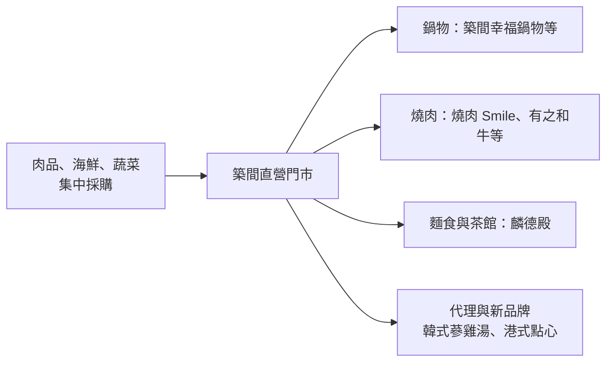
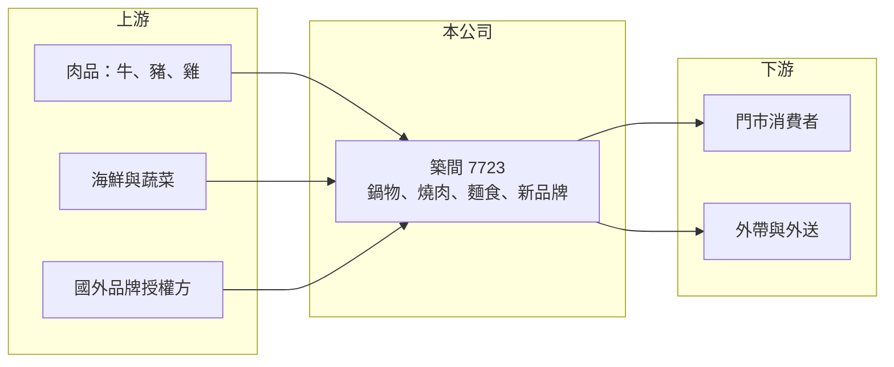

# 7723 築間

> 上櫃｜[[產業索引-觀光餐旅|觀光餐旅]]｜上市（櫃）日期 2025/04/30

# 第一章：企業模式與商業藍圖

> [!info] 撰寫說明
> 精簡版，由 Claude 依公開資料整理，架構比照 [[2330台積電]] 的四章研究，資料截至 2026-10-08。來源：Goodinfo 年度經營績效頁、工商時報 2026 年 6 月報導、櫃買中心開放資料（基本資料、2026 年第二季資產負債與綜合損益、每月營收、本益比殖利率）。旗下品牌清單部分憑記憶整理，已標示待校對；各品牌營收比重與門市總數未查得。#待校對

築間是發跡於台中的火鍋與燒肉連鎖集團，以「築間幸福鍋物」起家，近年擴張成多品牌餐飲集團。本章說明它的品牌組合、經營模式，以及 2025 年起的品牌調整。

## 一、核心定位：中價位鍋物與燒肉的多品牌集團

築間餐飲事業成立於 2020 年，2025 年 4 月登錄上櫃，董事長為林楷傑，總部在台中，實收資本額約 4.96 億元（櫃買中心開放資料）。品牌以中價位的個人鍋、燒肉與牛肉麵為主，包括築間幸福鍋物、燒肉 Smile、有之和牛、麟德殿牛肉麵等（品牌清單待校對）。

* **鍋物與燒肉的特性：** 火鍋與燒肉的廚房作業標準化程度高、不太依賴主廚手藝，適合快速複製展店。但同類品牌門檻也低，商圈內競爭激烈。
* **多品牌策略：** 從平價個人鍋到和牛燒肉，涵蓋不同價格帶，目標是在同一商圈以多個品牌搶占不同客群。

## 二、商業模式與轉型

依工商時報 2026 年 6 月報導，公司正進行品牌升級與門市優化：汰除較弱品牌、在同一區域集中開設多品牌，並推出喜辰港式點心茶餐廳、麟德殿．四時茶館，以及代理韓國「百年土種蔘雞湯」，另規劃新的粵菜品牌。轉型期間部分門市暫停營業，2026 年 1 至 5 月營收年減約 19%。

## 三、門市與展店節奏

營收從 2021 年的 27.9 億元快速擴張到 2023 年的 57.6 億元，之後持平並在 2025 年降至 49.4 億元（Goodinfo）。這個軌跡說明築間在疫後經歷一段快速展店期，但新品牌與新門市的效益不如預期，2025 年轉為虧損後開始收縮與調整品牌結構。門市總數與坪效未查得。

# 第二章：護城河深度與競爭優勢

快速擴張的多品牌集團，護城河往往在規模，風險則在管理能力。本章分析築間的優勢與目前的弱點。

## 一、護城河的核心組成要素

* **中部市場的品牌基礎：** 築間從台中起家，在中部商圈有較高的品牌知名度與門市密度，集中採購與物流配送也較有效率（推估）。
* **集團採購規模：** 鍋物與燒肉高度依賴肉品，集團規模讓公司在肉品採購上具備一定議價能力。
* **品牌孵化能力：** 公司持續推出新品牌與代理國外品牌，具備快速試錯的能力；但這同時也是風險，品牌太多會分散管理資源。

## 二、主要競爭對手

| 對手 | 定位 | 對築間的威脅 |
|---|---|---|
| [[2727王品]] | 多品牌集團，含石二鍋、肉次方等鍋物燒肉 | 同價格帶、同品類直接競爭 |
| [[2732六角]] | 連鎖餐飲與手搖飲 | 搶商場與街邊店面 |
| [[1268漢來美食]] | 港式飲茶與宴席 | 與新推出的港式點心品牌競爭 |
| 乾杯、輕井澤、這一鍋等 | 燒肉與火鍋連鎖 | 品類幾乎完全重疊 |

## 三、守得住與守不住

* **守得住：** 既有核心品牌在中部的熟客基礎，以及鍋物作為日常聚餐選項的穩定需求。
* **守不住：** 獲利率。2025 年營業利益率轉為 -1.54%、EPS 為 -6.69 元（Goodinfo），顯示展店過快、品牌過多時，固定成本會迅速吞掉毛利。
* **觀察重點：** 品牌汰弱留強後，營業利益能否轉正，以及新推出的港式點心、茶館與代理品牌能否成為新的獲利來源。

# 第三章：財務體質與盈利規模

資料日期：2026-10-08，表格是撰寫當時的快照；最新月營收、毛利率、累計 EPS 由自動排程寫在本筆記的屬性欄位（月營收、毛利率、累計EPS 等）。#待校對

本章用多年度數據檢視築間的擴張與獲利波動。

## 一、多年度三率與 ROE

| 年度 | 營收（新台幣） | [[毛利率]] | [[營業利益率]] | EPS（元） | [[ROE]] |
|---|---|---|---|---|---|
| 2021 | 27.9 億 | 38.8% | -2.03% | -2.51 | -25.9% |
| 2022 | 43.4 億 | 45.4% | 8.31% | 8.74 | 82.3% |
| 2023 | 57.6 億 | 46.0% | 8.82% | 8.61 | 38.9% |
| 2024 | 57.8 億 | 45.8% | 4.28% | 4.06 | 14.4% |
| 2025 | 49.4 億 | 45.7% | -1.54% | -6.69 | -34.4% |
| 2026 上半年 | 20.7 億 | 44.5% | -6.6% | -2.83 | 未查得 |

註：2021 至 2025 年取自 Goodinfo；2026 上半年依櫃買中心綜合損益計算。2021 年以前未查得。

* **波動極大：** 2021 至 2025 年營收年複合成長率約 15%（推算），但 2023 年後營收下滑。ROE 從 82% 到 -34% 劇烈擺盪，5 年算術平均約 15%（推算）沒有太大參考意義，重點在於獲利極不穩定。
* **毛利穩、費用重：** 毛利率維持在 45% 左右，問題出在營業費用。2026 年上半年營業費用約 10.6 億元，超過毛利約 9.2 億元，營業虧損約 1.37 億元（櫃買中心綜合損益）。
* **營收收縮：** 2026 年 1 至 8 月累計營收約 27.4 億元、年減約 19%（櫃買中心每月營收），反映品牌調整期間的關店與停業。

## 二、股利與財務結構

2025 年度虧損，未配發現金股利（櫃買中心本益比殖利率資料）。2026 年第二季底總資產約 36.2 億元、總負債約 29.9 億元、權益僅約 6.4 億元，負債比約 82%，保留盈餘為 -1.36 億元，另持有庫藏股 200 萬股（櫃買中心資產負債）。負債中非流動負債約 18.8 億元，應有相當比例為門市[[租賃負債]]（推估），銀行借款金額未查得。

## 三、[[ROIC]] 與 [[WACC]]

**ROIC 推算：** 2025 年營業利益約 49.4 億 × -1.54% ≈ -0.76 億元，稅後營業利益為負（虧損不計稅盾，以 -0.76 億元計）。以權益約 6.4 億元加上推估的有息與租賃負債約 15 億元作為投入資本，ROIC 約 -3.5%（推算）。2026 年上半年營業虧損擴大到約 1.37 億元，年化 ROIC 約 -12%（推算）。對照 2022 至 2023 年營業利益率約 8% 至 9% 時，ROIC 推估可達 15% 以上。

**WACC 推算：** 台灣 10 年期公債 1.75%、市場風險溢酬 6%、β 取餐飲同業常見值 0.8（槓桿較高故上調），權益成本約 6.6%；負債稅後成本約 2%，以權益 30%、負債 70% 加權，WACC 約 3.4%（推算）。

**結論：** ROIC 為負代表目前每一元投入資本都在毀損價值，與 2022 至 2023 年的高報酬形成強烈對比。公司能否回到創造價值的狀態，取決於品牌調整後營業利益率能否回到 4% 以上；在那之前，高負債比與低權益是主要的財務壓力。

# 第四章：總體風險與地緣政治

本章整理築間長期面對的財務、營運與競爭風險。

## 一、財務風險

* **高負債與權益偏薄：** 負債比約 82%、權益約 6.4 億元，若虧損持續，權益會進一步被侵蝕，可能需要增資或縮減營運規模。
* **租約負擔：** 直營門市的長期租約即使關店也可能需要支付違約金或繼續認列租金，轉型期間的固定成本難以快速下降。

## 二、營運風險

* **品牌管理能力：** 品牌數量多、汰換快，管理資源分散，新品牌失敗的機率不低。
* **人力與食材成本：** 鍋物與燒肉需要大量肉品與現場人力，肉價與基本工資上漲直接壓縮利潤。

## 三、其他風險

* **品類競爭：** 火鍋與燒肉是台灣競爭最激烈的餐飲品類之一，同業持續展店與促銷，價格戰風險高。
* **食安與代理授權：** 代理國外品牌需遵守授權方規範，食安事件對多品牌集團的形象衝擊也會擴散到其他品牌。

# 專有名詞解析

## 金融

- **[[租賃負債]]**：依 IFRS 16，企業把長期租約未來應付的租金折現後認列在資產負債表上的負債，連鎖餐飲與零售業金額通常很大。
- **[[ROIC]]**：投入資本報酬率，衡量企業用股東與債權人投入的資本，每年能產生多少稅後營業利益。
- **[[WACC]]**：加權平均資金成本，股東要求報酬與負債利息依資本結構加權後的平均值，是判斷是否創造價值的門檻。

## 產業

- **[[直營門市]]**：由總公司自己投資、經營的門市，獲利全歸公司，但展店資本與營運風險也由公司承擔。
- **[[品牌授權]]**：企業向品牌所有者取得在特定區域經營品牌的權利，需支付權利金並遵守品牌規範，可快速取得知名度。

# 核心供應鏈

- 上游：牛、豬、雞等肉品供應商，海鮮與蔬菜供應商，以及韓國蔘雞湯等國外品牌授權方；肉品供應鏈可參考 [[1215卜蜂]]、[[1210大成]]。
- 下游／客戶：門市內用消費者、外帶與外送。
- 同業：[[2727王品]]、[[2732六角]]、[[1268漢來美食]]、[[7705三商餐飲]]、[[7708全家餐飲]]。

## 最新新聞
<!-- news:start -->
<!-- news:end -->

## 相關連結
- [公開資訊觀測站](https://mopsov.twse.com.tw/mops/web/t05st03?step=1&firstin=1&co_id=7723)
- [Goodinfo](https://goodinfo.tw/tw/StockDetail.asp?STOCK_ID=7723)
- [Yahoo 股市](https://tw.stock.yahoo.com/quote/7723)
- [鉅亨網新聞](https://www.cnyes.com/twstock/7723/news)
