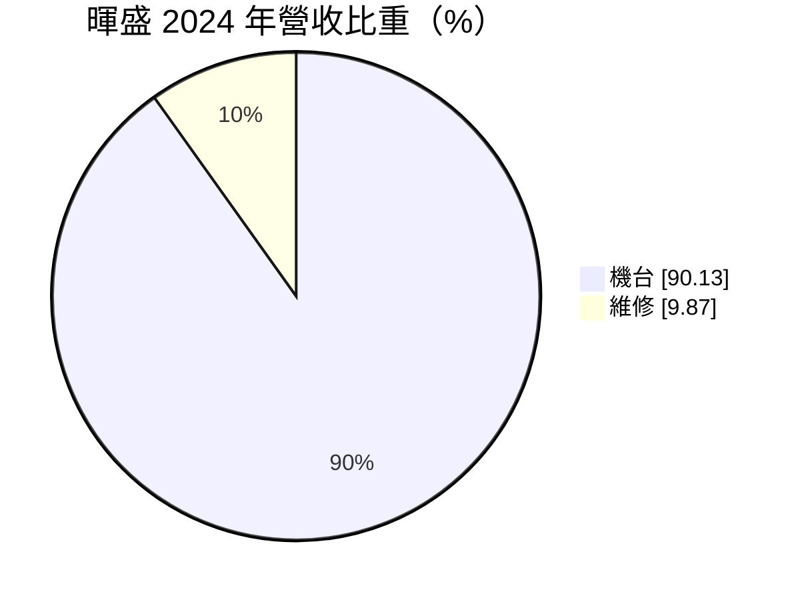
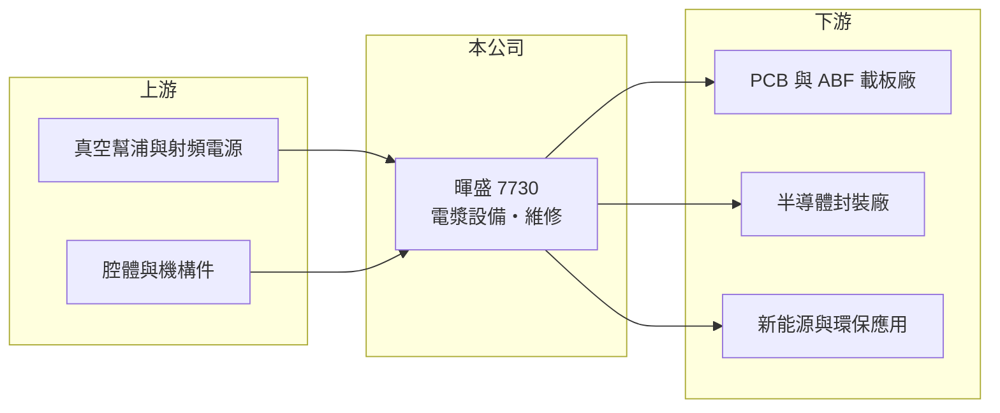

# 7730 暉盛-創

> 創新板｜[[產業索引-半導體業|半導體業]]｜上市（櫃）日期 2025/11/04

# 第一章：企業模式與商業藍圖

> [!info] 撰寫說明
> 精簡版，由 Claude 依公開資料整理，架構比照 [[2330台積電]]，資料截至 2026-10-08。創新板／新掛牌，公開資料有限。來源：證交所開放資料快照（基本資料、2026 年第二季綜合損益與資產負債、每月營收、股利）、Goodinfo 年度經營績效、MoneyDJ 基本資料（2024 年營收比重）、科技新報 2025 年 10 月上市前業績發表會報導。客戶名單未查得。#待校對

暉盛科技（以下簡稱暉盛）是台南科技工業區的設備廠，2025 年 11 月登上[[創新板]]，專精[[電漿]]設備的研發與製造。本章說明它的產品、應用與成長方向。

- **核心業務：** 電漿設備利用離子化氣體處理材料表面，用途包括清潔、除膠渣、表面活化與蝕刻，是 PCB、載板與半導體封裝製程中提升附著力與良率的關鍵步驟。暉盛以自主技術開發機台，並提供後續維修服務。
- **營收結構：** 依 MoneyDJ 資料，2024 年機台銷售占營收 90.13%，維修占 9.87%。設備業以機台出貨認列營收，訂單大小與客戶擴產時點會讓營收在年度之間波動；維修收入則隨裝機量累積而穩定成長。

- **營運據點：** 總部與工廠位於臺南市安南區的臺南科技工業區，鄰近南部的 PCB 與半導體聚落。海外據點與外銷比重未查得。
- **長期方向：** 依 2025 年 10 月業績發表會報導，暉盛的應用領域涵蓋半導體、[[ABF載板]]、PCB 與新能源環保，並積極爭取 AI 伺服器、高效能運算帶動的高階 PCB 與[[玻璃基板]]商機。AI 晶片封裝尺寸變大、線路更細，對表面處理的要求更高，是電漿設備的長期需求來源。

# 第二章：護城河深度與競爭優勢

設備業的護城河來自製程know-how、客戶驗證與裝機基礎。本章分析暉盛的競爭位置。

- **競爭優勢：** 電漿處理效果與氣體配方、腔體設計、均勻度控制密切相關，設備必須在客戶產線上通過長時間驗證才能量產採用，一旦導入，後續擴產通常沿用同一供應商。暉盛[[毛利率]]長期維持在 38% 至 45%，代表具備技術附加價值。
- **主要對手：** 電漿設備的國際對手包括美國 Nordson MARCH、日本與德國的專業廠商（待校對）；台股相關的濕製程與封裝設備廠包括 [[3131弘塑]]、[[3583辛耘]]、[[6187萬潤]]、[[8027鈦昇]] 等，業務部分重疊。
- **觀察重點：** 一是營收能否回到 2022 年 8.1 億元的高點，這取決於 PCB 與載板廠的資本支出；二是玻璃基板、先進封裝等新應用能否帶來量產訂單；三是維修收入占比是否上升，這能降低設備業的波動。

# 第三章：財務體質與盈利規模

資料日期：2026-10-08，表格是撰寫當時的快照；最新月營收、毛利率、累計 EPS 由自動排程寫在本筆記的屬性欄位（月營收、毛利率、累計EPS 等）。#待校對

暉盛的財務走勢清楚呈現設備業的景氣循環：2022 年高峰、2024 至 2025 年回落。

| 年度 | 營收（億元） | [[毛利率]] | [[營業利益率]] | EPS（元） | [[ROE]] |
|---|---|---|---|---|---|
| 2020 | 2.80 | 39.6% | 15.8% | 1.59 | 10.3% |
| 2021 | 4.51 | 38.1% | 17.7% | 2.67 | 16.2% |
| 2022 | 8.10 | 38.7% | 23.9% | 6.53 | 36.0% |
| 2023 | 7.62 | 38.3% | 21.9% | 5.00 | 21.0% |
| 2024 | 5.48 | 39.2% | 15.9% | 3.01 | 11.9% |
| 2025 | 5.18 | 44.9% | 14.3% | 1.73 | 7.0% |
| 2026 上半年 | 1.91 | 45.6% | 9.2% | 0.55 | 未查得 |

- **營收規模：** 2020 至 2025 年營收年複合成長率約 13%（推算），但 2022 年後連續三年下滑，反映 PCB 與載板產業在疫情後的庫存調整。2026 年 1 至 8 月累計營收 2.77 億元，較前一年同期減少約 7%。
- **獲利：** 2026 年上半年營業利益 0.18 億元，加上業外收入 0.08 億元，稅後淨利 0.20 億元，EPS 0.55 元。毛利率仍在 45% 以上，但營收縮小使費用率上升，營業利益率降到 9.2%。近五年（2021 至 2025）平均 ROE 約 18%（推算）。
- **財務特色：** 2026 年第二季底股東權益 9.76 億元、負債 3.10 億元，非流動負債僅 0.96 億元，財務保守；掛牌募資後流動資產約 10.0 億元。2025 年度配發現金 1 元與股票股利 0.5 元。
- **[[ROIC]] 與 [[WACC]]：** 官方快照未拆分有息負債，以非流動負債 0.96 億元作為有息負債近似值。2026 年上半年營業利益年化約 0.35 億元，扣除 20% 稅後約 0.28 億元，除以股東權益加非流動負債 10.7 億元，ROIC 約 2.6%（推算）；以 2025 年營業利益約 0.74 億元估算則約 5.5%（推算）。WACC 以 CAPM 推估：無風險利率 1.75%、市場風險溢酬 6%、β 假設 1.3（設備股推估值），權益成本約 9.6%；負債占比約 9%、稅後負債成本 2.0%，WACC 約 8.9%（推算）。目前 ROIC 低於 WACC，屬於景氣谷底加上掛牌現金墊高分母的結果；2022 至 2023 年高峰期 ROE 達 21% 至 36%，顯示景氣回升時有能力重新創造價值。

# 第四章：總體風險與地緣政治

設備業的需求來自客戶資本支出，本章整理暉盛的長期風險。

- **產業週期：** PCB、載板與半導體封裝廠的擴產具有明顯循環，設備商的營收波動通常比客戶更大。2022 年後的連續衰退就是典型例子。
- **營運風險：** 公司規模小，單一大客戶的訂單延後就可能影響全年營收；新應用（例如玻璃基板）仍在發展初期，量產時間不確定，研發投入可能需要較長時間才能回收。
- **其他風險：** 客戶若大量移往東南亞或中國以外地區設廠，暉盛需要建立海外服務能力；關鍵零組件（真空幫浦、射頻電源）多仰賴進口，供應與匯率都會影響成本。

# 專有名詞解析

## 半導體

- **[[電漿]]**：氣體被高能量游離後形成的帶電粒子狀態，可用於清潔、活化或蝕刻材料表面。
- **[[ABF載板]]**：以味之素增層膜（ABF）製作的高階 IC 載板，用於 CPU、GPU 與 AI 晶片封裝。
- **[[玻璃基板]]**：以玻璃取代有機材料作為封裝基板核心，具備更平整、耐熱的特性，被視為下一代先進封裝材料。

## 金融

- **[[創新板]]**：臺灣證券交易所為新創與成長型企業設立的上市板塊，掛牌條件較寬，但初期限制一般投資人交易資格。

# 核心供應鏈

- 上游：真空幫浦、射頻電源、氣體流量控制器、腔體與機構件供應商。
- 下游／客戶：PCB 與載板廠（例如 [[3037欣興]]、[[8046南電]]、[[3189景碩]] 等同類廠商，實際客戶未查得）、半導體封裝廠、新能源應用。
- 同業：[[3131弘塑]]、[[3583辛耘]]、[[6187萬潤]]、[[8027鈦昇]]。

## 最新新聞
<!-- news:start -->
<!-- news:end -->

## 相關連結
- [公開資訊觀測站](https://mopsov.twse.com.tw/mops/web/t05st03?step=1&firstin=1&co_id=7730)
- [Goodinfo](https://goodinfo.tw/tw/StockDetail.asp?STOCK_ID=7730)
- [Yahoo 股市](https://tw.stock.yahoo.com/quote/7730)
- [鉅亨網新聞](https://www.cnyes.com/twstock/7730/news)
