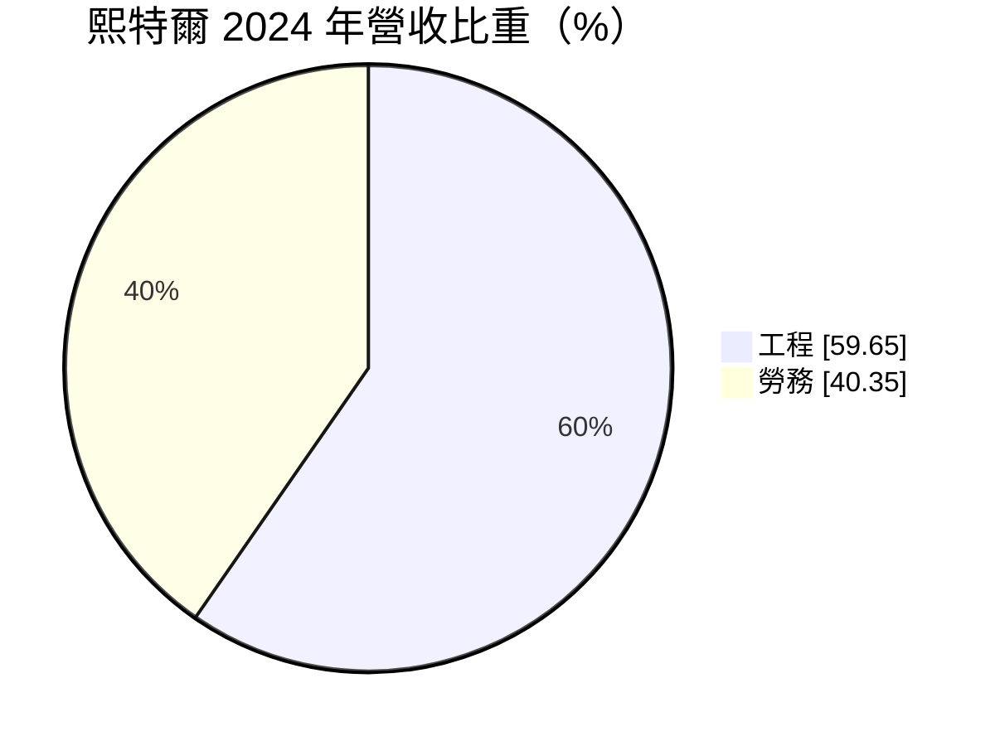
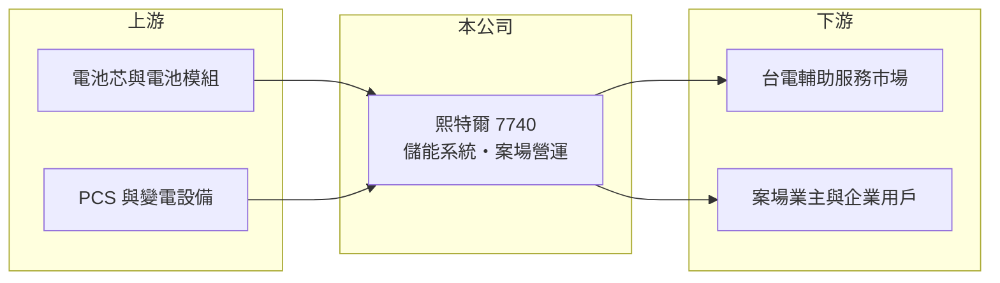

# 7740 熙特爾-創

> 創新板｜[[產業索引-綠能環保|綠能環保]]｜上市（櫃）日期 2025/06/16

# 第一章：企業模式與商業藍圖

> [!info] 撰寫說明
> 精簡版，由 Claude 依公開資料整理，架構比照 [[2330台積電]]，資料截至 2026-10-08。創新板／新掛牌，公開資料有限。來源：證交所開放資料快照（基本資料、2026 年第二季綜合損益與資產負債、每月營收、股利）、Goodinfo 年度經營績效、MoneyDJ 基本資料（2024 年營收比重）、科技新報 2024 年 10 月興櫃與 2025 年 4 月營收報導標題。2023 年 Goodinfo 數字前後不一致，表格以未查得處理。#待校對

熙特爾新能源（以下簡稱熙特爾）總部位於台北，2025 年 6 月登上[[創新板]]，是以[[儲能]]系統為核心的能源公司。本章說明它如何從工程與勞務收入，轉型為大規模儲能系統供應商。

- **核心業務：** 熙特爾提供儲能系統的規劃、建置與營運服務，客戶包括參與台電[[輔助服務]]市場的案場業主與企業用戶。公司同時持有並經營自有儲能案場，依 2024 年 10 月報導，擁有高雄兩座 100MW 的儲能案場。
- **營收結構：** 依 MoneyDJ 資料，2024 年工程收入占 59.65%、勞務收入占 40.35%。2025 年起營收結構大幅改變：2025 年 4 月報導指出其電池出貨量達 596MWh、3 月營收年增超過 18 倍，顯示電池模組與儲能系統銷售已成為最大收入來源。

- **營運據點：** 總部位於台北市松山區，儲能案場位於高雄等地。電池芯與系統的生產來源未查得。
- **長期方向：** 再生能源占比提高後，電網需要儲能平衡發電的不穩定，台灣與全球的儲能建置需求長期向上。熙特爾的策略是同時做「系統銷售」與「自有案場營運」，前者帶來營收規模，後者帶來長期穩定的電力服務收入。

# 第二章：護城河深度與競爭優勢

儲能產業成長快、進入者多，護城河仍在形成中。本章分析熙特爾的競爭位置。

- **競爭優勢：** 儲能案場需要電池系統整合、能源管理軟體、併網審查與長期維運能力，能完整交付並通過台電測試的業者有限。熙特爾自有案場的營運經驗，可以回饋到系統設計與後續標案，形成實績上的優勢。
- **主要對手：** 台股儲能與能源工程同業包括 [[1519華城]]、[[1513中興電]]、[[6806森崴能源]]、[[6869雲豹能源]]、[[6873泓德能源]]、[[6781AES-KY]] 等，國際上則有特斯拉、比亞迪、寧德時代等大型電池與系統供應商。價格競爭激烈是這個產業的常態。
- **觀察重點：** 2026 年上半年營收 72.7 億元，但[[毛利率]]只有 9.4%，代表目前以低毛利的硬體銷售為主。長期要看自有案場的電力服務收入比重能否提高，以及在電池價格下跌的環境下，能否維持獲利。

# 第三章：財務體質與盈利規模

資料日期：2026-10-08，表格是撰寫當時的快照；最新月營收、毛利率、累計 EPS 由自動排程寫在本筆記的屬性欄位（月營收、毛利率、累計EPS 等）。#待校對

熙特爾正處於營收爆發期，過去的年度數字與現在的規模差距極大，不能直接比較。

| 年度 | 營收（億元） | [[毛利率]] | [[營業利益率]] | EPS（元） | [[ROE]] |
|---|---|---|---|---|---|
| 2022 | 5.34 | 13.4% | 4.6% | 13.88 | 26.4% |
| 2023 | 0.94 | 未查得 | 未查得 | 未查得 | 未查得 |
| 2024 | 4.29 | 23.5% | -3.4% | -0.90 | -3.3% |
| 2025 | 42.2 | 15.5% | 8.3% | 4.90 | 25.1% |
| 2026 上半年 | 72.7 | 9.4% | 7.0% | 5.80 | 未查得 |

- **營收規模：** 營收從 2024 年 4.29 億元跳升到 2025 年 42.2 億元，2026 年上半年再達 72.7 億元；1 至 8 月累計 87.7 億元，較前一年同期成長約 14 倍。這種成長來自儲能系統大單出貨，屬於專案型收入，未來每年的營收可能隨標案起伏。2022 年 EPS 13.88 元是在股本很小時的數字，與現在不可比。
- **獲利：** 2026 年上半年營業利益 5.06 億元、稅後淨利 3.82 億元，EPS 5.80 元。營業利益率約 7%，在毛利率偏低的情況下靠規模撐起獲利。
- **財務特色：** 2026 年第二季底資產 68.9 億元，其中流動負債高達 45.2 億元，股東權益 18.0 億元，負債比約 74%。流動負債可能包含大量預收款、應付帳款與短期借款（推估），反映專案金額大、營運資金需求高。2025 年度配發現金 2.05 元與股票股利約 1.28 元。
- **[[ROIC]] 與 [[WACC]]：** 官方快照未拆分有息負債，以非流動負債 5.79 億元作為有息負債近似值，但流動負債中的短期借款未計入，因此 ROIC 會被高估。2026 年上半年營業利益年化約 10.1 億元，扣除 20% 稅後約 8.10 億元，除以股東權益加非流動負債 23.8 億元，ROIC 約 34%（推算，偏高估）。WACC 以 CAPM 推估：無風險利率 1.75%、市場風險溢酬 6%、β 假設 1.3（能源設備股推估值），權益成本約 9.6%；負債成本假設 2.5%、稅後 2.0%，負債占比約 24%，WACC 約 7.7%（推算）。即使把短期借款納入、ROIC 打折，目前仍可能高於 WACC，但專案型獲利能否延續，需要多年驗證。

# 第四章：總體風險與地緣政治

儲能產業同時受政策、電池價格與技術變化影響，本章整理熙特爾的長期風險。

- **產業週期：** 台電輔助服務市場的價格與容量需求會隨參與者增加而下降，早期高報酬的案場，後期報酬率可能回落；儲能標案集中釋出時營收大增，空窗期則可能大幅衰退。
- **營運風險：** 大型專案需要墊付大量營運資金，若客戶付款延遲或專案延宕，現金流壓力會很大。電池案場有火災等安全風險，一旦發生事故，可能面臨賠償與信譽損失。
- **其他風險：** 電池芯多仰賴中國等海外供應，關稅、貿易限制與原物料（鋰、磷酸鐵）價格都會影響成本；政府能源政策與電價制度的調整，也會改變儲能案場的收益結構。

# 專有名詞解析

## 金融

- **[[創新板]]**：臺灣證券交易所為新創與成長型企業設立的上市板塊，掛牌條件較寬，但初期限制一般投資人交易資格。

## 產業

- **[[儲能]]**：以電池等設備把電力儲存起來、需要時再釋放，用於平衡再生能源與電網供需。
- **[[輔助服務]]**：電網為維持頻率與穩定而向發電或儲能業者購買的調頻、備轉等服務。
- **[[EPC]]**：設計、採購、施工一次統包的工程模式，承包商負責交付可運轉的完整設施。

# 核心供應鏈

- 上游：電池芯與電池模組、電力轉換系統（PCS）、變壓器與能源管理軟體，屬於 [[EPC]] 統包時須整合的設備。
- 下游／客戶：台電輔助服務市場（自有案場）、儲能案場業主與企業用戶。
- 同業：[[1519華城]]、[[1513中興電]]、[[6806森崴能源]]、[[6869雲豹能源]]、[[6873泓德能源]]、[[6781AES-KY]]。

## 最新新聞
<!-- news:start（自動產生，請勿手動編輯此範圍） -->
- 2026-10-12 🏛️ 重訊 14:26｜本公司受邀參加寬量國際主辦之「20th QIC CEO Week」｜[觀測站](https://mops.twse.com.tw/mops/#/web/t05st01)
- 2026-10-08 🏛️ 重訊 15:20｜公告本公司115年第一次股東臨時會通過 解除新任董事競業禁止之限制案｜[觀測站](https://mops.twse.com.tw/mops/#/web/t05st01)
- 2026-10-08 🏛️ 重訊 15:18｜公告本公司115年第一次股東臨時會補選董事1席｜[觀測站](https://mops.twse.com.tw/mops/#/web/t05st01)
- 2026-10-08 🏛️ 重訊 15:17｜公告本公司115年第一次股東臨時會重要決議事項｜[觀測站](https://mops.twse.com.tw/mops/#/web/t05st01)

完整紀錄：[[7740熙特爾-創 新聞]]
<!-- news:end -->

## 相關連結
- [公開資訊觀測站](https://mopsov.twse.com.tw/mops/web/t05st03?step=1&firstin=1&co_id=7740)
- [Goodinfo](https://goodinfo.tw/tw/StockDetail.asp?STOCK_ID=7740)
- [Yahoo 股市](https://tw.stock.yahoo.com/quote/7740)
- [鉅亨網新聞](https://www.cnyes.com/twstock/7740/news)
