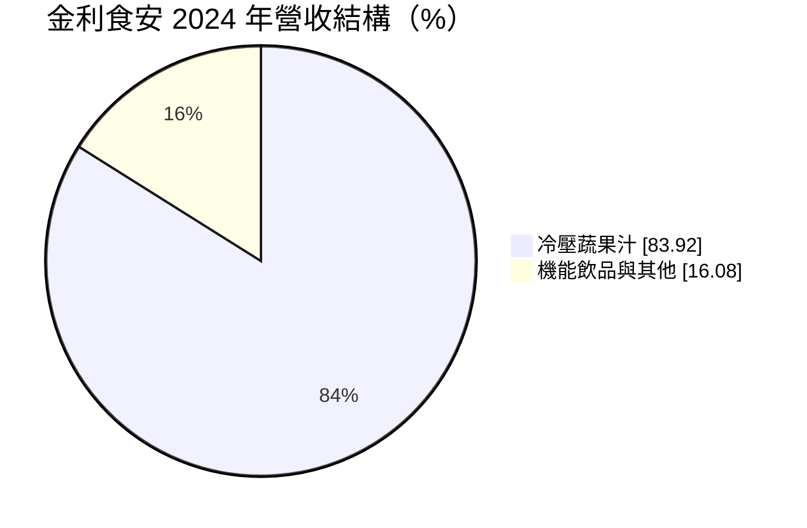
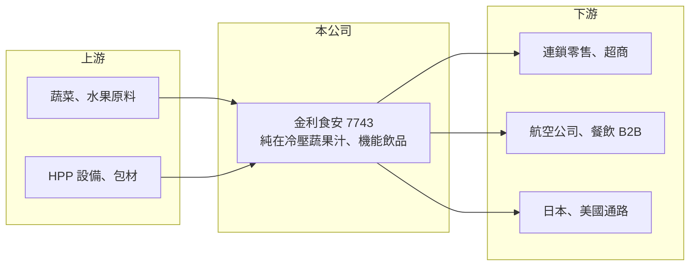

# 7743 金利食安

> 上櫃｜[[產業索引-食品工業|食品工業]]｜上市（櫃）日期 2025/05/20

# 第一章：企業模式與商業藍圖

> [!info] 撰寫說明
> 精簡版，由 Claude 依公開資料整理，架構比照 [[2330台積電]]，資料截至 2026-10-08。來源：櫃買中心開放資料快照（基本資料、2026 年上半年資產負債與綜合損益）、Goodinfo 歷年經營績效、食力 foodNEXT 上櫃前報導（2025 年）。公開資料有限，工廠位置與產能未查得。#待校對

金利食安是台灣冷壓蔬果汁的品牌與製造商，核心技術是以[[HPP]]高壓冷殺菌取代加熱殺菌，讓果汁保留新鮮風味，並從代工轉型為以自有品牌為主。

- **核心業務：** 公司成立於 2011 年，2025 年 5 月上櫃，主力產品是冷壓蔬果汁，另有鱸魚精、美容飲等機能飲品與冷萃咖啡茶飲。主要品牌包括「純在」（蔬果汁）、「品純萃」（機能飲品）與「CB LAB 冷萃實驗室」。
- **營收結構：** 依上櫃前資料，2024 年冷壓蔬果汁約占營收 83.92%，其餘為機能飲品等；自有品牌約占八成，代工約兩成。台灣內銷超過八成，外銷約一到兩成，主要銷往日本與美國。
- **營運據點：** 主要在台灣生產，通路涵蓋國內外連鎖零售、超商與長榮航空等企業客戶。冷壓果汁必須全程冷藏，保存期限短，因此國內冷鏈配送能力與通路上架關係是營運重點。
- **長期方向：** 公司規劃擴大 B2B 與餐飲通路、增加機能與即飲品項，並拓展歐美市場與投資原料供應鏈。上櫃取得的資金被定位為國際化的基礎，長期成長取決於海外通路能否複製台灣的品牌經驗。

# 第二章：護城河深度與競爭優勢

金利食安的護城河來自 HPP 設備與冷藏供應鏈的投資門檻，以及「純在」品牌在冷壓果汁這個利基市場的知名度。

- **競爭優勢：** HPP 設備價格高，加上需要從原料、製造到門市的完整冷鏈，一般飲料廠不容易跨入。冷壓果汁訴求無添加與新鮮，消費者重視品牌信任，先建立品牌與通路的業者有先行優勢。
- **轉型價值：** 從代工轉向自有品牌，代表公司能掌握定價與產品規劃，毛利率也比單純代工高。上櫃前五年營收約翻倍，說明品牌經營有一定成效。
- **主要對手：** 大型飲料與乳品集團如 [[1216統一]]、[[1201味全]]、[[1234黑松]] 的冷藏果汁產品，通路自有品牌，以及現打果汁店與進口冷壓果汁品牌。大型集團擁有更強的通路議價力，是長期最大的競爭壓力。
- **觀察重點：** 2025 年毛利率從約 33% 降到約 28.5%，營業利益率從約 9.7% 降到約 5.3%。長期要看品牌溢價能否抵銷原料與行銷成本，以及海外營收占比能否提高。

# 第三章：財務體質與盈利規模

資料日期：2026-10-08，表格是撰寫當時的快照；最新月營收、毛利率、累計 EPS 由自動排程寫在本筆記的屬性欄位（月營收、毛利率、累計EPS 等）。#待校對

金利食安的財務特色是營收穩定成長，但規模小、利潤率不高，上櫃後獲利反而下滑。

| 年度 | 營收（億元） | [[毛利率]] | [[營業利益率]] | EPS（元） | [[ROE]] |
|---|---|---|---|---|---|
| 2021 | 未查得 | 未查得 | 未查得 | 未查得 | 未查得 |
| 2022 | 5.06 | 35.8% | 9.21% | 1.36 | 9.49% |
| 2023 | 5.77 | 33.9% | 9.47% | 1.42 | 9.38% |
| 2024 | 6.42 | 33.3% | 9.69% | 1.85 | 11.3% |
| 2025 | 6.82 | 28.5% | 5.30% | 0.57 | 3.08% |
| 2026 上半年 | 3.65 | 27.7% | 6.93% | 0.62 | 未查得 |

資料來源：Goodinfo 歷年經營績效；2026 上半年取自櫃買中心開放資料。

- **營收規模：** 2022 至 2025 年營收從 5.06 億元成長到 6.82 億元，年複合成長率約 10.5%（推算）。2026 年上半年約 3.6 億元，略高於前一年的半年水準。
- **獲利：** 2022 至 2024 年營業利益率穩定在 9% 至 10%，2025 年降到約 5%，EPS 也從 1.85 元降到 0.57 元，股本因上櫃增資擴大也稀釋了每股盈餘。2022 至 2025 年平均 ROE 約 8.3%（推算）。
- **財務特色：** 2026 年第二季底權益總計約 7.5 億元，其中非控制權益約 1.0 億元；負債約 3.7 億元，非流動負債約 1.7 億元，可能與設備投資有關（推估）。配息資料未查得。
- **[[ROIC]] 與 [[WACC]]：** 有息負債未單獨查得，以約 2 億元推估。2025 年營業利益約 0.36 億元（6.82 億 × 5.3%），稅後約 0.29 億元，ROIC ≈ 0.29 ÷（7.5＋2）≈ 3.1%（推算）；2024 年營業利益約 0.62 億元，在上櫃前較小的資本基礎上推估 ROIC 約 8%。WACC 以無風險利率 1.75%、市場風險溢酬 6%、β 取小型食品股常見值 0.8，股東權益成本約 6.6%，稅後負債成本約 2%，權益占比約八成，WACC 約 5.6%（推算）。2025 年 ROIC 低於 WACC，代表上櫃募得的資金尚未轉化為足夠的營業利益，未來幾年的利潤率回升是檢驗重點。

# 第四章：總體風險與地緣政治

金利食安的風險集中在原料成本、冷鏈營運與通路議價力。

- **產業週期：** 蔬果原料受氣候、颱風與產季影響，價格波動大；冷壓果汁屬於較高單價的健康飲品，消費景氣轉弱時容易被替代。夏季是飲品旺季，營收有季節性。
- **營運風險：** 產品保存期限短，需求預測失準會產生報廢損失；冷鏈中斷會直接影響品質與品牌信任。通路集中在大型零售與超商，上架費與促銷要求會壓縮利潤。
- **其他風險：** 食品安全是品牌生命線，冷壓產品未經加熱，微生物控制要求更嚴格；外銷日本、美國與歐洲須符合各國食品法規；匯率與運費也影響外銷利潤。

# 專有名詞解析

## 金融

- **[[ROIC]]**：投入資本報酬率，稅後營業利益除以股東權益加有息負債，用來衡量公司運用所有資本的獲利能力。
- **[[WACC]]**：加權平均資金成本，股東權益成本與稅後負債成本依資本結構加權，ROIC 高於它才代表創造價值。

## 產業

- **[[HPP]]**：高壓加工（High Pressure Processing），以極高水壓殺菌而不加熱，可保留果汁的風味與營養，常用於冷壓果汁。
- **[[冷壓蔬果汁]]**：以壓榨而非高速攪打方式取汁、不經加熱殺菌的蔬果汁，必須冷藏保存。
- **[[冷鏈]]**：從工廠到門市全程維持冷藏或冷凍溫度的物流系統，是生鮮與冷凍食品能否穩定供貨的關鍵。

# 核心供應鏈

- 上游：國內外蔬果農產原料、HPP 設備與包材供應商。
- 下游／客戶：國內外連鎖零售與超商、長榮航空等企業客戶、日本與美國的進口通路。
- 同業：[[1216統一]]、[[1201味全]]、[[1234黑松]]（冷藏飲品）、[[1256鮮活果汁-KY]]（果汁原料）。

## 最新新聞
<!-- news:start -->
<!-- news:end -->

## 相關連結
- [公開資訊觀測站](https://mopsov.twse.com.tw/mops/web/t05st03?step=1&firstin=1&co_id=7743)
- [Goodinfo](https://goodinfo.tw/tw/StockDetail.asp?STOCK_ID=7743)
- [Yahoo 股市](https://tw.stock.yahoo.com/quote/7743)
- [鉅亨網新聞](https://www.cnyes.com/twstock/7743/news)
