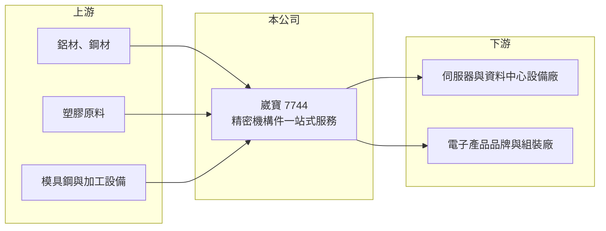

# 7744 崴寶

> 上櫃｜[[產業索引-電子零組件業|電子零組件業]]｜上市（櫃）日期 2025/11/27

# 第一章：企業模式與商業藍圖

> [!info] 撰寫說明
> 精簡版，由 Claude 依公開資料整理，架構比照 [[2330台積電]]，資料截至 2026-10-08。來源：櫃買中心開放資料快照（基本資料、2026 年第二季資產負債與損益、本益比殖利率）、Goodinfo 經營績效頁、nStock 公司簡介、科技新報與優分析報導標題。營收比重與客戶未查得，公開資料有限。#待校對

崴寶精密（以下簡稱崴寶）是一家做精密機構件的公司，從模具設計、塑膠射出、金屬沖壓、CNC 加工到組裝一條龍服務。理解它的關鍵在於：它把多種加工製程整合在同一個供應商裡，替客戶省去分別找模具廠、射出廠、沖壓廠的協調成本，並搭上 AI 與雲端資料中心對機構件的需求。

- **核心業務：** 公司登記成立於 2022 年，總部在台中西屯，2025 年 11 月在櫃買中心掛牌，實收資本額約 3.21 億元，董事長兼總經理為姚旭初。依 nStock 介紹，崴寶提供模具設計製造、塑膠射出、金屬沖壓、[[CNC]] 銑削與組裝，並結合開發、倉儲與貿易，屬於[[機構件]]的一站式供應商。
- **營收結構：** 產品別與客戶別比重未查得。依 2025 年 10 月上櫃前業績發表會的報導，公司受惠 AI 與雲端資料中心對精密機構件的強勁需求，推估伺服器相關機構件已是主要成長來源（比重待校對）。
- **營運據點：** 除台中總部外，在中國、美國與越南設有製造或業務據點。依 2025 年報導，越南二廠預計 2026 年第三季底投入量產，全產能開出後可望讓越南整體產能倍增。
- **長期方向：** 資料中心的機櫃、伺服器機殼與散熱模組都需要大量精密金屬與塑膠件，且規格隨功耗上升而越來越複雜。崴寶的長期方向是靠越南產能承接「中國以外」的訂單，並把一站式服務延伸到更高單價的伺服器與資料中心機構件。

# 第二章：護城河深度與競爭優勢

崴寶的護城河來自多製程整合能力與快速擴充的海外產能，屬於仍在成形中的窄護城河。

- **競爭優勢：** 機構件客戶在新產品開發階段最在意的是打樣速度與模具品質，能同時處理射出、沖壓與 CNC 的供應商可以縮短開發時程。崴寶 2022 至 2025 年毛利率穩定在 36% 至 40%，營業利益率約 20% 至 26%，明顯高於一般機殼與零件代工廠，顯示它在利基產品上有訂價能力。越南產能則是承接美系客戶訂單的重要條件。
- **主要對手：** 伺服器機構件同業包括 [[8210勤誠]]、[[3693營邦]]、[[2059川湖]]、[[3013晟銘電]]，以及 [[2354鴻準]]、[[2474可成]] 等大型金屬機構件廠。這些公司多數規模比崴寶大，崴寶的定位較偏向多樣、小量、高精度的零組件，而不是整台機殼或滑軌。
- **觀察重點：** 營收在三年內成長三倍以上，長期要確認高毛利能否在規模擴大後維持。若越南二廠量產後毛利率仍守住 35% 以上，代表一站式服務的溢價確實存在；若明顯下滑，則代表成長主要來自量而非技術。

# 第三章：財務體質與盈利規模

資料日期：2026-10-08，表格是撰寫當時的快照；最新月營收、毛利率、累計 EPS 由自動排程寫在本筆記的屬性欄位（月營收、毛利率、累計EPS 等）。#待校對

崴寶的財務呈現「高成長、高毛利、高 ROE」的特性，但掛牌時間短，長期紀錄有限。

| 年度 | 營收（億元） | [[毛利率]] | [[營業利益率]] | EPS（元） | [[ROE]] |
|---|---|---|---|---|---|
| 2022 | 7.14 | 36.7% | 20.2% | 未查得 | 48.9% |
| 2023 | 11.5 | 39.6% | 23.5% | 11.28 | 45.8% |
| 2024 | 14.8 | 39.6% | 19.6% | 10.72 | 30.5% |
| 2025 | 23.7 | 38.5% | 26.1% | 16.28 | 25.8% |
| 2026 上半年 | 20.0 | 37.1% | 26.7% | 13.46 | 未查得 |

（來源：Goodinfo 經營績效頁；2026 上半年依櫃買中心開放資料計算。Goodinfo 的 2022 年 EPS 24.32 元與當年淨利、股本不一致，故列未查得。）

- **營收規模：** 2022 至 2025 年營收由 7.14 億元增至 23.7 億元，三年年複合成長率約 49%（推算）。2026 年 1 至 9 月營收約 33.5 億元，年增約 94%，已明顯超過 2025 年全年。
- **獲利：** 2022 至 2025 年平均 ROE 約 37.8%（推算），屬極高水準；ROE 逐年下降主要是 2025 年掛牌募資讓股東權益大增，而不是獲利能力變差。2026 年上半年 EPS 13.46 元，營業利益率 26.7%。
- **財務特色：** 2026 年第二季總資產約 41.2 億元、權益約 27.1 億元、負債約 14.1 億元，非流動負債不到 1 億元，權益比約 66%。最近一次現金股利每股 7 元，約為 2025 年 EPS 16.28 元的 43%（推算），保留較多盈餘支應越南擴廠。自由現金流在擴產期可能偏低，未查得。
- **[[ROIC]] 與 [[WACC]]：** 以 2025 年營業利益約 6.19 億元（23.7 億元 × 26.1%）、稅率 20% 計算，稅後營業利益約 4.95 億元。有息負債未查得，投入資本以權益 27.1 億元到總資產 41.2 億元為區間，ROIC 約 12.0% 至 18.3%（推算）；2026 年上半年年化約 20.7% 至 31.5%（推算）。WACC 以 CAPM 推估：無風險利率 1.75%、市場風險溢酬 6%、β 假設 1.3（新掛牌、題材性高的中小型股），權益成本約 9.6%；負債比重假設一成、稅後成本 2%，WACC 約 8.8%（推算）。ROIC 明顯高於 WACC，代表崴寶目前正大幅創造經濟價值，關鍵在於擴產後能否維持。

# 第四章：總體風險與地緣政治

崴寶的風險集中在客戶與終端應用集中、快速擴產的執行，以及 AI 資本支出循環。

- **產業週期：** 營收成長高度依賴雲端業者與 AI 資料中心的資本支出。一旦雲端業者放緩採購，伺服器機構件訂單會快速下修，前幾年的高成長也可能反轉。
- **營運風險：** 三年內營收成長三倍，管理、品質與人才都要同步擴充，越南二廠若量產良率不佳，會拖累毛利率。客戶名單未查得，若營收集中在少數美系客戶，轉單或客戶自行垂直整合都會造成明顯衝擊（待校對）。依 nStock 的公告紀錄，2026 年曾發生資訊安全事件，顯示營運擴張中的內控也需要觀察。
- **其他風險：** 鋁、鋼材與塑膠粒價格波動會影響成本；美國關稅政策可能改變中國、越南產地的成本優勢。產品多以美元計價，有匯率風險。

# 專有名詞解析

## 應用

- **[[AI 伺服器]]**：搭載 GPU 或 ASIC 加速器、用於訓練與推論 AI 模型的伺服器，功耗與散熱需求遠高於一般伺服器。

## 產業

- **[[機構件]]**：電子產品中負責支撐、固定、保護與散熱的金屬或塑膠零件，例如機殼、支架、滑軌與散熱片。
- **[[CNC]]**：電腦數值控制加工，用程式控制刀具對金屬或塑膠進行高精度切削，適合小量、高精度零件。

# 核心供應鏈

- 上游：鋁材、鋼材、塑膠原料與模具鋼，以及 CNC 等加工設備（實際供應商未查得，#待校對）。
- 下游／客戶：伺服器與資料中心設備廠，例如 [[2382廣達]]、[[6669緯穎]]、[[2317鴻海]] 所在的產業；是否為崴寶客戶未查得，#待校對。
- 同業：[[8210勤誠]]、[[3693營邦]]、[[2059川湖]]、[[3013晟銘電]]、[[2354鴻準]]、[[2474可成]]。

## 最新新聞
<!-- news:start（自動產生，請勿手動編輯此範圍） -->
- 2026-10-12 📰 媒體 17:53｜營收速報 - 崴寶(7744)9月營收4.39億元年增率高達122.51％｜[鉅亨網](https://news.cnyes.com/news/id/6628292)

完整紀錄：[[7744崴寶 新聞]]
<!-- news:end -->

## 相關連結
- [公開資訊觀測站](https://mopsov.twse.com.tw/mops/web/t05st03?step=1&firstin=1&co_id=7744)
- [Goodinfo](https://goodinfo.tw/tw/StockDetail.asp?STOCK_ID=7744)
- [Yahoo 股市](https://tw.stock.yahoo.com/quote/7744)
- [鉅亨網新聞](https://www.cnyes.com/twstock/7744/news)
