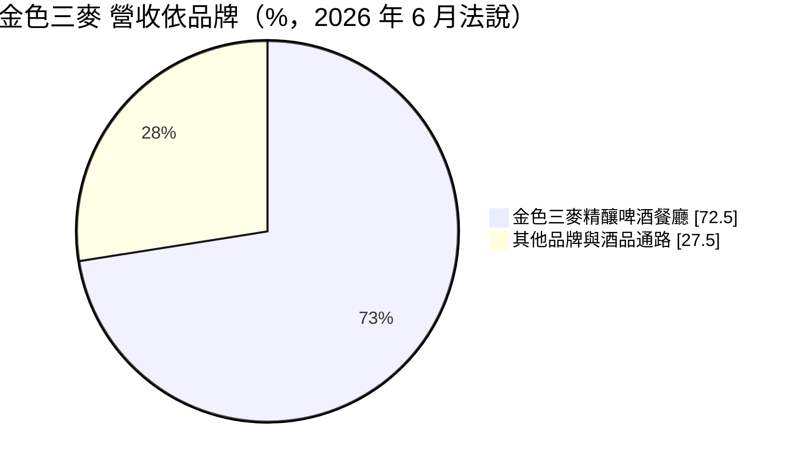
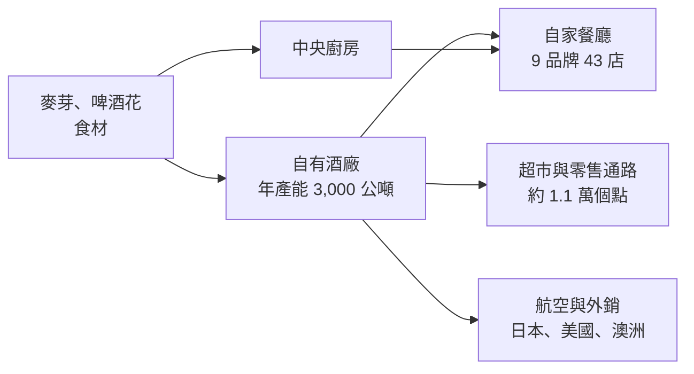
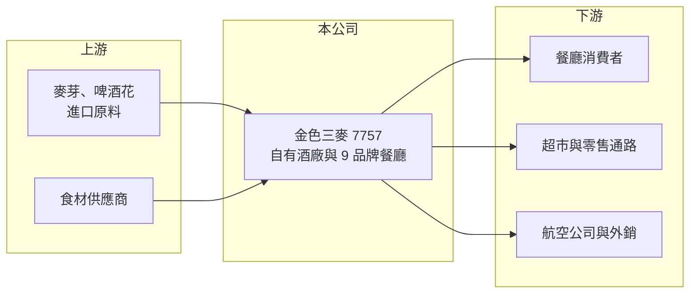

# 7757 金色三麥

> 上櫃｜[[產業索引-觀光餐旅|觀光餐旅]]｜上市（櫃）日期 2025/10/20

# 第一章：企業模式與商業藍圖

> [!info] 撰寫說明
> 精簡版，由 Claude 依公開資料整理，架構比照 [[2330台積電]] 的四章研究，資料截至 2026-10-08。來源：Goodinfo 年度經營績效頁、工商時報 2026 年 6 月上櫃業績發表會報導、櫃買中心開放資料（基本資料、2026 年第二季資產負債與綜合損益、每月營收、本益比殖利率）。品牌創立年份憑記憶整理，已標示待校對。#待校對

金色三麥是台灣少數同時經營連鎖餐廳與自有酒廠的公司，以[[精釀啤酒]]餐廳為核心。本章說明它「餐飲加酒品」雙引擎的商業模式。

## 一、核心定位：自釀啤酒帶動的主題餐廳

金色三麥餐飲股份有限公司成立於 2014 年，2025 年 10 月登錄上櫃，董事長為葉冠廷、總經理為葉淑芬，實收資本額 2.41 億元（櫃買中心開放資料）。金色三麥品牌創立於 2000 年代中期，從台北的精釀啤酒餐廳起家（創立年份待校對）。依 2026 年 6 月業績發表會，公司旗下共 9 個品牌、43 家門市，以西式、日式與無國界料理為主；其中「金色三麥」精釀啤酒餐廳有 21 家，貢獻約 72% 至 73% 營收（工商時報）。

## 二、商業模式：餐飲與酒品雙引擎

* **自有酒廠：** 年產能約 3,000 公噸，供應自家餐廳，也鋪貨到約 1.1 萬個超市與零售據點（工商時報）。在餐廳賣自家啤酒，等於把製造利潤與餐飲利潤都留在公司內，這是毛利率可以維持在 53% 至 56% 的主要原因。
* **酒品多角化：** 除了精釀啤酒，也有威士忌品牌「奔流」（約 3,000 個零售點）、華航機上供應的調酒，以及 2026 年預計進入超商的無酒精康普茶（工商時報）。

## 三、門市與展店節奏

公司規劃每年新增 3 至 5 家門市，重點放在提升單店獲利而不是快速擴張。新品牌「三麥茶樓」主打中式料理，鎖定 30 至 45 歲都會女性與上班族，客單價約 550 至 650 元，2026 年 7 月在台北開出首店，預計 2027 年下半年起擴大展店（工商時報）。精釀啤酒則在 2025 年外銷日本、美國與澳洲，但金額規模未查得。

# 第二章：護城河深度與競爭優勢

餐廳本身的進入門檻不高，但「自釀啤酒加餐廳」的組合需要酒廠執照、釀造技術與品牌經營。本章分析金色三麥的護城河。

## 一、護城河的核心組成要素

* **[[垂直整合]]的成本與差異化：** 自有酒廠讓公司的啤酒不必向酒商進貨，酒水毛利遠高於一般餐廳。顧客也是為了「現場喝到自家精釀」而來，這種體驗一般連鎖餐廳難以複製。
* **品牌與得獎紀錄：** 金色三麥的啤酒曾多次參加國際啤酒評比得獎（具體獎項待校對），品牌形象有助於零售通路鋪貨與外銷。
* **通路延伸：** 啤酒進入上萬個零售點，等於在餐廳以外持續替品牌打廣告，也讓收入不完全依賴門市來客。

## 二、主要競爭對手

| 對手 | 定位 | 對金色三麥的威脅 |
|---|---|---|
| 台灣菸酒（台啤） | 公營酒廠，啤酒市占最高 | 在零售通路價格與鋪貨上占絕對優勢 |
| 海尼根、百威等國際啤酒 | 進口與授權品牌 | 搶餐廳與超市的啤酒貨架 |
| [[2727王品]]、[[2729瓦城]] | 多品牌連鎖餐飲 | 在百貨與商場的聚餐客群競爭 |
| 啤酒頭、臺虎等精釀品牌 | 台灣精釀啤酒 | 在精釀啤酒品類直接競爭 |

## 三、守得住與守不住

* **守得住：** 「餐廳加自釀啤酒」的聚餐場景與品牌辨識度，以及酒廠帶來的高毛利。
* **守不住：** 新品牌的成功率。主力品牌貢獻超過七成營收，其他品牌規模仍小，三麥茶樓等新品牌能否複製成功仍待驗證。
* **觀察重點：** 單店獲利能否維持、酒品零售與外銷的占比能否提高，以及三麥茶樓的展店速度。

# 第三章：財務體質與盈利規模

資料日期：2026-10-08，表格是撰寫當時的快照；最新月營收、毛利率、累計 EPS 由自動排程寫在本筆記的屬性欄位（月營收、毛利率、累計EPS 等）。#待校對

本章用多年度數據檢視金色三麥的成長、獲利與資本報酬。

## 一、多年度三率與 ROE

| 年度 | 營收（新台幣） | [[毛利率]] | [[營業利益率]] | EPS（元） | [[ROE]] |
|---|---|---|---|---|---|
| 2022 | 15.0 億 | 54.9% | 9.45% | 5.62 | 19.0% |
| 2023 | 19.5 億 | 56.2% | 14.3% | 10.54 | 32.0% |
| 2024 | 22.0 億 | 55.3% | 12.4% | 10.01 | 26.8% |
| 2025 | 23.0 億 | 54.8% | 10.9% | 8.97 | 20.5% |
| 2026 上半年 | 11.4 億 | 54.5% | 8.8% | 3.23 | 未查得 |

註：2022 至 2025 年取自 Goodinfo；2026 上半年依櫃買中心綜合損益計算。2022 年以前未查得。

* **成長放緩：** 2022 至 2025 年營收年複合成長率約 15%（推算），但 2022 年仍有疫情低基期，2024 年後成長明顯放緩。2026 年 1 至 8 月累計營收約 15.5 億元、年增約 2.6%（櫃買中心每月營收）。
* **毛利高、營益率回落：** 毛利率穩定在 55% 上下，是連鎖餐飲中偏高的水準；營業利益率則從 2023 年的 14.3% 降到 2026 年上半年的 8.8%，反映人事與租金成本上升。
* **高 ROE：** 2022 至 2025 年平均 ROE 約 24.6%（推算），屬於高資本效率的餐飲公司。

## 二、股利與財務結構

2025 年度每股配發現金股利 7.75 元（櫃買中心本益比殖利率資料），以 EPS 8.97 元計算配發率約 86%（推算）。2026 年第二季底總資產約 20.4 億元、總負債約 10.3 億元、權益約 10.1 億元，資本公積約 5.4 億元主要來自上櫃前後的現金增資（櫃買中心資產負債）。負債以門市[[租賃負債]]與應付款為主（推估），銀行借款未查得。

## 三、[[ROIC]] 與 [[WACC]]

**ROIC 推算：** 2025 年營業利益約 23.0 億 × 10.9% ≈ 2.51 億元，以 20% 稅率計算稅後約 2.0 億元。以權益約 10.1 億元作為投入資本，ROIC 約 20%；若把租賃負債約 3 億元（推估）計入，ROIC 約 15%（推算）。

**WACC 推算：** 台灣 10 年期公債 1.75%、市場風險溢酬 6%、β 取餐飲同業常見值 0.6，權益成本約 5.4%；負債比重低，WACC 約 5% 至 5.5%（推算）。

**結論：** ROIC 約為 WACC 的三倍，代表餐廳與酒廠垂直整合的模式能持續創造價值。高配息加上每年 3 至 5 家的穩健展店，顯示營業現金流足以同時支應股利與擴張；但營業利益率若持續下滑，利差也會跟著縮小。

# 第四章：總體風險與地緣政治

本章整理金色三麥長期面對的法規、成本與經營風險。

## 一、法規與社會風險

* **酒類法規：** 菸酒稅、酒類廣告規範與酒駕管制趨嚴，會影響酒品銷售與餐廳的飲酒消費。年輕世代飲酒量下降也是長期趨勢。
* **食安與酒廠品質：** 酒廠與[[中央廚房]]同時供應所有門市，品質事件會同時衝擊餐廳與零售通路。

## 二、成本與營運

* **原料進口：** 麥芽與啤酒花多仰賴進口，國際穀物價格與匯率會影響釀造成本。
* **人事與租金：** 大型主題餐廳坪數大、需要較多人力，基本工資與商場租金上漲會壓縮營業利益率。

## 三、其他風險

* **品牌集中：** 主力品牌占營收七成以上，品牌熱度下降時缺乏替代。
* **經營權與家族治理：** 公司由創辦家族經營，接班與資本配置習慣是長期觀察重點。

# 專有名詞解析

## 金融

- **[[租賃負債]]**：依 IFRS 16，企業把長期租約未來應付的租金折現後認列在資產負債表上的負債，連鎖餐飲與零售業金額通常很大。
- **[[ROIC]]**：投入資本報酬率，衡量企業用股東與債權人投入的資本，每年能產生多少稅後營業利益。
- **[[WACC]]**：加權平均資金成本，股東要求報酬與負債利息依資本結構加權後的平均值，是判斷是否創造價值的門檻。

## 產業

- **[[精釀啤酒]]**：由小型或獨立酒廠以少量、多樣化方式釀造的啤酒，強調風味與原料，與大型酒廠的量產啤酒區隔。
- **[[垂直整合]]**：企業同時經營供應鏈上下游多個環節，例如自己釀酒也自己開餐廳販售，以掌握成本與品質。
- **[[中央廚房]]**：連鎖餐飲集中採購、清洗、切配與預先調理食材的工廠，再配送到各門市，以統一品質並降低成本。

# 核心供應鏈

- 上游：進口麥芽與啤酒花、肉品與蔬菜等食材供應商。
- 下游／客戶：餐廳消費者、約 1.1 萬個超市與零售據點（具體通路名稱未查得）、機上供應調酒的 [[2610華航]]，以及日本、美國、澳洲外銷。
- 同業：[[2727王品]]、[[2729瓦城]]、[[7708全家餐飲]]、台灣菸酒、啤酒頭、臺虎精釀。

## 最新新聞
<!-- news:start -->
<!-- news:end -->

## 相關連結
- [公開資訊觀測站](https://mopsov.twse.com.tw/mops/web/t05st03?step=1&firstin=1&co_id=7757)
- [Goodinfo](https://goodinfo.tw/tw/StockDetail.asp?STOCK_ID=7757)
- [Yahoo 股市](https://tw.stock.yahoo.com/quote/7757)
- [鉅亨網新聞](https://www.cnyes.com/twstock/7757/news)
