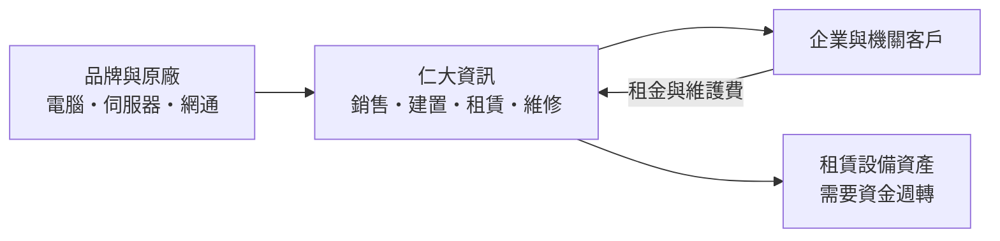
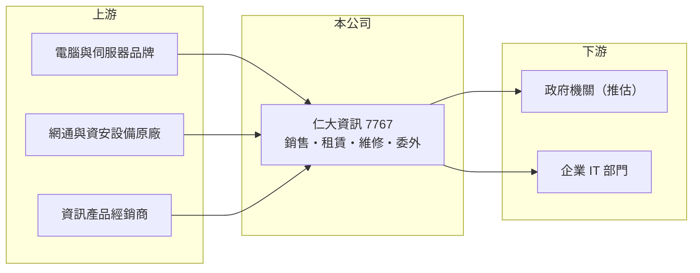

# 7767 仁大資訊

> 上櫃｜[[產業索引-資訊服務業|資訊服務業]]｜上市（櫃）日期 2025/12/10

# 第一章：企業模式與商業藍圖

> [!info] 撰寫說明
> 本文由 Claude 依公開資料整理，架構比照 [[2330台積電]] 的四章研究，資料截至 2026-10-08。財務數字來源：Goodinfo 年度經營績效頁、nStock 公司簡介、櫃買中心開放資料（基本資料、2026 年第二季資產負債與綜合損益、本益比殖利率）；營收比重、客戶產業與代理品牌未查得。公開資料有限。#待校對

仁大資訊（股票代號：7767，以下簡稱仁大）是一家以資訊產品銷售為主、搭配租賃、維修與委外專案的資訊服務商。本章說明這種「硬體通路加服務」的模式如何賺錢，以及它和純軟體公司的差別。

## 一、核心定位：企業與機關的資訊設備通路與服務商

仁大成立於 1999 年，主要營業項目為資訊產品的銷售、租賃及維修，以及委外專案設置與顧問。公司在 2020 年 12 月起由 [[5403中菲]]（中菲電腦）取得控制權，2023 年 6 月中菲陸續出售持股後喪失控制，仁大於 2024 年 10 月登錄興櫃、2025 年 12 月 10 日上櫃，承銷價每股 48 元，實收資本額約 3.01 億元。

和軟體代理商相比，仁大賣的主要是電腦、伺服器、網通與周邊設備，再加上建置、維修與租賃服務。這類生意的[[毛利率]]只有 11% 至 14%，但營收規模大，2025 年營收約 23.7 億元，是權益規模（約 9 億元）的兩倍半以上。

## 二、營收結構

公開資料未查得仁大的營收比重與客戶產業分布。依營業項目推估，收入可分為：

* **資訊產品銷售：** 硬體設備與軟體授權的轉售，是營收主體，毛利率最低。
* **租賃：** 以[[營業租賃]]方式出租電腦與設備，客戶按月付租金，屬於[[經常性收入]]，但需要先投入資金購買設備。
* **維修與委外服務：** 設備保固維護、駐點服務與委外專案，毛利率較高，也提高客戶黏著度。

公司過去曾由中菲電腦控股，中菲的主要客戶群為政府與金融機構，仁大的客戶結構可能也偏向公部門與大型企業（推估，待校對）。

## 三、資本轉化邏輯

* **以周轉賺錢：** 低毛利的設備銷售靠高周轉與規模維持獲利，營業費用必須控制得很緊，仁大的[[營業利益率]]約 4% 至 6%。
* **租賃需要資金：** 租賃業務要先買設備再分期回收，因此仁大的負債相對權益偏高，2026 年第二季底總負債約 21.8 億元、權益約 9.0 億元。

## 四、長期方向

2026 年 1 至 8 月營收約 22.49 億元、累計年增約 49%（nStock），顯示掛牌後業務擴張明顯。長期來看，企業與政府機關的資訊設備汰換、[[混合雲]]與資安建置，以及「租代買」的設備即服務趨勢，是這類通路服務商的需求來源。仁大能否提高租賃與服務的比重，決定它的利潤率能否往上走。

# 第二章：護城河深度與競爭優勢

資訊產品通路的護城河通常不深，差異化來自服務與客戶關係。本章分析仁大的競爭位置。

## 一、護城河的組成

* **服務與維修能力：** 對企業與機關而言，買設備容易、維護難。擁有在地維修團隊與駐點人員，能在合約期間持續服務客戶，是通路商與純電商、批發商最大的差別。
* **租賃帶來的黏著度：** 租賃合約期間通常數年，到期後客戶多半直接換新續租，讓仁大掌握汰換時點。
* **標案與實績：** 若客戶以政府與大型企業為主，投標需要過往實績與資格，具有一定的進入門檻（推估）。

## 二、主要競爭對手

| 對手 | 定位 | 與仁大的比較 |
|---|---|---|
| [[5403中菲]] | 政府與金融系統整合 | 前母公司，客戶群可能重疊 |
| [[2347聯強]]、[[6776展碁國際]] | 資訊產品通路與批發 | 規模大很多，偏向通路與經銷 |
| [[2453凌群]]、[[2480敦陽科]] | 系統整合 | 在企業與機關的建置案競爭 |
| [[8099大世科]] | 系統整合與維護 | 同為服務機關與企業的整合商 |

## 三、守得住與守不住

* **守得住：** 既有租賃與維護合約的續約，以及在地服務的客戶關係。
* **守不住：** 硬體轉售的毛利。標準化產品價格透明，客戶比價容易，毛利率很難提高。
* **觀察重點：** 2026 年營收大幅成長後，[[毛利率]]是否被稀釋；租賃與服務收入占比能否提高。

# 第三章：財務體質與盈利規模

資料日期：2026-10-08，表格是撰寫當時的快照；最新月營收、毛利率、累計 EPS 由自動排程寫在本筆記的屬性欄位（月營收、毛利率、累計EPS 等）。#待校對

通路服務商的財報重點在三件事：營收規模、費用控制，以及租賃資產帶來的資金需求。

## 一、多年度財務表

| 年度 | 營收（新台幣） | [[毛利率]] | [[營業利益率]] | EPS（元） | [[ROE]] |
|---|---|---|---|---|---|
| 2021 | 19.1 億 | 12.3% | 4.39% | 3.04 | 16.6% |
| 2022 | 19.8 億 | 10.9% | 4.36% | 3.09 | 16.0% |
| 2023 | 21.2 億 | 12.5% | 6.04% | 4.25 | 18.7% |
| 2024 | 24.4 億 | 12.1% | 5.44% | 4.42 | 16.9% |
| 2025 | 23.7 億 | 13.8% | 5.72% | 4.18 | 13.6% |
| 2026 上半年 | 16.41 億 | 12.1% | 5.3% | 2.29 | 未查得 |

資料來源：Goodinfo；2026 上半年為櫃買中心開放資料。2020 年以前資料未查得。

* **穩定成長：** 2021 至 2025 年營收年複合成長率約 5.5%（推算）；2026 上半年營收已達 2025 全年的七成。
* **費用紀律：** 毛利率只有一成多，但營業利益率維持在 4% 至 6%，代表營業費用率控制在 7% 至 8% 左右。
* **配息：** 2024 與 2025 年度各配發現金股利 3 元，以 EPS 約 4.2 至 4.4 元計算，配息率約七成（推算）。

## 二、ROE 與長期指標

2021 至 2025 年平均 ROE 約 16.4%（推算）。2025 年 ROE 降到 13.6%，主因是掛牌前後增資讓權益擴大。仁大的 ROE 有一部分來自財務槓桿：2026 年第二季底負債約為權益的 2.4 倍，雖然其中相當比例應是應付帳款與合約負債，但租賃業務也可能使用銀行借款（具體金額未查得）。

## 三、[[ROIC]] 與 [[WACC]]

**ROIC 推算：** 2025 年營業利益 1.35 億元，扣除 20% 稅率後約 1.08 億元。2026 年第二季底權益約 9.01 億元；有息負債未查得，假設約 0 至 8 億元（推估，考量租賃資產可能以借款支應），投入資本約 9 億至 17 億元，ROIC 約 6.4% 至 12%（推算）。

**WACC 推算：** 台灣 10 年期公債殖利率假設 1.75%、市場風險溢酬 6%、β 取資訊服務業常見值 0.8（同業估計值），股東權益成本約 6.55%；負債成本假設 2.5%、稅後 2.0%，權益占約 53% 至 100%，WACC 約 4.4% 至 6.5%（推算）。

**結論：** 在大多數假設下，仁大的 ROIC 高於 WACC，屬於創造價值的公司，但利差大小高度取決於有息負債的實際金額。讀者應以年報的借款明細確認投入資本，再判斷利差。

# 第四章：總體風險與地緣政治

通路服務商的風險多半來自價格競爭與資金週轉。本章整理仁大的長期風險。

## 一、產業週期

* **企業與機關 IT 預算：** 設備採購受景氣與政府預算影響，經濟放緩或預算刪減時，汰換可能延後。
* **PC 與伺服器換機週期：** 作業系統更新、AI PC 與資安需求會帶動換機潮，但換機潮過後需求可能回落。

## 二、營運風險

* **低毛利結構：** 毛利率只有一成多，原廠漲價、客戶殺價或專案成本超支，都可能吃掉大部分利潤。
* **租賃信用風險：** 租賃業務要承擔客戶違約與設備殘值下跌的風險。
* **快速擴張的管理：** 2026 年營收大幅成長，應收帳款、存貨與人力同步擴大，需要觀察現金流是否跟上。

## 三、其他風險

* **利率：** 若租賃資產以借款支應，利率上升會提高資金成本。
* **原廠政策：** 品牌原廠調整通路或直接銷售給大型客戶，會壓縮通路商的空間。
* **雲端化：** 企業把運算移到公有雲，地端設備的採購量可能長期下降，通路商需要轉向雲端代管與資安服務。

# 專有名詞解析

## 應用

- **[[混合雲]]**：同時使用企業自有機房與公有雲服務，依資料性質與成本分配運算資源的架構。

## 金融

- **[[毛利率]]**：營業毛利占營收的比例，反映產品定價能力與生產成本控制。
- **[[營業利益率]]**：扣除營業費用後的營業利益占營收的比例，衡量本業整體獲利能力。
- **[[ROE]]**：股東權益報酬率，稅後淨利除以股東權益，衡量公司運用股東資金的效率。
- **[[ROIC]]**：投入資本報酬率，稅後營業利益除以股東權益與有息負債的合計，衡量本業對所有資金提供者的報酬。
- **[[WACC]]**：加權平均資金成本，依股東權益與負債的比重加權計算的資金成本，ROIC 高於它才代表創造價值。

## 產業

- **[[系統整合]]**：把不同廠牌的硬體、軟體與網路設備整合成可運作的資訊系統，並負責建置與維護的服務。
- **[[營業租賃]]**：出租方保有設備所有權，承租方按期支付租金使用設備，期滿可歸還或續租的租賃方式。
- **[[經常性收入]]**：每年按合約重複收取的收入，例如維護費、租金，可預測性高於一次性銷售。

# 核心供應鏈

## 1. 上游：設備原廠與經銷
- 電腦與伺服器品牌：[[2353宏碁]]、[[2357華碩]] 等（實際代理品牌未查得）
- 資訊產品經銷：[[2347聯強]]、[[6776展碁國際]]

## 2. 中游：仁大與同業
- 前母公司：[[5403中菲]]
- 系統整合同業：[[2453凌群]]、[[2480敦陽科]]、[[8099大世科]]

## 3. 下游：客戶
- 政府機關與大型企業（客戶產業分布未查得）

## 最新新聞
<!-- news:start -->
<!-- news:end -->

## 相關連結
- [公開資訊觀測站](https://mopsov.twse.com.tw/mops/web/t05st03?step=1&firstin=1&co_id=7767)
- [Goodinfo](https://goodinfo.tw/tw/StockDetail.asp?STOCK_ID=7767)
- [Yahoo 股市](https://tw.stock.yahoo.com/quote/7767)
- [鉅亨網新聞](https://www.cnyes.com/twstock/7767/news)
