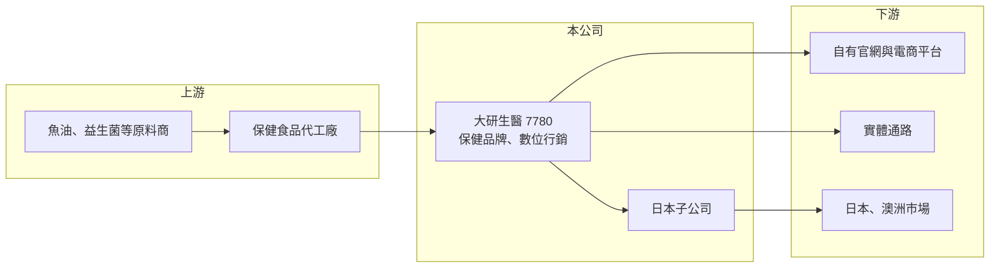

# 7780 大研生醫

> 上市｜[[產業索引-食品工業|食品工業]]｜上市（櫃）日期 2026/01/19

# 第一章：企業模式與商業藍圖

> [!info] 撰寫說明
> 精簡版，由 Claude 依公開資料整理，架構比照 [[2330台積電]]，資料截至 2026-10-08。來源：證交所開放資料快照（基本資料、2026 年上半年資產負債與綜合損益、股利）、Goodinfo 歷年經營績效、ETtoday 2025 年 8 月上市前報導、優分析與工商時報新聞標題。產品比重、生產方式未查得。#待校對

大研生醫是一家以數位行銷起家的保健食品品牌公司，成立不到十年就做到年營收近 20 億元，核心能力在於產品企劃與線上經營，而非製造。

- **核心業務：** 公司成立於 2018 年，2025 年 9 月上市，產品涵蓋三高保健（血壓、血脂、血糖）、護眼、益生菌等功能性保健食品，並有多種劑型。依上市前報導，其高濃度魚油的銷售市占率居冠。公司強調「安心、安全、有感」，最初是從替創辦人家人開發產品開始。
- **營收結構：** 產品別與通路別比重在這次查到的資料中未揭露。報導提到公司以數位化營運模式為主，並把「大電商」列為策略主軸之一，可以推估線上通路占比高（推估）。
- **營運據點：** 總部在台灣，2025 年上半年成立日本子公司並試營運，預計 2025 年下半年起貢獻營收；澳洲市場同步推進。報導未說明是否自有工廠，保健品牌公司通常委託代工廠生產（推估）。
- **長期方向：** 公司提出「七大戰略引擎」，包括大健康、電商、數據、AI、市場、併購與成長，目標成為亞洲的健康科技品牌。上市後計畫在日本與澳洲尋求併購，並以日本為基地發展跨境電商到東南亞。

# 第二章：護城河深度與競爭優勢

大研生醫的競爭力來自行銷與數據經營能力，以及魚油等明星產品累積的品牌聲量，屬於品牌型而非技術型的護城河。

- **競爭優勢：** 保健食品的同質性高，勝負常在於產品定位、廣告投放效率與回購率。大研生醫在短時間內做出高成長，代表其數位廣告、會員經營與新品推出速度具備優勢；毛利率長期維持在 60% 以上，顯示品牌有一定溢價。
- **輕資產模式：** 品牌公司把資金集中在行銷與通路，不需大量投資工廠，營收成長時資本需求低、現金回收快。代價是製造端掌握在代工廠手中，產品差異化必須靠配方、原料來源與品牌信任維持。
- **主要對手：** 國內有 [[1707葡萄王]]、[[8436大江]] 等兼具品牌與製造的保健公司，大型食品集團的保健品牌，以及大量電商新品牌與日系、美系進口品牌。電商平台的廣告費持續上漲，是所有品牌共同的成本壓力。
- **觀察重點：** 營業利益率在 11% 至 17% 之間擺動，說明行銷費用占營收比重高且會隨競爭調整。長期要看回購客戶的累積與海外市場能否降低對台灣電商廣告的依賴。

# 第三章：財務體質與盈利規模

資料日期：2026-10-08，表格是撰寫當時的快照；最新月營收、毛利率、累計 EPS 由自動排程寫在本筆記的屬性欄位（月營收、毛利率、累計EPS 等）。#待校對

大研生醫的財務特色是高成長、高毛利，上市後帳上現金充沛，但 EPS 因面額變更與增資而不能跨年直接比較。

| 年度 | 營收（億元） | [[毛利率]] | [[營業利益率]] | EPS（元） | [[ROE]] |
|---|---|---|---|---|---|
| 2021 | 未查得 | 未查得 | 未查得 | 未查得 | 未查得 |
| 2022 | 8.85 | 69.3% | 12.7% | 5.80 | 39.6% |
| 2023 | 11.9 | 68.4% | 17.1% | 10.32 | 67.6% |
| 2024 | 13.6 | 62.8% | 10.9% | 2.43 | 13.7% |
| 2025 | 19.0 | 63.6% | 15.2% | 0.51 | 10.0% |
| 2026 上半年 | 10.8 | 61.2% | 17.3% | 0.29 | 未查得 |

資料來源：Goodinfo 歷年經營績效；2026 上半年取自證交所開放資料。證交所資料顯示目前每股面額為 1 元，2025 年後的 EPS 以面額 1 元計，與先前年度不可直接比較；2024 年 EPS 大降可能與增資擴大股本有關（推估）。

- **營收規模：** 2022 至 2025 年營收從 8.85 億元成長到 19 億元，年複合成長率約 29%（推算）；上市前報導稱近五年營收年複合成長率達 88%。2026 年上半年約 10.8 億元，仍維持成長。
- **獲利：** 毛利率從約 69% 降到約 61% 至 64%，營業利益率則維持在 11% 至 17%。ROE 從 2023 年的 68% 降到 2025 年的 10%，主因是上市前後大幅增資，權益增加遠快於獲利。
- **財務特色：** 2026 年第二季底權益約 48.7 億元，流動資產約 59.9 億元，負債約 13.1 億元且幾乎都是流動負債，顯示帳上有大量上市募得的資金。公司在 2025 至 2026 年間有多次配息紀錄（證交所股利資料），配息政策細節待校對。
- **[[ROIC]] 與 [[WACC]]：** 2025 年營業利益約 2.89 億元（19 億 × 15.2%），稅後約 2.31 億元。若以全部權益 48.7 億元、有息負債視為零計算，ROIC ≈ 2.31 ÷ 48.7 ≈ 4.7%（推算）；但權益大部分是尚未投入營運的現金，若扣除現金，實際營運資本很小，本業 ROIC 遠高於 20%（推算）。WACC 以無風險利率 1.75%、市場風險溢酬 6%、β 取消費品牌成長股常見值 1.0，幾乎無負債，WACC 約 7.8%（推算）。本業本身創造價值的能力很強，但大量閒置現金拉低整體資本報酬，管理層如何運用這筆資金（併購、海外擴張或配息）將決定長期股東報酬。

# 第四章：總體風險與地緣政治

大研生醫的風險集中在行銷依賴、法規與併購執行。

- **產業週期：** 保健食品需求長期受人口老化支撐，但消費景氣轉弱時，非必需的保健支出會被縮減。電商促銷檔期集中，營收有季節性。
- **營運風險：** 成長高度依賴數位廣告，平台演算法改變或廣告成本上升會直接壓縮利潤；委外生產代表品質控管依賴代工廠，一次品質事件就可能重創品牌。
- **併購與海外風險：** 日本與澳洲的併購與擴張需要當地經營團隊與法規能力，若整合不順，可能出現商譽減損或虧損。
- **其他風險：** 保健食品的廣告與功效宣稱受台灣衛福部與各國法規嚴格規範，違規會遭罰款與下架；魚油等原料受國際漁獲與匯率影響；上市時間短，長期經營紀錄仍有限。

# 專有名詞解析

## 金融

- **[[ROIC]]**：投入資本報酬率，稅後營業利益除以股東權益加有息負債，用來衡量公司運用所有資本的獲利能力。
- **[[WACC]]**：加權平均資金成本，股東權益成本與稅後負債成本依資本結構加權，ROIC 高於它才代表創造價值。

## 產業

- **[[保健食品]]**：以補充特定營養或維持生理機能為訴求的食品，台灣通過審查者可標示「健康食品」標章。
- **[[輕資產模式]]**：品牌公司專注研發與行銷、把生產委外，資本支出低但對代工廠與通路依賴較高。

# 核心供應鏈

- 上游：國際魚油、益生菌等保健原料供應商，以及國內保健食品代工廠（具體廠商未查得）。
- 下游／客戶：一般消費者，透過自有官網、電商平台與實體通路購買；日本與澳洲市場由子公司開發。
- 同業：[[1707葡萄王]]、[[8436大江]]、[[3054立萬利]]（保健品牌事業）。

## 最新新聞
<!-- news:start -->
<!-- news:end -->

## 相關連結
- [公開資訊觀測站](https://mopsov.twse.com.tw/mops/web/t05st03?step=1&firstin=1&co_id=7780)
- [Goodinfo](https://goodinfo.tw/tw/StockDetail.asp?STOCK_ID=7780)
- [Yahoo 股市](https://tw.stock.yahoo.com/quote/7780)
- [鉅亨網新聞](https://www.cnyes.com/twstock/7780/news)
