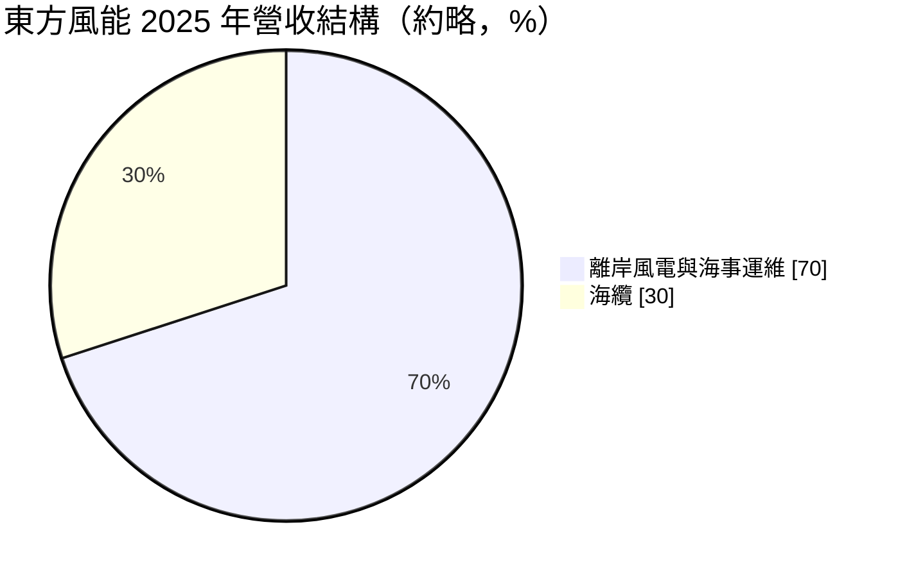
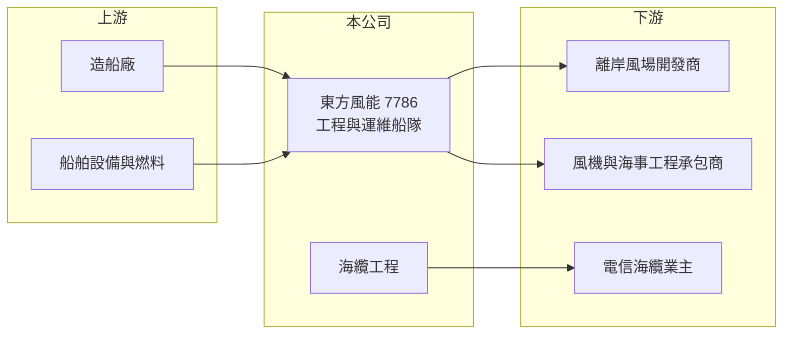

# 7786 東方風能

> 上市｜[[產業索引-綠能環保|綠能環保]]｜上市（櫃）日期 2025/11/18

# 第一章：企業模式與商業藍圖

> [!info] 撰寫說明
> 精簡版，由 Claude 依公開資料整理，架構比照 [[2330台積電]]，資料截至 2026-10-08。來源：Goodinfo 台灣股市資訊網年度經營績效（2021 至 2025 年）；優分析 UAnalyze 轉載 2025 年 10 月轉上市報導；證交所開放資料快照（基本資料、2026 年上半年資產負債、損益與營益分析、2025 年度股利）。主要風場客戶名單未查得。#待校對

東方風能科技成立於 2019 年 7 月、2025 年 11 月轉上市，總部在台中，董事長兼總經理為陳柏霖，實收資本額 17.6 億元。公司以自有船隊提供[[離岸風電]]的工程與運維服務，營收由 2021 年約 10 億元成長到 2025 年 105 億元，是台灣離岸風電國產化政策下成長最快的海事服務商之一。

- **核心業務：** 東方風能聚焦離岸風電、[[海纜]]、海事運維與油氣田四大領域，核心是把船舶以長期租約（保租）租給風場開發商與工程承包商，並承接海纜鋪設工程。風場從施工到 20 年以上的營運期都需要人員運輸、工程支援與維修船，這讓船隊收入具有長期、重複的性質。
- **營收結構：** 依 2025 年報導，離岸風電與海事運維合計約占 7 成，海纜約占 2 至 3 成。2025 年獲得中華電信台澎金馬四號通信海纜建置工程，總金額約 25.7 億元，預計 2026 年依完工比例認列。
- **營運據點：** 船隊共 18 艘，其中 14 艘營運中（7 艘人員運輸船、3 艘拖船，以及探勘船、重件駁船、重型工程支援船、海纜安裝船各 1 艘），另有 3 艘風場運維支援船與 1 艘重型工程支援船建造中，預計 2026 至 2027 年交付。新船單艘造價約 40 至 50 億元，船隊總造價超過 190 億元。
- **長期方向：** 公司保租期在手訂單約 160 至 200 億元，能見度延伸到 2042 年。長期目標是取得海纜統包工程，台灣以統包為主、國際以船舶租賃為主，並持續擴充運維船隊，跟上台灣離岸風電 [[區塊開發]]的長期建置。

# 第二章：護城河深度與競爭優勢

東方風能的護城河來自船隊本身與長約，海事工程船造價高、交期長，新進者很難在短期內複製。

- **競爭優勢：** 離岸風電專用船需要數十億元投資與兩三年建造期，且需熟悉台灣海峽的海況與在地法規的船員團隊。台灣政策要求風場提高國產化比例，本土船隊在投標上具優勢。長期保租合約把未來 15 年以上的收入先鎖定，降低了營運的不確定性。
- **主要對手：** 國際海事工程商如 DEME、Jan De Nul、Van Oord 等擁有大型安裝船；台灣有 [[2208台船]] 等造船與海事業者，以及其他本土工作船業者。東方風能以運維與工程支援船為主，不直接與大型安裝船正面競爭。
- **觀察重點：** 毛利率由 2022 年的 30.5% 降到 2025 年的 24.8%，營收規模擴大但單位利潤下滑，可能與工程類收入比重提高有關（推估）。長期要觀察新船交付後的租金水準、海纜統包能否取得，以及台灣風場建置進度。

# 第三章：財務體質與盈利規模

資料日期：2026-10-08，表格是撰寫當時的快照；最新月營收、毛利率、累計 EPS 由自動排程寫在本筆記的屬性欄位（月營收、毛利率、累計EPS 等）。#待校對

東方風能在 5 年內營收成長約 10 倍，營業利益率維持 20% 以上，ROE 長期在 20% 至 35%，屬高成長、高報酬的重資產公司。

| 年度 | 營收（億元） | [[毛利率]] | [[營業利益率]] | EPS（元） | [[ROE]] |
|---|---|---|---|---|---|
| 2021 | 10.3 | 22.2% | 19.8% | 未查得 | 17.6% |
| 2022 | 26.3 | 30.5% | 28.4% | 4.41 | 30.9% |
| 2023 | 50.1 | 29.0% | 26.2% | 7.07 | 34.6% |
| 2024 | 68.2 | 26.6% | 22.4% | 7.94 | 27.6% |
| 2025 | 105 | 24.8% | 21.9% | 11.11 | 23.5% |

註：Goodinfo 合併報表；2021 年 EPS 頁面數值異常，寫未查得。2026 年上半年營收 60.67 億元、毛利率 21.55%、營業利益率 18.74%、EPS 4.92 元（證交所資料）。

- **長期指標：** 2021 至 2025 年營收年複合成長率約 79%（推算），近 5 年平均 ROE 約 26.8%（推算）。2025 年度現金股利 5.6 元，配息率約 50%（5.6 ÷ 11.11），保留一半盈餘支應造船。在大量造船期間，自由現金流可能為負（推估，未查得現金流量資料）。
- **[[ROIC]] 與 [[WACC]]：** 2025 年營業利益約 23.0 億元（105 億元 × 21.9%），稅後約 18.4 億元；投入資本約 139 億元（2026 年第二季股東權益 97.32 億元，加上以非流動負債 41.93 億元推估的有息負債），ROIC 約 13%（推算）。WACC 約 6.0%（推算：無風險利率 1.75%、市場風險溢酬 6%、β 取海運與工程業常見值 1.0，股東權益成本 7.75%；稅前負債成本 2.5%、稅率 20%，負債占資本約 30%）。ROIC 明顯高於 WACC，代表船隊投資目前創造價值；新船陸續入帳後要看報酬能否維持。
- **財務特色：** 2026 年第二季總資產 191.8 億元，非流動資產 147 億元占 77%，負債比率約 49%。船舶以長期合約搭配銀行融資取得，是典型「先投資、後長期收租」的資產結構。

# 第四章：總體風險與地緣政治

東方風能的風險集中在單一產業政策與重資產擴張。

- **產業週期：** 營收高度依賴台灣離岸風電建置與運維，政策時程、風場開發商的融資與決策都會影響訂單。施工期與運維期需求不同，風場建置高峰過後，工程船的需求可能下降。
- **營運風險：** 新船造價高，若交付延誤或租約條件不如預期，折舊與利息負擔會壓縮獲利。海事作業受天候影響大，工安與船舶事故的成本高。
- **其他風險：** 國際海事業者進入台灣、國產化政策調整，都會改變競爭條件；利率上升提高融資成本；部分合約或設備以外幣計價，有匯率風險。

# 專有名詞解析

## 金融

- **[[ROIC]]**：投入資本報酬率，稅後營業利益除以股東權益加有息負債，衡量本業運用資本的效率。
- **[[WACC]]**：加權平均資金成本，股東與債權人要求報酬率的加權平均，是 ROIC 要超越的門檻。

## 產業

- **[[離岸風電]]**：在海上設置風力發電機，海事工程受天候與船隻調度影響大，工期與成本風險高。
- **[[海纜]]**：鋪設於海底的電纜或光纖電纜，用於離岸風場送電與國際通訊，鋪設需要專用船舶。
- **[[區塊開發]]**：台灣離岸風電第三階段的政策，分批釋出風場容量並要求一定比例國產化（時程細節待校對）。

# 核心供應鏈

- 上游：造船廠（含 [[2208台船]] 等國內外船廠，實際合作對象待校對）、船舶設備與燃料供應商。
- 下游／客戶：離岸風場開發商與風機、海事工程承包商（名單未查得）；中華電信海纜工程。
- 同業：國際海事工程商 DEME、Jan De Nul、Van Oord；國內風電供應鏈 [[9958世紀鋼]]、[[3708上緯投控]]。

## 最新新聞
<!-- news:start（自動產生，請勿手動編輯此範圍） -->
- 2026-10-19 📰 媒體 11:38｜〈焦點股〉東方風能高毛利船舶本季陸續交付 股價亮燈漲停｜[鉅亨網](https://news.cnyes.com/news/id/6633271)
- 2026-10-09 🏛️ 重訊 00:36｜本公司受邀參加寬量國際主辦之20th QIC CEO Week｜[觀測站](https://mops.twse.com.tw/mops/#/web/t05st01)

完整紀錄：[[7786東方風能 新聞]]
<!-- news:end -->

## 相關連結
- [公開資訊觀測站](https://mopsov.twse.com.tw/mops/web/t05st03?step=1&firstin=1&co_id=7786)
- [Goodinfo](https://goodinfo.tw/tw/StockDetail.asp?STOCK_ID=7786)
- [Yahoo 股市](https://tw.stock.yahoo.com/quote/7786)
- [鉅亨網新聞](https://www.cnyes.com/twstock/7786/news)
