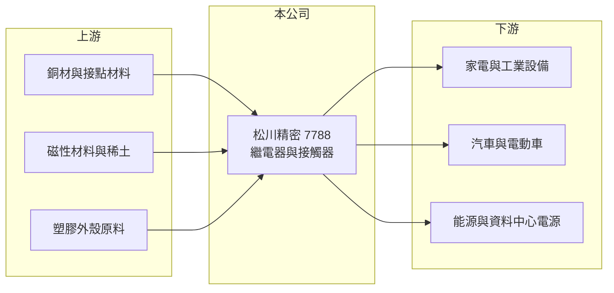

# 7788 松川精密

> 上市｜[[產業索引-電子零組件業|電子零組件業]]｜上市（櫃）日期 2025/10/16

# 第一章：企業模式與商業藍圖

> [!info] 撰寫說明
> 精簡版，由 Claude 依公開資料整理，架構比照 [[2330台積電]]，資料截至 2026-10-08。來源：證交所開放資料快照（基本資料、2026 年第二季資產負債與損益、股利、本益比殖利率）、Goodinfo 經營績效頁、nStock 公司簡介、優分析報導標題。應用別比重與產地細節依記憶整理，已標註待校對。#待校對

松川精密（以下簡稱松川）是台灣歷史悠久的[[繼電器]]製造商。理解它的關鍵在於：繼電器是用小電流控制大電流的「開關」，從家電、汽車到電動車充電、太陽能與資料中心電源都需要，產品單價不高但用量極大，長期競爭力取決於品質、認證與規模化的成本控制。

- **核心業務：** 松川成立於 1974 年，總部在新北市樹林，2025 年 10 月在證交所上市，實收資本額約 7.97 億元，董事長為王傳世、總經理為吳頌仁。依 nStock 的營業項目，公司從事繼電器、[[接觸器]]與電磁鐵等電子零件的研發、製造與銷售。
- **營收結構：** 產品別與應用別比重未查得。依記憶，松川的產品涵蓋家電與工業用電力繼電器、車用繼電器，以及電動車、太陽能與儲能使用的高壓直流繼電器（待校對）。依財經媒體報導標題，近年與 AI 資料中心電源相關的產品營收成長，推估與 [[HVDC]] 等高壓直流供電架構有關（待校對）。
- **營運據點：** 依優分析報導標題，松川已完成越南廠擴產，並對應稀土管制完成生產布局調整。依記憶，主要生產基地在中國與越南，台灣為研發與總部（待校對）。多國產能讓松川能因應關稅與供應鏈「去中國化」的要求。
- **長期方向：** 電氣化是繼電器產業最大的長期趨勢：電動車、充電樁、太陽能逆變器、儲能系統與資料中心直流供電，都需要耐高壓、大電流的繼電器與接觸器。松川的長期方向是把產品組合從家電與傳統車用，往這些高壓直流應用移動，提升單價與毛利。

# 第二章：護城河深度與競爭優勢

松川的護城河來自長年累積的認證、規模化製造與客戶關係，屬於窄護城河。

- **競爭優勢：** 繼電器用在安全相關的電力迴路上，要通過 UL、VDE 等安規認證，車用產品還要通過車廠驗證，客戶一旦採用，很少為了小幅降價而更換供應商。松川有超過五十年的製造經驗，毛利率長期穩定在 27% 至 28%，顯示在成本與品質上有一定優勢。多國產能則是面對關稅與地緣政治時的接單籌碼。
- **主要對手：** 全球繼電器市場由日本歐姆龍、松下、美國泰科電子（TE Connectivity）與中國宏發股份等大廠主導，其中宏發的規模與價格競爭力最強。台灣上市櫃中專做繼電器的同業不多，松川在台股屬於少數的純繼電器公司。
- **觀察重點：** 長期要追蹤高壓直流繼電器與資料中心相關產品的營收比重，以及毛利率能否從 27% 左右提升到 30% 以上。財經報導曾提到毛利率站上 30%，若能長期維持，代表產品組合升級確實發生。

# 第三章：財務體質與盈利規模

資料日期：2026-10-08，表格是撰寫當時的快照；最新月營收、毛利率、累計 EPS 由自動排程寫在本筆記的屬性欄位（月營收、毛利率、累計EPS 等）。#待校對

松川的財務特色是毛利率穩定、營業利益率隨景氣波動，2026 年營收與獲利明顯成長。

| 年度 | 營收（億元） | [[毛利率]] | [[營業利益率]] | EPS（元） | [[ROE]] |
|---|---|---|---|---|---|
| 2022 | 61.3 | 26.8% | 9.94% | 12.93 | 19.4% |
| 2023 | 54.8 | 27.9% | 6.31% | 6.17 | 10.4% |
| 2024 | 59.6 | 27.7% | 9.03% | 6.95 | 10.4% |
| 2025 | 64.3 | 27.0% | 7.26% | 3.63 | 4.94% |
| 2026 上半年 | 41.2 | 29.1% | 12.5% | 5.52 | 未查得 |

（來源：Goodinfo 經營績效頁；2026 上半年依證交所開放資料計算。2021 年以前資料未查得；各年 EPS 受上市前後股本變動影響，不可直接比較。）

- **營收規模：** 2022 至 2025 年營收在 55 至 64 億元之間，年複合成長率約 1.6%（推算），屬成熟型業務。2026 年 1 至 9 月營收約 68.5 億元，已超過 2025 年全年，成長幅度明顯。
- **獲利：** 2022 至 2025 年平均 ROE 約 11.3%（推算）。2025 年 ROE 降到 4.9%，一方面是獲利下滑，一方面是上市募資讓權益增加。2026 年上半年營業利益率約 12.5%、EPS 5.52 元，已超過 2025 年全年 EPS。
- **財務特色：** 2026 年第二季總資產約 133.6 億元、權益總計約 68.0 億元（含非控制權益約 5.5 億元）、負債約 65.6 億元，權益比約 51%。2025 年度擬發現金股利每股 2 元，約為當年 EPS 3.63 元的 55%（推算）。自由現金流是否長期為正未查得。
- **[[ROIC]] 與 [[WACC]]：** 以 2025 年營業利益約 4.67 億元（64.3 億元 × 7.26%）、稅率 20% 計算，稅後營業利益約 3.73 億元。有息負債未查得，投入資本以權益 68.0 億元到總資產 133.6 億元為區間，ROIC 約 2.8% 至 5.5%（推算）；2026 年上半年年化約 6.2% 至 12.2%（推算）。WACC 以 CAPM 推估：無風險利率 1.75%、市場風險溢酬 6%、β 假設 1.1（電子零組件常見值），權益成本約 8.4%；負債比重假設三成、稅後成本 2%，WACC 約 6.4%（推算）。2025 年 ROIC 低於 WACC，2026 年上半年已回到與 WACC 相當或略高，代表松川能否長期創造價值，取決於高壓直流產品帶來的利潤率提升能否持續。

# 第四章：總體風險與地緣政治

松川的風險來自景氣循環、原物料價格與國際大廠的價格競爭。

- **產業週期：** 繼電器需求跟著家電、汽車與工業設備的景氣走，2023 年營業利益率由 9.9% 降到 6.3% 就是例子。電動車、太陽能與儲能雖然是長期成長市場，但補貼政策與投資節奏變動大，短期需求波動明顯。
- **營運風險：** 中國同業以規模與低價擴張，可能壓縮一般型繼電器的價格。新產品線（高壓直流、資料中心應用）需要時間通過客戶驗證，若進度不如預期，產品組合升級會延後。越南擴產後的利用率與良率也是獲利關鍵。
- **其他風險：** 銅、銀等接點材料與電磁鐵所需的稀土磁材是主要原料，價格與供應受國際情勢影響；報導提到公司曾因應稀土管制調整生產。產品以外銷為主，匯率與美國關稅政策也會影響獲利。

# 專有名詞解析

## 應用

- **[[HVDC]]**：高壓直流供電，資料中心以較高的直流電壓直接供電給機櫃，可減少轉換損耗，需要耐高壓的開關元件。

## 產業

- **[[繼電器]]**：利用電磁鐵以小電流控制大電流開關的電子元件，廣泛用於家電、汽車、工業與能源設備。
- **[[接觸器]]**：用於大電流迴路的電磁開關，功能類似繼電器但承載電流更大，常見於工業馬達與能源系統。

# 核心供應鏈

- 上游：銅材、銀合金接點、磁性材料與塑膠原料（實際供應商未查得，#待校對）。
- 下游／客戶：家電與工業設備廠、汽車與電動車零組件廠，以及電源與能源設備廠，例如 [[2308台達電]]、[[2301光寶科]]、[[6409旭隼]] 所在的產業；是否為松川客戶未查得，#待校對。
- 同業：日本歐姆龍、松下，美國泰科電子，中國宏發股份。

## 最新新聞
<!-- news:start（自動產生，請勿手動編輯此範圍） -->
- 2026-10-21 🏛️ 重訊 15:41｜公告本公司董事會決議發行國內第一次無擔保轉換公司債｜[觀測站](https://mops.twse.com.tw/mops/#/web/t05st01)
- 2026-10-12 🏛️ 重訊 14:30｜更正115年8-9月背書保證資訊｜[觀測站](https://mops.twse.com.tw/mops/#/web/t05st01)
- 2026-10-07 🏛️ 重訊 16:26｜更正115年9月背書保證資訊｜[觀測站](https://mops.twse.com.tw/mops/#/web/t05st01)

完整紀錄：[[7788松川精密 新聞]]
<!-- news:end -->

## 相關連結
- [公開資訊觀測站](https://mopsov.twse.com.tw/mops/web/t05st03?step=1&firstin=1&co_id=7788)
- [Goodinfo](https://goodinfo.tw/tw/StockDetail.asp?STOCK_ID=7788)
- [Yahoo 股市](https://tw.stock.yahoo.com/quote/7788)
- [鉅亨網新聞](https://www.cnyes.com/twstock/7788/news)
