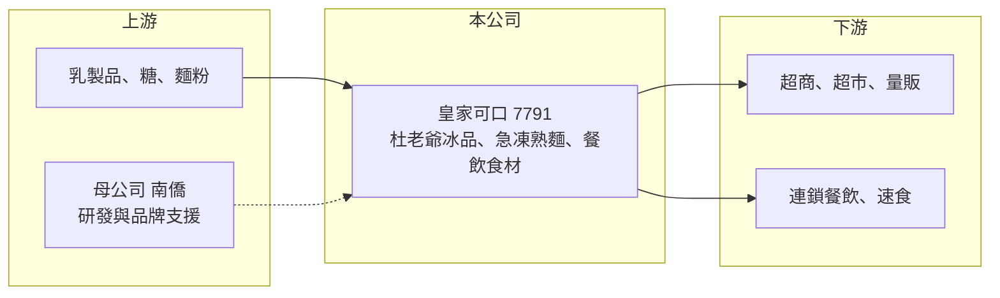

# 7791 皇家可口

> 上市｜[[產業索引-食品工業|食品工業]]｜上市（櫃）日期 2025/10/28

# 第一章：企業模式與商業藍圖

> [!info] 撰寫說明
> 精簡版，由 Claude 依公開資料整理，架構比照 [[2330台積電]]，資料截至 2026-10-08。來源：證交所開放資料快照（基本資料、2026 年上半年資產負債與綜合損益、股利）、Goodinfo 歷年經營績效、聯合新聞網 2025 年 11 月報導、優分析上市前新聞標題、HiStock 南僑整理文章（工廠資料）。產品營收比重未查得。#待校對

皇家可口是 [[1702南僑]] 集團旗下的冷凍食品公司，經營杜老爺冰淇淋與急凍熟麵兩大產品線，共用 -18°C 冷凍物流，把零售冰品與餐飲食材兩種市場結合在一起。

- **核心業務：** 公司成立於 1986 年，2025 年 10 月 28 日以每股 72 元上市。主要產品是「杜老爺」甜筒與冰棒、「曠世奇派」冰品，以及南僑讚岐等[[急凍熟麵]]。杜老爺與曠世奇派在台灣銷售約三十年，是成熟的冰品品牌。
- **營收結構：** 產品別比重在這次查到的資料中未揭露。冰品偏向零售通路與夏季旺季，急凍熟麵與奶昔、霜淇淋等則供應連鎖餐飲與速食業者，兩者在季節上可以互補。
- **營運據點：** 依南僑集團資料，冰淇淋在台南廠生產，冷凍麵在中壢廠生產（工廠歸屬待校對）。冰品與熟麵使用同一套冷凍車隊配送，能攤薄物流成本，這是同時經營兩條產品線的主要綜效。
- **長期方向：** 公司積極擴大餐飲通路，例如 2025 年替 [[2753八方雲集]] 旗下梁社漢排骨供應全台約 240 家門市的麵品，並為速食連鎖開發奶昔、為 [[5903全家]] 開發霜淇淋。長期成長來自把冷凍食材賣進更多連鎖餐飲，降低對夏季冰品的依賴。

# 第二章：護城河深度與競爭優勢

皇家可口的護城河是老品牌、冷凍物流與南僑集團的研發支援，三者結合讓它在冰品與連鎖餐飲食材上都有穩定的地位。

- **競爭優勢：** 冷凍食品必須全程維持低溫，自建冷凍物流的投資大、管理難，小型業者不易複製。皇家可口用同一套 -18°C 物流同時配送冰品與熟麵，單位配送成本較低，也能提供連鎖餐飲穩定的全台供貨。
- **品牌與研發：** 杜老爺是台灣消費者熟悉的冰品品牌，新口味推出容易獲得通路上架。南僑集團的油脂與烘焙研發經驗也支援冰品配方與麵品開發，替餐飲客戶客製化產品是黏著度的來源。
- **主要對手：** 冰品方面有 [[1216統一]]、[[1201味全]] 與進口冰淇淋品牌；冷凍麵與餐飲食材方面有各家冷凍食品廠，如 [[1215卜蜂]] 等食品集團的冷凍事業，以及日系冷凍麵進口商。冰品市場成熟、促銷多，價格競爭明顯。
- **觀察重點：** 毛利率在 2023 至 2025 年維持約 34% 至 36%，營業利益率從 2022 年的約 4% 提升到 2025 年的約 14%，顯示產品組合與效率改善。能否維持這個利潤率水準，是判斷護城河的關鍵。

# 第三章：財務體質與盈利規模

資料日期：2026-10-08，表格是撰寫當時的快照；最新月營收、毛利率、累計 EPS 由自動排程寫在本筆記的屬性欄位（月營收、毛利率、累計EPS 等）。#待校對

皇家可口的財務特色是營收規模持平、利潤率改善、幾乎沒有負債，並以高配息回饋股東。

| 年度 | 營收（億元） | [[毛利率]] | [[營業利益率]] | EPS（元） | [[ROE]] |
|---|---|---|---|---|---|
| 2021 | 未查得 | 未查得 | 未查得 | 未查得 | 未查得 |
| 2022 | 25.0 | 30.9% | 3.72% | 1.61 | 5.17% |
| 2023 | 30.3 | 35.5% | 10.5% | 3.66 | 11.4% |
| 2024 | 26.7 | 36.3% | 12.1% | 5.34 | 11.6% |
| 2025 | 25.8 | 34.5% | 13.7% | 5.61 | 11.9% |
| 2026 上半年 | 11.6 | 35.0% | 11.0% | 2.71 | 未查得 |

資料來源：Goodinfo 歷年經營績效；2026 上半年取自證交所開放資料。2023 年營收較高、2024 年回落的原因未查得。

- **營收規模：** 2022 至 2025 年營收在 25 億元至 30 億元之間，年複合成長率約 1%（推算），屬於成熟穩定的營收規模。2026 年上半年約 11.6 億元，冰品旺季集中在下半年的夏季月份。
- **獲利：** 營業利益率由約 4% 提升到約 14%，EPS 從 1.61 元成長到 5.61 元，獲利成長主要來自利潤率改善而非營收擴大。2026 年上半年 EPS 2.71 元低於前一年同期的 4.08 元，部分原因是上市增資擴大股本。2022 至 2025 年平均 ROE 約 10%（推算）。
- **配息：** 2025 年度現金股利 3.81 元，約為 EPS 的 68%，與報導所稱約七成的配息率一致，且公司每年配發現金股利。
- **[[ROIC]] 與 [[WACC]]：** 2026 年第二季底權益約 31.9 億元、負債約 6.2 億元，有息負債未單獨查得，以約 1 億元推估。2025 年營業利益約 3.53 億元（25.8 億 × 13.7%），稅後約 2.83 億元，ROIC ≈ 2.83 ÷（31.9＋1）≈ 8.6%（推算）。WACC 以無風險利率 1.75%、市場風險溢酬 6%、β 取食品業常見值 0.6，股東權益成本約 5.4%，幾乎無負債，WACC 約 5.3%（推算）。ROIC 高於 WACC 約 3 個百分點，代表公司在利潤率改善後能創造適度的超額價值；上市資金若投入餐飲通路擴張並維持利潤率，利差可望延續。

# 第四章：總體風險與地緣政治

皇家可口的風險在於季節性、原料成本與母公司關係。

- **產業週期：** 冰品銷售高度集中在夏季，天氣涼爽或多雨的年份會明顯影響營收；餐飲食材則受外食景氣與連鎖餐飲展店速度影響。
- **營運風險：** 乳製品、糖、麵粉與油脂價格上漲會壓縮毛利；冷凍物流與倉儲的用電與人力成本持續上升。大型連鎖餐飲客戶議價力強，單一客戶菜單調整會影響訂單。
- **公司治理：** 母公司南僑是主要股東，雙方在研發、品牌（如南僑讚岐）與可能的原料採購上有往來，關係人交易的條件與透明度是小股東需要留意的地方。
- **其他風險：** 食品安全事件對冰品與即食食材的品牌傷害很大；冰品市場成熟，進口品牌與通路自有品牌持續加入競爭。

# 專有名詞解析

## 金融

- **[[ROIC]]**：投入資本報酬率，稅後營業利益除以股東權益加有息負債，用來衡量公司運用所有資本的獲利能力。
- **[[WACC]]**：加權平均資金成本，股東權益成本與稅後負債成本依資本結構加權，ROIC 高於它才代表創造價值。
- **[[關係人交易]]**：公司與大股東、母公司或其關係企業之間的交易，需揭露條件以確保不損害小股東權益。

## 產業

- **[[急凍熟麵]]**：煮熟後急速冷凍的麵條，餐廳只需加熱即可出餐，可節省人力並維持品質一致。
- **[[冷鏈]]**：從工廠到門市全程維持冷藏或冷凍溫度的物流系統，是生鮮與冷凍食品能否穩定供貨的關鍵。

# 核心供應鏈

- 上游：乳製品、糖、麵粉、油脂等原料供應商；母公司 [[1702南僑]] 提供研發與品牌支援。
- 下游／客戶：[[5903全家]] 等超商與超市量販、[[2753八方雲集]] 旗下梁社漢排骨等連鎖餐飲與速食業者。
- 同業：[[1216統一]]、[[1201味全]]（冰品與冷藏食品）、[[1215卜蜂]]（冷凍食品）。

## 最新新聞
<!-- news:start -->
<!-- news:end -->

## 相關連結
- [公開資訊觀測站](https://mopsov.twse.com.tw/mops/web/t05st03?step=1&firstin=1&co_id=7791)
- [Goodinfo](https://goodinfo.tw/tw/StockDetail.asp?STOCK_ID=7791)
- [Yahoo 股市](https://tw.stock.yahoo.com/quote/7791)
- [鉅亨網新聞](https://www.cnyes.com/twstock/7791/news)
