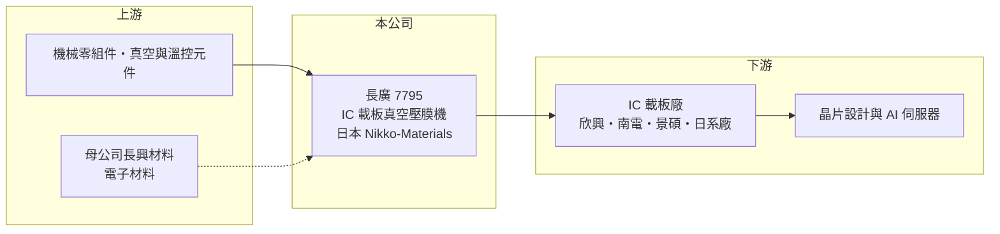

# 7795 長廣

> 上市｜[[產業索引-電子零組件業|電子零組件業]]｜上市（櫃）日期 2026/01/16

# 第一章：企業模式與商業藍圖

> [!info] 撰寫說明
> 精簡版，由 Claude 依公開資料整理，架構比照 [[2330台積電]] 的四章研究，資料截至 2026-10-08。來源：證交所開放資料（基本資料、2026 年第二季資產負債與綜合損益、股利、每月營收備註）、Goodinfo 經營績效頁（2021 至 2025 年度數字）、口袋學堂長廣精機介紹文（2026 年）、富果法說會整理與工商時報標題。公司 2026 年才上市，早年數字可能是重組前的追溯資料，公開資料有限。#待校對

長廣精機是一家「隱形冠軍」型的設備商：它做的機器不大、名氣也不高，卻是 AI 晶片所用高階[[IC載板]]製程中幾乎不可替代的一站。本章說明它的業務、集團背景與長期布局。

- **核心業務：** 長廣的主力產品是 IC 載板用的[[真空壓膜機]]，用途是在載板每一層線路之間，把 [[ABF]] 絕緣膜在真空與加熱條件下平整貼合、不留氣泡。載板層數越多、線路越細，壓膜的平整度要求越高；AI 伺服器晶片使用的 [[ABF載板]]動輒十多層，因此高階壓膜機是載板廠擴產時必買的關鍵設備。產品分為二段式與三段式壓膜機，三段式用於 12 層以上高階載板，毛利率較高。
- **集團背景與營收結構：** 公司登記成立於 2022 年 10 月、總部在高雄大寮，2026 年 1 月在證交所上市，母公司為 [[1717長興]]（持股約七成），[[6187萬潤]]與 [[3481群創]] 為策略股東。依介紹文，核心技術研發與高階組裝由日本子公司 Nikko-Materials 負責，貢獻逾八成營收；中國廣州據點負責中低階設備銷售，台灣則是集團營運樞紐。產品別營收比重未查得。長廣成立時間短，是為整合長興集團壓膜設備事業而設立的控股架構（推估），實際的設備技術與客戶關係累積遠早於 2022 年。
- **營收認列特性：** 長廣賣的是單價高、交機與驗收時間不固定的設備，營收以「機台驗收完成」認列，每月營收備註也多以認列機台數量說明變化。因此單月或單季營收波動很大，評估時應看全年或多年平均。
- **長期方向：** 依 2026 年的報導，公司正開發[[玻璃基板]]與晶圓級的真空壓膜設備，並推出針對低流動性 ABF 材料的新世代 90 噸壓膜機。這些布局的意義在於：當先進封裝從有機載板延伸到玻璃核心與晶圓級製程時，長廣希望把在載板壓膜累積的技術複製到下一代封裝材料上。

# 第二章：護城河深度與競爭優勢

設備商的護城河通常來自「被寫進客戶量產製程」。長廣在 IC 載板真空壓膜這個利基市場的地位，正是這種護城河的典型例子。

- **競爭優勢：** 依介紹文，長廣在 IC 載板真空壓膜設備的全球市占率超過 95%（待校對），並是多家一線載板廠量產線的指定供應商。載板廠的製程參數是圍繞特定設備調校出來的，換一家設備商就要重新驗證良率，風險與時間成本極高，所以既有供應商的地位非常穩固。長年維持 44% 以上的[[毛利率]]，也反映了這種近乎寡占的定價能力。
- **與母公司的綜效：** 母公司長興材料本身生產電子材料（包括乾膜光阻等），對膜材與壓合製程有深厚理解，設備與材料兩端的知識可以互相支援（推估）。策略股東萬潤是半導體設備廠、群創則在發展面板級封裝，都可能是長廣切入新封裝製程的合作夥伴。
- **主要對手：** 台灣的 [[2467志聖]]也做壓膜設備，但以印刷電路板乾膜壓膜與先進封裝其他製程為主，與長廣的高階載板真空壓膜客群區隔明確。日本也有壓膜設備商（名稱未查得）。真正的長期威脅不是現有對手，而是封裝技術改變後壓膜製程的重要性下降，或中國設備商以低價切入中低階市場。
- **觀察重點：** 長期應觀察三點：玻璃基板與晶圓級壓膜設備能否取得量產訂單；新世代設備能否支撐毛利率維持在 40% 以上；以及營收對少數載板大廠擴產計畫的依賴程度。

# 第三章：財務體質與盈利規模

資料日期：2026-10-08，表格是撰寫當時的快照；最新月營收、毛利率、累計 EPS 由自動排程寫在本筆記的屬性欄位（月營收、毛利率、累計EPS 等）。#待校對

長廣的財務是典型的「資本設備週期」：載板廠大舉擴產的年份營收與獲利暴增，擴產停頓時則明顯回落。本章用多年度數字檢視這個週期。

| 年度 | 營收（億元） | [[毛利率]] | [[營業利益率]] | EPS（元） | [[ROE]] |
|---|---|---|---|---|---|
| 2021 | 29.6 | 46.8% | 31.4% | 9.82 | 28.0% |
| 2022 | 38.8 | 49.0% | 32.8% | 17.33 | 67.1% |
| 2023 | 23.6 | 44.8% | 23.6% | 5.66 | 25.0% |
| 2024 | 22.3 | 44.6% | 25.2% | 4.22 | 19.2% |
| 2025 | 19.0 | 44.8% | 21.5% | 3.11 | 13.8% |
| 2026 上半年 | 8.90 | 41.5% | 15.6% | 0.88 | 未查得 |

- **營收規模與週期：** 2022 年是 ABF 載板缺貨、載板廠全面擴產的高峰，營收達 38.8 億元；之後載板產業進入庫存調整，2025 年降到 19.0 億元，2021 至 2025 年營收年複合成長率約負 10.5%（推算）。2026 年起 AI 伺服器帶動高階載板再度擴產，月營收年增幅明顯擴大，但設備交機有時間落差，獲利反映會晚於訂單。早年數字可能是上市前的追溯資料，且當時股本較小，EPS 與 ROE 不宜直接與上市後比較（待校對）。
- **獲利：** 毛利率在景氣高低點之間只在 41% 至 49% 擺動，代表產品定價能力穩定，獲利波動主要來自營收規模與固定費用的槓桿。2026 年上半年稅前淨利 1.46 億元，但所得稅費用 0.77 億元、有效稅率超過五成，稅後淨利僅 0.69 億元（證交所 2026 年第二季累計財報）；稅率異常偏高的原因未查得，可能與日本子公司稅負或盈餘匯回有關（推估），需留意是否為一次性。
- **財務特色：** 上市募資後，2026 年第二季底股東權益 28.4 億元（其中資本公積約 19.0 億元）、總負債 11.7 億元，流動資產 36.7 億元占總資產九成以上，屬於「輕資產、高現金」的設備商結構。2025 年度每股配發現金股利 2.15 元，約為當年 EPS 的七成，公司章程規定股東股利不低於可分配盈餘的 30%。
- **[[ROIC]] 與 [[WACC]]：** 以 2025 年營業利益約 4.1 億元（19.0 億 × 21.5%）、稅率 20% 計，稅後營業利益約 3.3 億元；投入資本以 2026 年第二季股東權益 28.4 億元加非流動負債 3.3 億元（有息負債明細未查得，以此近似）約 31.7 億元計，ROIC 約 10%（推算）。由於權益中含大量上市募得現金，若扣除超額現金，營運資產的實際報酬會明顯更高（推估）。2026 年上半年年化約 7%（推算）。WACC 以 CAPM 推估：無風險利率 1.75%、市場風險溢酬 6%、β 假設 1.2（半導體設備股常見值，非來源數字），股權成本約 9%；公司負債多為營運負債、有息負債很少，WACC 約 8.5% 至 9%（推算）。結論是長廣在載板擴產期 ROIC 遠高於 WACC，低谷期利差縮小；上市後帳上現金大增，未來能否把資金投入新設備開發並維持高報酬，是資本配置的關鍵觀察。

# 第四章：總體風險與地緣政治

利基設備商的風險通常不在競爭，而在「客戶什麼時候擴產」與「技術路線會不會改變」。本章整理長廣的長期風險。

- **產業週期：** 長廣的營收直接取決於 IC 載板廠的資本支出，而載板產業的擴產極度集中在景氣高峰，2022 年高峰到 2025 年低谷營收腰斬就是例證。AI 帶動的新一輪擴產雖然強勁，但只要雲端業者放緩 AI 投資，載板廠就會延後設備採購。
- **營運風險：** 客戶集中於少數全球載板大廠，單一客戶延後擴產影響很大。設備以驗收認列營收，交機延遲會造成季度營收大幅波動。核心技術與生產集中在日本子公司，日本的人力與供應鏈狀況也會影響交機能力。
- **技術風險：** 封裝技術若轉向玻璃基板、面板級封裝或其他不需傳統 ABF 壓膜的方式，現有產品的需求可能下降；長廣正以玻璃基板與晶圓級設備因應，但新產品能否成功仍待驗證。
- **其他風險：** 日圓與新台幣匯率變動會影響日本子公司的成本與合併營收；中國據點面臨中美科技管制與中國本土設備廠的價格競爭；母公司持股高，公司治理與關係人交易也是投資人應持續留意的面向。

# 專有名詞解析

## 半導體

- **[[IC載板]]**：承載晶片並連接晶片與電路板的多層基板，是晶片封裝的關鍵材料。
- **[[ABF]]**：味之素增層膜，是高階 IC 載板層與層之間使用的絕緣材料。
- **[[ABF載板]]**：以 ABF 為絕緣層的高階 IC 載板，用於 CPU、GPU 與 AI 加速器等高效能晶片。
- **[[真空壓膜機]]**：在真空與加熱環境下把絕緣膜平整壓合到基板上的設備，避免氣泡與厚度不均。
- **[[玻璃基板]]**：以玻璃取代有機材料作為載板核心，平整度與耐熱性較佳，被視為下一代先進封裝材料。

# 核心供應鏈

- 上游：機械加工件、真空幫浦、加熱與溫控模組等設備零組件供應商（具體廠商未查得）；母公司 [[1717長興]] 提供材料與集團資源，策略股東 [[6187萬潤]]、[[3481群創]]。
- 下游／客戶：全球 IC 載板廠，台灣主要 ABF 載板廠包括 [[3037欣興]]、[[8046南電]]、[[3189景碩]]，日本有揖斐電等（個別是否為長廣客戶未查得，待校對）。載板的最終需求來自 AI 加速器、伺服器 CPU 與高階網通晶片。
- 同業：[[2467志聖]]（電路板與先進封裝壓膜、製程設備）；日本壓膜設備商（名稱未查得）。

## 最新新聞
<!-- news:start（自動產生，請勿手動編輯此範圍） -->
- 2026-10-08 📰 媒體 17:24｜營收速報 - 長廣(7795)9月營收3.64億元年增率高達220.3％｜[鉅亨網](https://news.cnyes.com/news/id/6625043)

完整紀錄：[[7795長廣 新聞]]
<!-- news:end -->

## 相關連結
- [公開資訊觀測站](https://mopsov.twse.com.tw/mops/web/t05st03?step=1&firstin=1&co_id=7795)
- [Goodinfo](https://goodinfo.tw/tw/StockDetail.asp?STOCK_ID=7795)
- [Yahoo 股市](https://tw.stock.yahoo.com/quote/7795)
- [鉅亨網新聞](https://www.cnyes.com/twstock/7795/news)
