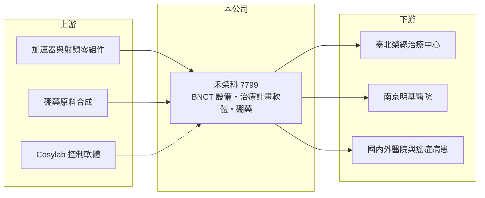

# 7799 禾榮科

> 上市｜[[產業索引-生技醫療業|生技醫療業]]｜上市（櫃）日期 2025/09/15

# 第一章：企業模式與商業藍圖

> [!info] 撰寫說明
> 精簡版，由 Claude 依公開資料整理，架構比照 [[2330台積電]]，資料截至 2026-10-08。來源：證交所開放資料快照（基本資料、2026 年第二季財報與營益分析、2025 年度股利、2026 年 8 月營收）、Goodinfo 經營績效頁、富果 2025 年 12 月法說會摘要。國際競爭者與技術起源憑記憶整理，已標「待校對」。#待校對

禾榮科是一家提供硼中子捕獲治療（BNCT）整體解決方案的台灣公司，理解它的關鍵在於「設備加藥物」的雙引擎模式：先賣或租治療設備給醫院，再靠每次治療使用的硼藥與維修合約產生長期收入。

- **核心業務：** 禾榮科開發加速器型[[硼中子捕獲治療]]（AB-BNCT）的完整方案，包括中子照射系統（硬體）、以蒙地卡羅法計算劑量的治療計畫系統（軟體），以及含硼藥物。BNCT 的原理是先讓腫瘤細胞吸收含硼藥物，再用中子照射，使硼在細胞內產生短距離的放射反應殺死腫瘤細胞，對周邊正常組織傷害較小。它主要用於復發、難治或對傳統放療有抗性的腫瘤，定位是補足傳統光子、[[質子治療]]與重粒子治療，而非取代。
- **營收結構：** 目前營收來自恩慈治療的照射費與藥品收入，2025 年全年約 0.1 億元，規模很小。依法說資料，未來收入來源包括設備銷售（單治療室系統約 12 億元、雙治療室約 16 億元，也可採租賃、BOT 或分潤）、每年約設備售價 5% 至 9% 的維保收入、治療用硼藥 BPA（參考日本每人次約 40 萬元）與診斷用藥 FBPA（每次約 4 至 8 萬元）。公司表示在取得藥證前，財務數字不會有顯著表現。
- **營運據點：** 公司設立於 2017 年 8 月，2025 年 9 月 15 日上市，實收資本額約 15.82 億元。治療中心建置案包括臺北榮總與南京明基醫院，截至法說時已治療超過 130 人次、涵蓋十多種癌症，並收治 8 位國際病患。
- **長期方向：** 中子照射系統已於 2024 年取得台灣 TFDA 醫材許可，治療用藥 BPA 正進行臨床試驗，目標取得台灣首張 BNCT 硼藥藥證（法說資料中時程有 2026 年底與 2027 年兩種說法）；診斷用藥 FBPA 已提出 IND 申請。公司目標在 2028 年完成加速器自主開發製造，並與斯洛維尼亞軟體公司 Cosylab 互為代理，借其通路推廣歐美市場。

# 第二章：護城河深度與競爭優勢

BNCT 是新興治療領域，護城河來自設備、藥物與臨床經驗的整合，本章說明禾榮科的優勢與對手。

- **競爭優勢：** 禾榮科宣稱是全球唯一同時提供加速器型 BNCT 設備、治療計畫軟體與硼藥的業者，醫院可以一次取得完整方案。公司自述其系統以約 1/4 的質子電流產生 7 倍熱中子通量，照射後的輻射衰變時間約 10 分鐘（競品約 2 小時），每日可治療至少 6 位病人（競品約 2 位），若屬實將直接影響醫院的投資回收速度（以上為公司自述數據）。累計專利申請 171 件、核准 54 件，臨床治療經驗也是後進者難以快速累積的資產。
- **主要對手：** 日本住友重機械的 BNCT 系統搭配 Stella Pharma 的硼藥，已在日本取得核准並納入保險給付；中國有中硼（廈門）醫療器械，美國有 TAE Life Sciences 與 Neutron Therapeutics 等公司（對手名單憑記憶，待校對）。日本對手先行取得核准與給付，是禾榮科在國際市場最主要的比較對象。
- **觀察重點：** BPA 藥證的取得時間最為關鍵，因為藥證是 BNCT 從恩慈治療轉為常規醫療、開始穩定收費的前提。其次是臺北榮總等治療中心投入常規醫療的進度，以及海外第一套設備訂單何時落地。

# 第三章：財務體質與盈利規模

資料日期：2026-10-08，表格是撰寫當時的快照；最新月營收、毛利率、累計 EPS 由自動排程寫在本筆記的屬性欄位（月營收、毛利率、累計EPS 等）。#待校對

在藥證取得前，禾榮科的財務以研發投入與資金存量為主，本章用多年度數據觀察。

| 年度 | 營收（億元） | [[毛利率]] | [[營業利益率]] | EPS（元） | [[ROE]] |
|---|---|---|---|---|---|
| 2022 | 約 0 | 未查得 | 未查得 | -1.13 | -17.4% |
| 2023 | 約 0 | 未查得 | 未查得 | -1.18 | -19.4% |
| 2024 | 約 0 | 未查得 | 未查得 | -2.04 | -22.8% |
| 2025 | 0.10 | -250% | -5184% | -3.31 | -7.43% |
| 2026 上半年 | 0.03 | -224.5% | 未具意義 | -1.05 | 未查得 |

（2021 年以前資料未查得。）

- **營收規模：** 營收只有恩慈治療的照射費與藥品收入，每年約千萬元以下，毛利率與營業利益率因營收過小而不具比較意義。真正的營收拐點在藥證取得、治療中心常規化與設備出售之後。
- **獲利：** 2025 年稅後淨損約 4.82 億元；2026 年上半年營業損失約 2.31 億元，業外收入約 0.66 億元（推估主要為利息收入），稅後淨損約 1.65 億元、EPS -1.05 元。
- **財務特色：** 2026 年第二季底股東權益約 111.65 億元、負債僅約 3.29 億元，上市前後募得大量資金，以目前虧損速度推算可支撐多年研發與建廠（推算）。2025 年 ROE 雖為 -7.4%，絕對虧損金額卻在擴大，ROE 降低主要是權益大增所致。
- **[[ROIC]] 與 [[WACC]]：** 以 2026 年上半年營業損失 2.31 億元年化為 4.62 億元，除以投入資本約 114.2 億元（股東權益加非流動負債 2.55 億元），ROIC 約 -4%（推算）。WACC 以 CAPM 推估：無風險利率 1.75%、市場風險溢酬 6%、β 取研發型醫療設備常見的 1.3（假設值），幾乎無負債，WACC 約 9.5% 至 10%（推算）。ROIC 為負，代表目前仍是資本投入期；大量現金存放帶來的利息收入可以部分抵銷虧損，但無法代替本業獲利。
- **長期指標：** 近 4 年（2022 至 2025 年）ROE 平均約 -17%（推算），未配發現金股利，自由現金流長期為負。

# 第四章：總體風險與地緣政治

BNCT 屬於新興放射治療，風險集中在法規、臨床與市場接受度，本章分別說明。

- **產業週期：** 放射治療設備的需求取決於醫院的資本支出計畫與政府醫療政策，單套設備金額高，採購決策週期長。BNCT 市場仍在早期，研究機構預估全球市場 2034 年可達 96.9 億美元，但新興市場的實際成長速度不確定性很高。
- **營運風險：** 硼藥藥證若延後，常規收費與設備銷售都會跟著延後。設備銷售金額大、筆數少，營收會呈現大幅跳動。加速器國產化目標若進度落後，成本結構與供應鏈自主性都會受影響。
- **其他風險：** 中子設備涉及原子能與輻射安全法規，每個國家都需要個別取證。日本與中國對手已先行建立臨床與給付基礎，禾榮科進入海外市場需要克服先行者優勢。健保是否給付 BNCT 也會影響台灣的治療量。

# 專有名詞解析

## 產業

- **[[硼中子捕獲治療]]**：先讓腫瘤吸收含硼藥物，再以中子照射引發短距離核反應殺死腫瘤細胞的放射治療，簡稱 BNCT。
- **[[質子治療]]**：以質子射線照射腫瘤的放射治療，能把劑量集中在腫瘤位置，減少對正常組織的傷害。
- **[[恩慈治療]]**：病人無其他治療選擇時，經主管機關核准使用尚未取得藥證或醫材許可的療法。
- **[[醫材許可]]**：醫療器材上市前須取得的主管機關核准，例如台灣 TFDA 許可證、美國 FDA 510(k) 或 PMA。
- **[[IND]]**：試驗中新藥申請，向主管機關申請在人體進行臨床試驗的程序。

# 核心供應鏈

- 上游：加速器、射頻與中子靶材相關零組件供應商，硼藥原料合成廠（個別名稱未查得），以及互為代理的軟體公司 Cosylab。
- 下游／客戶：臺北榮總、南京明基醫院等治療中心，以及國內外的復發與難治型癌症病患。
- 同業：國際的住友重機械、Stella Pharma、中硼醫療（待校對）；台股醫療設備相關的 [[4116明基醫]]、[[6872浩宇生醫]]，但治療領域不同。

## 最新新聞
<!-- news:start（自動產生，請勿手動編輯此範圍） -->
- 2026-10-17 🏛️ 重訊 12:30｜本公司與GE Precision Healthcare LLC簽署合作協議｜[觀測站](https://mops.twse.com.tw/mops/#/web/t05st01)
- 2026-10-15 📰 媒體 19:21｜禾榮科斥15.55億元取得苗栗高鐵產專區土地 加速BNCT全球布局｜[鉅亨網](https://news.cnyes.com/news/id/6631409)
- 2026-10-15 🏛️ 重訊 14:33｜公告本公司投標取得苗栗縣後龍鎮龍富段土地｜[觀測站](https://mops.twse.com.tw/mops/#/web/t05st01)
- 2026-10-08 🏛️ 重訊 14:43｜本公司受邀參加由寬量國際主辦之「20th QIC CEO Week」｜[觀測站](https://mops.twse.com.tw/mops/#/web/t05st01)

完整紀錄：[[7799禾榮科 新聞]]
<!-- news:end -->

## 相關連結
- [公開資訊觀測站](https://mopsov.twse.com.tw/mops/web/t05st03?step=1&firstin=1&co_id=7799)
- [Goodinfo](https://goodinfo.tw/tw/StockDetail.asp?STOCK_ID=7799)
- [Yahoo 股市](https://tw.stock.yahoo.com/quote/7799)
- [鉅亨網新聞](https://www.cnyes.com/twstock/7799/news)
